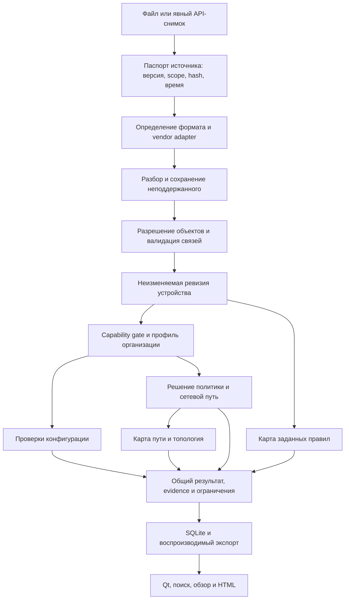
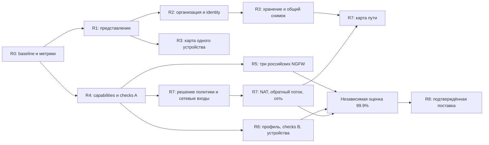
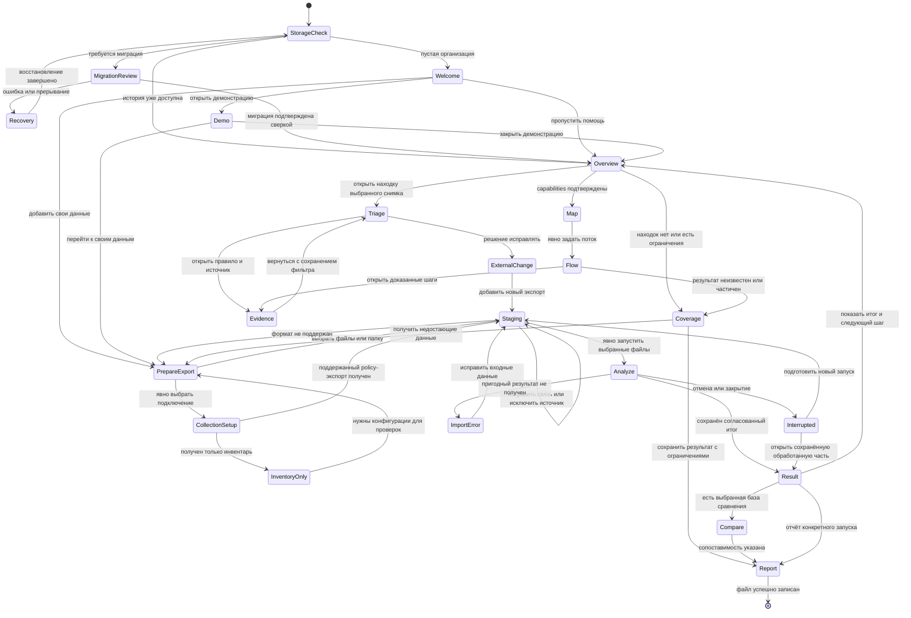

# Firewall Compliance — расширенный roadmap v2: полная база исследований

Сборка документа: 15.10.2026. Исследования выполнены 14–15.10.2026.

Статус: техническое задание и исследовательская база для будущей реализации. Документ не объявляет предложенные функции готовыми или точность 99,9% уже достигнутой.

Ниже полностью включены все восемь исследовательских разделов. Содержательный текст не сокращён; повторяющиеся объяснения сохранены вместе с контекстом соответствующего исследования. Порядок глав изменён так, чтобы сначала показать пользовательский путь, затем устройство продукта и проверку качества.

Первая версия постановки: [roadmap v1](../IMPROVEMENT_ROADMAP_2026-10.md). Её идентификаторы UX, NEW, NET, MAP и R сохранены в исследованиях и матрицах трассировки.

## Содержание полного документа

1. [Основания, архитектура и расширенный roadmap](#research-chapter-1)
2. [Пользовательский путь: от первого запуска до повторной проверки](#research-chapter-2)
3. [Интерфейс, анализ, доказательства и отчёты](#research-chapter-3)
4. [Сетевые устройства, NGFW и парсеры](#research-chapter-4)
5. [Существующие и 25 новых проверок](#research-chapter-5)
6. [Доступность, контрольные потоки и карта](#research-chapter-6)
7. [Точность 99,9% и протокол верификации](#research-chapter-7)
8. [Организация, данные, миграция и поставка](#research-chapter-8)

Приоритеты и оценки относятся к проектированию. Точные даты реализации, аппаратная семантика и количественные claims требуют описанных в тексте входов и испытаний. Неопределённые данные явно отмечены, чтобы их можно было получить до соответствующей задачи.


---

<a id="research-chapter-1"></a>

<!-- BEGIN FULL RESEARCH: 00_RESEARCH_SCOPE_AND_EXECUTION.md -->

# Roadmap v2: исследование, целевая архитектура и порядок реализации

Дата исследования: 14.10.2026. Статус: расширенное техническое задание, предложения к реализации. Основание — первая версия roadmap и последующий запрос пользователя раскрыть каждый пункт, провести исследование субагентами, спроектировать достижение точности не ниже 99,9% и объединить материалы в один файл без сжатия.

## 0.1. Что представляет собой вторая версия

Первая версия [IMPROVEMENT_ROADMAP_2026-10.md](../IMPROVEMENT_ROADMAP_2026-10.md) сохраняется как исходная постановка. Вторая версия развивает её направления и критерии. Она содержит исследование существующей реализации, альтернатив, технологических ограничений, первичных источников, необходимых данных, алгоритмов, пользовательских сценариев и приёмки.

Полный итог — `ROADMAP_V2_FULL.md` в этом каталоге. Он включает тексты исследовательских разделов целиком, а не только их резюме. Отдельные файлы остаются рабочей базой знаний и позволяют независимо уточнять направления. Каждый факт, зависящий от производителя, версии библиотеки или документации, привязан к источнику и области действия. Авторские проектные решения обозначены как предложения, а не как рекомендации производителя.

Работа выполняется над документацией. Новые функции не объявляются реализованными; пользовательская база не мигрируется. Исследование исходников и проверка текста не заменяют будущие аппаратные эксперименты, статистическую оценку и чистую Windows-матрицу.

Для статуса реализации используются следующие уровни доказательства:

| Уровень | Что является доказательством | Что этот уровень позволяет утверждать |
|---|---|---|
| Код | Наличие конкретной функции, контракта и вызывающего сценария | Функция существует в исходниках в указанной границе |
| Тестовый сценарий | Содержание конкретного теста и входов | Есть средство проверки данного поведения |
| Выполнение проверки | Результат запуска на определённой версии/среде | Проверка прошла на этих входах и среде |
| Лабораторная валидация | Наблюдаемое поведение выбранного устройства/версии | Согласованность модели с данным аппаратным сценарием |
| Статистический gate | Независимая выборка, эталон, знаменатели и доверительные границы | Обоснование численной цели в объявленной генеральной совокупности |

Одно доказательство не подменяет другое. Существующие golden-эталоны, например, полезны для регрессии, но не подтверждают сами по себе семантическое соответствие устройству.

## 0.2. Обязательный объём и границы

Пользовательская цель сохраняется полностью: одна организация, информативный обзор, компактная инфраструктура, понятные правила/объекты, доказательства без повторов, полезные инструменты анализа, понятные отчёты, видимые и затем работающие российские NGFW, расширение парка сетевых устройств, 25 дополнительных проверок, моделирование доступности и динамическая карта.

«Операции» сохраняют существующие сценарии. Для перехода к организации потребуется заменить контекст и проверить восстановление истории; это не основание переустраивать весь раздел. Чекбоксы существующих проверок сохраняются до расширения каталога, после чего появляются поиск и категории без потери быстрого включения. Прямой сбор по API/SSH планируется отдельно от файлового импорта. Автоматическое изменение устройств не входит в поставленную задачу.

Развитие Cisco ASA/IOS/XE находится в backlog по существующей договорённости. Уже работающие ASA-сценарии сохраняются и служат источником архитектурного опыта. Российские NGFW, Comware и HP/Aruba не должны ждать новой реализации Cisco NAT. При появлении подтверждённых non-Cisco сетевых входов проверка доступности развивается на них.

Цель 99,9% не позволяет исключить трудные функции из roadmap, чтобы улучшить показатель. Неподдержанный ввод учитывается и виден; его расширение остаётся инженерной задачей. Нельзя считать ответ «неизвестно» правильным положительным/отрицательным решением и таким способом получать 100% accuracy.

## 0.3. Исследовательские направления и трассировка первой версии

| Раздел первой версии | Полное развитие во второй версии | Что должно появиться в результате |
|---|---|---|
| 1. Результат | Этот раздел и пользовательские сценарии UX | Продуктовые вопросы, ценность и проверяемые результаты |
| 2. Существующее | Исходный код в каждом исследовании + реестр доказательств | Подтверждённые точки расширения и ограничения |
| 3. UX-01 | Организация, данные и поставка | Модель организации, миграция, конфликты и восстановление |
| 3. UX-02…UX-07 | UX и отчёты | Сценарии, состояния, представления, поиск, агрегирование, доступность |
| 4. Устройства/NGFW | Платформы и парсеры | Паспорта платформ, форматы входов, capability matrix, quality gates |
| 5. NEW-01…NEW-25 | Каталог проверок | Предикаты, данные, алгоритмы, примеры, FP/FN, evidence и действия |
| 6. NET-01…NET-05 | Доступность и карта | Модель потока и пути, семантика выводов, неизвестность, проверка |
| 7. MAP-01…MAP-03 | Доступность и карта | Карта ACL, снимки/diff, топология, обновление и экспорт |
| 8. R0…R8 | Этот раздел + задачи в исследованиях | Зависимости, рабочие пакеты, выпуск и оценка по фактической готовности |
| 9. Качество | Точность и верификация | Статистический протокол, корпус, независимые эталоны, release evidence |
| 10. Уточнения | Реестр решений ниже и вопросы по платформам | Обязательные входы, время уточнения и работа, которая не зависит от них |
| Дополнение пользователя 15.10: как начать и работать | Полный пользовательский путь и onboarding | Первый запуск, ввод данных, первый полезный результат, исправление, повторная проверка и повседневная работа |

Матрица предназначена для контроля полноты. Она не заменяет развёрнутые разделы, включённые далее полностью.

### Пользовательский путь как связующее требование

Подробный путь пользователя включён отдельной главой сразу после этой. Он связывает функции в последовательную работу: первый запуск → подготовка экспорта → предварительный просмотр → анализ → понятный результат → доказательство → решение пользователя → изменение конфигурации вне приложения → новая ревизия → сравнение → отчёт. Для карты и запроса доступности есть отдельные ветви с проверкой готовности входных данных.

Onboarding не должен становиться обязательной длинной анкетой. Организация создаётся автоматически; импорт файлов доступен сразу; пример можно открыть отдельно; неизвестные бизнес-настройки запрашиваются перед зависимой проверкой, а не блокируют первый запуск. Пользователь всегда видит, какой следующий шаг даст полезный результат.

Сквозные задачи пути обозначаются JRN в полной главе. Их реализация распределяется между R1 (понятный первый результат), R2 (первый запуск и организация), R3 (первое использование карты), R5 (помощь с экспортом конкретного NGFW), R7 (первый запрос доступности) и R8 (полный проход на поставляемом exe). Пользовательская проверка проходит через эти переходы целиком: изолированное тестирование страниц не доказывает работоспособность рабочего сценария.

## 0.4. Как трактуется точность не ниже 99,9%

Требование превращается в набор измеримых целей, с отдельным итоговым измерением. Для каждой формулировки указываются единица измерения, генеральная совокупность, поддержанная версия/конструкция, допустимый вид вывода, способ получения эталона и доверительная граница.

- **Парсер:** правильное восстановление значимых полей и связей в поддержанном формате. Отдельно измеряются потерянные/лишние правила, неверные условия, порядок, области и действия. Простая доля распознанных строк не заменяет семантическую корректность.
- **Проверки:** precision подтверждённых находок и recall реально присутствующих нарушений в согласованной области. Разные проверки имеют разные знаменатели; большой объём простых отрицательных случаев не скрывает пропуски редких ошибок.
- **Policy/path:** корректность решений на независимых запросах, отдельно опасные ложные разрешения, ложные запреты, альтернативные пути и полный обратный поток. «По конфигурационной модели» и «наблюдалось на живом устройстве» — разные утверждения.
- **UI/отчёт:** точное сохранение сущностей, связей, чисел, статусов и доказательств. Эти преобразования должны выполнять строгие инварианты; усреднять потерю находок до допустимых 0,1% нельзя.
- **Хранение/миграция:** сохранность каждой записи и её принадлежности. Ошибка потери данных блокирует выпуск, даже если доля сохранённых записей выше 99,9%.
- **Удобство:** завершение пользовательских задач, время, понимание статусов и доступность. Это отдельные UX-показатели; никакой коэффициент точности не доказывает, что пользователь понял экран.

Для независимых бинарных испытаний без ошибок односторонняя 95%-ная нижняя граница вероятности успеха равна `0.05^(1/n)`. Чтобы она достигла 0,999, нужно не менее `ceil(log(0.05)/log(0.999)) = 2995` испытаний. Это расчёт для одного заранее определённого показателя, при предпосылках биномиальной модели. Он не означает «2995 тестовых функций достаточно для всего продукта». [NIST рассматривает проверку доли дефектов через биномиальную модель](https://www.itl.nist.gov/div898/handbook/prc/section2/prc24.htm); [SciPy документирует exact Clopper–Pearson interval](https://docs.scipy.org/doc/scipy/reference/generated/scipy.stats._result_classes.BinomTestResult.proportion_ci.html). Формула и её применение к проекту здесь — собственный расчёт.

Если шесть независимых необходимых этапов верны с вероятностью 0,999 каждый, вероятность одновременной корректности всех шести равна `0.999^6 ≈ 0.994015`, то есть около 99,4015%. Этот пример иллюстрирует необходимость итогового gate. При зависимости нельзя просто перемножать цифры: нужно либо измерять результат end-to-end на независимом корпусе, либо доказывать обоснованный бюджет ошибок без предположения независимости. Подробный статистический протокол изложен в отдельном полном разделе.

Для каждого gate обязательно публикуются доля определённых ответов и доля unsupported/unknown. Высокая точность на 1% простых запросов не соответствует намерению пользователя. Минимальная полезная доля ответов согласуется на реальном парке, фиксируется до итоговой проверки и повышается с каждым этапом покрытия. Внутри уже поддержанной области необъяснимый отказ от ответа считается дефектом полноты, а не бесплатным способом улучшить precision.

По результатам исследования нельзя утверждать, что 99,9% уже достигнуто. Вторая версия задаёт путь и доказательства, необходимые для такого утверждения после реализации.

## 0.5. Общая архитектура расширения



Это целевой поток, а не описание готовой реализации. Исходный parser API, существующие модели и ревизии сохраняются до явно протестированной замены. Переход оформляется с совместимостью или миграцией, а не массовым переписыванием.

### Предлагаемые общие контракты

1. **Source passport:** содержание/роль источника, точная версия продукта и способ получения, hash, полнота с основанием, observed_at и imported_at, timezone, устройство и контекст. Исходный файл нельзя объявлять полным по расширению или имени.
2. **Capability declaration:** возможность не только платформы, но конкретного снимка: parse, resolve, binding, route, NAT, identity, schedule, application, counters. «Vendor поддерживает» не означает «эти данные есть в текущем экспорте».
3. **Organization profile:** зоны и допустимые отношения, административные сети, защищаемые сервисы, пороги, владельцы, исключения и версии. История анализа хранит использованный профиль, поэтому изменение настройки не переписывает старое заключение.
4. **Analysis manifest:** версия приложения, адаптера и checks; набор входных ревизий, параметры, время расчёта, область, результат и зависимые ограничения. Это основа воспроизводимости карты, отчёта и diff.
5. **Presentation projection:** отдельное компактное представление findings/limitations/objects, с явными ссылками на исходный результат. Сводка не является новым аналитическим эталоном.
6. **Evidence bundle:** правило/объект/факт, использованное условие, исходное расположение и безопасный фрагмент. SHA-256 проверяет совпадение подключённого источника, но не доказывает подлинность устройства или актуальность политики.

### Что не стоит усложнять до появления оснований

Локальный модульный монолит остаётся подходящей основой. Graph database, отдельный web backend, распределённая очередь и микросервисы не помогают доказать правильность правил и создают дополнительную работу. Для первых карт подходят чистые доменные DTO и Qt-представление; аналитическая алгебра не должна зависеть от графической библиотеки. Введение solver/BDD, нового формального движка или внешнего oracle требует отдельного прототипа с измерением стоимости и доказуемым выигрышем.

## 0.6. Расширенный порядок выполнения

Оценки из v1 сохраняют статус предварительных ориентиров, а не обязательств. После углубления объём каждого adapter/path может существенно увеличиться. Точные инженерные оценки выдаются после паспорта платформы, схемы данных и прототипа сложной семантики. Нельзя складывать приблизительные дни и объявлять полученное число датой готовности 99,9%.

### R0. Исследовательский и измерительный baseline

**Цель:** определить состояние продукта и материал, на котором будут проверяться изменения.

Рабочие пакеты:

- B01 — воспроизводимые synthetic аналоги перегруженных сообщений и скриншотов, с известными объектами, неизвестными полями и управляющими ACL.
- B02 — фактическая матрица возможностей из кода, вызовов, схем и выполненных проверок. Устаревшая спецификация не повышает статус.
- B03 — паспорт реального парка: платформы, версии, доступные типы экспортов, роли, ограничения доступа.
- Q00 — единицы измерения 99,9%, корпус, protocol, границы precision/recall, unknown/coverage и ownership эталонов.
- B04 — latency/memory/render baseline на зафиксированном ПК и объёмах; никаких гарантированных чисел без измерения.

Выход: нет неизвестных в определении метрик; неизвестные форматы честно занесены в список входов; корпус разделён на разработку и независимую оценку. R0 не требует готового экспорта всех NGFW для исправления UI.

### R1. Читаемый результат на существующей модели

U01 — агрегатор ограничений; U02 — таблица сведений; U03 — правила/объекты; U04 — evidence; U05 — HTML; U06 — постоянно видимые NGFW-карточки.

Последовательность: единая проекция → представления Qt → отчёт → regression на одинаковых данных. Общие сообщения группируются с сохранением источников; семантические неизвестности остаются. Для UI counts и принадлежности findings действуют строгие инварианты. Успех этого этапа измеряется понятностью пользовательских задач и отсутствием потерь представления.

Выход: пользователь находит нужный объект и условие правила, понимает причину ограничения и открывает доказательство; технические данные доступны отдельно; NGFW видны со статусом планирования. Обновлённый HTML воспроизводит одинаковые итоги с UI.

### R2. Организация, обзор и поиск

O01 — контекст организации; O02 — миграция/backup/recovery; O03 — обзор с приоритетами и качеством входа; O04 — общая identity/search projection; O05 — проверка нового exe и документации.

Зависимости: identity и миграция предшествуют межустройственному diff и общим числам. Сначала слой совместимости, затем schema migration. Если старых проектов несколько, запускать подтверждённое разрешение конфликтов, сохраняя все исходные данные. Не перезаписывать подключения по provider и не объединять разные устройства по одному имени.

Выход: одна организация в обычной работе, история и отметки не потеряны, новая БД создаётся автоматически, столкновения старых ID доступны для разбора, обзор различает ошибки импорта и реальные находки.

### R3. Карта заданных правил

M01 — Qt-визуализация существующего ACL API; M02 — persistence/manifests; M03 — фильтры и агрегация; M04 — comparison/export.

Зависимости: M01 можно выполнить после R1 на одном устройстве; M02 и межустройственная identity используют R2. Не ждать NAT или всех NGFW. Построить карту сначала на HP/Aruba и Comware с уже имеющимся контрактом, сохраняя unknown/deny/disabled.

Выход: интерактивные связи по правилам, переход к доказательству, восстановление снимка и положения узлов, фильтры по сети/сервису и scope. Подписи объясняют смысл линий; наличие линии не объявляется доступностью.

### R4. Общие capabilities, расширение текущих parsers и пакет A

P01 — паспорт capabilities и полноты; P02 — Comware bindings/order; P03 — HP/Aruba расширения; P04 — реестр checks и параметров; C01 — NEW-03…06 и NEW-09…16.

Точный пакет A — 12 новых проверок. Непроверяемая область не становится положительным результатом. Для NEW-13 нужна полнота графа ссылок; для set algebra — известные порядок, scope и семантика. Если одна зависимость не готова, поставляется конкретный проверяемый срез с зарегистрированным остатком работ, а задача расширения не снимается.

Выход: versioned checks с детальными evidence и примерами, независимая проверка результата алгоритмов, расширенное покрытие текущих платформ. Достигнутая статистическая цель публикуется только после соответствующего gate.

### R5. UserGate, Ideco и PT NGFW

V01/V02/V03 — три обязательных независимых направления. Каждый разбивается на паспорт/исследование, importer, resolver, bindings, policy checks, map integration, эталонную оценку и затем сетевые факты/collector.

Порядок реализации определяет готовность входа. UserGate имеет материалы и более определённый стартовый контракт, но это не повод исключить остальные платформы. CSV, текстовый экспорт, архив и API snapshot имеют разные полноту и semantics. Один новый адаптер можно выпустить раньше других; общее направление остаётся активным.

Выход на каждом срезе: таблица конкретных версий и поддержанных конструкций, воспроизводимые findings и source mapping, отрицательные и неизвестные случаи, заявленная точность в измеренном scope, явные остальные ограничения. Наличие кнопки не считается частью quality gate адаптера.

### R6. Профиль организации, пакет B и оставшиеся устройства

C02 — NEW-01/02/07/08/17/18/19/21/22/23, то есть 10 проверок. V04 — Huawei, V05 — Juniper, V06 — ArubaOS controllers. Для каждого — отдельная дорожка с собственным паспортом и тестовым корпусом.

Зависимости: бизнес-профиль нужен для нарушения сегментации и небезопасного назначения сервисов; новые operational/settings-входы нужны для SNMP/NTP/получателей логов. Нельзя вывезти точность из правильного port matcher при неверно заданной бизнес-политике. Пользовательская матрица также требует версии и валидации на контрольных примерах.

Выход: авторские правила организации выразимы и проверяемы, исключения имеют scope/причину/срок, история сохраняет прежний профиль. Расширение Junos filters не выдаётся за готовый SRX evaluator.

### R7. Решение политики, полный путь и слой топологии

NET-01 — query/result и capability gate; NET-02 — route/interface/binding inputs одной подтверждённой платформы; NET-03 — NAT/return semantics; NET-04 — несколько устройств/альтернативы/loops; NET-05 — контрольные потоки и diff. MAP-03 — объяснимое отображение сетевых фактов и пути. C03 — NEW-20/24/25, то есть 3 проверки с дополнительными входами.

Следовать минимальным полным вертикальным срезам: известный non-NAT policy decision → маршрут и один узел → NAT и обратное направление → сеть с альтернативными путями. В каждом срезе «полный» относится к конкретной объявленной семантике, а не ко всем возможностям производителя. Усложнение сопровождается расширением независимого корпуса, не только unit tests.

Выход: результат содержит уровень доказательства, условия, пути, правило/маршрут/трансляцию, неизвестности и обратный поток; сохраняется manifest. Полезные control flows повторяются после новой ревизии и демонстрируют изменения. Физическая топология требует фактов, которые ACL не предоставляет.

### R8. Повторяемая поставка и проверка утверждений

Release branch здесь — организационная идея, а не утверждение о существующем Git: каталог пока не является репозиторием, remote/hosted CI отложены. До отдельного решения проверки выполняются локально теми же средствами, которые затем можно перенести в CI.

Каждый крупный выпуск получает evidence bundle: версии, checksums, dependency manifest/SBOM по требованиям проекта, результаты тестов и статистической оценки, список поддержанных конструкций, compatibility/migration checks, чистая Windows 10/11 матрица и пользовательские сценарии. Qt/frozen smoke не подменяется существующим Tk smoke.

Поставка — поперечная работа, а не «несколько дней в конце». Поведение новой схемы и адаптера проверяется вместе со сборкой, иначе исходники и запущенный exe снова могут расходиться.

## 0.7. Зависимости и критический путь



Диаграмма упрощает управление зависимостями, но подробный gate каждого направления остаётся в исследовательских разделах. Независимая оценка выполняется по каждому срезу и end-to-end. Она не откладывается целиком до последнего блока.

Критический путь для точного сетевого анализа: источник/полнота → нормализация/identity → правильная binding → policy semantics → route/NAT/return/path → независимый эталон → метрика. UI можно улучшать параллельно, но красивое объяснение не исправляет семантически неправильное решение.

## 0.8. Реестр решений и необходимых данных

| Решение/вход | Когда требуется | Что происходит до получения |
|---|---|---|
| Версии и экспорты трёх NGFW | До фиксации importer каждой платформы | Исследование официальных форматов, UI и общие контракты |
| Реальный парк Huawei/Juniper/controllers | До очередности V04…V06 | Паспорта и архитектура отдельных adapters |
| Состав старых проектов, collisions и integrations | Перед миграцией O02 | Synthetic сценарии, план и проверка сохранности |
| Админские сети, сервисы, зоны и segmentation matrix | До активации зависящих checks B | Реестр checks и техническая схема профиля |
| RIB/FIB/NAT/neighbor/counters и их время | Перед соответствующим NET/C03 gate | Локальные policy решения и карта условий |
| Генеральная совокупность независимой оценки | Перед любым численным claim 99.9% | Подготовка корпуса и методики; claim отсутствует |
| Бюджет ответа unknown и performance targets | После baseline на реальном парке, до релизной оценки | Явные неизвестности и измерения без ложных гарантий |
| Разрешение публикации/Git/CI | Перед hosted CI и внешней публикацией | Локальные проверки/сборка; подготовленные материалы |

Ни одно из этих уточнений не используется для остановки всех работ. Оно ограничивает конкретную зависимую реализацию. Каждый неподтверждённый формат или hardware oracle остаётся в списке незакрытых входов, а не скрывается формулировкой «поддерживается».

## 0.9. Шаблон перехода от исследования к задаче

Идентификаторы R0…R8 и крупные пакеты U01…U06, O, P, V, C сохранены из v1. Детальные задачи UX-главы имеют отдельный префикс `UX02-A`…`UX07-F`, связанный с номером UX-требования, а пользовательские переходы — `JRN-*`. Например, `UX06-B` — renderer HTML в требовании UX-06, а верхнеуровневый `U06` первой версии — видимость NGFW. При создании TASK-файла сохраняются оба уровня трассировки, чтобы сходные номера не смешивали разные обязанности.

Каждая задача реализации содержит:

1. Пользовательский сценарий и ожидаемую ценность; точную ссылку на направление этого документа.
2. Предыдущую реализацию и source evidence, которое показывает проблему.
3. Область данных, версии, scope и предикат применимости.
4. Выбранный вариант, рассмотренные альтернативы и основание выбора.
5. Контракт входа/выхода, версии, identity и сохранение evidence.
6. Алгоритм и обработку неизвестного/конфликтного/неполного случая.
7. Приёмку, независимый oracle где нужен, положительные/отрицательные/граничные сценарии.
8. Доказательство корректности результата и численной цели, если делается такой claim.
9. Производительность, ресурсный лимит, отмену и rollback.
10. Миграцию/совместимость/поставку/обновление документации.

Приёмка исследования отличается от приёмки реализации: для исследования требуется полнота разборов и достоверные источники; для реализации — результаты на коде, устройствах, корпусе и сборке. Разделы далее содержат полную базу знаний для такой декомпозиции.

<!-- END FULL RESEARCH: 00_RESEARCH_SCOPE_AND_EXECUTION.md -->


---

<a id="research-chapter-2"></a>

<!-- BEGIN FULL RESEARCH: 07_USER_JOURNEY_AND_ONBOARDING.md -->

# Пользовательский путь: от первого запуска до подтверждённой повторной проверки

Дата разработки: 15.10.2026. Дополнение к roadmap v2 по прямому запросу: как человек, впервые запустивший программу, поймёт, что делать, получит полезный результат и продолжит работать. Это проект поведения и текстов интерфейса, а не заявление о реализации. Код приложения, база данных и пользовательские конфигурации при подготовке этого раздела не изменялись; пользовательское исследование и запуск desktop не проводились.

## 7.1. Основание и границы предложения

Исходники и действующее руководство подтверждают уже существующую цепочку: проект → добавить файлы/папку → предварительное определение формата и связи с устройством → локальная проверка → находки → правило/сохранённое доказательство → решение пользователя → новый запуск → сравнение → HTML/JSON. В навигации есть «Обзор», «Инфраструктура», «Анализ», «Операции» и «Отчёты»; настройки вынесены отдельно. Двойной щелчок в staging меняет связь файла с устройством. Предварительная подготовка и очередь выполняются в фоне. После завершения проверки текущая страница сохраняется, переход к результату явный. После перезапуска подключение исходника требует совпадающего SHA-256; изменённые байты предназначены для нового анализа. Отмена ожидающих заданий не равна остановке уже выполняющегося ядра. Эти свойства взяты из [USER_GUIDE](../USER_GUIDE.md), [workspace_navigation.py](../../src/firewall_compliance/interfaces/desktop/workspace_navigation.py) и [qt_app.py](../../src/firewall_compliance/interfaces/desktop/qt_app.py).

Целевыми расширениями являются: автоматическое пространство одной организации вместо обязательного проекта; welcome и пошаговая помощь; управляемая демонстрация; понятные инструкции получения данных из каталога возможностей; явное действие изменения связи без необходимости угадывать двойной щелчок; согласованный обзор; доказательная карточка находки; сравнение с gate совместимости; пользовательская карта и форма потока; сохранение безопасного прогресса знакомства. Их нет оснований объявлять работающими до реализации и испытания. Контракты представления, статусов и выгрузки подробно заданы в разделе UX; хранение, миграция и identities — в разделе организации; математическая область карты и потока — в сетевом разделе. Здесь определяется связный путь через эти возможности.

Все описанные ниже расположения кнопок, названия, персонажи, критерии и сценарии — авторские проектные предложения, требующие проверки с пользователями. Внешние источники подтверждают отдельные механизмы доступности и метод оценки, но не доказывают, что предложенный onboarding удобен именно администраторам этой программы.

Три ограничения действуют во всём пути:

1. Знакомство не запускает обнаружение сети, API-вызовы, автоматическую отправку отчёта или изменение оборудования. Подключение и конкретный сбор остаются отдельными явными действиями.
2. Работающий локальный анализ не означает полное понимание всех экспортов производителя. Версия, формат и поддержанные конструкции сопровождают вход и результат.
3. Прохождение подсказок не повышает точность анализа. Отсутствие находок, зелёная операция и вручную поставленное решение описывают разные факты.

## 7.2. Для кого проектируется путь

**Администратор, впервые открывший приложение.** Знает свою сеть, но не знает терминов и модели программы. Ему надо понять, какой файл взять, почему экспорт может оказаться неполным, как найти конкретную настройку и что исправлять во внешней системе. Полезный первый результат — объяснённая находка с правилом и достоверной привязкой к источнику либо честное объяснение, почему этот источник не анализируется. Создание имени организации само по себе полезным результатом не считается.

**Аудитор.** Может получить только готовый экспорт и историю, не имеет доступа к управлению устройством. Ему важны происхождение, время, область, воспроизводимость и автономный отчёт. В этом пути «запросить новые данные у администратора» является нормальным исходом; программа не требует вводить пароль от устройства для чтения сохранённого результата. Возможность открыть существующую историю и сформировать отчёт должна обходить мастер первого импорта.

**Опытный пользователь существующей версии.** Уже знает staging и раздел «Операции». Ему нужны сохранение истории и быстрый доступ к прежним действиям. Мастер не включается заново при каждом запуске и не меняет семантику команд очереди. Информация о переходе к организации показывается один раз по результатам реальной миграции.

**Новый сотрудник в организации с готовой историей.** Ему надо понять уже существующий обзор и последнее решение коллеги, не импортируя данные повторно. Короткая помощь предлагает «Открыть последнюю проверку», «Как читать результат» и «Добавить новые данные». Состояние знакомства относится к локальному пользовательскому контексту, а не к самому запуску анализа.

Это роли в исследовании, а не уже реализованная система RBAC. Если права чтения/редактирования в локальном продукте отдельно не реализованы, нельзя показывать выбор «аудитор» как обещание технического ограничения. Можно спросить «Что хотите сделать сейчас?» и переставить ссылки помощи, сохранив одни и те же доказательные требования. Введение реального режима чтения потребует отдельного контракта записи, а не только скрытия кнопок.

## 7.3. Модель обучения: действие, объяснение, проверка понимания

Выбран необязательный пошаговый помощник поверх существующей навигации. Он показывает ближайшее полезное действие и смысл данных; пользователь может уйти в обычный интерфейс и вернуться. Обязательный полноэкранный тур по всем разделам до импорта создаёт отложенную работу: человек ещё не знает, к каким данным относятся пояснения. Полный экспертный интерфейс без начального действия создаёт другую проблему: пустые таблицы и семь настроек не объясняют, где взять конфигурацию. Предложенный компромисс — начать с данных, раскрывать настройки на соответствующем шаге и предлагать короткое объяснение после появления реального результата.

На первом экране обещание формулируется предметно: «Добавьте экспорт конфигурации. Программа покажет найденные настройки и объяснит ограничения проверки. После изменения конфигурации можно сравнить новый результат». Рядом вторым уровнем: «Анализ файлов выполняется локально. Подключения и получение данных через API запускаются отдельно». Технические сведения о хранилище, версиях и журнале доступны через «Где хранятся данные?»; не требуется читать их для выбора файла.

Контрольный список помощника содержит только выполнимые пункты:

- Подготовить и добавить данные.
- Проверить распознавание и устройство.
- Выполнить первую проверку.
- Разобрать результат и его ограничения.
- Сохранить отчёт или подготовить повторную проверку.

Пункты отмечаются по подтверждённым событиям, а не по открытию страницы. «Разобрать результат» не считается доказанным автоматически по клику на находку: технически можно отметить «Карточка открыта», а понимание проверяется в исследовании. Если приложение не может наблюдать выполнение действия во внешней системе, оно не рисует соответствующую галочку. Помощник не выставляет балл «готовность администратора» и не называет первое знакомство аудитом всей сети.

Команды «Пропустить помощь» и «Продолжить позже» сохраняют обычный интерфейс. В «Справка → Первые шаги» открывается актуальная последовательность, рассчитанная по состоянию: если анализ уже есть, предлагается чтение результата, а не повторное создание данных. Обновление версии подсказок может добавить ненавязчивую ссылку «Изменилось в этой версии»; оно не сбрасывает завершённые операции.

## 7.4. Общее состояние и конечный автомат пути

Состояние помощника и состояние операции независимы. Поля состояния знакомства могут включать `onboarding_version`, `dismissed`, `last_step`, `demo_context` и ссылки на добровольно выбранный run. Они не заменяют persisted job/run/item states и не определяют, был ли файл обработан. Перед возобновлением проверяются существование объекта, право доступа и актуальный manifest. Исчезнувшая ссылка ведёт к истории с сообщением, а не к другой находке с похожим названием.



Здесь `Result` включает полное или частичное завершение с раздельными исходами файлов; это не синоним «все файлы успешно разобраны». `Interrupted` не обещает возможности продолжить с точки остановки. Если возобновление исполнения не реализовано, UI предлагает новый запуск оставшихся источников после проверки их байтов. `ExternalChange` — задача человека вне программы, не скрытая операция записи на устройстве.

Каждый переход, связанный с данными, несёт контекст: организация, синтетический/реальный режим, source revision, run/item, устройство, область политики и профиль проверки. Для обзора последних снимков передаётся manifest нескольких ревизий; для результата запуска — конкретный run. Нажатие «Назад» восстанавливает фильтр, сортировку, выбранную строку и область. Переход из первой находки в правило не должен незаметно переключаться на последнюю ревизию того же устройства.

## 7.5. Единый синтетический пример для всех экранов

Ниже описан проектный демонстрационный набор «Учебная организация». Он должен быть создан и проверен отдельной задачей, его ожидаемые результаты нельзя выдавать за результаты уже существующей fixture. Используется устройство `EDGE-LAB-01`, экспорт ограниченной IPv4 ACL поддержанного среза Aruba AOS-Switch с явно подтверждаемой версией. Сеть клиентов — `192.0.2.0/24`, сервер приложения — `198.51.100.20`, адрес тестового клиента — `192.0.2.10`, разрешённый сервис — TCP 443. Все адреса принадлежат диапазонам для документации, определённым [RFC 5737](https://www.rfc-editor.org/rfc/rfc5737.html); это учебные данные, не адреса инфраструктуры пользователя.

В ревизии `A` учебная ACL `CLIENTS_IN` содержит намеренно слишком широкое терминальное разрешение «Любой адрес → Любой адрес → Любой IPv4-сервис»; в независимом oracle fixture зафиксированы порядок и явная область применения. Карточка выбранной находки объясняет именно этот факт конфигурации. Иные автоматически полученные находки зависят от реально реализованных проверок, их настроек и семантики конкретного экспорта; общий счётчик заранее не придумывается. Один пользовательский сценарий разбирает одну находку, а не обещает, что в наборе будет ровно одна.

В ревизии `B` намеренно широкое правило заменяется разрешением `192.0.2.0/24 → 198.51.100.20 → TCP 443` с нужными для fixture полями и известным порядком. В демонстрации это заранее подготовленная новая конфигурация. В реальной работе изменение выполняет администратор по своим процедурам; программа не предлагает автоматически вставить этот пример в оборудование. Ожидаемое доказательство повторной проверки ограничено: выбранная any-any находка не наблюдается в сопоставимой поддержанной области. Это не доказывает сохранение всех сервисов, отсутствие других проблем или сквозную доступность сети.

Обе ревизии получают отдельные source keys и фактически вычисленные SHA-256. Базовая identity устройства сопоставлена явно. Время импорта и время наблюдения устройства не смешиваются; для демонстрации происхождение observation отмечается `synthetic`, если оно вообще задано. Если сценарий карты использует привязки, интерфейсы и маршруты, они входят в отдельный manifest учебного комплекта. Если данных для полного пути нет, демонстрация специально заканчивает поток ответом «Недостаточно данных для полного пути» и показывает, что локальное совпадение правила всё равно доступно. Учебная успешность не подменяет capability gate реального адаптера.

## 7.6. Экран за экраном: первый запуск и первые данные

### J01. Запуск и создание контекста одной организации

**Цель.** Открыть пригодное рабочее пространство без обязательного знания модели проектов.

**Экран и данные.** Перед welcome приложение проверяет фактическую доступность своего хранилища. Для новой пустой БД создаётся единственный внутренний контекст организации по контракту миграции; пользователю не нужно выбирать проект или создавать площадку. Имя «Моя организация» является редактируемой подписью. В шапке указано это имя и, при наличии, путь к данным через отдельную ссылку. Учётная запись и доступ к интернету для локального импорта не требуются по целевой модели.

**Кнопки и микротекст.** Основное действие «Добавить конфигурации». Рядом «Посмотреть на примере», «Открыть историю» при наличии истории и «Пропустить помощь». Поле «Название организации» необязательное; подпись: «Можно изменить позже в настройках». Текст: «Начните с одного устройства. Остальные конфигурации можно добавить позже».

**Выбор.** Пользователь выбирает свои данные, демонстрацию либо обычный интерфейс. Выбор цели «Проверить настройки», «Посмотреть готовый результат», «Разобраться в программе» может влиять на пояснение, но не создаёт разные хранилища или профили без явного действия.

**Обратная связь.** В пустой организации нет зелёных нулей и блока «Всё в порядке». Показывается «Данные ещё не добавлены». Сбой доступа к БД показывает проблему открытия данных с путём и доступными действиями восстановления; вместо этого не создаётся молча новое пустое пространство.

**Завершение и следующий шаг.** Контекст доступен, выбор пользователя сохранён. Свои данные → J03, демонстрация → J02, пропуск → пустой обзор с действием добавления. Проверка наличия старой БД ведёт к J20, а не к этому автоматическому созданию.

### J02. Демонстрация, которую невозможно спутать с собственной сетью

**Цель.** Дать изучить интерпретацию результата до подготовки реального экспорта.

**Экран и данные.** «Демонстрация — синтетические данные» с учебным `EDGE-LAB-01`, ревизиями A/B и ожидаемыми доказательствами. Предпочтительный вариант — отдельный временный demo-контекст за пределами production identities и сводок. Он не добавляет учебное устройство в организацию и не создаёт пользовательские решения для реальной истории. Архитектурный вариант временного хранилища требует реализации; до него можно поставлять автономный демонстрационный HTML, прямо называя его примером, без имитации интерактивного анализа.

**Кнопки и микротекст.** «Открыть учебный результат», «Как читать ограничения», «Добавить свои данные», «Закрыть демонстрацию». Постоянная подпись: «Учебный пример. Данные не относятся к вашей организации». Если доступен экспорт примера, и имя файла, и содержимое имеют эту маркировку.

**Выбор и обратная связь.** Можно последовательно открыть находку, evidence, сравнение A/B или выйти сразу. Демонстрация не меняет settings реальных проверок, не сохраняет секреты и не включает будущий сбор. Закрытие возвращает на предыдущую страницу реального контекста.

**Завершение и следующий шаг.** Просмотр примера доброволен; его можно повторить. Нажатие «Добавить свои данные» открывает J03 и явно снимает demo-контекст. Не ставить «Первый анализ выполнен» в реальном списке шагов только из-за просмотра примера.

### J03. Подготовить экспорт: сначала выбрать задачу и платформу

**Цель.** Объяснить, какой источник нужен и что он позволит проверить, прежде чем просить выбрать произвольный файл.

**Экран и данные.** Страница «Какие данные добавить?» имеет три варианта: «Уже есть файлы», «Нужна инструкция экспорта», «Получить через подключение». Для инструкции выбираются семейство, версия при наличии, способ экспорта и цель: проверки политики, карта заданных правил, расчёт потока. Каталог основан на единой матрице фактических capabilities, а не на списке логотипов. Неизвестную версию можно честно оставить неизвестной; это ограничивает подтверждение поддержки, а не провоцирует ввод случайной версии.

**Кнопки и микротекст.** «Выбрать файлы», «Выбрать папку», «Показать инструкцию», «Открыть подключения». Текст: «Имя и расширение файла не определяют поддержку: программа проверяет содержимое». Для инструкции: «Укажите семейство точно: Aruba AOS-Switch, AOS-CX и контроллер ArubaOS имеют разные форматы».

**Подтверждённые текущие входы.** У нового registry присутствуют Cisco ASA, HP/Aruba и Comware. По текущей матрице ASA ограничен текстовым running-config с указанным экспериментальным срезом; AOS-Switch/AOS-CX — соответствующими текстовыми UTF-8 экспортами IPv4 ACL; Comware — ограниченным IPv4 ACL с характерным контекстом версии. Конкретный перечень конструкций и веток версии берётся из [SUPPORTED_PLATFORMS](../SUPPORTED_PLATFORMS.md). Это не blanket-обещание поддержки всех версий производителя. Cisco не получает нового развития в этом onboarding сверх согласованного сохранения уже работающего. UserGate, Ideco и PT NGFW отображаются с фактическим статусом будущего/экспериментального адаптера; legacy JSON не предлагается как официальный универсальный формат. Juniper не объявляется подключённым.

**Состав инструкции.** Для каждой подтверждённой комбинации инструкция должна назвать исходный интерфейс производителя, точный вид документа, encoding, необходимость полного контекста ACL/объектов/привязок и обязательные сопутствующие источники для выбранной цели. Команды и пути экспорта публикуются только после сверки с официальной документацией соответствующего релиза. Если подтверждён только формат файла, показывать именно это и запросить документированный образец, а не изобретать команду. Для первого этапа реально полезнее короткая проверенная инструкция для нескольких форматов, чем универсальный неработающий скрипт.

**Выбор.** Пользователь может сразу добавить файл без знания платформы. Если файл уже есть, форма версии не блокирует автоматическое определение. Если выбран неподдержанный продукт, инструкция сообщает ограничение и предлагает сохранить запрос на формат локально/скопировать перечень нужных сведений; она не предлагает переименовать файл под поддержанный adapter.

**Обратная связь и ошибки.** «Экспорт получен» не означает «Полный набор данных устройства». Для фрагмента: «Можно разобрать доступную часть; выводы будут ограничены». Обезличенный токен вроде `ipN` не становится настоящим адресом по номеру. Для получения через API указывается отдельно, вернутся ли policy-данные или только инвентарь. Ссылка на внешнюю инструкцию открывается только по действию пользователя; локальная основная помощь доступна без сети.

**Завершение и следующий шаг.** У пользователя есть файл либо конкретное понимание, какой экспорт запросить. Готовые файлы → J05; выбранный коллектор → J04. Отсутствие файла не помечается ошибкой приложения: показывается «Вернитесь после получения экспорта» с возможностью открыть пример.

### J04. Явное подключение и сбор как отдельная ветка

**Цель.** Получить поддержанные данные без скрытого сетевого действия.

**Экран и данные.** Из J03 открывается существующий путь «Настройки → Интеграции», затем «Операции → Облачный сбор». Подключение содержит понятное имя, provider, endpoint, область и состояние последней попытки; несколько подключений различаются. Перед запросом видны выбранное подключение и предполагаемый тип данных. Сохранённый credential не означает согласия на запуск сбора при welcome или рестарте.

**Кнопки и микротекст.** «Сохранить подключение», «Проверить соединение», «Начать сбор», «Открыть последний результат». У проверки соединения текст результата ограничен фактически доказанным уровнем. Если вернулся инвентарь Cloud.ru: «Получены сведения о ресурсах. Проверки конфигурационных ACL для этих записей не выполнены».

**Выбор и обратная связь.** Человек может проверить связь и не запускать сбор. Во время сбора видны реально известные этапы и число полученных записей; невозможность получить один endpoint не превращает все остальные в подтверждённую политику. Ошибка авторизации объясняется без вывода секретов. Ранее сохранённый пригодный результат остаётся доступен с датой и отдельной ошибкой последней попытки.

**Завершение и следующий шаг.** Сбор имеет сохранённый исход и состав. Инвентарь ведёт в карточку ресурса и инструкцию получения policy-экспорта, а не к фиктивным семи выполненным checks. Только поддержанный policy-документ может попасть в соответствующую подготовку анализа. Существующие облачные операции сохраняются по смыслу; onboarding добавляет переходы и пояснения.

### J05. Добавить файлы или папку в подготовку

**Цель.** Сформировать контролируемый набор входов до запуска анализа.

**Экран и данные.** «Операции → Файлы и проверки», существующая staging-таблица с файлом, форматом, устройством и предупреждением. Над ней: «Подготовка: выбранные файлы ещё не проверены». Новый помощник подсвечивает этот уже существующий экран, не создаёт вторую отдельную очередь. В учебном сценарии выбирается `EDGE-LAB-01-A.cfg`.

**Кнопки и микротекст.** «Добавить файлы», «Добавить папку», «Убрать выбранные», «Очистить список». Дополнительно целевое видимое «Изменить связь с устройством» дублирует существующий double-click. Под очисткой пояснение: «Убирает файлы из подготовки; сохранённая история остаётся доступна». При выборе папки перед стартом показываются фактически отобранные файлы и правила включения подпапок/фильтра; необнаруженные файлы не подразумеваются проверенными.

**Выбор.** Можно удалить лишний файл, добавить недостающий, открыть локальные сведения о source. Перетаскивание допустимо как дополнительный способ при реализации, но все действия имеют кнопку и доступны с клавиатуры. Файл большого размера или очень большой набор получает понятный статус подготовки и отмену доступной работы; заранее выдуманный лимит размера не вводится.

**Обратная связь.** Предварительное определение идёт в фоне. До его завершения «Определяем формат», затем распознанное семейство/версия либо «Формат не определён». Имена и предупреждения не обрезаются без альтернативного полного просмотра. При отсутствии прав, исчезновении файла или изменении во время чтения показывается конкретная ошибка строки, без создания пустого устройства.

**Завершение и следующий шаг.** Набор зафиксирован для preview; ни одна строка пока не означает выполненный анализ. → J06. Если список пуст: «Добавьте хотя бы один источник для проверки» и основные действия добавления.

### J06. Предпросмотр распознавания и сопоставление устройства

**Цель.** Проверить, к чему относится файл, и избежать случайного объединения разных устройств.

**Экран и данные.** Для `EDGE-LAB-01-A.cfg` показываются имя источника, предполагаемая платформа, обнаруженная версия либо «Не определена», предложенная device identity, потенциальные ограничения. Детали содержат основание детекции и предупреждение об экспериментальной области. «Распознано» означает выбор адаптера, а не успешное выполнение всех проверок.

**Кнопки и микротекст.** «Новое устройство», «Это новая конфигурация существующего устройства», «Изменить связь», «Убрать источник». Для совпадения: «Предложена связь по известным признакам. Проверьте устройство перед запуском». Для неоднозначности: «Одинаковое имя не доказывает, что это одно устройство». Изменение ID не сопровождается текстом «Выбран другой формат»: парсер выбирается по содержимому.

**Выбор.** Новое устройство создаёт независимую identity. Для новой ревизии пользователь выбирает конкретное существующее устройство с платформой, последним source и происхождением, подтверждая связь. Несколько файлов одного устройства в одном пакете требуют понятного выбора: разные ревизии либо разные типы документов; их не объединяют в один full-export только по имени. Неизвестное соответствие остаётся раздельным до решения.

**Обратная связь и ошибки.** Совпадающие байты отмечаются как повтор того же source; это не обязательно запрет нового анализа с новым профилем. Разные байты при одинаковом имени — новый source. Для controller ArubaOS: явный неподдержанный формат с его реальным кодом, без попытки провести его как AOS-Switch. Для masked адресов: «Часть адресов не определена; проверки, зависящие от них, ограничены». Предпросмотр не должен говорить о полном coverage до фактического анализа.

**Завершение и следующий шаг.** Для пригодных источников подтверждена связь либо создана независимая identity; спорные строки остаются видимыми и исключаются из старта явно, с количеством исключённых. → J07. Если ни один файл не пригоден, доступна инструкция J03, а кнопка запуска объясняет причину недоступности.

### J07. Настроить первую проверку без перегрузки параметрами

**Цель.** Сделать параметры запуска видимыми и воспроизводимыми.

**Экран и данные.** Сохраняются существующие checkbox семи checks и параметры logging/comments. Короткая сводка: «Источников выбрано: …; устройств: …; проверок включено: …; профиль: …». Начальные значения соответствуют фактическим defaults выпуска. Пакеты новых checks не включаются как уже существующие: их доступность зависит от реализованного каталога и входов.

**Кнопки и микротекст.** Основное «Запустить проверку файлов». Вторичные «Параметры проверок», «Вернуться к источникам». «Выключенные проверки не выполняются и не подтверждают отсутствие проблем». Для правила logging объяснить, что наличие настройки логирования не доказывает получение событий внешним сервером.

**Выбор.** Начинающий может принять документированные defaults, опытный — раскрыть настройки. Параметры бизнес-профиля без данных, например административные сети, не подставляются из учебного набора. Проверка, требующая заполненного профиля, получает «Нужны данные профиля» либо явное невыполнение, а не мнимый отрицательный результат.

**Обратная связь.** При старте сохраняется snapshot параметров и source identities. Изменения настроек после старта относятся к будущим запускам; активная работа не меняется молча. Если файл изменился между preview и фактическим чтением, отображается реальное прочитанное содержимое/новая ревизия по контракту входов и требуется согласование изменившегося плана, когда это влияет на identity; старое SHA preview не используется как доказательство новых байтов.

**Завершение и следующий шаг.** Создан конкретный запуск и задания его источников. UI показывает run и фактический план. → J08. Двойное нажатие не создаёт случайно два одинаковых задания; повторный запуск остаётся отдельным явным действием.

### J08. Наблюдать выполнение и корректно отменять

**Цель.** Понимать, что уже сделано, что ещё выполняется и что означает отмена.

**Экран и данные.** Существующая очередь в «Операциях». Счётчик завершённых файлов относительно плана, исход каждой строки, текущий этап только если его действительно сообщает ядро. Во время первого анализа помощник кратко объясняет «Результат сохраняется в историю. Можно открыть другие разделы».

**Кнопки и микротекст.** Сохраняется «Отменить ожидающие». Рядом: «Задания, которые ещё не начались, будут отменены. Уже выполняющаяся проверка завершится по возможностям ядра». Не заменять эту команду общей «Остановить всё» без соответствующей реализации. «Открыть операцию» доступно после ухода со страницы.

**Выбор и обратная связь.** Пользователь может продолжать работу со старым результатом, который явно помечен старым run. Текущий запуск не зануляет предыдущий обзор. Недетерминированный этап не получает выдуманный процент 87% или прогноз времени. Ошибка одного файла сохраняется отдельно от обработанных источников. После закрытия окна реально прерванный run обозначается соответствующим состоянием после рестарта.

**Завершение и следующий шаг.** Показан подтверждённый итог: сколько обработано пригодно, частично, unsupported, error, отменено/прервано. Текст «Проверка завершена» дополняется этими исходами. Сохраняется принцип явного перехода «Открыть результат» без принудительного перенаправления пользователя. → J09; если пригодных результатов нет → J18.

## 7.7. Экран за экраном: понять результат и выполнить цикл исправления

### J09. Первый результат и обзор

**Цель.** Понять объём данных и выбрать обоснованный следующий шаг.

**Экран и данные.** После «Открыть результат» целевой помощник сначала показывает краткий итог выбранного run либо его обзор с четырьмя блоками UX-02. Режим области виден в заголовке: «Результат проверки …»; обзор последних снимков организации явно отличается. В учебном сценарии видны `EDGE-LAB-01`, ревизия A, область IPv4 ACL и предупреждение об экспериментальной поддержке.

**Кнопки и микротекст.** «Разобрать находки», «Посмотреть охват», «Открыть устройство», «Сохранить отчёт». Первое пояснение: «Находки описывают обнаруженные настройки. Ограничения показывают, где вывод сделать нельзя». Никакого общего процента безопасности.

**Выбор.** Администратор открывает приоритетную находку; аудитор может сразу изучить охват и provenance; при полном отсутствии находок пользователю предлагается прочитать выполненные проверки и ограничения, затем сформировать отчёт.

**Обратная связь.** Числа открывают именно соответствующее множество выбранного снимка, а не последние данные автоматически. «Не выполнена» показывается с `—` и причиной. Частичный ноль: «0 в проверенной части». Пустой фильтр отделяется от отсутствия находок во всём run. Облачный инвентарь не входит в число устройств с проверенной политикой.

**Завершение и следующий шаг.** Пользователь видит область, исходы источников, охват и действие. Есть находки → J10; нет/недостаточно данных → J18; отчёт → J15. При первом знакомстве уместна одна короткая подсказка о границе результата, закрываемая без блокировки интерфейса.

### J10. Разобрать первую находку

**Цель.** Понять конкретное условие, связанное правило и необходимое действие.

**Экран и данные.** «Анализ → Проблемы» с переданным run/device/filter. В учебном наборе выбрана находка по чрезмерно широкому разрешению. Карточка: «Что обнаружено», «Где», «Почему требует внимания», «Что проверить», «Доказательства», «Решение пользователя». В шапке — устройство, policy, ревизия, check и её охват. Ограничения не размножаются простынёй в каждой строке: общие причины сгруппированы, специфические причины остаются рядом.

**Кнопки и микротекст.** «Открыть правило», «Показать доказательство», «Связанные объекты», «Изменить решение». Пример текста: «В выбранной ACL есть разрешение с любыми адресами источника и назначения и любым IPv4-сервисом. Проверка описывает конфигурацию; сквозной путь сети здесь не рассчитывался». Для конкретного match-обоснования выводить реальные извлечённые условия, не общий шаблон вместо фактов.

**Выбор.** Можно перейти к rule/evidence до решения, оставить находку новой, подтвердить необходимость разбора или задокументировать иной вывод. Порядок важности помогает очереди, но не гарантирует бизнес-риск без контекста организации.

**Обратная связь.** Выбранная строка остаётся связана с payload при сортировке. Переходы не теряют run. Если finding не имеет прямой rule-ref, объясняется вид связи и доступный source; кнопка не открывает первое попавшееся правило. Ошибка загрузки карточки сохраняет список и предлагает повторить чтение, а не скрывает находку.

**Завершение и следующий шаг.** У пользователя есть предметное объяснение и доступ к основанию. → J11, затем J12. Открытие карточки не ставит автоматически «подтверждено» или «исправлено».

### J11. Проверить доказательство, правило и объекты

**Цель.** Сопоставить вывод программы с исходной настройкой и понять область действия.

**Экран и данные.** Карточка правила читает условия в порядке «откуда → куда → сервис → действие»; отдельно policy, порядок и binding. Вкладка evidence показывает сохранённый фрагмент, source identity, номера строк или иной реальный locator, SHA и статус доступности полного источника. Объекты раскрываются читаемым списком с вложенностью и предупреждением о цикле/неразрешённой ссылке. В учебном широком правиле адреса «Любой» — извлечённая семантика, а не замена unknown.

**Кнопки и микротекст.** «Назад к находке», «Открыть объект», «Копировать фрагмент», «Подключить исходник». «Этот фрагмент сохранён с результатом. Другие строки доступны после подключения исходника с совпадающим SHA-256». Для недоступного фрагмента: «Фрагмент не сохранён. Привязка к источнику доступна; содержимое нужно подключить отдельно».

**Выбор.** Сохранённые доказательства читаются без повторного импорта. Для дополнительных строк явно выбирается source. Не требовать сетевого подключения ради просмотра локального результата. Форма диапазона строк остаётся ограниченной подтверждённым source и реальным пределом текущей реализации; в текущем guide указано 200 строк.

**Обратная связь.** Совпадающие байты с другим именем допустимы по SHA-контракту. Несовпадающий SHA: «Это другая конфигурация. Её можно добавить для новой проверки; она не заменяет доказательство выбранного результата». Подлинность экспортировавшего устройства не доказывается хешем. Неразрешённая группа не отображается как пустая известная группа, отсутствующая область не становится transit.

**Завершение и следующий шаг.** Показано подтверждаемое evidence либо точная причина недоступности. Возврат восстанавливает исходный список и finding. → J12; если нужен новый экспорт → J03/J13. Повторное открытие после рестарта проходит J19.

### J12. Принять рабочее решение и подготовить исправление

**Цель.** Зафиксировать человеческую оценку отдельно от факта анализа.

**Экран и данные.** Вкладка «Решение» показывает текущий статус, комментарий и область применения. Уже существующие статусы сохраняются по контракту. Предлагаемый текстовый ряд: «Новая», «Подтверждена», «В работе», «Принят риск», «Ложное срабатывание», «Отмечена пользователем как устранённая». Подтверждённое системой изменение в новом сравнении показывается отдельно, чтобы ручной `resolved` не имитировал новую проверку.

**Кнопки и микротекст.** «Сохранить решение» либо существующее «Применить к выбранным» с явным количеством. «Решение меняет рабочую очередь, но сохраняет исходный результат и доказательства». Для `accepted_risk`/`false_positive` предложить причину; требования обязательности и срок исключения согласовать с контрактом профиля, не объявлять уже работающими.

**Выбор.** В учебном сценарии человек выбирает «В работе», пишет: «Согласовать ограничение доступа клиентов к серверу приложения по TCP 443». Может скопировать сведения для своей системы изменений. Программа не отправляет задачу коллегам или во внешнюю систему автоматически. Массовая смена требует видимых selected-count/scope и сохраняет историю каждого фактического изменения.

Принятие риска или исключение с датой действия не превращает исходное нарушение в соответствие требованиям. В целевом disposition-контракте допускается `accepted_until` с причиной, владельцем, областью и сроком, но raw finding/violation остаётся в результатах и доказательном архиве. По истечении срока возвращается открытое действие; исчезновение строки из фильтра «Открытые» не является устранением. Если exclusion влияет на применимость конкретного требования, основание и версия правила применимости должны быть самостоятельными доказательствами, а не выводиться из кнопки «Принять риск».

**Обратная связь.** После успешной записи: «Решение сохранено для выбранного результата». При ошибке записи остаётся несохранённый текст и доступна повторная попытка; тост успеха не показывается раньше commit. Новый запуск текущей реализации не наследует решение автоматически. Целевой перенос статусов возможен только после подтверждённого сопоставления находки; это отдельный gate, а не default приветственного мастера.

**Завершение и следующий шаг.** Решение и область сохранены либо явно остаются несохранёнными. Для исправления → J13. Аудитор без полномочий на оборудование может закончить отчётом J15 с зафиксированной необходимостью получения новых данных.

### J13. Выполнить изменение вне программы и получить новую конфигурацию

**Цель.** Замкнуть вывод приложения на реальную работу администратора, сохраняя различие между планом и выполненным действием.

**Экран и данные.** Небольшая панель «Как подтвердить изменение» в находке/сравнении. Последовательность: проверить назначение правила и зависимости → согласовать изменение по процедуре организации → применить через штатные средства устройства → проверить работу нужных сервисов → получить новый экспорт → добавить для повторной проверки. Программа не знает, выполнены ли внешние шаги, пока пользователь лишь читает панель.

**Кнопки и микротекст.** «Копировать сведения для изменения», «Добавить новую конфигурацию», «Открыть инструкцию экспорта». Текст: «Программа не изменила конфигурацию устройства. Повторный анализ требует нового экспорта». Копируемый блок включает device/revision/policy/rule, основание, ограничения и предложенное направление исправления; он не содержит неиспытанной команды vendor CLI, выдаваемой за готовую к применению.

**Выбор.** В учебном сценарии выбирается заранее подготовленный B. В реальном случае человек может отложить изменение, принять риск, запросить владельца сервиса или получить недостающие данные. Это нормальные ветви, не принудительный проход к «успеху».

**Обратная связь.** При выборе B предлагается связь с `EDGE-LAB-01`, но новая ревизия получает собственные source и run. Если человек по ошибке снова выбрал A, интерфейс сообщает совпадение содержания: «Выбран тот же source. Можно повторить проверки с текущим профилем; это не новый экспорт после изменения».

**Завершение и следующий шаг.** Новый source подготовлен и фактически проверен через J06–J08. Базовая ревизия A остаётся доступной. → J14. Наличие новой даты файла без изменения байтов не считается доказательством новой настройки.

### J14. Сравнить сопоставимые результаты и повторно проверить

**Цель.** Ответить, изменилось ли наблюдаемое условие, и отделить это от потери данных.

**Экран и данные.** «Операции → История» с существующим выбором двух запусков и целевым gate совместимости. База A и новая B показаны по сторонам с источниками, checks, версиями, профилями, manifest и датами. Форма предлагает последнюю сопоставимую базу, но не принимает её без показа. Сравнение rule IDs из существующей версии обозначается своим ограниченным смыслом до реализации более строгого сопоставления.

**Кнопки и микротекст.** «Выбрать базу», «Сравнить», «Почему часть данных несопоставима», «Открыть старое доказательство», «Открыть новое доказательство». Категории: «Появились», «Сохранились», «Не наблюдаются», «Несопоставимы»; «Устранены по критериям проверки» допускается только при выполнении отдельного доказательного контракта.

**Выбор.** Пользователь может сравнить конкретное устройство/область, не весь разновременный инвентарь. Если профиль изменён, видно влияние на checks. Если правило изменило номер, identity не подтверждается по похожему тексту без основания. При отсутствии базы «Это первая проверка выбранного устройства; сравнение появится после следующего сопоставимого запуска».

**Обратная связь.** Для A/B учебного oracle ожидается отсутствие выбранного any-any условия в поддержанной сопоставимой области B. Если B не разобрана, check выключен, устройство пропущено или область потеряна, вывод: «Повторно подтвердить изменение нельзя» с причиной. Отсутствие файла не даёт зелёное устранение. Уменьшение счётчика вследствие иной семантики новой версии проверки показывается как несопоставимость до обоснованной трансформации.

**Завершение и следующий шаг.** Для каждой сравниваемой части есть категория и основание. Человек может корректно описать, что подтверждено, а что осталось неизвестным. → J15 либо новая итерация J10–J14. Ручной комментарий A хранится с A, независимо от вывода B.

### J15. Сохранить отчёт и закончить осмысленный цикл

**Цель.** Получить автономный результат, который читатель поймёт без открытого приложения.

**Экран и данные.** «Отчёты» с явно выбранным run либо согласованным manifest. По умолчанию предлагается тот результат, из которого человек пришёл; текущая область подписана. Выбор последнего run отдельно допустим, но не происходит скрыто после завершения другой фоновой операции.

Если выбран режим «Последние снимки организации», это отчёт по manifest нескольких run/item/revision с собственными датами; он не получает фиктивный общий run_id. В таком отчёте видны состав и диапазон времени. Отчёт одного запуска остаётся отдельным режимом. При изменении базовых данных во время генерации используется зафиксированный snapshot, а не смесь обновлённой сводки со старым списком findings.

**Кнопки и микротекст.** Существующие «Сохранить HTML», «Сохранить JSON» и настройка включения фрагментов. Будущие CSV/отчёт сравнения появляются после реализации соответствующих контрактов. «Отчёт включает результаты, охват и ограничения выбранной области». «Без фрагментов» не называется полной анонимизацией: имена, адреса и комментарии могут оставаться в других полях.

**Выбор.** Аудитор выбирает подробный автономный HTML и JSON-архив; администратор — рабочий отчёт выбранного запуска/сравнения. Можно просмотреть состав до записи. Синтетический пример сохраняет маркировку. Программа не отправляет файл адресату самостоятельно.

**Обратная связь.** Сначала генерируется и записывается артефакт по атомарному контракту. Только затем «Отчёт сохранён» с полным путём, «Открыть файл» и «Показать папку» при поддержке. Ошибка диска, отказ доступа и отмена имеют отдельный исход, не оставляют неполный файл под видом готового. Сводка HTML и manifest сверяются с выбранным экраном, limitations не исчезают из управленческого варианта.

**Завершение и следующий шаг.** Файл доступен и содержит выбранную область. Первый цикл завершён как «получен и объяснён результат», а не «сеть стала безопасной». Далее предложить «Добавить другие устройства», «Запланировать у себя повторный экспорт» либо «Вернуться к открытым находкам». Без реализованного scheduler кнопка не обещает автоматическую еженедельную проверку.

## 7.8. Первый сетевой сценарий: карта и проверка потока

### J16. Открыть первую карту заданных правил

**Цель.** Понять связи, описанные поддержанными правилами, и не спутать их с физической топологией или доказанным прохождением трафика.

**Экран и данные.** Из карточки `EDGE-LAB-01` — «Карта связей по правилам». Сначала выбор ревизий и уровня, затем capability gate: есть ли нормализованные правила, известные области и необходимые ссылки. В раннем выпуске карта может быть доступна только для подтверждённых HP/Aruba/Comware срезов, как определено сетевым разделом; наличие ASA в общем registry не делает все карты универсальными.

**Кнопки и микротекст.** «Построить карту», «Выбрать устройства и ревизии», «Открыть правила связи», «Фильтры», «Табличное представление». Постоянный заголовок уровня: «Карта заданных правил. Не является подтверждением сквозной доступности». Одна карточка объясняет legend: источник, назначение, сервис, allow/deny и неизвестное, без обязательного изучения теории графов.

**Выбор.** Первый показ ограничен выбранным устройством/политикой; пользователь расширяет область явно. В учебной B выбирается связь клиентов `192.0.2.0/24` с `198.51.100.20` и TCP 443. Нажатие на связь показывает реальные исходные правила, действия, порядок и limitations. Агрегированная связь раскрывает число и состав underlying refs.

**Обратная связь.** При отсутствии bindings: «Можно показать условия правил. Место применения части политик неизвестно». При недоступном adapter карта не строит произвольные связи из имён. Если граф сокращён фильтром/лимитом отображения, показываются число скрытых сущностей и средство раскрыть/найти их. Табличная альтернатива содержит те же ключи и доступна клавиатурой.

**Завершение и следующий шаг.** Пользователь может найти rule evidence выбранной связи и назвать уровень доказательства. → J11 либо J17. Карта не ставит тост «Сеть доступна», даже если граф отрисован без ошибок.

### J17. Проверить конкретный поток без JSON-редактора

**Цель.** Задать понятный вопрос и получить ответ с границами модели.

**Экран и данные.** Форма «Проверить поток» с явными источником `192.0.2.10`, назначением `198.51.100.20`, протоколом TCP, портом назначения 443. Поле исходного порта запрашивается, когда требуется соответствующей моделью; неизвестный исходный порт не подставляется молча. Дополнительно направление, входной интерфейс, VRF/zone/time и контекст обратного трафика — по требованиям реально подключённого evaluator. Раскрытие параметров зависит от выбранного уровня, а отсутствие требуемого параметра видно до расчёта.

**Кнопки и микротекст.** «Проверить условия правил», «Проверить локальное решение» или «Рассчитать моделируемый путь» имеют разные подписи по фактическим capabilities. «Какие данные нужны?» раскрывает manifest потребностей. Существующие технические ASA JSON формы сохраняются в экспертном режиме; этот проект не выдаёт их за готовый универсальный пользовательский инструмент.

**Выбор.** Доступен самый высокий подтверждённый уровень, но человек может выбрать более узкий. Полный путь требует согласованных интерфейсов, маршрутов, NAT и иных источников по сетевому контракту; частичная ACL B не удовлетворяет этому автоматически. При недостающих данных можно получить ответ про совпадение правила, явно сохраняя неизвестность полного пути.

**Обратная связь.** В учебной B при корректно известном matcher можно показать совпадение с ограниченным разрешением и перейти к evidence. Если routes/NAT/topology не входят в manifest, текст: «Условия выбранного правила разрешают такой поток. Сквозной путь по имеющимся данным не определён». При неизвестном условии — «Решение не определено» с конкретным препятствием; при поддержанном полном evaluator — пошаговый trace и вывод только внутри его моделируемой области. Запуск формы сам по себе не посылает ping, TCP-пакеты или иные probes.

**Завершение и следующий шаг.** В ответе есть tuple запроса, уровень, набор источников, определённые и неизвестные шаги. Пользователь может открыть доказательство либо получить точную инструкцию недостающего экспорта. Ответ сохраняется/экспортируется с manifest после реализации persistence, а до неё честно отмечается текущий срок жизни результата.

## 7.9. Ошибки, пустые состояния и восстановление пути

### J18. Матрица ситуаций, в которых нельзя показывать ложный успех

| Состояние | Что пользователь должен понять | Текст и доступные действия | Условие выхода |
|---|---|---|---|
| Организация пустая | Анализ ещё не выполнялся | «Данные ещё не добавлены»; добавить файл/папку, инструкция, пример | Источник добавлен либо помощь закрыта |
| Нет файлов после фильтра папки | Папка выбрана, но план проверки пуст | «Подходящие файлы не выбраны»; показать фильтр и подпапки, изменить отбор | Есть явный план либо возврат |
| Предпросмотр идёт | Формат пока не установлен | «Определяем формат»; дождаться, убрать строку | Есть результат preview или подтверждённая отмена |
| Unsupported | Этот вход не имеет поддержанного анализа | Семейство/код причины; инструкция, другой файл, убрать из плана | Другой пригодный вход либо отчёт об отказе |
| Ошибка чтения | Файл не прочитан, это не нулевая политика | Имя, безопасный путь, причина; повторить/выбрать другой | Успешное фактическое чтение |
| Неполный экспорт | Анализ ограничен отсутствующими данными | «Проверена доступная часть»; конкретные недостающие данные | Полный для цели экспорт или осознанно ограниченный итог |
| Masked/unknown object | Программа не знает значение условия | Не определено + locator; показать затронутые checks | Подтверждённый source либо ограниченный ответ |
| Пригодных результатов нет | Операция могла закончиться, но анализ не получен | Итог источников, причины, инструкция; не «0 проблем» | Новый пригодный source |
| Ноль находок, check complete в своей области | Выбранные checks ничего не нашли в ограниченной области | «Находок в проверенной области нет»; охват/перечень checks | Просмотр охвата и отчёт/следующий вход |
| Ноль находок, check partial | Из неизвестной части нельзя вывести отрицательный результат | «0 в проверенной части»; конкретное ограничение | Дополнительные данные либо отчёт с неизвестностью |
| Check выключен | Он не выполнялся | «Не выполнена: выключена в настройках запуска» | Новый запуск с явным включением |
| Not applicable | Проверка не относится к этому scope | «Не применима» с основанием, без притворного успеха | Другой scope при необходимости |
| Фильтр скрыл все строки | Данные есть вне текущего фильтра | «По фильтру ничего не найдено»; активные chips, сброс | Изменён фильтр; manifest тот же |
| Очередь частично отменена | Сохранены только реально завершённые части | План и исход каждой строки, «Открыть обработанную часть» | Новый run оставшихся либо чтение результата |
| Прерванный запуск после закрытия | Последний run не полностью завершён | «Выполнение прервано»; обработанные/необработанные, новый запуск | Явный новый план; не фиктивный resume |
| Последний сбор неуспешен, старые данные есть | Старое наблюдение остаётся, но обновления нет | Последний пригодный снимок с датой + ошибка последней попытки | Новый подтверждённый сбор |
| Новая ревизия несопоставима | Нельзя доказать устранение сравнением | Перечень причин по устройству/check/scope/profile | Сопоставимые данные либо явный ограниченный отчёт |
| Нет маршрутов или NAT | Совпадение ACL не доказывает путь | Доступный уровень и список missing inputs | Новый manifest либо узкий ответ |
| Ошибка сохранения решения | Изменение статуса не подтверждено | «Не удалось сохранить»; сохранить текст, повторить | Успешный commit |
| Ошибка экспорта | Готовый отчёт не создан | Путь/причина, другой путь, повторить | Успешная атомарная запись |
| Нет доступной истории по ссылке помощника | Ссылка устарела, не сама задача анализа | «Этот результат недоступен»; история, обзор | Явный выбор существующего результата |

Эта матрица — продуктовый контракт микротекстов и переходов, а не разрешение изменять внутренние совместимые статусы JSON. Единый presentation-слой переводит raw состояния в точные сообщения, сохраняя оригинальный код и provenance в технических подробностях.

### J19. Рестарт, перенос исходника и потерянная сессия

При повторном запуске welcome не должен заслонять реальную историю. По умолчанию открывается существующая область/последний доступный обзор с датой и ссылкой на прерванные операции. Сохранённые findings, решения и выдержки доступны без исходного файла. Помощник предлагает «Продолжить разбор результата», но не перезапускает анализ и не обращается к сохранённому сетевому подключению.

Если человек хочет дополнительные строки или повторные checks в рамках исходной конфигурации, он выбирает «Подключить исходник». После чтения возможны три исхода:

1. Совпали байты по сохранённому SHA-256 — source подключён для соответствующей ревизии; другое имя файла не мешает. UI сообщает именно идентичность содержания, не подлинность устройства.
2. Байты отличаются — файл не подключён как evidence старого run. Можно явно добавить его в staging новой ревизии с предложенным устройством; исходный результат не переписывается.
3. Файл отсутствует/нечитаем — восстановление source не выполнено; сохранённое evidence остаётся доступным. Ошибка не создаёт пустую новую ревизию.

Повторные checks на совпавшем A создают новый run, сохраняющий выбранный profile/settings. Это не новый экспорт с оборудования. Если источник изменяется между подключением и запуском, ядро должно работать с теми фактически проверенными байтами/immutable session, которые указаны в manifest; silent substitution недопустима. Кнопка «Назад» после любого исхода возвращает к той же находке и не теряет несохранённый комментарий без предупреждения.

### J20. Первый запуск после обновления существующей установки

При 0/1/нескольких legacy projects поведение соответствует контракту организации. Для одного проекта — совместимый переход с сохранением исходного происхождения и исторических параметров; пользователь видит завершённый результат только после сверки миграции. Для нескольких проектов — сохранение всех данных с раздельными identities и подключениями, отдельная однократная страница возможных конфликтов. Названия проектов сохраняются как происхождение, а не теряются после исчезновения селектора.

Начальный экран миграции содержит: «Найдена существующая история», объём и состав, выбранный технический путь по разделу хранения, статус резервной копии и выполнения. Не требовать произвольной ручной пересборки организации или повторного импорта всей истории. Если процедура не допускает безопасной отмены во время транзакции, UI объясняет фактическую фазу и не обещает мгновенное прерывание. При недостатке места или сбое копирования миграция не объявляется успешной.

После подтверждённого завершения: «История доступна в едином рабочем пространстве организации». Ссылки «Открыть прежние результаты», «Проверить подключения», «Посмотреть изменения навигации». Счётчики и список конфликтов отражают реальную сверку, не только факт смены schema_version. Совпавшие имена устройств из разных проектов не объединяются автоматически; имя integration provider не заменяет identity подключения. Protected secrets сохраняются по реальным ограничениям среды, а недоступный после переноса секрет требует отдельного восстановления без ложного connected.

Первый onboarding старого пользователя — короткое объяснение нового контекста. Его не заставляют заново проходить «Добавить первый файл». При сбое показывается восстановление по документированному контракту, старые данные не подменяются новой пустой БД. Возможность открыть старую версию/копию зависит от совместимости хранения и не обещается текстом UI без доказательства.

## 7.10. Повседневная работа после первого знакомства

### J21. Еженедельная проверка конфигураций

Это предлагаемый рабочий ритм, не автоматически реализованное расписание. Сначала администратор открывает обзор последних снимков и смотрит их возраст/ошибки обновления. Если профиль свежести не задан, программа показывает дату и диапазон времени, не назначает произвольное «устарело через семь дней». Затем человек получает новые экспорты внешними средствами и добавляет их в существующую staging. Явно проверяет сопоставление устройств, выбирает согласованный профиль и запускает анализ.

По завершении он читает исходы файлов, сравнивает только сопоставимые части, начинает с новых/сохранившихся находок и отдельно проверяет потерянный охват. Если одно устройство не прислало экспорт, оно остаётся старым наблюдением с датой, а его проблемы не считаются устранёнными. После решений сохраняет отчёт нужного run или manifest. Следующая неделя использует ту же цепочку без welcome и без обязательного мастера.

Полезные быстрые действия: «Добавить новые конфигурации», «Открыть ошибки последнего импорта», «Сравнить с предыдущей сопоставимой проверкой», «Вернуться к находкам в работе». Они рассчитываются по состоянию и не запускают сбор автоматически. При выборе «Повторить с теми же файлами» текст различает повтор анализа неизменных байтов и проверку нового состояния оборудования.

### J22. Работа с одной срочной находкой

Администратор открывает конкретный run или результат поиска → проверяет device/revision → читает правило/evidence → фиксирует решение → вносит согласованное внешнее изменение → добавляет новый экспорт → сравнивает. Он может временно отфильтровать остальные устройства, но область отчёта остаётся явно выбранной. Смена фильтра не изменяет raw анализ, а принятый риск не исчезает из полного доказательного архива.

Если идентичность правила после изменения неоднозначна, задача не «закрывается» через исчезновение строки. Пользователь получает сопоставление области/семантики при поддержке либо ограниченное «не наблюдается». Исправление широкого разрешения дополнительно требует проверки бизнес-функции вне приложения; программа не делает вывод о штатной работе сервиса только из исчезновения finding.

### J23. Подготовка аудиторского среза

Аудитор фиксирует выбранный run или manifest последних снимков с диапазоном времени, проверяет источники/versions/profile, отдельно читает невыполненные checks и ограничения. Затем открывает выборку findings и evidence, читает статус человека с авторством/временем по реально доступному контракту, сохраняет HTML/JSON. Несовременные данные не становятся свежими от экспорта отчёта сегодня.

Если нужна передача другому лицу, перед сохранением доступен состав данных и предупреждение о фактическом содержимом. Внешнее отправление остаётся отдельной явной работой человека. Отсутствие фрагментов в отчёте не доказывает удаление всех адресов/идентификаторов. Если полноценная редакция/redaction не реализована, интерфейс не обещает её одним выключателем.

### J24. Добавление новой площадки или нового производителя

Пользователь добавляет файлы в ту же организацию, задаёт площадку/теги как фильтры и подтверждает identities. Не создаётся новый проект ради каждой партии. Для нового производителя сначала открывается capability card: статус разработки, поддержанные версии/форматы и границы. Unsupported экспорт виден в операциях как неподдержанный источник, а не в инвентаре как успешно проверенное устройство с нулём правил.

Облачные ресурсы в этих переходах имеют identity с namespace конкретного connection. Один provider/resource ID или одинаковое отображаемое имя в двух подключениях не дают оснований объединить их. Если связь с конфигурационным устройством подтверждается позже, она оформляется отдельной доказанной связью, не переписывающей происхождение облачных наблюдений.

Существующие данные других производителей остаются доступны; нет требования перевести весь инвентарь на единую платформу. Обзор показывает смешанную полноту, а карта и сравнение получают только явно выбранные подтверждённые части. Поисковая выдача отличает устройство, облачный ресурс и файл, который не удалось разобрать.

## 7.11. Доступность и управление интерфейсом с клавиатуры

Приложение desktop на Windows/PySide6. Проектировать прежде всего для рабочего окна, таблиц и клавиатуры; буквальный перенос мобильного wizard не является требованием. Уменьшение ширины окна и увеличение DPI должны сохранять порядок чтения и доступность основных действий через перенос, прокрутку и раздельные панели.

Qt документирует Tab/Shift+Tab, явный tab order, focus policy и accelerators; это техническая основа управляемого порядка фокуса, не доказательство готового UX приложения. [Qt: Keyboard Focus in Widgets](https://doc.qt.io/qt-6/focus.html). Для целевого пути задать последовательность фокуса по смыслу: заголовок/контекст → основные поля → действие → таблица → детали. После открытия карточки фокус переходит на её заголовок/первое действие, после закрытия — к исходной строке. Существующее Alt+Left сохраняется. Enter в таблице выполняет явное открытие выбранной строки; изменение device link имеет отдельную доступную команду, не только double-click. Не назначать Escape безусловной отменой уже запущенного анализа.

Qt предлагает стандартные механизмы семантической доступности, масштабируемые layouts и использование системных шрифтов; кастомные элементы требуют корректного доступного представления. [Qt: Accessibility](https://doc.qt.io/qt-6/accessible.html). У каждого поля должно быть постоянное название, а не только placeholder. Disabled capability поясняется доступным текстом рядом. Статусы включают слова и иконку по необходимости, цвет не является единственным носителем смысла. Прогресс не похищает фокус; окончание операции озвучивается через проверенный механизм и остаётся в истории. Ошибка связывается с полем/строкой и имеет действие исправления.

WCAG2ICT используется как информативное руководство применения критериев к desktop, а не самостоятельная сертификация. [W3C: WCAG2ICT](https://www.w3.org/TR/wcag2ict/). Для HTML-отчётов дополнительно проверяются их применимые веб-критерии; совпадение названия кнопки в Qt и HTML не доказывает одинаковую доступность. Карта получает табличную альтернативу с теми же связями; взаимодействие через наведение не является единственным способом получить правило. Многострочное evidence допускает выбор и копирование клавиатурой. Служебный JSON остаётся в дополнительных подробностях, предметный вывод читается независимо от него.

При реализации испытать путь на реальной целевой Windows и средствах чтения экрана, с высоким DPI, крупным шрифтом, светлой/тёмной темой и узким окном. Конкретные поддержанные комбинации фиксируются в результатах. Прохождение обычного keyboard smoke не заменяет испытание screen reader и не подтверждает доступность всех кастомных моделей.

## 7.12. Как проверить понимание пользователя и не подменить им точность 99,9%

### Отдельные виды доказательств

**Техническая верность пути.** Источник, ревизия, run, finding, rule/evidence и отчёт должны совпадать по ключам во всех переходах. Для этого применимы детерминированные acceptance cases и инварианты, с допуском ноль потерянных связей на контрольном корпусе. Это поддерживает доверие к интерфейсу, но не повышает точность matcher/parser.

**Понимание человеком.** Измеряются успешность конкретных задач без подсказки, ошибки интерпретации, обращения к помощи и время. Нельзя объявить «99,9% пользователей правильно понимают программу» по восьми сессиям или количеству завершённых мастеров. Результаты формативных исследований нужны для изменения дизайна и выявления барьеров. Цель аналитической precision/recall 99,9% из раздела качества имеет другие единицы, корпус и статистическую модель.

**Доступность.** Проверяются соответствующие критерии и реальные пользователи средств доступа. W3C рекомендует сочетать оценку по требованиям с участием пользователей и явно ограничивать выводы малых исследований; одного вида оценки недостаточно. [W3C: Involving Users in Evaluating Web Accessibility](https://www.w3.org/WAI/test-evaluate/involving-users/). Это основание отдельной линии исследования, а не доказательство универсальности предложенного onboarding.

### Протокол формативной проверки

Первый раунд — не менее восьми представителей предполагаемых ролей, распределённых между администраторами, аудиторами и новичками продукта, включая участников с привычным им keyboard/assistive workflow. Это проектный минимум для разнообразия наблюдений, а не расчёт статистической достаточности. Если целевые роли и доступность не представлены, ограничение явно записывается. Участники работают на синтетическом корпусе, не вводят реальные secrets и не исправляют настоящее оборудование. Перед массовым исследованием провести пилот сценария и проверить независимый oracle A/B.

Модератор выдаёт задачи без названий нужных кнопок: «Вы впервые открыли программу. Узнайте, есть ли в этой конфигурации настройка, которую следует обсудить»; «Покажите, откуда взят вывод»; «После изменения вам дали второй экспорт. Что именно можно утверждать по сравнению?»; «Сохраните результат для коллеги»; «Скажите, разрешён ли этот поток через всю сеть и почему». Заранее не объяснять, что ноль не доказывает безопасность: именно это является одним из проверяемых пониманий. Объяснение даётся после задания при разборе.

Для каждого задания фиксируются: стартовая точка, результат без помощи, результат после подсказки, отказ/блокер, число возвратов, выбранные scopes и время до осмысленного результата. Ошибка критична, если участник считает unsupported проверенным, ноль безопасностью всей сети, новый SHA доказательством старой конфигурации, ручной resolved подтверждённым исправлением или карту доказанным путём. Не объединять такие ошибки с косметическими задержками в один средний балл.

Ориентир UX-02 «определить объём и следующий шаг за 30 секунд» сохраняется как проектная цель для уже загруженного обзора. Время до первого анализа замеряется отдельно: подготовка внешнего экспорта, ручной выбор файлов, время фонового ядра и чтение результата. Нельзя требовать универсальные «две минуты до результата», если экспорт устройства не входит в контроль приложения. Для времени публикуются p50/p90 и распределение по опыту; восемь сессий дают описательные значения, не гарантию будущего percentile популяции.

Условие перехода от прототипа к следующему пилоту: нет неустранённых наблюдённых критичных ошибок интерпретации в повторно проверенных сценариях; все участники могут восстановить путь после допустимой ошибки/прерывания либо известные барьеры устранены; технические инварианты проходят на полном наборе сценариев этого раздела. Для релизного утверждения о доле успешных задач заранее определить population, independent unit, sampling, confidence и обработку неуспехов. Если нужна именно статистическая нижняя граница 99,9%, размер и независимость выборки рассчитываются до эксперимента в соответствии с разделом качества; повторение одного сценария автотестом не является тысячами независимых человеческих наблюдений.

### Что хранить как результат исследования

Артефакты: версия прототипа/сборки, corpus manifest с SHA, сценарии, независимые expected outcomes, обезличенная таблица участников по роли/опыту/средству доступа, протокол подсказок, фактические ошибки, времена, решения по изменениям и результаты повторного раунда. Запись экрана и дополнительные персональные данные собираются только по реальному согласованному протоколу; локальная разработка roadmap не подразумевает включение удалённой телеметрии продукта.

Отчёт исследования должен прямо разделять «разработано», «проверено технически», «наблюдалось в пилоте» и «подтверждено статистически». Пока такого отчёта нет, этот roadmap содержит проверяемую гипотезу пути, а не уже достигнутые показатели удобства.

## 7.13. Задачи реализации и зависимости

| ID | Конкретный результат | Зависимость | Проверяемая приёмка |
|---|---|---|---|
| JRN-01 | Таблица текущих/целевых переходов и общий navigation context | PresentationSnapshot/identity из UX и организации | Ни одна ссылка finding→rule→source не меняет ревизию; назад восстанавливает исходный фильтр |
| JRN-02 | Welcome для пустой организации и необязательное имя | Совместимый single-org слой | Нет обязательного проекта; ошибка открытия старой БД не создаёт пустую вместо неё |
| JRN-03 | Необязательный помощник со saved state и «Первые шаги» | JRN-01/02 | Можно уйти и вернуться; пункты выводятся из подтверждённых событий; повторный запуск не начинает анализ |
| JRN-04 | Отдельный синтетический demo-контекст либо честный автономный пример раннего этапа | Oracle corpus A/B, разделение identities | Demo не входит в реальный обзор/отчёт и не меняет профиль; маркировка сохраняется во всех переходах |
| JRN-05 | Каталог «Как получить данные» по format/version/capability | Матрица адаптеров и проверенные vendor instructions | Unsupported продукты не получают кнопку несуществующего импорта; офлайн-помощь доступна |
| JRN-06 | Staging preview с явной командой связи и состояниями источников | Существующая staging и identity contract | Все действия доступны без double-click; разные устройства не объединяются по имени |
| JRN-07 | План запуска и понятные параметры checks | Snapshot profile/settings | Выключенный check не отображается выполненным; изменение settings после старта не меняет run |
| JRN-08 | Итог очереди и честная отмена/прерывание | Существующие job states | План и каждый исход согласованы; «Отменить ожидающие» не обещает остановку выполняющегося |
| JRN-09 | Первый результат, переходы к coverage/finding/evidence | UX-02–UX-05 | Ноль/partial/unsupported различимы; открываемые счётчики совпадают с выбранной областью |
| JRN-10 | Читаемая панель решения и внешнего исправления | Persisted decisions/history | Ручной статус не меняет raw; программа не утверждает, что изменила устройство |
| JRN-11 | Путь новый экспорт→сопоставимость→сравнение | Diff gate и identities | Пропавший source/выключенный check/ошибка B не считаются устранением |
| JRN-12 | Отчёт выбранного результата с завершением записи | Versioned projection/atomic export | Успех только после записи; counts/keys/limitations равны выбранному snapshot |
| JRN-13 | Первый map/flow сценарий и missing-input объяснение | NET capability contracts | Rule map не выдаётся за путь; unsupported уровень недоступен с причиной; нет неявных probes |
| JRN-14 | Возобновление чтения после рестарта и source guard | Persisted history/SHA session | Совпавший SHA восстанавливает чтение; изменённый source — только новая ревизия |
| JRN-15 | Migration walkthrough для 0/1/нескольких проектов | Протокол миграции хранения | История не теряется; конфликты видимы; старый пользователь не проходит первый импорт заново |
| JRN-16 | Keyboard/accessibility реализация всех шагов и табличная карта | Qt view semantics, целевая Windows | Полный цикл без мыши; возвращаемый фокус; ошибки/статусы читаются целевым средством доступа |
| JRN-17 | Формативный протокол и отчёт с наблюдениями | Реальный прототип, представители ролей | Есть результаты задач, ошибки и retest; нет неподтверждённого UX-процента |
| JRN-18 | Согласованное обновление USER_GUIDE и встроенной помощи | Реализованные предыдущие задачи | Инструкции соответствуют текущему выпуску; будущие возможности не описаны как работающие |

Порядок: сначала контекст/статусы/пустое состояние и существующий staging-путь, затем карточка результата и цикл исправления, затем каталог форматов и демо, после готовности сетевых contracts — map/flow. Миграция и single-org требуют своего quality gate до включения нового first-run. Простые исправления объяснений возможны раньше большого wizard; они должны использовать тот же status vocabulary, чтобы не создавать временную ложную семантику. Календарные оценки здесь не назначаются: объём UX зависит от готовности общей проекции, хранилища и сетевых контрактов; оценка появится после прототипа и разбивки UI в реальном Qt-коде.

## 7.14. Сквозные сценарии приёмки

1. **Чистый старт.** Новая БД, без сети: открывается одна организация, можно пропустить помощь, добавить файл и выполнить поддержанный анализ. Не требуется проект, API-credential или обязательный тур.
2. **Учебный режим.** Открыть A, доказательство и B, выйти к своим данным: в production инвентаре нет `EDGE-LAB-01`, настройки и решения не изменены, экспорт примера маркирован.
3. **Первый файл.** Добавить A через клавиатуру, подтвердить устройство, оставить документированные defaults, запустить, открыть результат. В каждой карточке совпадают source/run/revision.
4. **Смешанный пакет.** Пригодный A, controller unsupported, нечитаемый файл и частичный экспорт: итог сохраняет каждый исход; число проверенных устройств не включает ошибки; нет общего «всё успешно».
5. **Отмена очереди.** Отменить ожидающие во время работающего задания: подтверждены реально отменённые и реально завершённые части; после рестарта нет ложного resume/success.
6. **Чтение первого результата.** По находке A открыть правило, объект при наличии и evidence, вернуться: выбранная находка, фильтр и ревизия те же. Неизвестная ссылка не выбирает похожий объект.
7. **Ручное решение.** Поставить «В работе» и комментарий, затем попытаться сохранить при контролируемой ошибке записи: raw unchanged, несохранённый текст не потерян, успех не показан. После успешного commit статус связан с исходным run.
8. **Реальная повторная проверка модели.** Добавить B как новую ревизию того же устройства, выполнить checks с сопоставимым профилем, открыть diff: исчезновение выбранного any-any имеет основание; другие неизвестные части не получают устранение.
9. **Несопоставимая B.** Повторить сравнение с B-error, B-unsupported, исключённым устройством, выключенным check и несовместимой версией проверки: каждое препятствие видно, зелёного подтверждения исправления нет.
10. **Нулевой результат.** Отдельные complete-in-scope/partial/not-executed/not-applicable наборы без findings: каждый имеет свой текст, ни один не называется безопасностью сети.
11. **Source после рестарта.** Сохранённое evidence открывается без файла; тот же SHA под другим именем подключается; другой SHA не подменяет A и явно направляется в новую подготовку.
12. **Облачная ветка.** Сохранить connection без сбора, перезапустить приложение: запросы не запускаются. Явный inventory-only сбор не становится policy analysis; предыдущие данные сохраняются при неуспехе обновления.
13. **Карта/поток.** Выбрать B с известным matcher, но без полного сетевого комплекта: увидеть заданную связь/совпадение и неизвестность полного пути, открыть underlying rule refs. Нет скрытого сетевого probe.
14. **Отчёт.** Из конкретного A/B-контекста сохранить HTML/JSON: manifest и count sets совпадают с выбранным snapshot, limitations доступны offline. Отмена/ошибка записи не публикует полуартефакт как готовый.
15. **Миграция.** 0/1/несколько проектов, совпадающие device names, несколько connections одного provider и interruption: UI соответствует проверенному состоянию хранения, конфликт не скрыт, сохранённая история доступна.
16. **Доступность.** Пройти J01→J15 только клавиатурой и повторить значимые этапы целевым средством чтения экрана; масштабировать окно/DPI; таблица заменяет граф для всех существенных действий. Результаты фиксируются по фактическим комбинациям.
17. **Повторная неделя.** Открыть историю без welcome, добавить новые sources для части устройств, сравнить: старые данные остальных сохраняют свою дату и не объявлены свежими; список следующего действия объясняет ошибку обновления.

Для реализации технических сценариев использовать существующие pytest/Hypothesis, Ruff, mypy и uv. Отдельно нужны Qt-интеграционные проверки навигации, ручная визуальная/keyboard/assistive QA и исследование с представителями ролей. Снимок экрана не доказывает identity; backend unit-test не доказывает понимание пользователя; успешный usability task не доказывает точность parser. Допуск пути требует каждого соответствующего вида доказательства.

## 7.15. Что человек должен уметь после первого цикла

После первого осмысленного знакомства человек должен уметь своими словами объяснить: какой источник и какая ревизия проверены; какие проверки реально выполнены и с какими границами; где находится исходная настройка выбранной находки; как сохранить собственное решение; что изменение устройства выполняется внешними средствами; как получить новую проверку и почему исчезновение finding не всегда подтверждает исправление; как сохранить автономный отчёт выбранной области. Дополнительно при использовании карты он должен различать заданное правило, локальное решение и полный моделируемый путь.

Эти способности проверяются заданиями и технической связностью данных. Программа помогает пройти цепочку «данные → проверка → объяснение → доказательство → решение → внешнее изменение → новые данные → сравнение → отчёт», сохраняя доступ к ошибкам и неизвестности на каждом этапе. Только после такой проверки можно утверждать, что пользовательский путь реализован и подтверждён в заявленной области исследования.

## 7.16. Как целевой путь выглядит глазами обычного пользователя

Это текст будущего быстрого старта после реализации соответствующих задач. Его нельзя без изменений включать в действующее руководство текущей версии: сейчас первый анализ всё ещё начинается с проекта, а welcome, demo и новые формы карты/потока являются целевыми возможностями.

1. Вы запускаете программу. На экране написано: «Данные ещё не добавлены». Название организации можно оставить предложенным или изменить. Чтобы начать, нажимаете «Добавить конфигурации». Если сначала хотите посмотреть результат без своих файлов, нажимаете «Посмотреть на примере»; учебный режим всё время подписан.
2. Если файл уже есть, выбираете «Уже есть файлы». Если файла нет, выбираете семейство устройства в «Нужна инструкция экспорта» и видите, какой именно документ нужен для вашей задачи. Если формат пока не поддержан, программа сообщает это до обещания анализа. Вы получаете экспорт самостоятельно либо просите администратора; программа не подключается к устройству сама.
3. Нажимаете «Выбрать файлы» или «Выбрать папку». Открывается подготовка в «Операциях». В ней видно, какие файлы действительно попали в план и что программа смогла распознать. Можно убрать лишний файл; это не удаляет старую историю.
4. Проверяете строку каждого файла. Для первого `EDGE-LAB-01-A.cfg` подтверждаете новое устройство `EDGE-LAB-01`. Если программа предлагает связать файл с уже известным устройством, сверяете его сведения. Не объединяете устройства только потому, что у них одинаковые имена.
5. Нажимаете «Запустить проверку файлов». При необходимости раскрываете параметры; обычный первый запуск может использовать документированные defaults. Видите прогресс по файлам. Если передумали, «Отменить ожидающие» отменяет ещё не начавшиеся задания; уже выполняющаяся работа имеет свой фактический исход.
6. После окончания нажимаете «Открыть результат». Сначала проверяете, все ли нужные файлы разобраны и какие проверки имеют ограничения. Если находок нет, читаете охват: это отсутствие находок в проверенной области, а не заключение о безопасности всей сети.
7. Открываете выбранную находку. Для учебного A программа объясняет слишком широкое разрешение. Нажимаете «Открыть правило» и «Показать доказательство», видите исходную строку и ревизию. Если значение неизвестно, программа прямо пишет «Не определено» и объясняет причину.
8. Если вывод требует работы, выбираете «В работе», добавляете комментарий и сохраняете решение. Это ваша рабочая отметка. Она не исправляет конфигурацию и не меняет исходный результат. При принятии риска находка остаётся в полном результате с вашим решением и сроком, если такой срок поддержан.
9. Меняете настройку через обычные средства управления устройством и процедуры своей организации, проверяете необходимые сервисы, затем получаете новый экспорт. В учебном примере выбираете подготовленный B. В программе нажимаете «Добавить новую конфигурацию», подтверждаете то же устройство и запускаете проверку новой ревизии.
10. В истории выбираете старый и новый результаты и нажимаете «Сравнить». Программа показывает, какие части действительно сопоставимы. Если выбранное широкое правило больше не обнаруживается в сопоставимой области, это видно с основанием. Ошибка нового файла, выключенная проверка или потерянная область дают неизвестность вместо ложного исправления.
11. Для вопроса о связи можно открыть «Карту связей по правилам». Она показывает заданные правила. Для конкретного запроса открываете «Проверить поток», вводите адреса и сервис. Программа отдельно сообщает, рассчитаны ли только условия правила, локальное решение или полный моделируемый путь. Если данных не хватает, показывает недостающий экспорт; сетевые пробы не запускаются скрыто.
12. В «Отчётах» выбираете нужный запуск или состав последних снимков, проверяете включение фрагментов и нажимаете «Сохранить HTML» либо «Сохранить JSON». После подтверждения записи открываете готовый файл. В следующий раз начинаете с обзора и новых экспортов: проходить знакомство заново не нужно, история и сохранённые доказательства остаются доступны.

Если вы аудитор и получили уже готовую историю, начинаете со шага 6. Если изменение устройства делает другой администратор, после шага 8 можете сохранить отчёт и запросить новый экспорт; отсутствие прямого доступа к устройству не блокирует чтение доказательств. Если вы закрыли программу между шагами, открываете нужный результат в истории. Для дополнительных строк старого source подключаете файл с совпадающим SHA-256; новую конфигурацию добавляете новым запуском.

<!-- END FULL RESEARCH: 07_USER_JOURNEY_AND_ONBOARDING.md -->


---

<a id="research-chapter-3"></a>

<!-- BEGIN FULL RESEARCH: 01_UX_AND_REPORTS.md -->

# UX-02–UX-07: доказательные результаты, интерфейс и отчёты

Дата исследования: 14.10.2026. Это расширение [roadmap v1](../IMPROVEMENT_ROADMAP_2026-10.md), а не описание уже реализованных функций. Подтверждённые факты ниже получены чтением текущих исходников; приложение, тесты и portable-сборка не запускались. Предложения требуют реализации и проверки. Фактическая пригодность установленного exe, быстродействие на пользовательском ПК, поведение средств чтения экрана и удобство для реальных пользователей пока неизвестны.

## Общая архитектура представления и смысл 99,9%

Цель — чтобы человек мог пройти цепочку «сводка → находка → правило → исходный фрагмент → решение» и на каждом шаге видеть одну и ту же область данных. Для администратора это сокращает время поиска причины; для аудитора делает вывод воспроизводимым; для руководителя показывает работу и ограничения без искусственного процента безопасности. Эти роли — проектная гипотеза, которую необходимо проверить интервью и заданиями на прототипе.

Подтверждено: [RowsModel](../../src/firewall_compliance/interfaces/desktop/qt_models.py) уже отделяет строки отображения от payload; `_table` в [qt_app.py](../../src/firewall_compliance/interfaces/desktop/qt_app.py) подключает `QSortFilterProxyModel`. Поэтому полезнее развивать существующие модели, чем переносить всё в новую UI-технологию. Qt специально отделяет модель данных, представление и delegate, позволяя показывать одни данные несколькими способами; это основание для общего presentation-слоя, а не доказательство удобства конкретного экрана. [Qt Model/View Programming](https://doc.qt.io/qt-6/model-view-programming.html).

Предлагается добавить неизменяемую проекцию `PresentationSnapshot`: manifest выбранных ревизий, версии парсеров и проверок, профиль, область фильтра, findings, checks, limitation groups и provenance. Qt и HTML используют эту проекцию, а исходные `diagnostics`, результаты и пользовательские решения сохраняются отдельно. Display label не становится ключом: «Разрешить» и `allow` относятся к одной семантике, но изменение перевода не должно менять идентичность. Счётчики вычисляются из множеств ключей, а не суммой визуальных строк.

В рамках UX требование 99,9% следует разделить:

- **Сверка данных:** 100% равенство множеств идентификаторов, счётчиков, статусов и provenance между проекцией, экраном и экспортом на поддержанном корпусе. Допуск 0,1% здесь не нужен: одна потерянная находка может быть критичной. Несовпадение блокирует выпуск.
- **Группировка:** каждая raw-запись имеет обратную ссылку из ровно одной группы соответствующего уровня; разные причины не схлопываются; неизвестные поля не превращаются в известные. Проверять не только размеры, но и обратное восстановление связей.
- **Usability:** доля успешных заданий, время, число возвратов и ошибки интерпретации измеряются отдельно. Нельзя честно объявлять 99,9% удобства по нескольким интервью либо зелёным тестам. Цели ниже — критерии проектирования; достигнутые значения появятся только после исследования.
- **Точность анализа:** presentation не повышает доказательную силу backend. `partial`, неизвестный объект, неподтверждённый binding и несопоставимые снимки остаются видимыми. Ноль находок означает только отсутствие находок в явно указанной области.

Для всех разделов установить единый текст статусов: «Выполнена в поддержанной области», «Выполнена частично», «Не выполнена», «Не применима». Ошибка получения данных отделяется от ограничения анализа, а принятие риска — от устранения. Источником статуса выполнения остаётся совместимый `check_execution_status` из [check_presentation.py](../../src/firewall_compliance/interfaces/desktop/check_presentation.py), включая существующий `CHECK_NOT_EXECUTED`.

Доступность закладывается до полировки. Стандартные Qt Widgets дают основу доступного интерфейса; нестандартным контролам нужны собственные доступные сведения и проверка. [Qt Accessibility](https://doc.qt.io/qt-6/accessible.html). WCAG2ICT даёт информативное руководство переноса критериев WCAG на desktop; это не самостоятельная сертификация приложения. [WCAG2ICT](https://www.w3.org/TR/wcag2ict/). Проектные требования: операции доступны клавиатурой, фокус видим, цвет дополняется текстом, длинные значения доступны полностью, заголовки и названия кнопок озвучиваются. Для HTML применимы критерии WCAG 2.2; для desktop их конкретная трактовка проверяется по WCAG2ICT. [WCAG 2.2](https://www.w3.org/TR/WCAG22/).

## UX-02. Обзор: понять состояние и выбрать действие

### Текущее основание

`_build_summary`, `_refresh_summary`, `open_overview_resources` и `open_overview_findings` в [qt_app.py](../../src/firewall_compliance/interfaces/desktop/qt_app.py) уже выводят количество устройств, облачные ресурсы, производителей, последнюю завершённую проверку и последние операции. Однако обзор совмещает уникальные устройства проекта и итоги отдельного последнего запуска. `cloud_resources` в [workspace_models.py](../../src/firewall_compliance/interfaces/desktop/workspace_models.py) сохраняет последнее наблюдение каждого ресурса с собственным временем; отсутствие в новом сборе специально не объявляется удалением. Это поведение следует сохранить.

### Пользовательские задачи и расширение

Первый экран должен отвечать: сколько инфраструктуры известно; чему сейчас можно доверять; что сделать первым; улучшилась ли ситуация после обновления. Четыре блока v1 раскрываются так:

1. **Данные.** Раздельно показать устройства с нормализованной политикой, облачные ресурсы инвентаря, ошибочные импорты и неподдержанные источники. Над блоком — выбранный режим: «Последние снимки организации» или конкретный запуск. Даты каждой ревизии доступны в деталях; общий диапазон времени обозначает разновременный состав. Возраст сравнивать с порогом профиля свежести, а при отсутствии порога выводить дату без произвольного ярлыка «устарело».
2. **Требует внимания.** Открытые находки по важности и отдельно ошибки получения/разбора. Список пяти первых кандидатов показывает устройство, краткое действие, статус пользователя и полноту. Порядок объясним: важность → согласованный бизнес-приоритет устройства → давность открытой находки → стабильный ключ. Пока бизнес-приоритета нет, использовать только известные поля. Не считать рейтингом риска неподтверждённую достижимость.
3. **Изменения.** Для каждой категории показывать «Появились», «Сохранились», «Не наблюдаются», «Несопоставимы». «Устранены» появляется только после выполнения предусмотренного контракта подтверждения. Карточка раскрывает основание сравнения и причины исключения отдельных устройств. Не суммировать исчезновение устройства и исчезновение находки как исправление.
4. **Следующий шаг.** Действие выводится из состояния: нет данных → добавить конфигурации; импорт завершился ошибкой → открыть конкретные ошибки; старые входы → обновить; есть открытые важные находки → начать их разбор; недостаточно сетевых входов → показать нужный экспорт. Пользователь может открыть остальные действия; рекомендации не заменяют навигацию.

### Данные и представление

Состав обзора фиксируется manifest со списком `(device identity, revision, run/item, acquired_at)`. Счётчик «Устройства» — уникальные подтверждённые device keys; ошибочный файл без распознанного устройства считается источником, а не новым устройством. Текущий `cloud_resource_key` учитывает public config, тип и resource ID, но не имеет отдельного connection_id и не сохраняет project namespace в глобальном ключе. Его нельзя без изменения применять к общему инвентарю после объединения проектов. Новый scoped key: `(organization_id, connection_id либо legacy namespace, provider, tenant/context, resource type, native resource ID)`. Снимок public context сохраняется с наблюдением, чтобы перенастройка подключения не меняла историческую принадлежность. Без native resource ID используется scan/index fallback, не обещающий устойчивость между сборами; совпадение имени или IP не объединяет ресурсы. Разные подключения объединяются только отдельным подтверждённым сопоставлением. Приёмочный пример: два старых проекта с одинаковыми public config/type/resource ID, но разными connections сохраняют две сущности и обе истории.

Под «Открытыми» явно перечислить включённые пользовательские статусы; по умолчанию new/confirmed/in_progress. Принятый риск и ложное срабатывание остаются отдельными категориями. Обновление снимка не переносит статус автоматически по одному названию. Переход по счётчику передаёт те же manifest, статус и severity, иначе цифра и список окажутся про разные данные.

`compare_run_findings` в [batch_reports.py](../../src/firewall_compliance/interfaces/desktop/batch_reports.py) сейчас сопоставляет device_id/check_id/rule_ids и предупреждает об ограничениях. Для нового обзора нужен отдельный gate совместимости: идентичность устройства, scope, версия определения проверки и профиль. При неопределённом соответствии показывать неизвестность, сохраняя старую функцию как технический режим.

### Состояния, варианты и задачи

Пустой обзор показывает пример ожидаемой конфигурации и одну кнопку добавления. Во время сбора сохраняет предыдущий подтверждённый снимок с текстом «Обновление выполняется». Прерванный запуск не заменяет всё рабочее пространство нулями. Отмена вычисления сводки оставляет последнюю согласованную проекцию. Переход к исчезнувшему объекту сообщает, что ревизия недоступна, и предлагает историю, а не выбирает похожее имя.

Вариант «один процент состояния» отвергнуть: он смешивает охват, возраст и найденные проблемы. Вариант «много технических таблиц сразу» затрудняет выбор действия. Выбранное решение — компактная сводка с объяснимым раскрытием до исходной ревизии.

Задачи: UX02-A manifest и режим области; UX02-B агрегатор данных/свежести; UX02-C счётчики со ссылками; UX02-D gate сравнения; UX02-E правила следующего действия; UX02-F прототип с пустым/ошибочным/смешанным набором. Приёмка: все переходы дают точно соответствующее множество ключей; облачный инвентарь не попадает в число проверенных политик; неизвестность не выглядит улучшением. В исследовании не менее 8 представителей целевых ролей выполняют три задания: определить объём, выбрать следующий шаг, найти три приоритетные находки. Начальный ориентир v1 — 30 секунд; дополнительно фиксируются p50/p90 и ошибки понимания. Это formative-проверка, а не статистическое доказательство 99,9%.

## UX-03. Инфраструктура и сведения: найти устройство и оценить охват

### Текущее основание

`_build_devices` создаёт таблицу «Ресурс / файл», «Платформа», «Состояние», «Правила», «Проблемы», «Источник / время». `_device_selected` формирует HTML сведений со всеми check reasons и parser diagnostics. [ResourceDetails.refresh](../../src/firewall_compliance/interfaces/desktop/resource_details.py) уже показывает находки выбранного снимка, историю наблюдений и технические сведения об источнике; `open_findings` сохраняет навигационный контекст. Эти функции составляют основу, но нуждаются в общей проекции и более точной привязке к ревизии.

### Пользовательские задачи и расширение

Основной список сохраняет четыре запрошенные колонки: «Устройство», «Платформа / версия», «Тип», «Правил». Колонки «Состояние», «Проблемы», «Источник / время» удалить из обычного списка. Вместо переноса ошибок в невидимые tooltip над таблицей показать действие «Источники с ошибками: N»; у неразобранного файла в первой колонке — его имя и текстовый маркер «Импорт не выполнен». Это сохраняет видимость сбоя без возвращения удалённых колонок.

Поиск должен работать по имени, alias, платформе, типу и source name. Фильтры «Устройства/Облако», платформа, тип, площадка и зона включаются по мере появления подтверждённых metadata; не угадывать площадку по IP. Чипы активных фильтров можно снять по одному; команда «Сбросить» снимает только фильтры, сохраняя область снимков.

Карточка содержит пять стабильных вкладок: сведения, правила, объекты, находки, история/источник. В «Сведениях» сначала название/платформа/возраст, затем `Проверка — Найдено — Охват`; ниже один блок ограничений. Число находок — переход, статус охвата — раскрытие причин. «Не выполнена» имеет `—`; частичная проверка с пустым результатом — «0 в проверенной части». Для облачного инвентаря: «Проверки политик недоступны для этих данных», без фиктивных нулей семи checks.

### Алгоритм, состояния и выбранное решение

Для устройства отображать одну выбранную ревизию; соседняя новая ревизия не подменяет карточку незаметно. История сортируется по времени наблюдения, но identity записи включает operation kind и ID: проверка и облачный сбор могут иметь разные контракты. Число правил различает исходные правила и отображаемые применения одного правила; если adapter не извлёк полный каталог, в карточке — «Извлечено N; каталог неполный». Без валидной конфигурации — `—`, а не ноль.

При одинаковом hostname в разных namespaces сохранить отдельные записи и уточнение площадки/происхождения. Если версия устройства не извлечена, «Версия не определена», а не версия parser. Если фильтр скрыл все строки, сообщить «Ничего не найдено при этих фильтрах» и показать сброс; это другое состояние, чем пустая организация. При multi-select панели показывают «Выбрано N», не сведения случайной первой строки.

Полностью убрать свежесть и ошибки из интерфейса неприемлемо, но возвращать их в таблицу вопреки запросу также не нужно. Выбрана компактная таблица и содержательная карточка. Сохранение выбранного ключа после сортировки важнее сохранения номера строки: proxy index нельзя использовать как постоянную identity.

Задачи: UX03-A четыре колонки и отдельный список ошибок; UX03-B модель таблицы checks; UX03-C unified resource identity; UX03-D deep links в findings и историю; UX03-E сохранение фильтра/выбора. Приёмка: удалённых колонок нет; любой count равен списку находок данной ревизии; `partial/not_executed/not_applicable` различимы; длинное имя доступно целиком через карточку и копирование. Клавиатурный сценарий «найти устройство → открыть сведения → открыть находки → вернуться» выполняется без мыши и восстанавливает фильтр и выбор.

## UX-04. Правила и объекты: понятная семантика и общий поиск

### Текущее основание

`_endpoint_summary` добавляет внутренний resolution_status в квадратных скобках; `_service_summary` соединяет protocol с именем/портами, что допускает `ip ip`. `_device_selected` помещает `_json(value)` в ячейку объекта. `_build_rules` уже имеет глобальную таблицу и поиск по display string; `ResourceDetails.show_rule_source/show_rule_json` дают источник и полный JSON. Подтверждено чтением [qt_app.py](../../src/firewall_compliance/interfaces/desktop/qt_app.py) и [resource_details.py](../../src/firewall_compliance/interfaces/desktop/resource_details.py); наличие UI не доказывает semantic search по пересечению адресов.

### Расширение правил

Правило читается как «кто → куда → сервис → действие». Колонки v1 сохраняются: порядок, правило, действие, откуда, куда, сервис. Политика и место применения задают группу. Внутри группы показывается vendor order; произвольная сортировка по адресам помечается «Порядок отображения», не имитируя порядок исполнения. Когда семантика order неизвестна, «Порядок применения не подтверждён». Один rule с несколькими bindings имеет один исходный ключ и несколько мест применения в карточке; это не независимые находки.

Formatter разделяет address/service/action/scope. Известные CIDR и ranges отображаются кратко; any переводится по типу поля. Для deny/drop/reject сохраняются разные canonical actions, а пояснение даётся только при подтверждённой семантике adapter. `TCP 443` может иметь подсказку «обычно HTTPS», но не заменяется утверждением о приложении. Identity, schedule, application и негарантированный порядок остаются отдельными условиями, даже если основной список их не вмещает.

Области transit, management, control-plane и unknown выводятся текстом. Для SNMP management назначения-IP и UDP/161 нельзя достраивать из общих знаний: показывать извлечённые условия и «Порт не извлечён». Неизвестный address resolution — «Не определено: ссылка не разрешена» с переходом к объекту, а не `Любой адрес`.

Карточка: краткое предложение, исходные условия, применения, связанные находки, объекты, evidence. Действия «На карте» и «Проверить поток» включаются после capability gate; карточка объясняет недостающие входы. Полный JSON сохраняется последним уровнем, а не в обычной таблице.

### Расширение объектов и поиска

Объект имеет identity `(device, revision, namespace, type, native key)`; название отдельно. В ячейке 2–3 значения плюс «ещё N». У группы различать число прямых участников и число уникальных разрешённых leaf values. Цикл или лимит раскрытия означает неполное разрешение, не пустую группу. Системные placeholders отмечаются как системные; их нельзя выдавать за пользовательские объекты либо кандидаты удаления.

Карточка позволяет искать внутри состава, копировать исходное/нормализованное значение, раскрывать дерево ссылок и видеть использующие правила. «Используется в N правилах» считается по подтверждённому графу ссылок; при неполном графе подпись «Найдено N ссылок в поддержанной области». Объекты с одним значением могут быть кандидатами унификации, но presentation их не объединяет.

Поиск по политикам должен разделять режимы «Текст» и «Адрес/сервис». В структурированном режиме CIDR ищется через пересечение/включение множеств, диапазон портов — через интервалы и протокол. Пользователь выбирает «точное значение», «пересекается», «полностью содержит». Отдельно показываются правила с unresolved-условиями, которые нельзя подтвердить или исключить. Запрос к `10.0.0.5` не должен пропускать известное правило `10.0.0.0/24` из-за отсутствия подстроки.

Модель результата сохраняет причину совпадения: source/destination/service/direct reference/resolved member. Иначе общий поиск превратится в список без объяснения. Поиск по политике и поиск по устройству используют один formatter и matcher, отличаясь фильтром устройства. На следующем этапе — сохранённые запросы и сравнение результатов, без смешения configured match с эффективным доступом.

### Состояния, варианты, задачи и приёмка

Большая вложенная группа раскрывается лениво; лимит выводится с кнопкой следующей порции. IPv4 и IPv6 не сравниваются как строки; неизвестный протокол не совпадает с «любой» автоматически. При неоднозначном именованном сервисе предлагается выбрать protocol/port; не угадывать приложение. Копирование полного значения отдельно от копирования краткой display label.

Выбран общий поиск и карточки вместо двух независимых справочников и длинных JSON-ячеек. Это даёт одну семантику в инфраструктуре, анализе и отчётах, сохраняя экспертный просмотр.

Задачи: UX04-A typed formatters; UX04-B grouped rule projection; UX04-C object graph/card; UX04-D text/semantic search и match explanation; UX04-E единые переходы; UX04-F масштаб/клавиатура. Приёмка: synthetic аналоги исходных скриншотов не содержат одинокого `{` или `ip ip`; в fixture с двумя namespace одинаковые имена остаются раздельными; unresolved не превращается в any; исходное правило с двумя bindings считается один раз. На эталонных IP/CIDR/port queries совпадает полный набор keys и reasons. При 100/125/150/200% масштабировании все значения доступны без перекрытия, а полный просмотр не требует hover.

## UX-05. Анализ, evidence и ограничения: краткость без потери доказательств

### Текущее основание

`check_reasons` в [check_presentation.py](../../src/firewall_compliance/interfaces/desktop/check_presentation.py) соединяет все limitation messages. `_finding_selected` в [qt_app.py](../../src/firewall_compliance/interfaces/desktop/qt_app.py) вставляет limitations всей проверки, затем evidence limitations и пересекающиеся фрагменты. `rule_evidence_text` в [resource_details.py](../../src/firewall_compliance/interfaces/desktop/resource_details.py) умеет показывать сохранённый фрагмент и сообщает о проверке SHA-256 при повторном подключении. На этой основе можно улучшить читаемость, не удаляя исходные сообщения.

### Карточка находки и работа с решениями

Начало карточки: «Что найдено» → «Почему важно в этой области» → «Что проверить/изменить». Ниже affected rules и минимальный подтверждающий fragment. Если check описывает candidate, это слово должно быть видно: кандидат объединения не является приказом менять правило. Recommendation из backend не переписывается алгоритмом агрегации в более уверенную формулировку.

Статус пользователя отображается отдельным блоком с комментарием и датой. «Отмечено устранённым» и «Больше не наблюдается» не равны доказанному исправлению. Массовое изменение статуса показывает число selected findings и область, сохраняет отдельную запись решения для каждого ключа. Ручное решение не изменяет evidence, severity и исходный result.

Связанное evidence раскрывается по типам: источник/расположение; нормализованное условие; сравнение с другим правилом; организационный профиль; ограничения вывода. У каждого — происхождение и revision. Фрагмент из другой ревизии не подставляется по одинаковому имени файла. Если фрагмента нет, оставлять находку и location, предлагая подключить источник с нужным hash. Несовпадение hash — отдельный результат, без переключения на «похожий» файл.

### Алгоритм агрегации

Группа ограничения имеет составной ключ: device identity, revision, scope kind/key, origin type, code, versioned message template, canonical parameters. Общий code недостаточен: `UNKNOWN_REFERENCE` для разных имён или областей может означать разные причины. Текстовая нормализация допустима только как fallback: trim и согласование переносов строк без удаления IP, портов, object names и отрицаний. Если семантический template неизвестен, объединять лишь идентичные безопасно нормализованные записи в одной области.

Каждая группа хранит raw record references, множество check IDs, rule IDs, locations, count raw occurrences и human summary. Число затронутых правил — размер множества `(device, revision, rule identity)`, а не сумма per-check counts. Если rule_id не указан, выводить «Затронутые правила не указаны», даже когда 9 сообщений похожи на 9 правил. Ограничения без scope остаются «Общие для источника»; автоматически объявлять их локальными запрещено.

При выборе находки показывать группы, где affected rules пересекаются с rule refs, и одну строку общих ограничений источника/проверки. Raw source-level diagnostics раскрываются отдельно. Нерелевантные локальные сообщения не копируются в каждую карточку; отсутствие точной привязки прямо обозначается.

Пример: три проверки выдали одну причину для одних и тех же девяти правил. Сводка: «Условия 9 правил разрешены не полностью; ограничены 3 проверки». Раскрытие показывает девять keys, три checks и все raw messages. Другая группа с тем же кодом, но неизвестным NAT, не смешивается с неизвестными адресами. При изменении фильтра устройства пересчитывается видимое множество, а исходная группа сохраняется в snapshot.

### Состояния, варианты и приёмка

«Нет ограничений» означает, что список пуст в данном result, а не гарантию полноты всей конфигурации. Неизвестный code выводится буквально с исходным message и пометкой неизвестного классификатора. Повреждённая запись без обязательных связей идёт в диагностический раздел с raw identity, не исчезает. Для миллионов сообщений вычисление имеет лимиты; превышение показывает неполную агрегацию и доступ к raw export.

Вариант удаления дублей в backend потерял бы provenance. Вариант группировки только по тексту смешал бы разные причины. Выбран presentation aggregator с обратимой связью и conservative fallback. Disclosure уменьшает начальный объём, но критическая неизвестность остаётся в кратком слое. APG описывает раскрывающий контрол с состоянием expanded и активацией Enter/Space; в HTML использовать соответствующую семантику, в Qt — эквивалентные доступные состояния. Это правило взаимодействия, не эмпирическое доказательство уменьшения ошибок. [W3C Disclosure Pattern](https://www.w3.org/WAI/ARIA/apg/patterns/disclosure/).

Задачи: UX05-A registry templates и scope; UX05-B pure aggregator; UX05-C relevance projection; UX05-D evidence renderer; UX05-E решения пользователя; UX05-F round-trip fixtures. Приёмка: 100% raw refs доступны из групп; одинаковый code с разными параметрами не теряет смысл; числа unique rules/checks точны; `CHECK_NOT_EXECUTED` не превращается в complete. Qt/HTML содержат одинаковые group keys. Пользователь в тестовом задании отличает «частично выполнено и 0 в известной части» от «не выполнено»; доля ошибочных интерпретаций измеряется отдельно и служит основанием доработки текста.

## UX-06. Отчёты: воспроизводимое автономное объяснение

### Текущее основание

[batch_reports.py](../../src/firewall_compliance/interfaces/desktop/batch_reports.py) уже создаёт package `firewall-compliance.batch-report`, schema `1.0.0`, HTML/JSON, user decisions и опциональные фрагменты. `render_batch_html` экранирует данные, не использует JavaScript и сетевые ресурсы, однако проходит raw limitations внутри checks и выводит evidence JSON. `_build_reports` в [qt_app.py](../../src/firewall_compliance/interfaces/desktop/qt_app.py) выбирает запуск и включение fragments. Существующая автономность — ценный baseline.

### Пользовательские сценарии и расширение

Отчёт нужен для передачи результата коллеге, согласования исправлений и повторной проверки через месяцы. Структура v1 расширяется: титул и область → данные/свежесть/полнота → приоритетные действия → таблица checks → findings → приложения устройств/ограничений/источников. В резюме не включать raw простыню; каждое утверждение имеет внутреннюю ссылку на supporting result. Finding card содержит why/action и ссылку на source location; одна finding не повторяется целиком в нескольких приложениях, используются anchors.

Первый режим — конкретный run. Второй, после UX-02 manifest, — зафиксированный набор последних ревизий с явным диапазоном времени. Экспорт фиксирует состав в момент нажатия, а не перечитывает новые items во время записи. Профиль и версии сохраняются; изменение настроек после запуска не переписывает старый отчёт.

JSON сохраняет raw contract и решения раздельно. Compact presentation добавляется версионированным полем/пакетом; breaking change требует новой major schema и migration/reader. Не заменить limitations summary вместо raw list. Для HTML использовать ту же projection, чтобы labels и счётчики не расходились. CSV findings следующий срез: stable ID, device/revision, check, severity, status, title, action, source pointer; многострочные поля и Unicode требуют корректного quoting. Экспорт CSV должен обращаться с ведущими `=`, `+`, `-`, `@` как с текстом в целевых табличных программах по отдельно выбранному и проверенному профилю; каноническое значение сохраняется в JSON.

### Данные, состояния и варианты

В отчёте выводится manifest с exact IDs и версиями, а также digest canonical manifest для сравнения пакетов. Hash не заменяет подпись и не доказывает происхождение; он позволяет обнаружить различие состава при воспроизводимой канонизации. Не требовать побайтового равенства HTML разных генераторов — проверять semantic sets и manifest.

Без fragments остаются source name/hash/location и текст «Фрагменты исключены». Это не следует называть очищенным от секретов отчётом: internal addresses могут оставаться в findings. Если нужен отдельный redacted export, это самостоятельная спецификация с сохранением linkage и проверкой утечек; простой чекбокс fragments её не реализует.

Ошибка записи сообщает точный путь и причину; готовый файл публикуется атомарным завершением после успешной генерации. Отмена не оставляет файл, выглядящий законченным. Пустой run содержит таблицу ошибок источников и состояние, а не «0 проблем — всё хорошо». Для print-представления раскрытые доказательства и длинные значения не обрезаются; скрытые интерактивные секции должны попасть в печатную версию по выбранной политике.

Выбран автономный HTML с внутренними anchors и нативными details, JSON как доказательный архив и CSV как рабочий список. PDF отложен до явной потребности: его layout и связь с полным evidence потребуют отдельной проверки. Нельзя обещать одинаковую доступность browser/print/PDF без испытаний каждого представления.

Задачи: UX06-A versioned report projection; UX06-B readable HTML и anchors; UX06-C manifest/compatibility; UX06-D raw+compact JSON; UX06-E CSV; UX06-F visual/offline/print QA. Приёмка: полное равенство counts и sets Qt/JSON/HTML; все constraints и raw refs сохранены; source strings `<script>`, кавычки, переносы, Unicode и длинные names отображаются текстом. HTML открывается offline без запросов; keyboard disclosure работает; ссылки разрешаются внутри файла. Fixtures покрывают no-fragments, failed import, canceled run, huge group и несопоставимые изменения. Производительность измерять на зафиксированном корпусе и ПК; размеры/время до этого неизвестны.

## UX-07. Настройки, интеграции, пользовательские и экспертные инструменты

### Текущее основание

`_build_settings` в [qt_app.py](../../src/firewall_compliance/interfaces/desktop/qt_app.py) создаёт checkbox «Показать запланированные интеграции». `planned or key == "usergate"` скрывает три NGFW-карточки; PT/Ideco отключены, UserGate открывает объяснение. Aruba находится в «Серверном оборудовании». [qt_network.py](../../src/firewall_compliance/interfaces/desktop/qt_network.py) реализует `NetworkWidget` с JSON editors и явной ASA-границей; документы остаются в памяти, исходный JSON экспортируется. [workspace_navigation.py](../../src/firewall_compliance/interfaces/desktop/workspace_navigation.py) сохраняет раздел «Операции»: история, файлы и проверки, облачный сбор.

### Интеграции

Все UserGate/PT/Ideco видны постоянно, включая запланированные. Статус разработки, способ получения и maturity — разные поля: «Запланировано»; «Импорт файлов»; «API-сбор»; «Экспериментально». Карточка показывает текущие поддержанные возможности и нужный следующий вход. Открытие planned card допустимо и полезно, запуск отсутствующего connector недоступен с пояснением. Не использовать «Скоро» как срок без инженерного основания.

В паспорте: версия платформы, подтверждённый формат, доступные policy/objects/bindings/routes/NAT, полнота экспорта, ссылка на инструкцию получения, граница анализа. Aruba переименовать в группу «Сетевое оборудование», добавить HP/H3C Comware. Похожие синтаксисы не означают один adapter; support label должен происходить из capability matrix.

Разделять «описание интеграции» и «конкретное подключение организации». Несколько API connections одного provider должны иметь отдельные keys и результаты проверки связи. Проверка соединения сообщает только доказанный уровень: authentication/API endpoint, а не работоспособность policy analysis. Секреты не включать в краткие карточки и report manifest. Недоступная сеть не удаляет последнее успешное наблюдение; показывать время и ошибку последней попытки.

### Настройки проверок и профиль

Существующие checkbox остаются. Добавить категории, поиск, краткое условие, required inputs и maturity. Выключенный check — не `not_applicable`; в новом run он не выполняется и получает соответствующую причину. Параметры профиля показывать рядом с объяснением воздействия: порог диапазона, administrative networks, разрешённые logging/NTP receivers. Не прятать важные условия только в tooltip.

Профиль имеет version, author/time, effective scope и сериализованное содержимое. Предпросмотр изменения показывает, какие checks зависят от параметра; повторный run сохраняет новую версию, старые результаты сохраняют старую. Исключение имеет объект/область, reason, owner, expiration и history. Оно влияет на рабочую очередь и трактовку решения, но не удаляет finding из raw результата. Истёкшее исключение снова требует внимания; timezone и дата должны быть явными.

Для раннего этапа лучше локальный профиль с явными полями и проверкой ввода. Автоматическое извлечение бизнес-политики из комментариев слишком неоднозначно; его можно позже предложить как suggestions с ручным принятием, без молчаливого изменения правил организации.

### Пользовательские инструменты и экспертный режим

Три сценария вводятся последовательно: «Поиск по политикам» → «Карта связей по правилам» → «Проверить поток». Доступность зависит от выбранных ревизий и capabilities. Для disabled action рядом показать «Нужны привязки политик к интерфейсам» или «NAT-порядок не подтверждён», а не пустую JSON-форму. Даже недоступный инструмент остаётся обнаружимым через страницу возможностей.

Существующие ASA JSON forms сохраняются в экспертном режиме с заметной платформой, областью и сроком жизни документов. Пользовательский form не превращает текущий ASA backend в multi-vendor: сначала универсальный контракт и capability gate, затем подключение подтверждённых adapters. В ответе различать configured rule match, local policy decision и full modeled path. Подробная разработка карты/NET находится в соответствующих разделах roadmap; UX обеспечивает текст границ и evidence transition.

### Операции и навигация сохраняются

Сценарии истории, staging/checks, cloud collection не перестраивать ради новой IA. Допустимые изменения — название организации, исправленные переходы и обязательная согласованность identity. В [workspace_history.py](../../src/firewall_compliance/interfaces/desktop/workspace_history.py) `remember/back/payload_key` уже поддерживают возврат; расширить snapshot навигации ревизией и структурированным фильтром. Возврат с evidence должен восстановить запрос и выбранный объект, а не открыть пустую страницу.

Во время операции показывать её реальное состояние и результат отмены; отмена запроса не означает отмену уже сохранённого run. Настройки меняют будущие операции, а не активный анализ незаметно. Переключение workspace после миграции UX-01 не должно ломать cloud history, protected secrets и current import workflow. Здесь требуется compatibility coverage, а не новые функции операций.

### Задачи и приёмка

UX07-A убрать visibility gate NGFW и сделать информационные cards; UX07-B каталог capabilities; UX07-C профиль/check categories; UX07-D исключения с history; UX07-E gate инструментов и expert mode; UX07-F навигация и регрессия операций. Приёмка: три NGFW видны при каждом запуске; planned description открывается, но отсутствующий импорт не обещается; Comware различим; checkbox состояния корректно входят в настройки run. Переходы между общим поиском, устройством, находкой, evidence и операцией сохраняют manifest и selection. Текущие ASA сценарии и export JSON сохраняются; инфраструктура других платформ не получает ложный ASA-success.

## Сквозная реализация, проверка и открытые вопросы

Порядок работ: зафиксировать synthetic corpus → presentation contract/identity → limitation aggregator → typed formatters → сведения/evidence → HTML → обзор/search → настройки/profile. Это позволяет закрыть исходные визуальные ошибки до новых сложных сетевых алгоритмов. Не начинать редизайн с декоративной темы: сначала связность данных, затем layout и accessibility.

Для производительности разделить подготовку immutable projection и применение Qt model update. `QAbstractItemModel` не thread-safe; связанные с view model API должны выполняться в её GUI thread, а фоновые результаты доставляться queued update. [Qt QAbstractItemModel: thread safety](https://doc.qt.io/qt-6/qabstractitemmodel.html#thread-safety). Каждый worker получает generation token manifest/filter; устаревший результат не заменяет более новый экран. Для крупных списков рассмотреть incremental fetch после измерений, не объявлять page size магической гарантией скорости.

При реализации проверять pure functions проекта через pytest/Hypothesis, lint/format Ruff и mypy; не писать тесты, зеркалящие display string без смыслового oracle. Нужны независимые expected sets, negatives для ошибочного объединения и property «group refs покрывают raw refs без потерь». Screenshot QA отдельно проверяет 100–200% DPI, узкое окно, длинные строки, светлую/тёмную тему и keyboard focus; скриншот не доказывает correctness identity. Manual assistive-technology smoke выполняется на Windows с целевым средством чтения экрана; доступные названия из кода не доказывают его реальное поведение.

Основные неизвестные: стабильность device/rule identity между vendor exports; фактические scopes diagnostics; полнота object-reference graph; реальные размеры корпуса и ПК; целевые роли и приоритеты устройств; политика свежести и status «открыто»; requirement на передачу redacted reports. Эти вопросы блокируют соответствующие claims, но не мешают реализовать conservative labels, сохранение raw и устранение повторов.

Готовность UX-пакета подтверждается тремя самостоятельными свидетельствами: техническая сверка всей цепочки данных; visual/accessibility QA каждой страницы и отчёта; пользовательское выполнение конкретных задач. До получения этих свидетельств документ остаётся проектом, а целевые проценты и времена — измеримыми требованиями, не заявлением о достигнутом результате.

<!-- END FULL RESEARCH: 01_UX_AND_REPORTS.md -->


---

<a id="research-chapter-4"></a>

<!-- BEGIN FULL RESEARCH: 02_PLATFORMS_AND_PARSERS.md -->

# Платформы, парсеры и достоверность нормализации

Дата исследования: 14.10.2026. Расширение всех пунктов раздела 4 первого roadmap. Это исследование и проект требований, а не заявление о выполненной реализации. Код приложения и тесты не изменялись, оборудование не опрашивалось. Российские UserGate, Ideco и PT NGFW обязательны; порядок зависит от готовности подтверждённых входов. Новое развитие Cisco отложено, существующие сценарии должны сохраняться.

## 1. От чего отталкиваемся

Проверенный `src/firewall_compliance/parsers/catalog.py` включает только `CiscoAsaParser`, `HpArubaParser`, `ComwareParser`. Старые описания UserGate, Huawei и Juniper в `SUPPORTED_PLATFORMS.md` относятся к наследию прототипа; они не доказывают наличие адаптера в новом каталоге. Остаточный `__pycache__/juniper...` также не является исходным кодом подключённого адаптера. HP/Aruba уже различает AOS-Switch, AOS-CX и неподдержанный controller-синтаксис; Comware намеренно отвергает Huawei/VRP. Это полезные границы, их необходимо сохранить.

`Rule` уже содержит последовательность, действие, активность, адреса, сервисы, зоны, описание, owner, policy_id, direction и first_match. Но отдельного проверяемого условия source port, application, identity, time, VRF и NAT в этой модели нет. `Endpoint` представляет CIDR, диапазон и FQDN, но не хранит исходный граф членства групп. `Service` хранит один протокол и destination port ranges; `PortRange` допускает 1…65535. Это необходимо учитывать для платформ с документированным портом 0: либо расширять контракт отдельным ADR и проверять совместимость, либо сохранять такую конструкцию unsupported, не менять её на 1.

`ParseResult` требует source_map для каждого правила и согласованность ссылок. `ParseCoverage` считает конструкции внутри выбранного среза. Даже coverage=1 не доказывает полноту конфигурации устройства: файл с одной ACL может быть разобран идеально и не содержать остальных политик. Registry выбирает по содержимому, при равном максимальном confidence сообщает неоднозначность. В будущем confidence detection остаётся эвристикой выбора, а не статистической точностью анализа.

В `tests/contract` существуют контракты HP/Aruba и Comware, присутствуют synthetic fixtures и golden-инфраструктура. Исследование подтвердило их наличие, но не прохождение. Сетевые входы и forwarding описаны отдельными ASA-контрактами; из их существования нельзя автоматически вывести готовность сетевого анализа новых производителей.

## 2. Общая стратегия: шесть независимых ступеней

**Parser** устанавливает производителя, продукт, версию, формат и границы снимка; разбирает синтаксис без потерь. **Resolver** связывает объекты, группы и сервисы, обнаруживает циклы и неизвестные ссылки. **Bindings** устанавливает место применения, направление, область, порядок и default action. **Checks** запускает только проверки, предпосылки которых подтверждены. **Map** показывает настроенные связи с ограничениями. **Network** добавляет интерфейсы, VRF, маршруты, NAT, stateful-семантику и обратное направление. Каждая ступень имеет собственный статус; готовность первой не повышает автоматически остальные.

Потенциал подхода — единые поиск, карточки и проверки для разных вендоров при сохранении существенных различий. Пользователь сможет сравнить два снимка и увидеть, что изменилась политика, объект, применение или качество входов. Он сможет перейти от находки к точному фрагменту, а от отсутствующей возможности — к инструкции получения конкретного файла. Для большой группы правил сначала отображается символическая группа; её содержимое раскрывается отдельно. Декартово произведение адресных групп не требуется для интерфейса и не должно бесконтрольно создаваться в памяти.

Срез определяется кортежем «vendor/product/release/model/exporter/version/format/policy-kind/context/address-family». Например, «Junos set IPv4 stateless filter» не означает «SRX security policies и NAT». В паспорте дополнительно фиксируются область выгрузки, доступ пользователя к разделам и границы времени capture. Все существенные неподдержанные условия сохраняются: их нельзя удалить и затем оценивать упрощённое правило как полное.

## 3. Матрица возможностей по срезам

Обозначения: **E** — существующий экспериментальный срез, установленный по коду; **P** — проект следующего среза; **U** — внешний формат или семантика требуют подтверждения; **—** — в этот срез не входит. Таблица не является рекламной матрицей готовой поддержки.

| Срез | Policy/objects | Resolver | Bindings/order | Checks/map | Interfaces/routes | NAT/time/identity/apps/counters |
|---|---|---|---|---|---|---|
| AOS-S IPv4 ACL | E: ограниченные адреса/порты | E/P: явные значения, новые ссылки отдельно | E: interface/VLAN; management отдельно | E в пригодных областях / расширение P | P: сначала configured interfaces/VLAN | U/P по отдельным условиям; NAT — |
| AOS-CX IPv4 ACL | E: access-list ip | E/P | E: interface/VLAN/control-plane; режим применения сохранить | E/P | P: VRF и RIB отдельным входом | P: counters; остальные по паспорту |
| Comware IPv4 basic/advanced | E: rule, eq/range | E/P | P: packet-filter; auto U до проверки release | Ограниченный E; полный срез P | P | P: time/counters/SNMP; NAT отдельно |
| UserGate 7.5+ native text | P; транспорт подтверждён, полная grammar U | P | P после экспорта | P | P после грамматики | U/P независимо по типам |
| UserGate converter package | P; exporter-specific контракт U | P | P: device/MC templates различать | P | P | U/P; не равен native text |
| Ideco выбранной версии CSV | P: только фактически экспортированные поля | U: полнота каталога объектов | U: order/context/placement | P в подтверждённом CSV scope | — | U; нулевые поля не доказаны |
| Ideco API-snapshot | U: endpoint/schema/полнота | U | U | P после паспорта | U | U |
| PT NGFW выбранной версии | U: export/API schema | U | U: manager/deployed/node scope | P после паспорта | U | U |
| Huawei VRP IPv4 ACL | P: отдельная grammar | P | P: применение + order по release | P | P после ACL | P: time; прочее отдельными срезами |
| Junos stateless filter | P: set сначала, hierarchy позже | P: prefix-list/groups | P: interface/filter-list/term behavior | P | P | next term/modifiers P; SRX NAT — |
| SRX security policy | P: отдельный family | P: address-books/applications | P: zone-pair/global/context | P | P | U/P: schedule/identity/NAT/statefulness |
| ArubaOS controller session ACL | P: session ACL/netdestination/netservice | P | P: user-role/global/local overrides | P | P | U/P: user/app/time/NAT/session state |
| Cisco ASA текущий | E сохраняется | E сохраняется | E сохраняется | E сохраняется | E в текущей границе | Существующие unknown сохраняются; новое развитие отложено |

Для capability необходимо хранить не булево «платформа поддержана», а статус, scope, reason, источник доказательства и версию контракта. Полнота object catalog, bindings inventory и routes inventory измеряется отдельно. `absent`, `not_exported`, `redacted`, `unsupported`, `ambiguous` и «доказанно пусто» должны оставаться различимыми.

## 4. HP/Aruba AOS-Switch и AOS-CX

Официальный AOS-S 16.11 справочник показывает `show running-config` с Configuration Editor и release в заголовке. Для CX официальный справочник `show access-list` 10.13 различает именованную ACL, interface/VLAN, направления in/out/routed-in/routed-out и вывод configuration/commands. Это подтверждает возможность получать полезные текстовые срезы; таблица show-команды и полный running-config — разные форматы и нуждаются в разных паспортах. [AOS-S running-config](https://arubanetworking.hpe.com/techdocs/AOS-S/16.11/MCG/KB/content/kb/sho-run-con129.htm), [CX ACL](https://arubanetworking.hpe.com/techdocs/AOS-CX/10.13/HTML/acls_6300-6400-8100-8360/Content/Chp_ACLs/ACLs_cmds/sho-acc-lis.htm).

Потенциал первой очереди — превратить уже разобранные ACL в полноценный инвентарь области применения. Один и тот же набор ACE может быть применён к нескольким VLAN и интерфейсам, но эти области не становятся одной политикой. Для switchport input и routed input сохраняется точный mode; нынешнее представление direction=in может быть удобным UI-сводным полем, но недостаточно как единственная семантика для будущего evaluator.

Parser расширяется отдельными grammar production для sequence, remark/comment, permit/deny, protocol number, source/destination address и портовых операторов. Quoted ACL names и comments разбираются лексером, не split по пробелам. Дополнительные ACE conditions, fragments, flags, DSCP, IPv6, noncontiguous wildcard и непредставимые значения получают свои коды. Положительный parser не должен молча игнорировать хвост строки. Resolver добавляет только документированные для выбранного продукта виды ссылок; нельзя перенести Cisco object-group в AOS-S по сходству имени.

Bindings расширяет журнал «ACL→target kind→target ID→mode→VRF→source». Management `ip authorized-managers`, CX control-plane и transit остаются разными областями. При конфликте sequence сохраняются обе строки и ambiguous order; имя объекта не является основанием для угадывания применения. Checks используют отдельно пригодные ACL, а unsupported одной области не должен отключать независимую полностью разобранную область. Map показывает не только source/rule/destination, но и место применения с текстовой легендой.

Network начинается с configured interfaces, VLAN membership, SVI addresses и VRF. Следующий срез — operational RIB с timestamp; наличие static route в конфигурации ещё не означает её установку. NAT не вводится как обязательная зависимость switch ACL map. Counters подключаются только вместе с точным operational форматом и reset semantics. Приёмка: сопоставимые S/CX примеры дают разные платформы; одинаковые ACE на двух VLAN дают две области; control-plane не разрешает transit; source port или DSCP без модели делают matcher partial, а не all-traffic.

## 5. HP/H3C Comware

Текст `display current-configuration` и работа с сохранённой конфигурацией описаны H3C. В официальных ACL-руководствах порядок config основан на rule ID, auto использует depth-first и tie breakers; таблица зависит от типа ACL и платформы. Поэтому нельзя просто сортировать все auto ACL по ID или длине source prefix. [H3C configuration management](https://wwwsg.h3c.com/en/d_201301/772595_294551_0.htm), [H3C ACL order](https://www.h3c.com/en/d_202106/1416727_294551_0.htm).

Существующий 0.1.0 разбор полезен для инвентаря IPv4 basic/advanced rule, но warning явно исключает вычисление packet-filter и auto. Следующий результат должен закрыть применение, сохранив прежние unknown для неподтверждённых вариантов. Для этого паспорт фиксирует Comware 5/7, release, модель и тип ACL. Правило обнаружения version 5.20/7.1 пригодно как текущая эвристика, но новое покрытие release требует корпусной проверки, а не ослабления на любой `acl`.

Parser добавляет section-aware interface grammar и документированный packet-filter на выбранной версии. Не смешивает ACL как matcher QoS, security-policy и packet filtering: permit в ACL, используемой классификатором, нельзя автоматически интерпретировать как доступ по МЭ. Для basic ACL destination и service зависят от контракта назначения, а не от произвольного заполнения any. Непрерывные wildcard нормализуются как сегодня; произвольные bitmask требуют отдельного symbolic matcher либо unknown.

Resolver хранит time-range и группы как исходные сущности с типом, ссылки проверяются после чтения всего файла. Bindings включает default action только при подтверждённом profile и полном входе. SNMP management usage может сосуществовать с transit usage одной ACL: вывод должен сохранять оба назначения. Документированный H3C command reference также показывает различие rule counting и packet-filter hardware-count; эти источники нельзя считать взаимозаменяемыми. [H3C packet-filter/counters](https://www.h3c.com/en/Support/Resource_Center/EN/Home/Public/00-Public/Technical_Documents/Reference_Guides/Command_References/H3C_CR-24948/10/202601/2739182_294551_0.htm).

Checks/map становятся доступны по областям с доказанным order. Для auto желательно два этапа: сначала импорт явно отображённого effective order из versioned display ACL, затем независимая реализация алгоритма сортировки и differential comparison. Если effective order неизвестен, проверки ширины адреса сохраняются, а shadowing/order conflict ограничиваются. Network: interfaces/VRF/configured routes→operational RIB→forwarding decisions; QoS, PBR и SecPath NAT требуют самостоятельных срезов.

Приёмка: shuffled текст с rule IDs не меняет config order; auto не получает config order; shared ACL transit+SNMP сохраняет два контекста; unmatched traffic оценивается только при известном default; удаление packet-filter из truncated входа даёт неизвестное применение, а не «ACL не используется».

## 6. UserGate NGFW

Для 7.5.0+ официально подтверждён native text export через SCP порт 2200, удалённый объект `sys_config`, metadata с product/version/created и шифрование чувствительных данных с USER_KEY. Это структурированный текст; статья не утверждает, что он JSON. Полный синтаксис всех политик и библиотек этой статьёй не подтверждён. [Официальный текстовый экспорт](https://docs.usergate.com/funkciya-eksporta-i-importa-konfiguracii_2315.html).

Первый полезный адаптер выбирает именно native text для фактической версии 7.5+. Перед написанием parser требуются образцы firewall rules, адресных списков, services/groups, zones, enabled, logging, schedules и одинаковых имён в разных namespaces. Образцы получают вручную или через отдельный согласованный collector; локальный импорт не должен требовать пароль устройства. Метаданные secret не выводятся в UI или golden fixtures. Timestamp без доказанного timezone не становится точным UTC capture.

Альтернатива — официальный converter export/import package. Документация описывает json-файлы разделов, различия NGFW и MC/templates, version-specific ограничения, изменения экспорта/порядка и исключённые секреты. Такой пакет — самостоятельный контракт, в котором дополнительно закрепляется версия converter. Он не равен legacy JSON проекта и не становится общей схемой всех NGFW. [Конвертеры UserGate](https://docs.usergate.com/722/). Открытая страница `github.com/usergate/export-import` при проверке показала empty repository; её нельзя использовать как подтверждённый доступный код экспортёра или schema. [Проверенный репозиторий](https://github.com/usergate/export-import).

Потенциал — богатый граф зависимостей policy→library objects→zones→interfaces и объяснение неполноты профилей приложения/идентификации. Parser сначала должен сохранять rule AST и все условия, даже не участвующие в проверках. Resolver поддерживает namespaces device/template/library, nested groups, отрицания и ссылки на встроенные объекты по каталогу версии. Внешняя обновляемая IP-list и FQDN сохраняются символически, пока нет отдельного timestamped contents snapshot.

Bindings отделяет локальную настройку от manager template и от подтверждённо применённой конфигурации узла. Порядок экспорта проверяется на двух overlapping allow/deny rules с известным ожидаемым результатом. Checks A и map включаются лишь для чистого L3/L4-среза либо при полном matcher для дополнительных условий. Schedule/identity/app-rule нельзя выдавать как постоянный allow. Network сначала получает interfaces/routes/VRF, затем отдельную проверенную NAT grammar и evaluation order, reverse flow и session semantics.

Приёмка: product не NGFW отвергается или выбирает отдельный adapter; неизвестный minor release остаётся экспериментальным; converter/native inputs не перехватывают друг друга; unresolved library member не заменяется any; manager rule, не привязанное к node, отображается как шаблон; обновление списка адресов меняет snapshot dependency и результаты сравнения.

## 7. Ideco NGFW

Официальный changelog ФСТЭК фиксирует CSV-выгрузку правил firewall/content filter для Ideco UTM 19.17.73 от 06.04.2026. Это конкретная ветка и версия; нельзя переносить утверждение на любой Novum/v22 без подтверждения. Официальный changelog Novum также содержит исправления NAT counters для локальных и Center правил — важный повод закреплять context и release в operational contract. [ФСТЭК changelog](https://ideco.ru/changelog-fstek), [Novum changelog](https://ideco.ru/changelog).

Документированные backup operations позволяют сохранять/восстанавливать данные, но это не описание открытой parser schema резервной копии. v22 documentation route открылся без извлекаемого текста; найденный официальный Center PDF подтверждает упоминание REST API сервиса, а не точные endpoints получения firewall inventory. **Unknown:** CSV columns выбранной версии, separator/encoding, object IDs, полнота groups/zones/order, API auth/schema/pagination/revision, backup contents. [Ideco backup](https://docs.ideco.ru/pdf/v21/ru-ngfw-settings-server-management-backup.pdf), [v22 documentation](https://docs.ideco.ru/v22/ru/), [Center PDF](https://docs.ideco.ru/cc-v21.pdf).

Первый срез рационально сделать read-only CSV inventory после получения образца именно нужной ветки. Parser сохраняет сырой header, column mapping и каждое значение; пустая ячейка трактуется согласно паспорту, никогда универсально как any/false. Локализованный caption не является enum action без versioned mapping. Если поле содержит имя группы без состава, resolver оставляет unresolved. Даже если CSV удобен для review и поиска, отсутствие библиотеки объектов не позволяет NEW-13 об использовании объектов или расчёт сетевого пути.

Потенциал полного адаптера — объединить rule inventory, object catalog, контекст обработки и deployed policy. API-snapshot — отдельная исследовательская задача после чтения vendor contract на выбранной версии. Collector должен сохранить raw responses всех страниц, terminal pagination marker и snapshot/revision сведения, если они предоставляются. Если атомарности нет, два чтения контрольной версии либо обнаружение изменений формируют inconsistent snapshot; последовательность отдельных успешных ответов не доказывает согласованность.

Bindings разделяет Center/local, device/context и доказанный порядок. Checks сначала включают подтверждённые ширину сетей/портов, metadata и enabled; логирование требует фактическое поле, не оценку по пустой CSV колонке. Map строит configured conditions даже при частичном каталоге, помечая unresolved узлы. Network не начинается с догадки о внутренних файлах backup: интерфейсы, маршруты и NAT получаются из подтверждённых источников каждого среза.

Приёмка: comma в quoted description и multiline cell не ломают строки; CSV с одними names показывает неизвестный состав; одинаковые rule IDs Center/local различаются; counter из исправленной и затронутой версии не объединяются; unsupported CSV branch даёт понятную диагностику. Изготовление adapter без подтверждённого образца не считается выполнением V02.

## 8. PT NGFW

Официальная обзорная страница в поисковой выдаче подтверждает централизованное управление и наличие REST API. При прямом открытии help portal получен 502; детали schema и export не проверены. Официальное обучение отдельно упоминает NAT, backup и API automation. Экспорт CSV журналов найден в документации 1.8, но журнал событий не является экспортом конфигурационных правил. [Обзор PT NGFW](https://help.ptsecurity.com/ru-RU/projects/ngfw/latest/help/10589080075), [Официальная программа обучения](https://edu.ptsecurity.com/kursy-po-ekspluatacii-productov-pt/pt-ngfw), [CSV журналов](https://help.ptsecurity.com/ru-RU/projects/ngfw/1.8/help/9392074507).

**Unknown:** пригодный policy export, extension/archive layout, API endpoints/auth/schema, ordering, UUID stability, templates/group placement, published/deployed revision и доступ к node network facts. Версия latest — переменная ссылка, её нужно заменить закреплённой release documentation перед реализацией. PT AF, MaxPatrol и другие продукты производителя не могут служить источником контрактов PT NGFW.

V03 начинается с обязательного паспорта и пакета обезличенных данных от лабораторного узла и менеджера. Структура пакета пока не предписывается вендору: принимается реальный подтверждённый формат. Минимальные поля, которые должен обеспечить адаптер: rule identity, name, order, enabled, action, address/service refs, zone/context, source provenance. Наличие поля проверяется на образце, не предполагается из названия REST.

Parser добавляется после этого; resolver выделяет независимые namespaces и встроенные объекты, bindings связывает desired policy с фактом placement и installed revision. Если получены только manager rules, UI должен говорить о политике управления, а не утверждать её работу на appliance. Checks и map следуют тому же capability gate, что для UserGate/Ideco. Network требует собственного policy/NAT pipeline и operational route profile; универсальная последовательность ASA не переносится.

Потенциал — сравнение «настроено в менеджере» и «применено на выбранном узле», поиск устаревших deployment и согласованный multisnapshot. Это самостоятельные будущие функции, требующие подтверждённых revisions, а не обязательное обещание текущего первого импорта. Приёмка исследовательской задачи — доступный source contract и документированная таблица unknown; приёмка parser — порядок и references без потери условий; приёмка integration — две политики на разных узлах не объединяются по имени. Недоступность help portal не исключает обязательное направление PT из roadmap.

## 9. Huawei VRP

Официальная Huawei grammar advanced IPv4 ACL включает config/auto order, source/destination wildcard, port operators eq/neq/gt/lt/range, flags, time-range и vpn-instance. Официальные материалы показывают `display current-configuration` в VRP. Эти факты подтверждают текстовую основу адаптера, но не идентичность Comware или единый синтаксис всех Huawei моделей. [Huawei ACL grammar](https://info.support.huawei.com/hedex/api/pages/EDOC1100277650/AZM1016J/05/resources/vrp/dc_vrp_acl4_cfg_0057.html), [Huawei configuration example](https://info.support.huawei.com/network/ptmngsys/Web/tsrev_wlan/cn/content/wlan/10_edesk_web_login_failure/edesk_web_login_failure_edesk002.html).

Первый срез — выбранная модель/release VRP и IPv4 ACL, отдельно от USG/другой ОС. Parser не выбирает Huawei по единственному `acl number`; нужен product/version контекст и отказ при противоречащих признаках. Лексер сохраняет # section boundary, view и line source. Named ports получают versioned таблицу; неизвестный alias не угадывается. Resolver добавляет time-range/address-pool только после подтверждения фактических конструкций. Bindings выясняет точный механизм применения ACL на этой модели; traffic classification не приравнивается packet filtering.

Checks/map сначала показывают rules и области с известной семантикой; при auto order известны ограничения до отдельной проверки. Network добавляет interfaces/vpn-instance/configured routes и operational RIB. Приёмка: Huawei input никогда не выбирает Comware; command не относящаяся к ACL не меняет её scope; neq-порт сохраняет два диапазона либо unsupported; vpn-instance не теряется; unsupported tail блокирует точное policy decision.

## 10. Juniper Junos и SRX

Официально доступны hierarchy и `show configuration | display set`; при недостаточных правах вывод может содержать ACCESS-DENIED. Stateless firewall filter допускает next term и не имеет универсальной простой first_match семантики; unmatched filter traffic implicitly discarded. SRX security policies управляют transit по zone pair и документируют отдельные operational detail/hit-count команды. [Junos configuration viewing](https://www.juniper.net/documentation/us/en/software/junos/cli/topics/topic-map/junos-configuration-viewing.html), [Filter evaluation](https://www.juniper.net/documentation/us/en/software/junos/routing-policy/topics/concept/firewall-filter-stateless-evaluate-packets.html), [SRX policies](https://www.juniper.net/documentation/us/en/software/junos/cli-reference/topics/ref/command/show-security-policies.html).

Первый parser предпочтительно set format с полноценным lexer для quote/list и сборкой нескольких statements одного term. Затем hierarchy parser строит тот же AST; differential тест двух форматов выявляет расхождения. Term order берётся из подтверждённой последовательности экспорта, не алфавита имён. Inactive/deactivate, apply-groups, inheritance, исключения prefix-list и conditions сохраняются явно. Пока inheritance не разрешено, effective filter остаётся partial даже при успешно прочитанных set statements.

Set-first — предварительный инженерный выбор для упрощения первого лексического разбора, а не требование производителя. Окончательный стартовый формат определяется подтверждённым образцом нужной версии. Если доступен только пригодный hierarchy export, первым реализуется он; оба формата приводятся к общей AST с сохранением порядка и inheritance. Перестановка этапов не исключает поддержку второго формата из roadmap.

Resolver хранит prefix-lists, address-books, applications и namespaces logical-system/tenant. Bindings для stateless — interface unit/family/input/output/filter-list, для SRX — from-zone/to-zone/global/context. next term является control flow; count/log modifier не обязательно означает terminal permit. Все эти случаи требуют расширения policy semantics, а не насильного first_match в текущем `Rule`.

Потенциал — общий анализ конфигурации коммутатора/маршрутизатора и SRX с явным различием stateless и stateful. Checks/map first slice ограничены terms без неподдержанных conditions/control flow; затем добавляется term evaluator. SRX отдельным этапом получает zone policies, applications, schedule, NAT и обратную stateful модель. Network не переносит поведение filter на SRX zone-policy pipeline. Приёмка: ACCESS-DENIED уменьшает полноту; два statements одного term не создают два правила; next term не затеняет последующие как permit; hierarchy/set дают одинаковую IR; одинаковые object names двух address-books не смешиваются.

## 11. ArubaOS controllers

Официальная session ACL grammar включает first matching rule, implicit deny, alias/netdestination, netservice, user/userrole, application и дополнительные actions. Документация приводит связь user-role→session-acl; официальный developer portal описывает получение ACL Session через AOS8 JSON API с config_path. Это отдельная продуктовая семья от AOS-S/CX. [Session ACL grammar](https://arubanetworking.hpe.com/techdocs/ArubaOS/oxygen/AOS-8%20Command%20Line%20Interface%20Guide/GUID-32C0DCDE-CAA1-4E2D-A96F-F5667B69CD3B.html), [Role binding](https://arubanetworking.hpe.com/techdocs/Archived/AOS-8/ArubaOS_8.9.0_Web_Help/Content/arubaos-solutions/rap/conf-sess-acl-bri.htm), [AOS8 ACL API](https://developer.arubanetworks.com/aos8/reference/get_object-acl-sess).

Первый slice — текстовые session ACL конкретной версии, netdestination/netservice и role binding. Два существующих controller exports, отмеченных unsupported в specs, требуют законно доступных обезличенных fixtures; их нельзя восстановить по именам файлов. Parser сначала остаётся отдельным candidate adapter, чтобы прежний явный отказ не исчез раньше полезной поддержки. Resolver различает static alias, user address и dynamic role: user не превращается в any.

Bindings учитывает global/role ACL, managed node/config hierarchy, local overrides и порядок session-acl. API collector в следующем этапе фиксирует config_path; raw объект одного узла не доказывает effective inherited policy другого. При app condition без DPI/session state checks остаются конфигурационными; pre/post classification не заменяется destination port matcher. Map обозначает пользовательские роли символическими nodes. Network требует AP forwarding mode, controller/node context и NAT actions; guest ACL сама не доказывает Internet path.

Приёмка: AOS8 session input не выбирает switch parser; role отсутствует — known ACL inventory, unknown effective assignment; alias unresolved — unknown endpoint; app-rule не считается чистым L4 permit; global и role rules не сортируются между собой произвольно; сохранённые source anchors включают inherited origin при наличии данных.

## 12. Новые данные и безопасная обработка форматов

Предлагаемая IR расширяет текущие контракты версионированно. Нужны **SourceBundle** с manifest, SHA-256 каждого member, exporter/version, collection scope и capture interval; **PolicyContext** с device/node/tenant/template/VRF/policy kind; **ObjectDefinition/Reference** с namespace, type, unresolved reason и original membership; **MatchExpression** для AND/OR/NOT и typed dimensions; **RuleOrder** с effective rank, original sequence, order provenance; **PolicyBinding** с точным target/mode; **EvaluationProfile** с terminating/control-flow/default/stateful/NAT pipeline; **Observation** counters/RIB с временем и reset origin.

Эти названия — проект внутренних контрактов, не поля vendor schema. Их вводят ADR и migration/export schema version. На первом этапе L3/L4 rules могут иметь обратимо совместимую проекцию в текущий Rule. Если projection теряет condition, match_status остаётся partial/unknown, а evaluator новой IR получает полное дерево. Структурированные conditions важнее безразмерного массива строк warnings: по ним capability gate может объяснить, какая именно проверка блокируется.

Text reader сохраняет исходные bytes и line mapping после нормализации CRLF/BOM. UTF-8/UTF-8 BOM поддерживаются согласно паспорту; cp1251/UTF-16 добавляются только как явные профили, не безошибочная эвристика. Строки пагинации, ANSI escapes, wrapped output и command prompts распознаются с диагностикой. CLI command output и конфигурационный файл различаются. Неполный section нельзя делать полностью известным только потому, что file EOF корректен.

CSV parser использует реальные delimiter/quote/encoding/header профили, сохраняет номера record и физических строк. Duplicate column, malformed quotes, unexpected field count и missing required column блокируют соответствующий срез. Formula-like cell — строка данных; в будущих spreadsheet exports её экранируют. Archive reader не извлекает произвольные пути: проверяет относительные member names, запрет traversal/absolute/symlink, лимиты entries/uncompressed bytes/compression ratio и duplicate members. Nested archive не распаковывается без отдельного profile. Резервная копия неизвестного формата получает unknown format, а не попытку выполнить содержимое.

Provenance связывает сущность с hash bundle/member и line/object path/vendor ID. В UI доступны обезличенные snippets; secret fields не копируются в отчёт. Пересборка IR сохраняет исходный hash и parser version. Стабильная identity across snapshots отделена от UUID конкретной ревизии: vendor ID предпочтителен, но проверяется на повторное использование. Совпадение имени — кандидат сопоставления, неоднозначность остаётся видимой.

## 13. Как стремиться к ≥99.9% без фиктивного обещания

Требование следует измерять минимум тремя величинами: корректность нормализованных сущностей в заявленном slice; корректность определённых policy decisions относительно независимого oracle; доля входа/запросов, для которых вынесен определённый результат. Отдельно публикуются false allow и false deny. Возвращение unknown на все запросы не является успехом, даже если ошибочных allow нет. Coverage recognition ratio не подменяет ни одну из этих метрик.

Для каждого release фиксируется test population и допустимая экстраполяция. «Все модели всех версий» невалидный scope без такого корпуса. При независимых Bernoulli испытаниях и нуле ошибок односторонняя 95% верхняя граница вероятности ошибки равна `1 - 0.05^(1/n)`; n≥2995 даёт границу ниже 0.001. Это ориентир проверки статистического заявления, не доказательство для зависимых generated rules. Тысячи вариаций одного fixture не становятся независимыми конфигурациями. Нужны strata по платформе/release/grammar/context и отдельные результаты критичных семейств. На редких сложных конструкциях corpus мал — статус experimental и явные ограничения сохраняются.

Golden corpus получает вручную проверенные expected AST/IR/provenance/capabilities и основание vendor semantics. Ожидания не генерируются тем же parser, который проверяется. Contract tests проверяют неизменяемость, source anchors, no silent loss, unresolved propagation и deterministic output. Hypothesis создаёт valid/invalid ports, ranges, masks, groups, cycles и chunked input; metamorphic tests меняют whitespace/comments, порядок definitions и имена в пределах namespace. Changes term order не должны проходить как harmless transformation.

Differential testing сравнивает native/другой подтверждённый экспорт одной лабораторной конфигурации, independent matcher и, где доступно без изменения политики, vendor effective ACL/policy output. Два parser, скопированные из одной grammar implementation, слабые oracle. Operational command может иметь собственный scope и state, поэтому совпадение timestamp/version/context обязательно. Failure injection обрывает archive, CSV, API page и network facts; expected outcome — явная неполнота, а не исчезновение правил.

Release gate: нет известных ошибок в supported critical semantics; все unsupported constructs классифицированы; доли decisions/unknown и corpus distribution опубликованы; source_mapping проверен; версии exporter закреплены; false-allow counterexample блокирует выпуск slice до исправления. Ruff/mypy/pytest/Hypothesis проекта используются при будущей реализации. Документ не сообщает достигнутые 99.9%: на текущем исследовательском этапе нет измерений и независимого vendor oracle.

## 14. Задачи, зависимости и приёмка

| Задача | Работа и зависимость | Проверяемый результат |
|---|---|---|
| P01-A | Паспорта, capability matrix и source bundle; до новых adapters | Каждый input имеет scope/version/source, неизвестные поля явно перечислены |
| P01-B | MatchExpression/ObjectReference/Binding ADR; зависит P01-A | Unsupported condition не теряется в Rule projection; сохранение/экспорт версионированы |
| P02-A | Comware config order + packet-filter по selected release | Separate transit/SNMP, exact binding mode, golden anchors |
| P02-B | Comware auto order, effective output и comparator | Tie breakers проверены independently; неподтверждённый release остаётся unknown |
| P03-A | AOS-S/CX source ports/additional conditions и exact modes | Ширина/сравнение правил не используют усечённый matcher |
| P03-B | Switch interfaces/VLAN/VRF, затем route input | Configured/operational facts и freshness различаются |
| V01-A/B | UserGate native text passport→parser/resolver; converter отдельно | Versioned fixtures, namespaces, no legacy JSON promotion |
| V02-A/B | Ideco CSV contract→inventory; API passport→snapshot отдельно | Branch/version/header закреплены; missing objects/context видны |
| V03-A/B | PT official contract+sample→adapter, manager/node association | Unknown schema не заменена выдуманной; installed scope проверяется отдельно |
| V04 | Huawei selected VRP ACL+binding profile | Detection collision corpus с Comware; unsupported tail сохранён |
| V05-A/B | Junos set filter→hierarchy differential; SRX policy отдельно | Term control flow, inheritance, zones и address-books не смешаны |
| V06-A/B | ArubaOS session/role→effective hierarchy/API | Switch/controller separation, dynamic user/app boundaries |
| V-GATE | На каждый slice parser→resolver→bindings→checks→map | Выпускается фактическая ступень с опубликованной приёмкой |
| V-NET | Network facts/NAT/reverse flow для одного готового slice | Path result только при полных prerequisites; остальные платформы не блокируют выпуск |

UserGate, Ideco и PT готовят паспорта параллельно; отсрочка образца одного вендора не задерживает читаемый HP/Aruba/Comware map. Однако экспериментальный importer без объектов или deployed context не выдаётся за завершённую полную поддержку. Оценка первого roadmap 10–20 дней на adapter остаётся предварительной после фиксации формата; трудоёмкость всех дополнительных срезов оценивается отдельно по grammar inventory и доступности oracle.

FortiGate, Check Point, Palo Alto остаются возможными кандидатами при реальном парке, без обязательных задач этого исследования. Universal converter может ускорить получение материала, но меняет provenance и способен потерять vendor conditions; поэтому не заменяет native contract. API ускоряет регулярный capture, но добавляет auth/pagination/version/consistency; текст/CSV проще воспроизвести, но часто беднее по scope. Выбор делается по фактическому качеству входа, а не удобству заранее заданного JSON.

## 15. Реестр первичных источников и незакрытые вопросы

Все ссылки проверялись 14.10.2026. «Поиск» означает индексированный первичный источник, не успешное полное чтение страницы. Таблица фиксирует пределы доказательств.

| Источник | Доступ/что подтверждено | Чего не подтверждает |
|---|---|---|
| [UG text export](https://docs.usergate.com/funkciya-eksporta-i-importa-konfiguracii_2315.html) | Открыт; 7.5+, SCP/sys_config, metadata, secret encryption | Полную grammar всех разделов |
| [UG converters](https://docs.usergate.com/722/) | Поиск; json package и version-specific изменения/ограничения | Стабильную схему неизвестной версии converter |
| [UG GitHub](https://github.com/usergate/export-import) | Открыт; empty repository в данном ответе | Наличие доступного exporter implementation |
| [Ideco ФСТЭК changes](https://ideco.ru/changelog-fstek) | Поиск; CSV rules в 19.17.73 | Все Novum версии и полноту object catalog |
| [Ideco changes](https://ideco.ru/changelog) | Поиск; версии и counter/API changes | Rule retrieval endpoint/schema |
| [Ideco v21 backup](https://docs.ideco.ru/pdf/v21/ru-ngfw-settings-server-management-backup.pdf) | Поиск; file backup/restore | Читаемый parser format backup |
| [Ideco v22 docs](https://docs.ideco.ru/v22/ru/) | Открыт, извлекаемый текст отсутствует | Конкретный REST/CSV contract |
| [Ideco Center PDF](https://docs.ideco.ru/cc-v21.pdf) | Поиск; REST API service упомянут | Полный API inventory/pagination |
| [PT overview](https://help.ptsecurity.com/ru-RU/projects/ngfw/latest/help/10589080075) | Поиск подтверждает REST/manager; прямое открытие 502 | Рабочий schema/export contract |
| [PT 1.8 release](https://help.ptsecurity.com/en-US/projects/ngfw/1.8/help/9732345995) | Поиск; прямое открытие 502 | Совместимость parser с текущей latest |
| [PT logs](https://help.ptsecurity.com/ru-RU/projects/ngfw/1.8/help/9392074507) | Поиск; CSV logs | Export policy configuration |
| [PT training](https://edu.ptsecurity.com/kursy-po-ekspluatacii-productov-pt/pt-ngfw) | Поиск; API/NAT/backup направления | Syntax/fields API |
| [AOS-S 16.11 config](https://arubanetworking.hpe.com/techdocs/AOS-S/16.11/MCG/KB/content/kb/sho-run-con129.htm) | Поиск; running-config example | Полный парк моделей и releases |
| [CX 10.13 ACL](https://arubanetworking.hpe.com/techdocs/AOS-CX/10.13/HTML/acls_6300-6400-8100-8360/Content/Chp_ACLs/ACLs_cmds/sho-acc-lis.htm) | Поиск; command modes/targets | Hardware forwarding всех моделей |
| [H3C configuration](https://wwwsg.h3c.com/en/d_201301/772595_294551_0.htm) | Поиск; current/saved configuration handling | ACL semantics всех Comware |
| [H3C ACL](https://www.h3c.com/en/d_202106/1416727_294551_0.htm) | Поиск; config/auto ordering | Перенос tie breakers на любой release |
| [H3C packet-filter](https://www.h3c.com/en/Support/Resource_Center/EN/Home/Public/00-Public/Technical_Documents/Reference_Guides/Command_References/H3C_CR-24948/10/202601/2739182_294551_0.htm) | Поиск; bindings/count distinctions | Полноту текущего adapter |
| [Huawei ACL](https://info.support.huawei.com/hedex/api/pages/EDOC1100277650/AZM1016J/05/resources/vrp/dc_vrp_acl4_cfg_0057.html) | Поиск; advanced rule grammar | Идентичность Comware/default enforcement |
| [Huawei current config](https://info.support.huawei.com/network/ptmngsys/Web/tsrev_wlan/cn/content/wlan/10_edesk_web_login_failure/edesk_web_login_failure_edesk002.html) | Поиск; VRP display current-configuration | Универсальный export bundle |
| [Junos viewing](https://www.juniper.net/documentation/us/en/software/junos/cli/topics/topic-map/junos-configuration-viewing.html) | Поиск; hierarchy/set, ACCESS-DENIED | Effective inherited config конкретного узла |
| [Junos filter](https://www.juniper.net/documentation/us/en/software/junos/routing-policy/topics/concept/firewall-filter-stateless-evaluate-packets.html) | Поиск; next term/default discard | SRX security-policy pipeline |
| [SRX policy command](https://www.juniper.net/documentation/us/en/software/junos/cli-reference/topics/ref/command/show-security-policies.html) | Поиск; zone-context/detail/hit-count | NAT ordering/reverse session oracle |
| [ArubaOS ACL](https://arubanetworking.hpe.com/techdocs/ArubaOS/oxygen/AOS-8%20Command%20Line%20Interface%20Guide/GUID-32C0DCDE-CAA1-4E2D-A96F-F5667B69CD3B.html) | Поиск; session grammar, roles, dynamic/app terms | Полноту effective hierarchy выбранного node |
| [ArubaOS roles](https://arubanetworking.hpe.com/techdocs/Archived/AOS-8/ArubaOS_8.9.0_Web_Help/Content/arubaos-solutions/rap/conf-sess-acl-bri.htm) | Поиск; user-role/session-acl binding | Автоматическую роль конкретного пользователя |
| [ArubaOS API](https://developer.arubanetworks.com/aos8/reference/get_object-acl-sess) | Открыт/поиск; ACL Session и config_path | Поддержку всех AOS releases и snapshot atomicity |

Обязательные дальнейшие входы: фактический список моделей/releases парка; native UG text и/или закреплённый converter package; Ideco CSV и object export нужной ветки; PT versioned API/export reference и sample; effective order/placement для Comware auto и controller hierarchy; operational RIB/counters с reset/capture сведениям. Их отсутствие — конкретная незакрытая задача соответствующего slice, а не основание выдумывать формат или исключать производителя.

<!-- END FULL RESEARCH: 02_PLATFORMS_AND_PARSERS.md -->


---

<a id="research-chapter-5"></a>

<!-- BEGIN FULL RESEARCH: 03_CHECKS_CATALOG.md -->

# Расширенный каталог проверок: семантика, доказательства и развитие

Дата исследования: 14.10.2026. Статус: проект требований, не реализованные функции и не отчёт о security scan. Документ развивает раздел 5 и задачи P04/C01/C02/C03 первой версии [roadmap](../IMPROVEMENT_ROADMAP_2026-10.md). Все 25 идентификаторов NEW сохранены для трассировки. Предложенные технические имена FW-* новых проверок требуют регистрации; исторические семь идентификаторов уже существуют.

## 1. Что подтверждено исходниками и что необходимо построить

Изучены `analysis/policy_checks.py`, `analysis/firewall_assurance.py`, `analysis/policy_matching.py`, `domain/policy_matching.py`, `domain/assurance.py`, `domain/configuration.py`, `domain/network.py`, `domain/parse_result.py`, `domain/observation.py`. Это статическое исследование контрактов; тесты приложения в рамках документа не запускались.

Сегодня анализатор запускает семь независимых checks. Его контекст содержит ревизию, время, два флага обязательности metadata и `max_pair_rules=1000`. Доменный matcher умеет объединять адресные/портовые интервалы и проверять включение; полностью неизвестное условие возвращает `None`. FQDN и адресные зоны не вычисляются как адресные множества. Scope попарных проверок подтверждается только при известной зоне, policy ID, направлении и `first_match`. Для HP/Aruba ограничения могут блокировать отдельную ACL; для других платформ неполнота разбора блокирует попарный анализ значительно шире. Это сознательная граница текущего поведения, которую нельзя незаметно отменить ради большего числа результатов.

`RuleMatch` сегодня содержит адреса источника, назначения, сервис по протоколу и destination ports. Полей source ports, ICMP type/code, пользователя, приложения, расписания, negate, state, дополнительных NGFW-условий в этой алгебре нет. `Endpoint` хранит разрешённые значения, но не исходный граф вложенности; `ParseResult` не задаёт полный typed reference graph объектов для NAT/VPN/management. У `Rule` есть `owner`, но нет структурированного основания, временного срока или observation counters. Поэтому новые проверки не должны запускаться поверх упрощённой модели, если отброшенное измерение способно изменить вывод.

`CheckResult` разделяет `complete`, `partial`, `not_applicable`; отсутствие findings не означает чистую политику. Внутри finding сейчас выставляется `confidence=1.0`. Это значение не является результатом статистического измерения precision и не доказывает 99,9%. При расширении необходимо документировать его смысл либо заменить на тип доказательства и измеренную калибровку. Версия check, parser, профиля, resolver и входных snapshot должны составлять воспроизводимую идентичность результата.

## 2. Исследовательская основа и границы переноса

NIST рекомендует формулировать политику для входящего и исходящего трафика, разрешать необходимое и проверять настройку до и после изменений. Это основание для профиля организации, тестовых потоков и ревью доступа; оно не задаёт универсальный порог CIDR или число дней неиспользования. См. [NIST SP 800-41 Rev.1, разделы 4 и 5](https://nvlpubs.nist.gov/nistpubs/legacy/sp/nistspecialpublication800-41r1.pdf).

Классическое исследование Al-Shaer/Hamed рассматривает аномалии упорядоченных firewall-политик и различает отношения между правилами. Его подход используется как исследовательское основание NEW-09…11, но конкретные алгоритмы ниже — требования проекта, подлежащие самостоятельной проверке. [Discovery of Policy Anomalies in Distributed Firewalls, INFOCOM 2004, DOI](https://doi.org/10.1109/INFCOM.2004.1354680). Полный текст через открытие DOI и найденного PDF в этой сессии недоступен; нельзя утверждать, что все доказательства авторов проверены. Подтверждены библиографические данные и тема по доступному поисковому материалу самой публикации. До реализации алгоритмов получить полный текст и выполнить инженерную верификацию.

Вендорская практика также подтверждает пользу анализа shadow rules и сохранения их конфигурации перед изменениями. [Palo Alto Networks: Security Policy Rulebase Best Practices](https://docs.paloaltonetworks.com/best-practices/security-policy-best-practices/security-policy-best-practices/deploy-security-policy-best-practices/security-policy-rulebase-best-practices). Это пример зрелого процесса, не заявка на поддержку PAN-OS в проекте.

Counters требуют версии семантики: руководство PAN-OS 11.1 описывает reset, first/last hit, modified и отсутствие синхронизации статистики HA peers. Поэтому generic правило «ноль = ненужное» неприемлемо. [View Policy Rule Usage](https://docs.paloaltonetworks.com/pan-os/11-1/pan-os-admin/monitoring/view-policy-rule-usage). NAT тоже требует adapter-specific порядка: Cisco описывает отдельные NAT types и rule order, а пример ASA связывает translation с ACL. [ASA Information About NAT, версия 9.2](https://www.cisco.com/c/en/us/td/docs/security/asa/asa92/configuration/firewall/asa-firewall-cli/nat-overview.html), [ASA NAT and ACL example](https://www.cisco.com/c/en/us/support/docs/security/asa-5500-x-series-next-generation-firewalls/115904-asa-config-dmz-00.html). Это референс для контракта NEW-25; новый функционал Cisco остаётся отложенным по v1.

## 3. Общий контракт всех проверок

### Область, capability и четырёхзначное решение

Каждый паспорт проверяется в `device/context/VRF/policy/binding/direction/family/observation window`. Разные VRF, tenants, virtual systems, management и transit никогда не объединяются из-за совпадения имени или IP. Предлагается registry capability: `address_sets`, `service_sets`, `full_match`, `ordered_terminal_policy`, `binding_scope`, `object_catalog`, `reference_graph`, `schedule`, `rule_metadata`, `logging_config`, `ntp_config`, `management_acl`, `rule_counters`, `routing_snapshot`, `nat_pipeline`. Capability подтверждается для версии формата и конкретного среза, а не флагом «вендор поддержан».

На каждой единице оценки нужны четыре исхода: `violation`, `compliant`, `unknown`, `not_applicable`. Их не следует механически смешивать с существующим статусом выполнения всего check. `complete` означает, что все применимые единицы в заявленном scope оценены; `partial` — есть неизвестные/пропущенные единицы с причинами; `not_applicable` — доказанно отсутствуют применимые единицы либо проверка отключена утверждённым профилем. Отсутствие требуемого профиля — `unknown`, а не положительный результат и не фиктивная неприменимость.

Неизвестность локализовать по affected rules и dependencies. Если unsupported конструкция относится только к другому VRF, не блокировать весь прибор без причины; если привязать её к области нельзя, блокировать отрицательные выводы для потенциально затронутых областей. `unknown` не заменять `any`, пустая группа не равна unresolved, отсутствие строки в частичном экспорте не равно отсутствию настройки.

### Семантическая алгебра

Для полностью поддержанного правила `r` его matcher задаёт множество пакетов `M(r)`, включая все измерения, которые реально участвуют на платформе. Для действующей first-match политики эффективная часть `E(r)=M(r)\(∪ M(t))`, где `t` — более ранние активные терминальные правила той же области. Пересечения и разности вычисляются в пространстве полных tuples, а не отдельно по каждой оси с последующим неправильным объединением. Пример: union двух прямоугольников `A×X` и `B×Y` не равен `(A∪B)×(X∪Y)`; последнее добавляет лишние `A×Y` и `B×X`.

Для локальных проверок широты достаточно доказанного настроенного matcher, и finding должен называться «настроено разрешение». Для нарушения конкретного доступа по профилю нужны две явно разные ступени: intent finding на `M(r)` и effective policy finding на `E(r)`. Если порядок неизвестен, можно доказать intent нарушение по полным собственным условиям, но нельзя утверждать эффективный allow. Маршруты, NAT, reverse path, state и endpoint service существуют ещё одним уровнем. Даже вычисленный firewall path не доказывает работу сервиса на конечном хосте.

Алгебра должна поддержать intersection/difference/union, witness tuple, provenance покрывающих фрагментов, нормализацию интервалов без раскрытия каждого IP. Сначала точная реализация на небольших пространствах; затем decision diagrams/интервальные структуры только после сравнения с независимым oracle. Лимиты времени, памяти, фрагментов и cancel имеют воспроизводимые настройки. Достижение лимита выдаёт `unknown/partial`, количество обработанного и необработанного, без «успешно, нарушений нет».

### Evidence, severity и корреляция

У каждой находки: check ID/version, device/revision/source hash, индивидуальные rule IDs, source locations, scope, профиль/version, вычисленные множества или witness, preconditions, уровень утверждения и remediation. Для конфигурационной находки о NTP rule IDs могут быть пусты: нужен ID соответствующей сущности, а не выдуманное firewall-правило. Секреты заменять marker/hash, не переносить community/password в JSON/HTML/карточку.

Severity определяется отдельным объяснимым профилем: тип нарушения, категория источника, критичность назначения, широта и effective evidence. «Публичный IP» сам по себе не значит «Internet», TCP/443 не доказывает безопасный протокол, порт 5432 не доказывает PostgreSQL. Снижение severity исключением не изменяет вычисленное техническое условие. Связанные findings группировать в одну problem card с несколькими check IDs: duplicate/shadowing/conflict, any-any/broadness, parser missing-object/reference error. Подсчёт problem cards и findings хранить отдельно, чтобы не терять трассировку.

## 4. Потенциал существующих семи проверок

### FW-ANY-ANY — широкий matcher адресов

Текущее поведение: активный `ALLOW`, полный resolver, хотя бы одна общая IP family с универсальными source и destination. Код не требует универсального сервиса: существующий title «Разрешение между любыми адресами» соответствует реализации, но пользовательское имя any-any может ошибочно восприниматься как «любые порты». Не менять историю задним числом. Расширение: три подтипа — any-addresses с ограниченным сервисом, any-service с ограниченными адресами, universal всех осей. Сохранять family; IPv4 0.0.0.0/0 не эквивалентен IPv6 ::/0.

Польза — быстро найти наиболее широкие намерения, затем показать effective остаток и исключения до правила. Для админского сервиса high, для необходимого proxy egress с профильным ограничением contextual lower; generic порог не устраняет факт широты. Evidence: какие оси universal, конкретный matcher, policy placement, было ли вычислено `E`. Приёмка: allow/deny/disabled, обе families, any с unknown service, ограниченный TCP/443 и универсальный IP. NEW-04…06 могут дать подробности, но broadness у одной problem card не должен увеличивать счёт «опасных правил» втрое.

### FW-DUPLICATE — равенство matcher и эффекта

Сейчас сравниваются активные terminal rules одной доказанной области, совпадение `RuleMatch`, action и известного logging. Неизвестное logging препятствует утверждению полного duplicate. Расширение: эффект должен включать NGFW security profiles, log destination, schedule, identity, QoS и прочие поддержанные side effects. Предложить две категории: duplicate matcher для ревью и доказанно одинаковый весь эффект для кандидата удаления. Нельзя удалять правило только потому, что условия совпали: могут различаться владелец, lifecycle, change ticket или vendor-specific counters.

Evidence сохраняет обе индивидуальные позиции, поля equality и поля различий; canonical hash ускоряет shortlist, но равенство подтверждается сравнением. NEW-12 касается объектов, а не правил. Приёмка — различный logging, разный profile, schedule и namespace не превращаются в одинаковые правила; перестановка независимых объектов не меняет canonical equality; одинаковые names не создают совпадение. Remediation только draft change с повторным symbolic diff.

### FW-SHADOWED — полное покрытие одним предыдущим правилом

Сейчас это включение всех условий одного позднего matcher в более ранний terminal matcher. Полные одинаковые duplicates отделяются. Развитие: показывать две ситуации — одно действие (позднее не добавляет решение) и противоположное действие (позднее намерение не выполняется). Добавить nonterminal/log-only и user/app/time semantics, только когда adapter их доказал. Для schedule сравнивать временные множества; «первое правило активно сейчас» не означает затенение во все времена.

Польза — объяснить, почему изменение в позднем правиле не влияет на policy. Evidence: covering rule ID, covered rule ID, inclusion proof и witness исхода. Severity medium по умолчанию для ревью, high при доказанном скрытии запрещающего ограничения критичного сегмента. NEW-10 добавляет покрытие union, NEW-09 partial; NEW-11 связывает opposite actions. Приёмка: одно правило покрывает адреса, но не сервис — находки нет; разные VRF не сравниваются; неизвестное раннее правило не игнорируется; remove/reorder recommendation требует повторного решения policy.

### FW-MERGE-CANDIDATE — сжатие без расширения доступа

Текущий алгоритм рассматривает соседние rules с одинаковым эффектом, описанием и владельцем, ровно одной отличающейся осью; вложенные/затенённые кандидаты исключаются. Развитие — предложить точный union только изменяющейся оси и доказать `decision_before=decision_after` для всей поддержанной области. Несмежные rules нельзя объединять по простому совпадению action: intermediate deny и side effects могут изменить outcome. Разные profiles и deadlines запрещают автоматическое объединение.

Evidence: source IDs, proposed normalized rule, delta matcher, число сокращённых сущностей, proof/no-proof. Это info, не нарушение и не причина снижать compliance. Для NEW-04 union может пересечь организационный порог широты — вывести tradeoff и не рекомендовать изменение. Приёмка: после union нет дополнительных сочетаний source×destination; log/profile различия блокируют; hidden unsupported condition делает candidate unknown. Потенциал — безопасное планирование, export draft и сравнение, без записи на устройство.

### FW-LOGGING — регистрация событий по назначению

Сегодня флаг `require_logging` проверяет активные allow, известное `logging_enabled`; severity medium. Развитие: профиль выбирает allow/deny, start/end, traffic class, sampling, rate limit и обязательные destinations. Не требовать весь permit traffic без учёта нагрузки. Настройка «logging enabled» и delivery журналов — разные evidence. NEW-21 проверяет получателя; их связывает проблема наблюдаемости, но причины разные.

Evidence: policy requirement и фактический режим; запрещённая отсутствующая настройка отличается от unsupported logging syntax. Приёмка: disabled policy => not_applicable; logging unknown => partial; локальный журнал без внешнего receiver не считается успехом NEW-21; full-profile logging не заменяется булевым true. Operational ingestion/retention можно добавить позднее самостоятельными health checks и не заявлять его по configuration alone.

### FW-COMMENTS — описание намерения

Сегодня активное правило с `description_status` known/absent и пустым description создаёт low finding; неизвестный комментарий даёт limitation. Развитие: структурированный minimum template «цель, получатель, service purpose», lint placeholder («test», «tmp») как advisory, поиск ссылки на заявленный owner/ticket без автоматического превращения текста в подтверждённые metadata. Существующие чекбоксы сохраняются, профиль позволяет обязательность по scope.

NEW-19 проверяет owner/основание, NEW-17/18 lifecycle. Полезная карточка показывает четыре независимых поля и один checklist, чтобы одна пустая строка не выглядела четырьмя разными уязвимостями. Приёмка: unicode/whitespace, известное отсутствие и unsupported разбор различаются; непустой «owner=Ivan» не считается действительным владельцем без соглашения о формате. Польза — ускорить безопасный review и не потерять бизнес-назначение при cleanup.

### FW-DISABLED — lifecycle отключённых правил

Сейчас все disabled правила инвентаризируются как info. Правильно сохранить это поведение: disabled rule не даёт текущего разрешения. Развитие: disabled_since, reason, restore owner, retained evidence, ссылка на ticket, планируемое удаление после rollback window. Если duration неизвестна, не вычислять её из возраста файла. Сравнение ревизий показывает состояние включения без утверждения о дате фактического изменения на устройстве.

Связи: NEW-20 может предложить review активного правила, а после подтверждённого отключения FW-DISABLED отслеживает lifecycle. NEW-17 не должен считать disabled временное правило действующим просроченным доступом. Acceptance: отсутствуют active-risk findings для disabled; повторный импорт не сбрасывает manual note; сравнение rules со сменившимся ID показывает ambiguous mapping. Потенциал — восстановление и безопасная уборка с человеческим ревью, не массовое удаление.

## 5. Паспорта NEW-01…NEW-25

Во всех паспортах P/N/U — positive violation, negative compliant, unknown. Примеры synthetic; адреса служат иллюстрацией, не описывают сеть пользователя. Требования общего контракта применяются к каждому паспорту, поэтому указанные ниже edge cases дополняют общие, а не отменяют их.

### NEW-01 / B / FW-MANAGEMENT-UNTRUSTED — административное разрешение вне допустимого источника

**Смысл и польза.** Выявить настроенные пути к управлению устройством/системой, выходящие за approved admin networks. Разделить управление самим firewall и транзит к management endpoint: у них разные ACL/bindings, severity и remediation.

**Scope и входы.** Активный allow, полный matcher management service, registered target либо подтверждённый management listener, профиль admin sources по site/VRF, mapping зоны и binding. SSH/RDP/HTTPS-management задаются профилем; TCP/443 ко всем сайтам не считать управлением. Capability `management_acl` для local plane или `full_match/binding_scope` для transit.

**Предикат.** `V=M(r)∩AdminTargets∩AdminServices∩(SourceUniverse\AllowedAdminSources)` в соответствующей области. Непустой V — configured intent finding; наличие witness в `E(r)` — effective policy finding. Если admin list неполон/не утверждён, U. Зона Internet определяется authoritative mapping, не вычислением public IP.

**Severity/evidence/remediation.** High для critical management из недоверенной зоны, medium для избыточной trusted подсети; evidence сохраняет offending source fragment, target/service, rule ID, binding и profile clause. Предложить admin VPN/jump-host source scope, не советовать отключить единственный management path без альтернативы.

**P/N/U, ошибки.** P: guest zone→registered switch tcp/22 allow; N: только jump-host /32; U: HTTPS назначение неизвестно. FP при неверном inventory, FN при нестандартном management port или неразобранном локальном listener. DNAT, IPv6, inherited ACL и динамические VPN pools обязательны в corpus.

**Задачи/приёмка.** Typed admin profile, management inventory, interval difference, explain card. Проверить пересечение /24 с разрешённым /28: найти только остаток; earlier deny должен менять effective слой, сохраняя intent. Связать FW-ANY-ANY/FW-LOGGING с одной проблемой.

### NEW-02 / B / FW-DATABASE-EXPOSURE — доступ к зарегистрированной БД из запрещённой категории

**Смысл.** Проверять доступ к важным хранилищам по их владельцу и approved caller set, а не по известным номерам портов. Польза — различать необходимый application→DB traffic и широкий пользовательский/гостевой доступ.

**Входы/capability.** Инвентарь DB endpoints с service identities, ports/protocol, criticality, site/VRF, сроком свежести; профиль permitted sources; полные адресные/service условия. Если известен лишь tcp/3306, результат advisory «сервис по профилю портов», не «открыта БД». DNS/cluster endpoints требуют подтверждённого resolution snapshot.

**Алгоритм.** Для каждого зарегистрированного DB service `d`: `V=M(r)∩TuplesTo(d)\ApprovedDBTuples(d)`; объединить findings для одного rule/DB, сохранив отдельные witnesses и profile clauses. Effective stage использует E. Не смешивать destination port до/после DNAT; неизвестная stage => U для effective утверждения.

**Severity и действия.** High для запрещённой зоны к critical DB; medium для слишком широкого application tier. Evidence содержит ID инвентаря, несовпадающую категорию, rule ID, destination и service, свежесть. Remediation — выделить consumers, проверить backup/replication/monitoring, сузить правило, затем прогнать контрольные потоки.

**Примеры/риски.** P: guest→registered DB/5432; N: approved app /28; U: unmanaged asset либо stale DNS. FP при устаревшем DB inventory, FN при прокси/нестандартном service. Edge: clusters, failover addresses, shared NAT, replication, одинаковый IP в двух VRF.

**Приёмка.** Импорт inventory, comparison и per-service evidence. БД на 15432 находится, обычный web service на 5432 не маркируется БД. any-any связывается с FW-ANY-ANY, operational наличие процесса не утверждается.

### NEW-03 / A / FW-DISALLOWED-PROTOCOL — разрешение запрещённого профилем протокола

**Смысл.** Сократить legacy cleartext и исключить неоправданное использование сервиса. Название «незащищённый» применимо только к доказанному протоколу/назначению; L4 tuple сам по себе может быть только совпадением с профилем портов.

**Входы.** Полные TCP/UDP/protocol conditions активного allow и версионированный запрет с scope, назначением, исключениями. Пакет A может поставляться с явным baseline, но его активацию и границы нужно показать: Telnet/FTP, HTTP только для management target. Capability service sets; app-aware утверждения требуют application matcher.

**Предикат.** `M(r)∩ForbiddenServiceTuples(profile)≠∅`; фиксировать все нарушенные clauses, не весь диапазон как опасный. Для broad IP any показать, что совпадение включает forbidden service, без выдуманного обнаружения трафика. Intent/effective слои отдельно.

**Severity/evidence.** Medium по умолчанию, high при management из untrusted; evidence rule ID, service fragment, цель, профиль и exception state. Предложить защищённую альтернативу по назначению, endpoint readiness и постепенную миграцию. TLS на нестандартном порту либо FTP over TLS не распознавать по одному номеру.

**P/N/U и edge.** P: Telnet allow при active baseline-запрете, включая случай принятого временного исключения; во втором случае сохраняется `technical_outcome=violation`, а `disposition=accepted_until` снимает открытое действие только в точном scope и до срока. N: SSH либо сервис, разрешённый самой baseline-политикой; U: protocol OTHER либо HTTPS-management цель не установлена. Пользовательское принятие риска не превращает техническое нарушение в N и не меняет его эталонную метку precision/recall. FP — tunnel/encryption вне модели; FN — нестандартный порт без app inventory. ICMP нельзя трактовать как портовый диапазон.

**Задачи/приёмка.** Baseline clauses, пересечение, distinction protocol/port heuristic. Fixtures содержат broad range, named service и unknown. Дубликат any-any группируется, FW-LOGGING не считается заменой запрета.

### NEW-04 / A / FW-BROAD-SERVICE-RANGE — избыточное множество портов

**Смысл.** Выделить широкое настроенное разрешение для ревью минимально необходимых сервисов; число портов — показатель сложности/широты, не доказательство эксплуатации.

**Scope/входы.** TCP/UDP destination port intervals активного allow, profile thresholds по назначению/направлению и протоколу. Capability `service_sets`; source-port ограничения отдельно отражаются и не выдаются за destination диапазон. Для протокола IP any применять отдельный universal-service subtype, а не маскировать count 65536.

**Алгоритм.** Merge overlapping/adjacent intervals; `count=Σ(end-start+1)` по уникальному множеству и протоколу. Нарушение `count>threshold` или contiguous span превышает отдельный порог. Профиль может ограничивать множество разрешёнными service IDs, а не cardinality. Пороговые числа согласуются организацией; единого industry стандарта «100 портов опасно» нет.

**Severity/evidence/remediation.** Low/medium intent review, выше для critical destinations и untrusted sources. Evidence rule ID, canonical ranges, cardinality, threshold и category. Предложить список минимальных сервисов по owner specification; отсутствие traffic observations не позволяет автоматически убрать остальные.

**P/N/U и ошибки.** При демонстрационном threshold=100 P: 1000–1100 (101), N: 1000–1099, U: unresolved service group. Overlap 1000–1050 и 1040–1100 считать 101, не 112. FP — approved dynamic RPC/voice диапазон без exception; FN — множество маленьких rules, вместе дающих broad access (будущий aggregate view).

**Приёмка.** Interval boundaries, 1/65535, TCP versus UDP, duplicates, cancellation; cardinality invariant к порядку и разбиению диапазонов. Связи FW-ANY-ANY/FW-MERGE-CANDIDATE: сжатие может увеличивать визуальный span, но не должен изменять точное множество.

### NEW-05 / A / FW-BROAD-SOURCE — слишком широкое множество источников

**Смысл.** Найти разрешения, в которых источников существенно больше утверждённого потребителя. Польза — подсветить overscope без догадки о реальной активности каждого адреса.

**Входы.** Known source address set и профиль допустимой широты для service/destination/site/VRF/IP family. CIDR prefix может служить удобной подписью, но основной limit — cardinality/approved sources. Capability address sets; динамические группы и FQDN без закрытого snapshot => U для точного подсчёта.

**Алгоритм.** Объединить интервалы, определить count отдельно IPv4/IPv6 и difference с approved set. Проверять как cardinality threshold, так и фактический лишний fragment. Сумма двух /25 соответствует /24 по cardinality, а два далеко расположенных /32 не превращаются в широкий spanning диапазон. Не вычитать network/broadcast: ACL matcher сравнивает адреса, бизнес число «живых хостов» здесь не вычисляется.

**Severity/evidence.** Medium для критичного target, low для housekeeping; широкое management связывать с NEW-01. Evidence: rule ID, union, family, limit, exceeded fragment и witness. Предложить consumer group по inventory и approved profile. Нет наблюдений — нет автоматической рекомендации минимального рабочего source set.

**P/N/U/edge.** При лимите 256 P: /23; N: /24 ровно на границе; U: unresolved nested group. FP из-за неверного business threshold, FN при разделении broad grant на много rules. IPv6 /64 не оценивать по IPv4 /24-порогу; использовать назначенные policy sets. Any-any отображается существующей problem card с деталью NEW-05.

**Приёмка.** Profile validation, family split, exact union, adjacent/overlapping intervals, exclude/negate только при поддержке полного matcher. Threshold и outcome воспроизводимы при переупаковке CIDR.

### NEW-06 / A / FW-BROAD-DESTINATION — слишком широкое множество назначений

**Смысл.** Ограничить destinations необходимыми backend/asset groups и сделать видимым ошибочно заданный «весь subnet» вместо сервера.

**Scope/входы.** Known destination set активного allow, family-specific profile по источнику, service purpose и scope; approved destination inventory. До NAT анализирует только документированную match stage. Capability address sets; URL categories/application destinations нельзя заменять множеством IP без подтверждённой семантики.

**Предикат.** Тот же exact union cardinality и set difference, что NEW-05, по оси D. `V=D\ApprovedDestinations`, при доказанно полном business scope. Если порог есть, но inventory нет, выдавать threshold finding, не «доступ к посторонним серверам». Общий адресный span — только отображение, не исчисление union.

**Severity/evidence/remediation.** Medium при известной критичной zone/service, low для широкого profile review. Evidence rule ID, D, expected set, лишний fragment, stage, threshold. Remediation — выделить named target group, проверить failover/CDN/replication до narrowing; не строить список из текущих DNS answers как вечный whitelist.

**Примеры/ошибки.** P: app→вся server /16 при approved /28; N: две approved DB /32; U: dynamic FQDN group without authoritative time window. FP — legitimate elastic service без корректного профиля, FN — broad access через множество narrow rules. Edge: shared IP hosting, any v4 при ограниченном v6, destination negation, overlapping site ranges.

**Приёмка.** Не дублирует FW-ANY-ANY в summary, но сохраняет отдельный technical outcome. Доказать отрицательный результат на точном union с дырками; unsupported NAT не позволяет расширить утверждение до network reachability.

### NEW-07 / B / FW-UNRESTRICTED-EGRESS — все сервисы из доверенной в недоверенную область

**Смысл.** Выявить обход approved egress architecture, например прямое unrestricted разрешение вместо proxy/DNS/NTP gateways. Это организационное требование, не универсальный запрет Internet.

**Входы.** Trust classification зон/сетей, direction/binding, полные service sets, approved egress clauses, исключения. Capability full matcher и mapping; RFC1918 не заменяет classification. Trust не бинарная глобальная метка: филиал/vendor VPN/DMZ задаются явно.

**Алгоритм.** Пересечь активный allow с `TrustedSources×UntrustedDestinations`; доказать universal service по поддержанному protocol universe. `tcp any` — все TCP, но не все IP protocols; разные subtypes. Дополнительно определить forbidden egress difference по matrix; NEW-08 даёт конкретные запретные потоки. При ранее стоящих deny вычислить E для effective subtype.

**Severity/evidence.** Medium по умолчанию, high для critical production прямого egress в prohibited zone. Rule ID, direction, zone provenance, service universality и exception. Предложить approved gateways и необходимые сервисы; отсутствие logs нельзя использовать как доказательство ненужности egress.

**P/N/U/edge.** P: workstations→external IP any; N: approved proxy /32 tcp/3128; U: destination zone mapping неизвестен. FP — неверная trust label, FN — union множества service-specific rules (позднее aggregate). Proxy transparent routing, VPN, NAT and IPv6 требуют отдельного corpus.

**Приёмка.** Сам публичный destination не создаёт violation; tcp universal не маркируется universal-IP. Связать FW-ANY-ANY, FW-LOGGING, NEW-08 и NEW-25 по общей проблеме egress, сохраняя их разные доказательства.

### NEW-08 / B / FW-SEGMENTATION-MATRIX — пересечение с запрещённым потоком

**Смысл.** Превратить business segmentation в проверяемое условие и показать точный нарушающий tuple. Потенциал — контроль неизменности сегментации при каждом импорте и сравнение policy before/after.

**Входы.** Версионированная matrix зон/сетей/ролей, services, direction и exception deadlines; complete membership mapping. Explicit deny clauses и отсутствие allow в closed-world matrix должны различаться. Режим «не указан => запрещён» допустим только при утверждённой полноте матрицы.

**Алгоритм.** `V_raw=E(r)∩ForbiddenTuples` для effective technical violation; отдельно `M(r)∩ForbiddenTuples` для intent. Baseline matrix permissions определяют само ForbiddenTuples и не смешиваются с пользовательским принятием риска. Для действующих принятых исключений хранится отдельное `V_open=V_raw\AcceptedExceptionTuples(scope,time)`: это множество открытых действий, а не новый технический эталон. Исходные находка и V_raw сохраняются с disposition/accepted_until; precision/recall технической проверки не меняются при принятии риска. Противоречивые baseline clauses — ошибка профиля/U, не случайный выбор последнего. Наличие пересечения доказывается witness; отсутствие по всей политике требует полного matcher и coverage.

**Severity/evidence.** High для запрета критичного trust boundary; medium для остальных. Evidence rule IDs, matrix clause, source/target group provenance, service/time, witness и chosen winner. Remediation — пересмотреть правило или policy clause через approved change process, не скрывать организационную ошибку новым exception.

**P/N/U и ошибки.** P: guests→payroll DB; N: app→DB approved tcp/15432; U: host одновременно в несовместимых categories либо matrix incomplete. FN — неописанные новые segments; FP — stale inventory/roles. Multi-zone addresses и negate требуют exact membership semantics.

**Приёмка.** DSL/validator, explain solver, independent packet enumeration в small model. Более ранний deny устраняет effective violation, но показывает intent. FW-SHADOWED/NEW-11 связываются, не заменяют матричный результат.

### NEW-09 / A / FW-PARTIAL-SHADOW — непустая перекрытая и непустая остающаяся часть

**Смысл.** Объяснить, почему позднее правило работает лишь частично и какие адреса/сервисы реально до него доходят. Не всякое пересечение — дефект: whitelist exception перед general rule может быть намерением.

**Scope/входы.** Complete ordered terminal policy в одной binding области, все match dimensions включая schedule/identity при их наличии. Capability `ordered_terminal_policy/full_match`; одинаковые sequence либо неизвестное earlier condition => U для затронутой части.

**Алгоритм.** `C=M(r)∩∪M(t)` и `R=M(r)\∪M(t)`. Finding тогда и только тогда, когда C и R непусты. Сохранять покрывающие effective fragments и winning actions; если R пусто, маршрутизировать в FW-SHADOWED/NEW-10. Pair intersection достаточно для shortlist, но proof строится на union всех preceding terminal rules.

**Severity/evidence/remediation.** Medium при hidden intended deny, info/low при намеренном exception. Evidence rule ID, earlier IDs, witness в C и R, exact segments и active time. Remediation — уточнить поздние условия или описание; reorder только после diff поведения.

**P/N/U и риски.** P: earlier deny tcp/1–100, later allow tcp/50–150 => 50–100 shadowed, 101–150 remaining; N: disjoint либо full shadow subtype; U: раннее rule с application condition без поддержки. FP при игнорировании временного окна, FN при неверном union rectangle.

**Приёмка.** Реализовать intersection/difference/provenance; witness из R не совпадает ни с одним preceding rule; C∪R=M(r), C∩R=∅. Связь NEW-11 добавляет opposite action intent без второго счёта затенённого правила.

### NEW-10 / A / FW-UNION-SHADOW — полное покрытие несколькими предыдущими правилами

**Смысл.** Закрыть пробел single-rule shadowing: позднее правило может быть полностью недостижимым, хотя ни одно раннее правило не включает его целиком.

**Входы.** Те же capabilities и область, что NEW-09; полный ordered list, terminal semantics, exact match dimensions. Поддержать default rules как явные synthetic semantic entities только с adapter evidence; не смешивать implicit deny после r с предыдущими rules.

**Предикат.** `M(r)≠∅`, `M(r)\∪M(t)=∅`, и ни один t самостоятельно не покрывает M(r). Сформировать covering set. Минимальный covering set необязателен для первой версии; результат честно «достаточный набор», а greedy сокращение — улучшение UX, не доказательство математического минимума. Лимит фрагментов даёт U.

**Severity/evidence.** Medium для cleanup, high при полностью неработающем critical deny. Evidence individual rule IDs, union fragments, empty remainder proof, actions, completeness. Remediation — review intended policy, удалить только после reconciliation owners/tickets и decision equivalence для текущей и ожидаемой будущей конфигурации.

**Примеры/риски.** P: earlier tcp/1–50 плюс 51–100, later 1–100; N: gap=75 либо one earlier covers all (FW-SHADOWED); U: runtime budget exceeded. Особый negative: earlier A×X и B×Y не покрывают late (A∪B)×(X∪Y). FN/FP из axis-wise union полностью исключить тестовым oracle.

**Приёмка.** Exact-cover engine, overlap dedup, repeated IDs guard, IPv6 symbolic tests, limits/cancel. Все witnesses позднего matcher имеют winner earlier; NEW-09 не одновременно выводится как partial на той же единице.

### NEW-11 / A / FW-CONFLICTING-OVERLAP — противоположные действия на общих условиях

**Смысл.** Подсветить зависимость решения от порядка и ускорить review intent. Allow и deny exception часто намеренны; finding называется «пересечение с различающимся действием», не «ошибка доступа».

**Входы.** Полные matchers, одна ordered policy scope, documented action equivalence. Deny/drop/reject все блокируют доступ, но различаются ответом/log effects; для outcome противоположность allow versus blocking, для side-effect conflict отдельная категория.

**Алгоритм.** Для пары i<j определить `X=M(i)∩M(j)`. Рассмотреть `X\∪M(t<t_i)` — часть, где перестановка этой пары действительно может изменить outcome. Непустой X при пустой observable change — только intent relation; полное containment классифицировать shadow, partial relation связать NEW-09. При несоседних rules проверять intermediate winners для контрфактической перестановки.

**Severity/evidence.** Info/medium review, high только с подтверждённым matrix violation/hidden critical deny. Rule IDs, intersection witness, winner сейчас, simulated outcome after specified change, ограничения. Рекомендация — описать исключение либо уточнить диапазоны, не перемещать deny «наверх» автоматически.

**P/N/U и ошибки.** P: allow app /24→DB перед deny app /25; N: оба allow или disjoint; U: unknown order. FP — намеренный narrow allow exception без documented exception; FN — неучтённая app/time condition. Partial schedule overlap вычислять отдельно.

**Приёмка.** Action taxonomy, relation graph, контрфактический solver. Same deny/drop показывать effect difference, не allow/deny conflict. FW-SHADOWED/NEW-09/10 остаются техническими subclaims одной карточки.

### NEW-12 / A / FW-EQUIVALENT-OBJECTS — разные объекты с одинаковым значением

**Смысл.** Сократить объектный хаос, обеспечить устойчивые группы и уменьшить риск несогласованного изменения двух эквивалентных объектов.

**Входы.** Полный catalog одного namespace, object kind, resolved canonical value, raw members/provenance; capability object_catalog и resolver. Для групп сравнивать semantic value и отдельно structure. FQDN сравнивать literal canonical hostname, а не текущий IP: два разных домена с одинаковым DNS answer не эквивалентны навсегда.

**Алгоритм.** Canonical key `(namespace,type,family,normalized semantic set,all relevant qualifiers)`; shortlist hashing, затем exact equality. Group и host с одинаковым value — semantic candidate, не interchangeable тип автоматически. Учитывать dynamic predicates, negate и protocol qualifiers; unknown blocks proof.

**Severity/evidence/remediation.** Info/low, не vulnerability. Object IDs, source locations, canonical equality, список всех referencing entities и differing metadata. Предложить canonical объект, impact preview ссылок и сохранение алиасов до approved cleanup. Разные owners/lifecycle могут оправдать разные объекты.

**P/N/U и edge.** P: two /24 objects одинакового namespace; N: same name в другом VRF либо разные FQDN; U: partially resolved group. FP — потерянный namespace/type qualifier, FN — разные эквивалентные interval partitions без canonical merge. Семантически разные service names по application purpose не объединять автоматически.

**Приёмка.** Typed object identity, hash/equality, references impact. FW-DUPLICATE остаётся отдельным rule check; NEW-13 может обнаружить старый alias, но удаление требует общего proof graph.

### NEW-13 / A / FW-UNREFERENCED-OBJECT — нет поддержанных ссылок на объект

**Смысл.** Уменьшить размер configuration и burden review, сохраняя служебные объекты NAT/VPN/management. Заявление об «unused» требует полного графа всех потребителей, а не поиска имени в firewall rules.

**Входы.** Typed references с namespace/object ID, source owner, reference kind, section completeness. Root entities: active/disabled rules, NAT, VPN, management, schedules, external policy imports, templates и reserved vendor objects. Capability reference_graph задаёт именно поддержанные kinds. Неизвестная секция потенциального использования препятствует global deletion claim.

**Алгоритм.** Для прямого «нет ссылок» indegree=0 по полному графу. Отдельное улучшение — «не достижим от roots» (dead groups могут ссылаться друг на друга); название и доказательство другие. Disabled rule reference по-прежнему использование. При частичном graph вывод «нет ссылок в исследованном firewall срезе» advisory, не рекомендуем удалить.

**Severity/evidence/remediation.** Info, reference scope manifest, object ID, namespace, complete sections и any missing kinds. Предложить owner review/export backup; reserved/default objects исключаются validated vendor policy, не префиксом имени.

**P/N/U.** P: полный catalog и граф, orphan host; N: ссылка только в disabled NAT; U: NAT section unsupported. FP — внешнее templating и невидимые references; FN — учитывать только indegree и пропускать dead subgraph. Edge: include files, address/service names совпадают, cross-namespace references.

**Приёмка.** Graph builder, completeness gate, deletion preview. NEW-14/15 делают graph invalid и запрещают утверждать global unused, FW-DISABLED не обнуляет ссылки.

### NEW-14 / A / FW-MISSING-OBJECT-REFERENCE — ссылка без цели

**Смысл.** Превратить parser diagnostic в действие «исправить владельца ссылки», сохранив причину неполного анализа.

**Входы.** Полный catalog соответствующего namespace, raw typed reference и syntax semantics (object reference отличается от literal builtin service). Capability object_catalog/reference_graph. Forward reference допустима: резолвинг после чтения всех sections. Если dependent include/export part не получен, отсутствие объекта недоказано.

**Предикат.** Target ID отсутствует в полностью прочитанном разрешённом namespace после resolving allowed imports. В alternative namespace нельзя искать автоматически и считать исправление доказанным. Если vendor отвергает configuration с такой ссылкой, сообщить «источник содержит неразрешённую ссылку», не «на устройстве разрешён небезопасный доступ».

**Severity/evidence.** Medium data-quality, high workflow priority для blocked critical policy, но risk severity отдельно. Source rule ID либо owner entity ID, token/source location, expected target type, namespace, completeness. Remediation — получить missing include либо исправить reference/create intended object после просмотра impact.

**P/N/U/edge.** P: complete source с group member nonexistent; N: target объявлен ниже; U: partial catalog. FP — неверное распознавание builtins, case normalization или namespace inheritance; FN — silently placeholder object. Unicode/case-sensitive names и vendor implicit object definitions требуют fixtures.

**Приёмка.** Не создавать новый finding поверх того же parser error: одна карточка с parser issue ID и check ID. Matcher affected rules остаётся unknown; отсутствие object не расширяет allow до any.

### NEW-15 / A / FW-CYCLIC-GROUP — цикл вложенных групп

**Смысл.** Найти невозможность конечного полного раскрытия и показать краткую понятную цепочку ссылок вместо повторных generic errors.

**Входы.** Raw directed membership graph, identities/type/namespace, edge source locations; capability reference_graph. Resolved flattened endpoints недостаточны: после flattening происхождение цикла может быть потеряно. Dynamic group predicates анализируются отдельно, если это не явные membership edges.

**Алгоритм.** Tarjan/Kosaraju SCC: component size>1 либо self-loop. На SCC одна problem card; показать representative cycle и все affected groups/rules. Не пытаться перечислить все простые циклы экспоненциально. При частичном графе обнаруженный цикл доказуем, отсутствие циклов по всему catalog — нет.

**Severity/evidence/remediation.** Medium data/model issue; operational последствия определяет vendor validation. Object IDs, cycle edges и locations, dependent rule IDs, parser issue link. Предложить убрать неверный edge либо вынести shared members в acyclic group. Не заменять group пустым множеством и не угадывать desired values.

**P/N/U.** P: A→B→C→A или A→A; N: diamond A→B,C→D без back edge; U: unresolved external include для negative claim. FP — неверные identity collisions или обратные reference edges, FN — граф строится только из resolved portions. Edge: cross-type references, large depth, detached циклы без rules.

**Приёмка.** Iterative/stack-safe graph analysis, deterministic canonical cycle, cancellation, no secret leakage. NEW-14 missing edge отделяется, NEW-16 не считает cycle пустой группой. Parser и check показывают один source-backed actionable result.

### NEW-16 / A / FW-EMPTY-GROUP-IN-RULE — доказанно пустая группа в активном правиле

**Смысл.** Найти намерение, которое не имеет ожидаемых членов, и предупредить об опасной vendor semantics пустого selector.

**Scope/входы.** Explicit empty definition либо exact known empty resolution, active reference, object membership, vendor-specific meaning. Capability object_catalog/reference_graph/full_match. Поле пустого tuple с status UNKNOWN не является пустым object. Некоторые vendor representations используют отсутствие selector как any/default — это другой typed state.

**Алгоритм.** Построить proof empty leaf/group по complete graph, затем traversing active references. В зависимости от семантики: no-match => ineffective rule; wildcard-on-empty => broad unintended grant; vendor-rejected => source diagnostic. Без documented semantic behavior finding может доказать пустоту объекта, но effect U.

**Severity/evidence/remediation.** Low/medium ineffective intent, high только доказанному unintended allow по профилю. Object definition и IDs, referencing rule IDs, source fields, behavior basis, affected axis. Рекомендация — восстановить нужных members или убрать reference после проверки owner, не подставлять any.

**P/N/U/edge.** P: defined empty static group в active allow; N: known populated group или reference only disabled; U: missing members, cycle, dynamic group без inventory snapshot. FP — пустой dynamic group временно допустим, FN — неправильное сохранение состояния пустоты при нормализации. Negated empty group может означать universe, а не empty.

**Приёмка.** Добавить domain representation empty/absent/unresolved, vendor semantic fixtures. NEW-14/15 остаются unknown dependencies, FW-DISABLED reference не даёт active issue; доказательство пустоты сохраняется отдельно от доказательства воздействия.

### NEW-17 / B / FW-EXPIRED-TEMPORARY-PERMIT — срок истёк, разрешение ещё действует в настройках

**Смысл.** Контролировать жизненный цикл временного доступа и не оставлять incident/migration exceptions навсегда.

**Входы.** Active allow, explicit approved lifecycle metadata temporary + expires_at, aware analysis clock/timezone, schedule semantic state. Capability rule_metadata/schedule. Deadline from owner metadata и vendor enforcement schedule различать. Истёк metadata deadline при отключившем доступ vendor schedule — просроченный review artifact, но не действующее разрешение.

**Предикат.** `temporary ∧ enabled ∧ now≥expires_at` для административной просрочки; действующий permission subtype требует matcher-active-time и ненулевое effective или configured разрешение на now. Границу inclusive/exclusive документировать; без known timezone U. Repeat weekly schedule без overall deadline не считать expires_at.

**Severity/evidence.** Medium lifecycle, high critical untrusted permit, low если schedule уже блокирует. Rule ID, structured deadline provenance, timezone, evaluated_at, schedule state, profile clause. Предложить disable/extend с владельцем и основанием, затем подтвердить новой ревизией; отметка «исправлено» не подменяет configuration evidence.

**P/N/U.** P: expired metadata, active no schedule limit; N: future deadline; U: текст «до пятницы» или naive timestamp. DST ambiguous/nonexistent local times, leap-day, stale config и clock skew fixtures обязательны. FP — неверная extraction, FN — временное намерение не отмечено структурно (NEW-18 может тоже не знать).

**Приёмка.** Typed lifecycle, frozen clock tests, UTC conversion и chronology; FW-DISABLED исключает active subtype, NEW-19 связывает owner gaps. Metadata import не разрешает выдумать deadline из любого comment.

### NEW-18 / B / FW-TEMPORARY-PERMIT-WITHOUT-END — временное разрешение без конечного срока

**Смысл.** Предотвратить бесконечные временные exceptions ещё до просрочки, предоставить понятный backlog владельцам.

**Входы.** Explicit temporary marker/provenance, active allow, known completeness deadline metadata, organization maximum duration и optional starts_at. Capability rule_metadata. Prefix «temp» в name — suggestion на review, не authoritative lifecycle. Unknown deadline field и known absent deadline дают разные исходы.

**Алгоритм.** `temporary ∧ enabled ∧ expires_at_status=ABSENT` => violation. Дополнительный subtype `duration>profile.max` требует known start/end; бесконечное recurring schedule не заменяет end date. Если profile позволяет аварийное exception, оно должно иметь собственный finite review date; отсутствие данных не становится exception.

**Severity/evidence/remediation.** Low/medium process, high только связанное concrete access risk. Rule ID, marker source, required deadline clause, completeness, owner. Action — установить срок и ответственного, документировать business renewal condition; не автоматически назначать «30 дней» из шаблона.

**P/N/U/edge.** P: tag temporary=true, expires_at known absent; N: finite future end; U: parser не извлекает metadata или name=t-legacy. FP — structured tag используется как исторический label, FN — реальные temporary rules без marker. Disabled temporary objects — inventory/review, не active lifecycle violation.

**Приёмка.** Schema and profile validation, negative marker cases, null versus absent. FW-COMMENTS не заменяет эту проверку: непустое описание может не содержать срок; NEW-17 отвечает за существующий истёкший срок, не дублирует missing-end.

### NEW-19 / B / FW-MISSING-OWNER-CHANGE-BASIS — нет обязательного владельца или основания

**Смысл.** Обеспечить возможность безопасного изменения каждого разрешения и привязать responsibility к доступу. Это completeness business metadata, а не оценка личности владельца.

**Входы.** Structured owner ID/team, reason/change reference, профиль mandatory fields по active permit/deny, source completeness и optional owner registry. Capability rule_metadata; current `Rule.owner` можно использовать как raw field, но validation требует отдельного provenance/status. Не интерпретировать произвольный комментарий как owner и ticket.

**Предикат.** Для применимых rules list missing/invalid required fields. Known absent => violation; unknown parse => U. Owner departed/team nonexistent — отдельный stale-owner subtype с authoritative registry snapshot; не объявлять человека уволенным по пустой строке. Ticket existence без connected source не подтверждается regex.

**Severity/evidence/remediation.** Low/medium, повышение при critical access без responsible team. Rule ID, fields/status, expected profile и sanitized reference. Action — назначить team, бизнес-цель, change approval; сохранять imported facts и manual annotation раздельно, чтобы note не выдавалась за device metadata.

**P/N/U/edge.** P: required owner known absent, comment непустой; N: owner team + structured basis; U: unsupported annotation section. FP — неучтённое inherited owner, FN — бессмысленный placeholder прошёл validation. Shared policy owners и legacy emergency changes требуют явного профиля.

**Приёмка.** Metadata statuses, inheritance, typed import/manual overlay и экспорт provenance. FW-COMMENTS/NEW-17/18 объединяются в checklist, отдельные check outcomes сохраняются; никаких network запросов к ticket system без разрешённого workflow.

### NEW-20 / C / FW-RULE-NO-HITS-WINDOW — нет срабатываний за достаточное окно

**Смысл.** Предложить evidence-backed review active rules, которые могли стать obsolete, сохраняя редкие backup/DR/seasonal workflows. Нулевой counter — факт наблюдения, не доказательство неиспользования за всю историю.

**Входы.** Vendor/version counter semantics, enabled measurement, stable rule ID и matcher hash, per-node/HA observations, first/last hit, reset/created/modified, observation start/end, completeness и разрешённая длительность. Capability rule_counters и observation. Время импорта/mtime не заменяет начало наблюдения.

**Алгоритм.** Построить окно от max(requested start, reset, created, semantic modification, valid collection start). Подтвердить, что весь требуемый период покрыт и каждый релевантный active HA member наблюдён. Для monotone cumulative counter delta=0 при отсутствии reset/wrap; vendor-supported last_hit может давать дополнительное доказательство. Если окно короче требуемого, U. Counter aggregate без peer coverage не считается глобальным нулём.

**Severity/evidence/remediation.** Info/low candidate review. Rule ID, stable identity proof, window, counters/deltas, reset, gaps, peer coverage, caveat seasonal use. Action — owner review, planned observe window, disable with rollback, последующий review; не auto-delete.

**P/N/U и ошибки.** P: 90 approved days full zero observations; N: one hit within window; U: reset вчера/смена UUID/missing peer. FP — сезонность, outages, counting disabled; FN — другая shadow rule получает traffic. FW-SHADOWED помогает объяснить ноль, но не substitutes observation.

**Приёмка.** Counter snapshot model, identity mapping, timelines, HA/reboot/version fixtures и negative reset. Основание переносится из [PAN-OS 11.1 rule usage documentation](https://docs.paloaltonetworks.com/pan-os/11-1/pan-os-admin/monitoring/view-policy-rule-usage), конкретные adapter defaults проверяются отдельно.

### NEW-21 / B / FW-LOG-RECEIVER-MISSING — внешний получатель не соответствует профилю

**Смысл.** Проверить возможность централизованного аудита по configuration. Local logging и remote receiver выполняют разные роли, поэтому boolean rule logging недостаточен.

**Входы.** Полный logging configuration: receivers, enable state, facility/severity filters, source interface/VRF, protocol/port, category forwarding profiles, approved receiver set и requirements. Capability logging_config; разные operational collectors/profiles имеют отдельную identity. DNS receiver сравнивать как FQDN или с time-bound authoritative resolution.

**Алгоритм.** Для required category доказать хотя бы один enabled compatible target в approved set и соответствующие forwarding links. Нет ни одного при complete config => violation; wrong receiver/transport/filter — distinct subtypes. Если конфигурация хранится в management server, local export without inheritance даёт U. Настроенный receiver не доказывает delivery/retention.

**Severity/evidence/remediation.** Medium, high для critical audit requirement. Entity IDs, locations, approved receiver clause, effective category linkage, отсутствующая настройка как completeness evidence. Настроить approved target и filter; operational test ingestion по отдельному согласованному сценарию, без secret export.

**P/N/U/edge.** P: only local logs при remote required; N: required categories направлены approved SIEM; U: incomplete export. FP — централизованный inherited profile; FN — receiver существует, но filter исключает все relevant events. VRF/source interfaces, dual collectors и HA config требуют tests.

**Приёмка.** Configuration model + profile linkage, checked known absence; FW-LOGGING показывает отсутствующую генерацию событий, NEW-21 — route configured delivery. Их общая карточка не утверждает, что SIEM реально принимает журнал.

### NEW-22 / B / FW-NTP-PROFILE — нет approved time source в настройках

**Смысл.** Поддержать сопоставимость времени журналов, сроков и evidence. Это проверка выбранных источников времени, а не измерение drift или синхронизации.

**Входы.** Complete NTP/time settings нужного context: enable, servers/peers, VRF/source, optional authentication metadata (без secrets), profile allowed/required sources и vendor defaults/inheritance. Capability ntp_config. Устройства, получающие время иным approved механизмом, должны иметь явную альтернативную applicability.

**Алгоритм.** Сравнить configured enabled sources с profile: required отсутствуют либо forbidden set непуст => violation; documented approved alternatives => N/not_applicable по профилю. Если отсутствие строки может означать factory default или managed source, нужно resolver evidence, иначе U. DNS identity и IP identity не эквивалентны без утверждённого alias mapping.

**Severity/evidence/remediation.** Low/medium; повысить workflow priority при спорной chronology, не объявлять false timestamps фактом. Entity/source IDs, allowed clause, configured list, completeness, auth status. Remediation — approved source/VRF; затем отдельный operational sync observation. No route к NTP может выявляться NET query, но configuration наличие сервера не означает достижимость.

**P/N/U.** P: no servers при complete config и required profile; N: approved pair configured; U: partial export. FP — inherited management time, FN — имя approved сервера без доставки. Edge: timezone versus UTC time (timezone не NTP), peer mode, IPv6, auth unsupported.

**Приёмка.** Typed NTP configuration и tested vendor default resolution; никакого title «не синхронизирован» без operational. NEW-17 clock input и NEW-20 windows показывают dependency на доверие времени, не блокируют всё автоматически по generic NTP finding.

### NEW-23 / B / FW-SNMP-LEGACY-SCOPE — SNMP v1/v2c вне approved management set

**Смысл.** Выявить management exposure legacy SNMP с учётом локального listener и ACL, не считать любой transit UDP/161 настройкой SNMP на устройстве.

**Входы.** Enabled version/listeners, management bind/interface/VRF, permitted community scope как opaque identity, local ACL semantics, profile approved networks и legacy exceptions. Capability management_acl и SNMP configuration. Community/password полностью редактируются из evidence; field presence и sanitized identity достаточны.

**Предикат.** Для local v1/v2c configured accessible-source set S определить `V=S\ApprovedManagementSources`, с учётом listener binding и applicable ACL. Если source restrictions в полном config отсутствуют и vendor documented default universal, можно доказать S=universe; иначе U. v3 не означает автоматически безопасно: security level/auth/privacy требуют будущего отдельного check/profile.

**Severity/evidence/remediation.** Medium, high untrusted source к critical device; rule IDs relevant management ACL плюс listener entity ID, offending fragment, profile и version. Action — сузить scope/перейти на agreed v3 режим после совместимости monitoring; не выводить community и не советовать менять её в отчёте открытым текстом.

**P/N/U и edge.** P: v2c configured universal при approved /28; N: only approved collectors; U: unknown ACL binding. FP — транзитная ACL принята за management; FN — второй listener/IPv6/другая VRF. Trap receiver UDP/162 не равен inbound query listener UDP/161.

**Приёмка.** Local-plane resolver, all bindings, secret redaction tests; FW-LOGGING/FW-ANY-ANY связываются только при той же management scope. Unsupported SNMP ACL не подставляется any для finding.

### NEW-24 / C / FW-NO-ROUTE-CONTROL-FLOW — нет применимого маршрута к точному адресу

**Смысл.** Проверить заданные пользователем контрольные потоки и объяснить, почему network calculation не имеет выходного пути. Нельзя проверять «все адреса правила» одним lookup network prefix.

**Входы.** Exact query destination/source, family, ingress/VRF, coherent full routing snapshot, connected/interface state, PBR/route lookup semantics, time window и NAT stage если влияет на lookup. Capability routing_snapshot/forwarding resolver. Static configuration list не обязательно полная active RIB/FIB; определить claim layer явно.

**Алгоритм.** Выполнить platform lookup: applied PBR/VRF selection, longest-prefix match, next-hop recursive resolution и eligibility. Complete supported lookup возвращает no applicable route => violation для контрольного ожидания permitted flow. Blackhole/reject route — маршрут есть, но outcome block: другой subtype. ECMP и unresolved next-hop не равны route absence.

**Severity/evidence/remediation.** Medium availability expectation, high critical control flow; network failure не называть vulnerability. Query ID, device/VRF, exact tuple, source snapshot hashes/time, lookup trace, required expectation. Action — проверить маршрут/VRF/next-hop либо входные данные; service health не утверждать.

**P/N/U.** P: full empty eligible table для exact target без default; N: valid default route; U: partial RIB/PBR unsupported/downstream missing. FP — wrong VRF/NAT phase, FN — считать installed route working without neighbor. IPv6, connected routes, discard, ECMP, default and recursive loop обязательны.

**Приёмка.** Полные routing input contracts, query registry и negative default-route test. Ограниченность query set видна в отчёте: отсутствие findings не доказывает маршрутизацию всей сети. FW-* policy checks не заменяют routing.

### NEW-25 / C / FW-NAT-PROTECTED-SERVICE-PUBLICATION — запрещённая публикация через NAT

**Смысл.** Выявить скрытое внешнее намерение публикации защищаемого сервиса и объяснить translation plus policy, включая несовпадающие внешние/внутренние порты.

**Входы.** Verified version-specific NAT pipeline, active bindings/order, match and transform relations source/destination/port, pre/post tuple, policy stage, zone/VRF, protected inventory и prohibited publication profile. Capability nat_pipeline/full_match/binding_scope; no generic NAT assumption по имени vendor. Сначала поддержанный static DNAT с точной relation, затем pools/twice NAT/hairpin.

**Алгоритм.** Представить translation как relation `T(pre,post)`, а не простую map без domain. Найти pre tuples из forbidden zone, для которых selected T ведёт к protected service и applicable policy даёт allow на документированной stage. Разделить «NAT намерение публикации» и «NAT+policy разрешение». Network reachable subtype требует отдельно route/return/state; endpoint service operation не следует даже из него. Source NAT обычного egress не превращать в inbound publication.

**Severity/evidence/remediation.** High critical prohibited publication; medium reviewintent. NAT rule ID, firewall rule IDs, external/internal addresses and ports, translation stage, winner, profile clause, limitations. Предложить убрать/сузить DNAT или policy sources, проверить approved reverse-proxy/VPN вариант. Изменение NAT может затронуть другие flows: обязательный preview impact.

**P/N/U/edge.** P для NAT+policy permission: external tcp/15432→protected DB tcp/5432 с доказанным allow; N этого же слоя: source-only PAT outbound либо доказанный deny на applicable stage; U: unknown NAT order/conditional rule. Deny не отменяет отдельную находку слоя NAT intent, если baseline запрещает уже саму настройку публикации: её label и scope сохраняются отдельно. Принятое исключение добавляет disposition к технической находке, не делает её N. FP — перепутанные pre/post зоны, FN — port translation, alternate mappings и HA context. Identity NAT, overlapping pools, twice NAT, hairpin и reverse initiation semantics обязательны в последующих capability strata.

**Приёмка.** NAT relation and selection, independently verified pipeline fixtures, exact witnesses и all dependent source hashes. NEW-01/02/08 связываются по protected target; unknown NAT блокирует эффективный вывод, не скрывает честный intent finding. Источники семантики: [Cisco NAT order](https://www.cisco.com/c/en/us/td/docs/security/asa/asa92/configuration/firewall/asa-firewall-cli/nat-overview.html) и [NAT+ACL example](https://www.cisco.com/c/en/us/support/docs/security/asa-5500-x-series-next-generation-firewalls/115904-asa-config-dmz-00.html); перенос на новые NGFW только после их собственных подтверждённых документов.

## 6. Каталог профилей, порогов и исключений

### Предлагаемая структура профиля

`OrganizationPolicyProfile` содержит ID/version/hash, effective_from, author/approval reference, timezone, scope selector, provenance и completeness mode. Профиль хранится неизменяемыми версиями; rerun старого снимка с новым профилем создаёт новый evaluation, а не исправляет историю.

| Профиль | Поля и правила | Проверки |
|---|---|---|
| Management | Admin targets/services, allowed sources по site/VRF, local/transit distinction, jump-hosts, trust categories | NEW-01/23 |
| Protected services | Asset IDs, DB/critical services, owner, approved callers, inventory freshness, NAT stage | NEW-02/25 |
| Forbidden services | Protocol/application/port heuristic distinction, allowed context, scoped exceptions | NEW-03 |
| Breadth | Per-family/per-protocol cardinality, contiguous-span advisory, approved sets, intent/effective mode | NEW-04…06 |
| Egress | Trusted/untrusted mapping, gateways, universal-TCP versus universal-IP, required services | NEW-07 |
| Segmentation | Explicit allow/deny tuples, closed/open-world mode, precedence, membership, service/time clauses | NEW-08 |
| Object hygiene | Namespaces, reserved/system objects, full reference kinds, import/template roots, merge approval | NEW-12…16 |
| Lifecycle | Temporary marker semantics, deadline zone, maximum duration, emergency review, owner/basis requirements | NEW-17…19 |
| Usage | Observation duration, business cycle, resets, HA peers, stable identity, seasonal/DR exceptions | NEW-20 |
| Observability | Required event categories, logging mode/receiver/transport, approved time sources, inherited config | FW-LOGGING/NEW-21/22 |
| Control flows | Query ID, expected policy/network outcome, criticality, query frequency, required coherent inputs | NEW-24/25 и NET |

Первый пакет может включать объяснимые примеры профилей «только инвентаризация», «локальная policy hygiene», «утверждённая сегментация», «protected management», «operational review». Они являются шаблонами, а не автоматически обязательной политикой. Демо-порог 100 ports или 90 days нельзя показывать как отраслевое требование. Threshold должен иметь unit, scope и источник утверждения; negative/zero/неограниченные значения валидируются явно. Для IPv6 предпочтительно approved prefix/set matching; огромное число адресов обычного /64 не означает миллиарды реально доступных серверов.

### Исключения и remediation lifecycle

Exception содержит отдельный ID, check IDs, exact entity/scope predicate, основание, owner, approved_by/reference, begins_at/expires_at, review_at и immutable revision. Allow exception применяется только к заявленному subspace: нельзя исключением на DB/5432 suppress весь any-any. Исключение не убирает technical violation evidence, а добавляет disposition `accepted_until`; summary разделяет open и accepted. После истечения исключения автоматически восстанавливается открытое действие; техническая находка и её эталонная метка сохраняются непрерывно. Если entity mapping между ревизиями неоднозначен, exception не переносится молча.

Manual annotation («исправили») отличается от verified resolution: закрытие по новой ревизии возможно только при той же сопоставимой области, sufficient capabilities и unchanged check/profile semantics. Если следующая ревизия unsupported или профиль ослаблен, статус «не подтверждено», а не «устранено». Suppressed parser errors тоже не становятся complete. Comment и remediation ticket хранятся с автором/временем, но не требуют отправки внешних сообщений из приложения.

Изменения по предложению check выпускаются как draft: предполагаемые rules/objects, targeted problem, expected outcome, symbolic decision delta, unknown scope, rollback reference. Для broadness cleanup нужны положительные business control flows, для segmentation — положительные и запретные. Нельзя одновременно выводить «объединить правила» и «сузить доступ» без объяснения разных целей; decision diff должен показать, изменилось ли разрешённое множество.

## 7. Измеримое достижение качества 99,9%

### Что именно измеряется

Цель: precision и recall не ниже 0,999 на заранее объявленном поддержанном scope для конкретного check/adapter/version/profile. Это целевой gate, не достигнутый показатель документа. `precision=TP/(TP+FP)`, `recall=TP/(TP+FN)`. Общая accuracy по огромному числу отрицательных tuples непригодна: может скрыть пропуск всех редких нарушений. Для rule relations единица оценки — отношение/область по паспорту, для broadness — правило/family/protocol, для object checks — объект/reference/SCC, для counters — правило/окно/peer set, для routing — контрольный query. Их denominators нельзя складывать без объявления метрики.

Нужны два отчёта: quality среди definitive решений и end-to-end detection всех ground-truth positives внутри supported scope. Abstention на положительном кейсе снижает end-to-end recall/coverage, поэтому нельзя получить «99,9%» оставив все сложные cases unknown. Отдельно считать abstention rate, support coverage, false-complete rate (недоказанная полнота), witness validity и evidence traceability. Unsupported cases не включать скрыто в denominator; вести полный список и частоту таких входов в реальном парке.

Глобальное average не заменяет страты: отдельно каждой платформе/версии, v4/v6, ranges/groups, schedule/app conditions, binding, NAT stage, object graph и operational windows. Каталог может получить общий gate только если все обязательные страты прошли; провал редкой critical страты нельзя компенсировать простыми any-any cases. Для intent checks и effective checks independent labels, чтобы правильный finding о настройке не засчитывался как правильный вывод о фактическом пути.

### Корпус и независимость

1. Human-authored fixtures по каждому паспорту: P/N/U/not-applicable, edge и каждое declared limitation. Два review автора разметки с resolution disagreements; спорный business intent не превращать в ground truth без profile.
2. Малое конечное пространство пакетов с независимым exhaustive oracle: например несколько source/destination IP, protocols, port values и time slots. Oracle перечисляет tuples напрямую и применяет policy, не вызывает `RuleMatch.covers` или solver under test.
3. Hypothesis generator для interval normalization, set operations, ordering, object graphs. Metamorphic properties: splitting/merging interval не меняет множество; добавление disabled rule не меняет decision; renaming object preserving identity/values не меняет matcher; union shadow invariant к разбиению covering rules.
4. Golden versioned vendor cases по подтверждённым форматам, source mappings и namespaces. Исходные конфигурации anonymized/synthetic; privacy-preserving transformation не должна менять semantics. Сохранить paired original oracle только в authorized test environment, не в public fixtures.
5. Blind holdout: отдельные authors, unseen configurations и edge categories; не корректировать thresholds после просмотра holdout. Failures возвращаются в development corpus, новый holdout создаётся заново, предыдущий результат остаётся в журнале.
6. Differential validation при доступном независимом vendor emulator/lab или другом formal engine, с точным совпадением semantics. Различие результатов разбирается, не решается majority vote. Реальные probes проверяют наблюдение пути лишь в согласованном окне и не устанавливают универсальную truth для configuration.

### Статистический gate

Одна точечная оценка 99,9% на тысяче примеров не доказывает нижнюю доверительную границу 99,9%. При независимых Bernoulli испытаниях и нуле ошибок односторонняя exact 95% нижняя граница success probability равна `0.05^(1/n)`; для превышения 0,999 нужно как минимум 2995 соответствующих наблюдений. Это вывод из биномиальной модели, не гарантия для любой сети. Для precision и recall нужны соответствующие независимые denominators; тысячи correlated packets из одной configuration не дают тысячи independent cases. Если заявляется joint confidence либо много strata, требуется поправка multiplicity/объявленный family confidence и больший sample size.

При ненулевых ошибках вычислять exact bounds, а не правило «допустима одна ошибка на тысячу». При отсутствии positive labels recall не определён; при отсутствии emitted positives precision не определён. Детерминированное доказательство алгебры усиливает correctness supported model, но не доказывает parser accuracy или полноту business inventory. Поэтому весь pipeline оценивается отдельно: source→normalized model, model→check decision, decision→evidence/UI/export.

99,9% следует реализовать ступенчато: prototype correctness (small oracle), pilot quality на утверждённых scope, measured release gate на независимом corpus, field monitoring evidence disagreements. До gate UI указывает experimental/limited, а не численную гарантию. Рекомендуется сначала target 100% witness validity и zero false-complete на corpus, затем precision/recall; эти строгие invariants не заменяют statistical metric.

## 8. Декомпозиция реализации и завершение этапов

| Задача | Конкретный результат | Зависимости | Приёмка |
|---|---|---|---|
| CHECK-ARCH-01 | Versioned registry: check ID, claim layer, requirements, units, severity rules | P01/P04 | Все 32 паспорта имеют declarations; disabled/unsupported отчёт воспроизводим |
| CHECK-ARCH-02 | Scope/dependency resolver, field completeness, localized limitations | CHECK-ARCH-01, adapters | Unknown не any; неполный export не complete; unaffected scopes могут оцениваться |
| CHECK-ARCH-03 | Set algebra intersection/difference/union/witness/provenance | Domain matcher | Exhaustive oracle, Hypothesis identities, no axis-union enlargement |
| CHECK-ARCH-04 | Profile/exception validation, immutable versions and provenance | Organization context | Old run повторим, expiration корректна, ambiguous entity mapping не переносит exception |
| CHECK-A-01 | NEW-03…06 breadth/service checks | ARCH-02/04 | Все P/N/U/edge, exact counts и context |
| CHECK-A-02 | NEW-09…11 relation engine | ARCH-03/full policy | Partial/one-rule/union shadow различаются, counterfactual outcome доказуем |
| CHECK-A-03 | Typed graph + NEW-12…16 | Object adapters | NAT/VPN/reference scope явен, циклы и empty не unresolved |
| CHECK-B-01 | NEW-01/02/07/08 profile-based intent/effective | Inventory/matrix + ARCH | Profile clauses и witnesses; port не asset; public IP не trust |
| CHECK-B-02 | NEW-17…19 lifecycle metadata | Typed metadata/time | Frozen-clock and absence/unknown fixtures; source/manual fields различимы |
| CHECK-B-03 | NEW-21…23 device observability/management | Logging/NTP/SNMP adapters | Known config absence отдельно от operational claims; secrets redacted |
| CHECK-C-01 | Counters windows and NEW-20 | Operational inputs/identity | Resets/HA/gaps/version semantics; ноль без окна не unused |
| CHECK-C-02 | Control flows and NEW-24 | NET routing contracts | Exact address/VRF/family, full table gate, default/PBR/ECMP cases |
| CHECK-C-03 | NAT relation and NEW-25 | Verified adapter NET/NAT | Correct pre/post stage, independent witnesses, no generic fallback |
| CHECK-Q-01 | Independent labeled corpus/holdout, metric report | Each delivered slice | Precision/recall/coverage/CI по declared strata; недостигнутый gate явно указан |
| CHECK-UX-01 | Problem correlation and evidence cards Qt/HTML/JSON | U01…U05 | Individual IDs не потеряны; summary counts consistent; claim layer виден |

Разделение A/B/C из v1 сохранено: A — NEW-03…06,09…16; B — NEW-01/02/07/08/17…19/21…23; C — NEW-20/24/25. Сначала внедряются контракты, потом checks на одной доказанной платформе, затем capability расширяется независимо. Ни generic parser support, ни checkbox «включено» не означают, что конкретная проверка исполнена полностью.

Артефакт готов к реализации, когда каждому check назначены owner, supported adapter/version scope, corpus manifest и profile decisions. Выпуск готов только после actual implementation и проверки критериев соответствующего среза. Данный документ не считает эти условия выполненными.

## 9. Открытые решения, которые нельзя заполнить догадками

Потребуются утверждённые trust/zone mappings, DB и management inventory, matrix completeness mode, lifecycle timezone и deadlines, owner registry semantics, approved log/NTP/SNMP settings, breadth thresholds по family/service, business cycle counters, supported NAT export/version и coherent routing inputs. Эти решения не блокируют разработку generic контрактов и synthetic corpus, но ограничивают actionable business verdicts.

Для NEW-09…11 нужно выбрать initial exact representation и лимиты на измеренном объёме; доступ к полному исследованию Al-Shaer/Hamed остаётся исследовательским действием до реализации, а не скрыто выполненным чтением. Для 99,9% требуется согласовать единицы метрик, confidence level, required strata, coverage floor, стоимость FN/FP и размер независимого корпуса. Без этих решений число 99,9% остаётся целью, а не характеристикой продукта.

<!-- END FULL RESEARCH: 03_CHECKS_CATALOG.md -->


---

<a id="research-chapter-6"></a>

<!-- BEGIN FULL RESEARCH: 04_REACHABILITY_AND_MAP.md -->

# Расширение roadmap: доступность, контрольные потоки и динамическая карта

Дата исследования: 14.10.2026. Область: NET-01…NET-05, MAP-01…MAP-03, разделы 6 и 7 roadmap v1. Это техническое исследование и проект будущих изменений; оно не объявляет перечисленные функции реализованными и не подтверждает прохождение тестов. Приложение, база и исходный код не изменялись. Ссылки на внешние источники проверены через веб; предложения архитектуры и бюджетов ниже являются инженерным выводом для данного проекта.

## 1. Точка старта и принцип развития

В проекте уже есть несколько разных полезных компонентов. `domain/reachability.py` задаёт типизированный `ReachabilityQuery`, выбор маршрута и предварительный результат. `analysis/route_selection.py` выбирает кандидатов из наблюдаемой таблицы, сохраняет маршруты и основания. `analysis/policy_decision.py` объясняет локальное first-match решение по явно подтверждённой ACL. `domain/policy_decision.py` проверяет согласованность trace, binding, полноты и implicit deny. `analysis/forwarding_policy.py` и соответствующий доменный сервис реализуют условную цепочку политик ASA. `application/forwarding_binding.py` проверяет связь разных входов с одной ревизией. В desktop `network_backend.py` вызывает эти API, но пользователь вводит значительную часть метаданных и деклараций вручную.

Этот фундамент следует расширять без потери осторожной семантики. Текущий `ReachabilityResult` допускает только `unknown` и `not_enough_evidence`. `SingleDeviceDecisionResult` также не объявляет итоговую доставку. Это не случайный недостаток интерфейса: код прямо сообщает, что NAT/PBR, runtime-состояние, рекурсивный next-hop и обратный путь ещё не проверены. Новый красивый экран не должен переводить такие результаты в «доступно».

Текущий route selector ограничен IPv4, единственной таблицей `default`, полным наблюдаемым набором интерфейсов и RIB. Он принимает connected/static маршруты; для нескольких кандидатов проверяет административную дистанцию и затем совместимость метрик. Более специфичный неизвестный маршрут, неполная RIB, смешанная IPv6-область или неподдержанный контекст не игнорируются. Равные кандидаты обозначаются `equal_cost`, но не подтверждают работающий ECMP или выбор конкретной ветви. Адрес назначения, совпадающий с адресом самого устройства, считается неподдержанным local delivery. Это важные фактические ограничения для NET-02.

Условный forwarding evaluator ASA требует подтверждённых inventories, наблюдения, конкретного ingress и заданного вызывающей стороной egress. Поддержанный профиль узкий: новый транзитный поток, non-VPN, non-fragment, определённые TCP/UDP/ICMP условия; NAT/PBR/exceptions должны быть доказанно absent. Даже положительное `policy_status` оставляет верхний итог неопределённым с `runtime_pending`. Новая Cisco разработка не становится обязательной частью roadmap: существующие API сохраняются и тестируются, а следующие сетевые адаптеры выбираются среди подтверждённых non-Cisco платформ.

Карта уже имеет полноценный контракт `AclMap` в `domain/acl_map.py`, API `build_acl_map`, фильтрацию `select_acl_relations`, JSON и DOT экспорт. В одном правиле сохраняются наборы источников, назначений и сервисов без декартова произведения. `condition_status` независим от `action`: allow с unsupported условием не превращается в доказанный доступ. Узлы неизвестных объектов не заменяются any. Идентификаторы включают UUID ревизии, область политики и полное значение объекта; это ключ внутри снимка, а не стабильная идентичность между импортами. Повторная JSON-валидация заново строит проекцию и проверяет согласованность. Она не удостоверяет происхождение источника криптографически.

Наличие соответствующих integration, unit и golden файлов установлено поиском в `tests`. В рамках исследования они не запускались; их существование не доказывает корректность сетевой модели или прохождение проверок на устройстве.

## 2. Три режима, которые пользователь должен различать

### 2.1. Настроенные условия

Режим отвечает: «Какие разобранные правила содержат условия, относящиеся к этому адресу или сервису?» Он полезен сразу после импорта ACL, даже если маршрутов и bindings нет. Результат показывает правило, область, действие, активность, source location, полноту условия и причины неопределённости. Разрешающая линия означает заданное разрешающее условие, а не факт применения, работающий маршрут или ответ сервера.

Для частичного пересечения запроса с объектом полезно показывать конкретную часть: запрос `10.0.0.0/24`, правило `10.0.0.128/25` — совпадает половина адресного множества. Слово «совпадает» имеет несколько режимов: объект включает запрос; запрос включает объект; множества пересекаются; точное равенство. Эти режимы должны быть доступны фильтру и иметь явные подписи. Неизвестное содержимое группы возвращает «не удалось проверить совпадение», а не пустой результат поиска.

### 2.2. Эффективное решение политики

Режим отвечает: «Какое действие получает заданный пакет в определённой цепочке политик?» Обязательны область применения, binding, порядок, состояние правил, все существенные условия и подтверждённое действие конца цепочки. First-match нельзя предполагать для произвольного NGFW, ACL управления или облачного набора правил. Профиль платформы определяет порядок таблиц и секций, terminal/nonterminal действия, defaults и координаты адресов на каждом этапе.

Если раннее правило содержит неизвестную identity или application и потенциально совпадает с запросом, поздний allow нельзя считать итоговым. Если неизвестность доказанно не влияет на запрос, например правило относится к иной известной destination-сети, допустимо пропустить его с trace этого основания. Такая локальная независимость требует проверки всех известных измерений; она не равнозначна общему игнорированию неизвестных правил.

Ответ «Разрешено политикой» должен всегда сопровождаться областью: устройство, ревизия, политика, ingress/egress, направление, время и применимость. Если входной контекст условный, это написано рядом с выводом, а не спрятано в JSON. Пользователь может моделировать гипотетическое условие, но результат гипотезы не должен получать статус наблюдаемого факта.

### 2.3. Путь по сетевой модели

Режим отвечает: «Может ли пакет пройти через известную последовательность устройств в выбранном снимке, и допускается ли обратный трафик?» Он объединяет локальные политики, трансляции, маршрутизацию, соседство, границы сети и session semantics. Прямой путь, обратный путь и завершение TCP handshake — отдельные утверждения. Даже успешная конфигурационная модель не доказывает запущенный сервер, исправный кабель сейчас, отсутствие перегрузки, корректный TLS и работоспособность приложения.

Практический образец разделения прямой и обратной трассы есть в официальной документации Batfish: виртуальная directional traceroute не требует обратной связности, а bi-directional вопросы возвращают обратные трассы и созданные сессии. Это хороший ориентир структуры ответа, но не доказательство правильности нашего движка. [Batfish: Packet Forwarding](https://batfish.readthedocs.io/en/stable/notebooks/forwarding.html).

## 3. NET-01: единый query/result и честный capability gate

### 3.1. Контракт запроса

Существующий запрос следует сохранить как совместимую версию, добавив отдельную расширенную схему. Новая схема содержит `query_id`, `mode`, `snapshot_id`, начало потока, source/destination множества, IP family, protocol number, source/destination ports, ICMP type/code, TCP flags, connection intent, время анализа, identity/application context и кванторы. Начало задаётся как конкретный ingress интерфейс или endpoint с доказанным attachment. Для ambiguous attachment приложение предлагает варианты, а не выбирает первое устройство по IP.

Для обычного пользователя достаточно адресов, протокола, порта назначения и снимка. Дополнительные поля раскрываются только при наличии соответствующих условий или когда без них запрос неоднозначен. Source port может быть конкретным числом, диапазоном либо «любой допустимый». Последнее является множеством, а не случайно выбранным 49152. Текущий `PortRange` ограничен 1…65535, поэтому поддержка полного пространства заголовка 0…65535 требует отдельного решения контракта, миграции и негативных тестов; нельзя незаметно расширить старую модель или silently отбросить порт 0.

Значения по умолчанию должны быть предметными и видимыми. Для нового TCP соединения можно предложить SYN без ACK, но сохранить это явным условием. Пакет неизвестной фрагментации не становится non-fragment автоматически. IPv6 extension headers, multicast, tunnel encapsulation, ICMP errors, control-plane и established sessions имеют отдельные capability flags и первоначально могут возвращать unsupported. FQDN не разрешается по текущему DNS основного компьютера незаметно: нужен снимок разрешения, время, TTL и происхождение либо явное пользовательское допущение.

### 3.2. Capability gate по запросу

Gate проверяет не общий ярлык «платформа поддержана», а необходимые способности для конкретного вопроса. Например: ACL parsing поддержан, IPv4 route import поддержан, NAT неизвестен, identity не нужна конкретному потоку. В таком случае режим настроенных условий доступен; решение политики может быть доступно; полный путь ограничен. Матрица возвращает status по каждому этапу, required inputs, blockers и разрешённые режимы.

Полезно различать `supported`, `unsupported`, `missing`, `contradictory`, `not_applicable`. Отсутствующий необязательный счётчик не блокирует статическую политику; отсутствующий релевантный NAT inventory блокирует итог, если нет доказательства его неприменимости. «Функция отключена» и «в конфигурации доказанно отсутствует» — разные значения. Runtime telemetry может быть свежей, конфигурация старой; freshness относится к каждому виду фактов.

### 3.3. Контракт результата

Результат должен хранить не один boolean, а `conclusion`, `model_level`, `scope`, `assumptions`, `unresolved`, `coverage`, `trace_graph`, `witnesses`, `blocking_cuts`, `versions`, `input_fingerprints` и execution metadata. Предлагаемые выводы: `model_permitted`, `model_blocked`, `mixed`, `unknown`, `unsupported`, `invalid_input`, `cancelled`, `resource_limited`. Mixed означает известные разные исходы частей запроса или ветвей, а не ошибку движка. Cancelled и resource_limited никогда не подменяются deny.

Для batch API достаточно Python application service и типизированных моделей: проект локальный, REST сервер не обязателен. Будущая CLI может принимать JSON request file и экспортировать воспроизводимый result. Все входы валидируются до вычисления; неизвестные enum, несовместимая семья IP, чужой revision ID и конфликтующие координаты отвергаются с понятной диагностикой. JSON import должен повторно проверять структурную целостность и версию, но не обещать достоверность самой конфигурации.

### 3.4. Критерии поставки NET-01

Первый срез подключает существующие route/policy/interface API как отдельные этапы и сохраняет их текущие статусы. Прежний JSON остаётся читаемым. В UI видны уровень доказательства и необходимые входы. В интеграционной регрессии старый unknown не повышается только из-за новой обёртки. При несовпадении ревизий запрос отклоняется; при неполной области gate сообщает точный недостающий input. Повторный replay на тех же байтах и версиях даёт тот же канонический результат, исключая временные поля выполнения.

## 4. NET-02: сетевые входы и маршрутизация для non-Cisco платформ

### 4.1. Какие данные действительно необходимы

| Данные | Как используются | Что нельзя вывести из их отсутствия |
|---|---|---|
| Настроенные интерфейсы | Адреса, admin-state, VRF, VLAN, зоны, policy attachments | Наличие адреса не означает operational up |
| Operational интерфейсы | Состояние линка в момент наблюдения | Старая запись up не гарантирует состояние сейчас |
| RIB | Установленные кандидаты, источники маршрутов, приоритеты | Running config не заменяет выбранные динамические маршруты |
| FIB | Фактические forwarding entries и next-hop группы | RIB-кандидат не обязательно установлен в forwarding plane |
| VRF/context | Изоляция адресных пространств и таблиц | Одинаковый CIDR не означает одну сеть |
| PBR | Выбор пути по дополнительным условиям | Обычный longest-prefix не доказывает путь при неизвестном PBR |
| L2/VLAN/bridge | Передача внутри broadcast domain | Общий prefix не подтверждает один VLAN или кабель |
| ARP/ND/neighbor | Связь next-hop с адресатом и интерфейсом | Пустая таблица не доказывает невозможность будущего разрешения |
| LLDP и ручные связи | Кандидаты adjacency с происхождением | Ручная связь не становится наблюдаемым соседством |
| NAT/session/identity | Преобразование и контекст политики | Отсутствие экспорта не означает выключенную функцию |
| Cloud attachments/routes | Связь VM/NIC/subnet/router/firewall | Полученный инвентарь не означает полную сетевую политику |

Для каждого вида входа нужен паспорт конкретной платформы, версии и формата: точная команда/API, область выборки, pagination/filter metadata, источник времени, completeness, source mapping, unsupported constructs и fixture provenance. Приоритет следует выбирать по реальному парку и доступным экспортам HP/Aruba, Comware или нового подтверждённого адаптера. Запуск NET-02 не требует возвращения отложенной Cisco разработки.

### 4.2. RIB и FIB не следует смешивать

Сначала определить, что моделируется: конфигурационные статические намерения, control-plane selection или наблюдаемая forwarding table. Для RIB профиль объясняет административную дистанцию и сравнимость метрик; для FIB уже выбранные entries не нужно повторно «выбирать» как сырые control-plane маршруты. Общая модель хранит `table_role`, `route_source`, installed/active статус, next-hop группу, recursive reference и snapshot time.

Longest-prefix применяется внутри конкретного address family и VRF, после необходимых стадий PBR/NAT данного профиля. Рекурсивный next-hop разрешается с visited set и трассой зависимостей. Blackhole, reject, connected delivery, local delivery и выход за границу моделируемой сети различаются. Route-to-interface без next-hop имеет платформенную семантику; его нельзя универсально интерпретировать как прямое соседство. Основные требования к IPv4 forwarding изложены в [RFC 1812](https://www.rfc-editor.org/rfc/rfc1812); конкретные defaults и реализация всё равно требуют документации выбранной платформы.

Для известной частичной таблицы возможно доказать отдельный локальный факт, но не полный выбор, если неизвестная часть может содержать более специфичный маршрут. Будущий более точный gate может хранить completeness по prefix/scope и доказать отсутствие влияния вне query range. Это отдельная оптимизация модели полноты, а не разрешение игнорировать truncated dumps.

### 4.3. VRF, overlapping networks и L2

Ключ сети должен включать организацию, площадку, routing domain, VRF, address family и prefix. `10.0.0.0/24` в двух филиалах не объединяется по строковому равенству. VRF leaking выражается явным переходом с правилом и provenance. VLAN ID тоже локален области коммутации; одинаковый VLAN 100 на разных площадках не доказывает общий сегмент.

Для L2 достаточно начать с подтверждённых attachment и явных broadcast domains, не реализуя полный STP симулятор. Если spanning tree, bridge filtering, VLAN translation или tunnel transport влияют на вопрос и не поддержаны, путь заканчивается в unknown boundary. Отсутствие LLDP не означает отсутствие линка: протокол может быть отключён. Согласованное соседство требует сопоставления обоих концов или иной документированной информации.

### 4.4. Приёмка NET-02

Нужны сценарии: маршрут default и более специфичный deny/blackhole; несколько VRF с одинаковым destination; отсутствующий ingress; RIB/FIB disagreement; рекурсивный next-hop; recursive loop; local address; partial table; filtered dump; неподдержанный PBR; stale neighbor; VLAN boundary; duplicate interface labels. Для каждой ситуации указать, какой факт доказан, какой итог остаётся неизвестным, и почему. Поддержка новой платформы считается завершённой только в паспорте проверенного формата, а не после успешного разбора пары строк.

## 5. NET-03: NAT и обратное направление

### 5.1. NAT является преобразованием, а не подписью на линии

Сетевой пакет проходит через последовательность координат: original, ingress wire, policy input, pre/post NAT, routing input, egress wire. Профиль платформы явно задаёт порядок. Trace сохраняет полный tuple до и после операции, ID NAT правила, секцию, приоритет, match condition, translated domain и source location. Для static 1:1 преобразования функция может быть обратимой; для динамического PAT она зависит от сессии, выбора порта, пула и состояния.

Общий исходный принцип NAT/NAPT и связанного состояния описан в [RFC 3022](https://www.rfc-editor.org/rfc/rfc3022). Отдельные особенности mapping/filtering UDP рассматривает [RFC 4787](https://www.rfc-editor.org/rfc/rfc4787). Эти документы задают терминологию и классы проблем, но не определяют порядок секций или defaults UserGate, Ideco, PT либо другого выбранного firewall.

Первый поддержанный NAT профиль лучше ограничить static destination/source translation с подтверждённой семантикой, новым соединением, одной платформой и полным релевантным inventory. Это настоящий поставляемый срез, а не имитация полного NAT. Затем добавлять identity NAT, twice NAT, port translation, pools, hairpin, exclusions и session-dependent mapping отдельными задачами. Если обязательный профиль уже содержит динамический NAT, его нельзя заменить статическим для красивой демонстрации: он остаётся следующей необходимой задачей в плане.

### 5.2. Обратный поток не строится простым обменом исходных IP

После DNAT внешний адрес назначения заменён внутренним, после SNAT изменён источник, после PAT изменён порт. Ответ начинается с tuple, который видит конечный узел, и проходит связанные обратные transformations. Для TCP модель учитывает SYN/SYN-ACK/ACK в пределах выбранного уровня; для UDP — session association и timeout; для ICMP echo — type/code и identifier, если трансляция использует его. ICMP error содержит вложенный заголовок и первоначально может быть unsupported.

Stateful разрешение обратного пакета допустимо только при подтверждённой семантике session tracking на соответствующем устройстве. Нельзя добавлять reverse allow только потому, что слово NGFW предполагает stateful поведение. Если прямой и обратный маршруты проходят через разные узлы кластера, нужны сведения о state synchronization и применимости. При неизвестной синхронизации итог условный. Сессия из гипотетического прямого trace не равна наблюдаемой сессии из telemetry.

### 5.3. Разделение policy feasibility и resource feasibility

Динамическая трансляция может быть разрешена правилами, но зависеть от свободных адресов/портов и runtime capacity. Без наблюдения пула допустим вывод «политика допускает создание mapping при доступном ресурсе», а не «пакет сейчас доставляется». Аналогично stateful connection table может быть заполнена. Эти обстоятельства отражаются assumption и ограничением уровня, а не случайным deny.

Для каждого NAT результата полезен witness: исходный tuple, выбранное правило, преобразованный tuple, допустимые альтернативы. При множестве возможных портов хранить диапазон или symbolic relation, а не миллионы вариантов. Неразрешённая зависимость помечается у конкретного этапа. UI предлагает добавить точный недостающий экспорт: NAT rules, effective NAT, pool status или sessions, в зависимости от вопроса.

### 5.4. Приёмка NET-03

Набор включает static SNAT, DNAT, port translation, no-NAT exception перед общим NAT, порядок секций, пересекающиеся правила, disabled NAT, hairpin, forward allow/reverse deny, asymmetric return, unknown pool, stale sessions и unsupported ALG. Обязателен сценарий, где решение меняется при неверном использовании pre/post NAT адреса: он ловит самый опасный класс ложного allow. Ожидания подтверждаются документацией профиля и независимым стендом с захватом пакетов, когда такой стенд доступен. Исследование не требует сейчас запускать активные пробы в сети пользователя.

## 6. NET-04: композиция устройств и точный алгоритм

### 6.1. Снимок организации

Нужен `NetworkSnapshot` с неизменяемым списком device revisions, fact collections, adjacency, model boundary, capture windows, consistency policy и versions. Входные данные разных устройств не становятся «одновременно наблюдаемыми» только потому, что импортированы в одну минуту. Сохраняются `captured_at`, `observed_at`, uncertainty interval, imported time и basis каждого значения. Для статической конфигурационной модели допустим declared consistent snapshot; его происхождение видно отдельно от operational capture.

Политика согласованности задаёт допустимый временной разброс и причины отклонения. Число вроде пяти минут не является универсальной истиной: для стабильной статической конфигурации и динамического routing convergence нужны разные условия. Если during capture произошла смена route/policy, модель может быть contradictory. Пользователь вправе анализировать исторический снимок, но программа не представляет его как текущую сеть.

### 6.2. Представление packet sets

Для первого прототипа рационально использовать точные интервалы адресов и портов, canonical disjoint unions, protocol sets и дополнительные предикаты профиля. Правило задаёт множество пакетов. First-match вычисляется через пересечение текущего остатка с условием и вычитание совпавшей части перед переходом к следующему правилу. Неизвестный предикат создаёт возможное совпадение и остаток с ограничением, а не произвольный выбор одной ветви.

Header Space Analysis предлагает геометрическое представление заголовков и операции над множествами для анализа сетевых инвариантов. Для проекта полезна сама идея точной композиции transfer functions; заимствование подхода не даёт автоматически поддержку stateful NGFW. [USENIX: Header Space Analysis](https://www.usenix.org/conference/nsdi12/technical-sessions/presentation/kazemian).

При росте числа измерений рассмотреть BDD, decision diagrams, symbolic SAT/SMT backend или lazy predicates. Выбор принимается после benchmark одинаковых workload. Interval engine проще объяснять и проверять для IPv4/static ACL, BDD компактнее для некоторых перекрытий, SMT удобен для witness и дополнительных ограничений, но каждый имеет потенциальное разрастание и сложность deployment. Не вводить сложную solver зависимость ради абстрактного обещания 99.9%.

### 6.3. Worklist и transfer graph

Начальное состояние содержит node/ingress, VRF, packet subset, phase, transformation history, abstract session context и evidence path. Worklist последовательно применяет профиль обработки: admission, applicable policy, NAT, PBR/route, egress policy, adjacency и delivery boundary. Точная последовательность определяется платформой. На ветвлении каждый successor получает свой subset и причины. Терминальные исходы включают permitted delivery-to-modeled-boundary, explicit/implicit drop, no route, blackhole, loop, exit boundary и unknown.

Состояния канонизируются, одинаковые proven subsets объединяются, а ранее обработанное покрытие вычитается. Детектор loop должен учитывать узел, интерфейс, VRF, phase, packet representation и abstract state. Повтор одного устройства после NAT не всегда является loop. Произвольный hop limit лишь останавливает вычисление: он возвращает resource_limited, а не доказанную петлю. Для finite supported abstraction допустим fixpoint с доказанным завершением; для неподдержанных state transitions нужен явный barrier.

Обычные graph algorithms полезны для топологии и candidates, но обход простого графа устройств не заменяет packet transfer. Сильносвязная компонента может содержать цикл на графе, который ни один пакет не проходит из-за ACL. NetworkX предоставляет алгоритм SCC, который можно использовать как предварительный индекс или диагностическую визуализацию, сохраняя отдельную packet semantics. [NetworkX: strongly connected components](https://networkx.org/documentation/stable/reference/algorithms/generated/networkx.algorithms.components.strongly_connected_components.html).

### 6.4. ECMP и кванторы

Квантор по пакетам и квантор по путям — независимые параметры. Пользователь может спросить: существует ли хотя бы один пакет с успешным путём; все ли пакеты диапазона имеют хотя бы один допустимый путь; все ли возможные ECMP ветви допускают выбранный поток; есть ли хотя бы одна запрещающая ветвь. Для source subnet и port range недостаточно найти один witness и объявить весь диапазон разрешённым.

Сначала сохраняются raw branch outcomes, затем они сворачиваются по выбранному квантору для каждого пакета. Для `exists_path` подтверждённый allow witness доказывает true; false требует полного охвата альтернатив без allow; при возможной неисследованной разрешающей ветви результат unknown. Для `all_paths` один подтверждённый deny/non-delivery counterexample уже доказывает false; true требует полного охвата и allow всех релевантных ветвей; иначе unknown. Один allow и один deny дают mixed описание ветвей, но истинность запроса зависит от квантора: `exists_path=true`, `all_paths=false`. Один allow и unknown дают true/unknown; один deny и unknown дают unknown/false. При неполном охвате даже перечисленные deny-ветви не доказывают `exists_path=false`. Если ECMP hash неизвестен, модель перечисляет возможные ветви; она не утверждает, какую выберет устройство для конкретного tuple. Потенциальные эффекты multipath обсуждаются в [RFC 2991](https://www.rfc-editor.org/rfc/rfc2991), однако точная hash-политика должна подтверждаться на платформе.

Raw may-allow и may-block множества могут пересекаться: один пакет может иметь разные исходы на разных ECMP-ветвях. Их нельзя выдавать за disjoint partition. После редукции по path quantifier строится непересекающееся разбиение пакетов `definitely_satisfied / definitely_violated / indeterminate` относительно выбранного утверждения. Затем независимо применяется packet quantifier, например `all_packets`: true требует отсутствия violated и indeterminate во всём непустом scope; known violated пакет опровергает утверждение; иначе unknown. Для пустого scope требуется отдельное обозначение vacuous/non-applicable, чтобы не создавать ложный полезный успех. Mixed branch summary сохраняется отдельно от этого разбиения. В интерфейсе показывать выражения и примеры каждой части. Приёмка включает truth table allow+deny, allow+unknown, deny+unknown при обоих path quantifiers и неполном списке альтернатив. Для огромных пространств нельзя оценивать долю по количеству перечисленных witness. Если требуется процент address/port coverage, denominator определяется явно и считается по точной measure выбранного конечного пространства; identity/time domains могут не иметь простой численной меры.

### 6.5. Cloud и границы организации

Cloud network graph может включать NIC, subnet, router, security groups, ACL, load balancer, NAT gateway, peering, tunnel и external service. Один HTTP API ответ с VM inventory не подтверждает ни routing, ни policy. Каждый cloud адаптер объявляет собственную семантику. Как пример различия классов: AWS security groups stateful, а network ACL stateless и применяются к subnet; это официально документировано, но не переносится автоматически на Cloud.ru. [AWS security groups](https://docs.aws.amazon.com/vpc/latest/userguide/vpc-security-groups.html), [AWS network ACL](https://docs.aws.amazon.com/vpc/latest/userguide/vpc-network-acls.html).

Модель заканчивается на определённой boundary. «Выход в интернет разрешён до gateway» и «сервис внешнего адреса доступен» — разные выводы. Peering и VPN требуют маршрутов обеих сторон и transfer semantics. Load balancer может завершать TCP и создавать новый backend flow, поэтому это композиция соединений, а не простой следующий hop исходного пакета. Неизвестный внешний сегмент сохраняется отдельным boundary node.

## 7. NET-05: контрольные потоки и проверка изменений

Контрольный поток — сохранённый intent с query template, expected model level, кванторами, owner, rationale, criticality, allowed exceptions и evidence requirements. Пример: «Из backup VRF ко всем серверам backup-agent допускается TCP/9100 на всех возможных маршрутах; доступ из guest VRF запрещён». Для запрещающего intent требуется отсутствие любого разрешённого пути в полном охвате; одиночный deny trace недостаточен.

После нового импорта система сопоставляет устройства, выбирает consistent snapshot, повторяет применимые queries и сравнивает результат с предыдущим. Если новый input неполный, статус «не удалось проверить», а не «нарушение устранено». Changed model/parser version показывается отдельно: изменение ответа может быть вызвано движком, данными или intent. Для расследования нужен replay предыдущего результата на прежней версии и повторный расчёт старого снимка новым движком.

Набор контрольных потоков полезно делить на обязательные business intents, сетевые troubleshooting примеры и временные hypotheses. Только первые участвуют в compliance итогах. Exception имеет область, срок, владельца и не изменяет вычисленный сетевой факт. Пользовательская отметка «принято» не превращает blocked в allowed.

Differential анализ должен показывать новые разрешённые packet sets, утраченные разрешения и изменения неопределённости; сравнение текстовых строк правил этого не обеспечивает. Официальный Batfish differential API демонстрирует сравнение reachability между snapshots. Это ориентир вопроса и независимый инструмент для пересекающегося supported subset, а не универсальный gold standard. [Batfish: Differential Questions](https://batfish.readthedocs.io/en/stable/notebooks/differentialQuestions.html).

Приёмка: allow→deny, deny→allow, known→unknown, new alternative route, изменённый NAT, expiry exception, reordered rules, renamed objects и deleted device. Отдельно проверяется, что поиск актуальной ревизии не соединяет две разные организации/VRF и что отсутствие снимка не делает контрольную проверку успешной.

## 8. MAP-01: карта ACL в Qt как рабочий инструмент

### 8.1. Представление и взаимодействие

Базовая сцена показывает source objects → rule node → destination objects, сервис как условие или отдельную связанную вершину. Название режима постоянно видно: «Связи по правилам». Действие, enabled и condition status имеют независимые признаки. Deny — подпись и характер линии; disabled — приглушённость и перечёркнутый маркер; unknown/unsupported — значок и текст. Цвет дополняет смысл, но не несёт его единолично.

Клик по rule node открывает карточку правила, findings, source excerpt, область политики и coverage. Клик по объекту показывает canonical contents, вложенность группы, provenance и правила использования. Пользователь может закрепить две вершины, показать связи между ними, перейти к таблице тех же правил и запустить NET query. Переход к NET не должен автоматически обещать эффективный путь: сначала gate и выбор конкретных условий.

Объекты-группы не раскрываются полностью при первом открытии. Показывается aggregate node с числом членов, диапазоном значений и completeness. Раскрытие выполняется локально и ограниченно; rule relation остаётся одной структурой. Это предотвращает взрыв `source × destination × service`. Агрегированная линия содержит число правил и отдельное число unknown, allow, deny и disabled; её подпись не говорит «разрешён доступ», если внутри смешанные действия.

### 8.2. Фильтры и группировка

Фильтры: device/site/VRF/policy/direction, source/destination intersection mode, protocol/port, action, enabled, condition status, findings severity, owner/tag и source freshness. Filter state сохраняется отдельно от анализа. Если результат обрезан ради отображения, видна надпись «Показано X из Y» и кнопка уточнить фильтр. Невидимое правило продолжает существовать в canonical map и экспорте полного результата.

Группировка по zone/subnet/device должна сохранять область. Не следует сворачивать одинаковые сети разных VRF или площадок в одну семантическую вершину. Визуальный group ID отделён от domain node ID. Unknown зоны группируются в явный контейнер «Зона не установлена», а не в trusted/internal. Предлагается режим «только связи выбранного объекта», чтобы разобраться в большой карте без глобального layout.

### 8.3. Qt и выбор layout

Для первого среза подходит существующий PySide6 Widgets стек: `QGraphicsScene`, `QGraphicsView`, собственные лёгкие items и side panel. Документация Qt описывает spatial indexing и rendering сцены; выбор BSP либо NoIndex зависит от частоты перемещения items. Обещания документации о больших сценах нельзя переносить на Python callback overhead без измерений. [Qt: QGraphicsScene](https://doc.qt.io/qtforpython-6/PySide6/QtWidgets/QGraphicsScene.html).

Стартовый layout — детерминированный layered left-to-right по source/rule/destination с lanes по policy/device. Он понятнее force-directed для ACL и сохраняет порядок правил. Graphviz `dot` ориентирован на направленные иерархические графы и может быть optional layout backend; его бинарник и лицензии packaging проверяются отдельно. DOT text export уже возможен без установленного Graphviz. [Graphviz: dot](https://graphviz.org/docs/layouts/dot/).

Force-directed режим полезен для обзорной топологии, но не должен постоянно переставлять узлы после клика. Layout seed/version и pinned coordinates сохраняются. Для небольшого локального среза можно написать собственный layered algorithm без новой зависимости. NetworkX уже есть optional dependency для graph operations, однако не стоит превращать его mutable graph в canonical domain model.

Тяжёлая проекция и layout выполняются в worker с cooperative cancellation. Qt scene items создаются и изменяются в GUI thread. Документированный worker-object подход QThread позволяет разделить вычисление и обновление UI; CPU-intensive Python workload дополнительно оценивается на GIL contention, при необходимости выносится в процесс. [Qt: QThread](https://doc.qt.io/qtforpython-6/PySide6/QtCore/QThread.html).

## 9. MAP-02: persistence, обновление, diff и экспорт

Сохранять нужно canonical snapshot и view state отдельно. Snapshot включает map schema, builder version, device revisions, источники и fingerprint; view state — фильтр, layout, pinned nodes, zoom и selection. Перемещение вершины не изменяет анализ. Persist operation атомарна: либо новый снимок доступен полностью, либо остаётся прежний. Отмена worker не оставляет half-built snapshot в списке завершённых.

Первый этап делает полный rebuild выбранного среза после импорта. Дальше measurement определяет необходимость incremental. Инкрементальная схема хранит dependency index: source fact→object→rule→relation→aggregate. Изменение группы может затронуть сотни правил, изменение binding — область, а изменение parser semantics — весь снимок. Нельзя ограничивать rebuild только изменёнными строками файла, если зависимости поменяли значение неизменившихся правил.

Для incremental результата обязательна периодическая и тестовая сверка с полным rebuild: canonical nodes/relations/limitations должны совпадать. VeriFlow показывает ценность локализации затронутых equivalence classes, но его prototype scope и ограничения rewrite отличаются от наших NAT/NGFW задач. В проект переносится идея dependency-aware recalculation, а не заявленная производительность исследования. [USENIX: VeriFlow](https://www.usenix.org/conference/nsdi13/technical-sessions/presentation/khurshid).

Cross-revision mapping имеет отдельный контракт `MatchEvidence`: device stable identity, vendor object ID при наличии, policy scope, semantic fingerprint, structural context и ambiguity. Совпавшее имя объекта недостаточно; переименование без изменения содержимого может быть same semantic entity, но re-used vendor ID требует проверки. Если сопоставление неоднозначно, diff показывает unmatched/ambiguous, а не уверенно объявляет удаление и создание. Current revision-based node IDs сохраняются для доказательств внутри снимка.

JSON экспорт остаётся полным воспроизводимым контрактом. DOT содержит графическую проекцию. PNG показывает выбранный viewport или полный layout и содержит легенду, snapshot time, mode и filter scope. Автономный HTML может давать search/filter и side panel без внешних CDN, telemetry или обращения к сети; встроенные source labels экранируются. Для filtered export явно сохраняются excluded counts и filter expression. Красивый PNG не является полным evidence report и не заменяет JSON.

Экспорт чувствителен: адреса, правила и названия устройств раскрывают устройство сети. Пользователь выбирает включение excerpts и анонимизацию по необходимости; это не повод блокировать обычный локальный экспорт. Никакие URL/HTML/script атрибуты не принимаются из текста конфигурации как активные элементы. При анонимизации нужна последовательная замена, сохраняющая равенство и топологию в рамках пакета, и отметка, что файл преобразован.

## 10. MAP-03: топология и рассчитанный путь на одной карте

Новый слой содержит devices, interfaces, routing domains, zones, L2 segments, subnets и подтверждённые adjacency. У ребра есть тип: configured attachment, observed neighbor, routed next-hop candidate, cloud relationship или manual hypothesis. В легенде и карточке видны происхождение, время и completeness. ACL map не используется как источник физических кабелей.

Результат NET накладывается на слой как отдельная projection: forward trace, reverse trace, NAT points, blocking stages, unresolved boundaries и альтернативы. Не рисовать один зелёный путь, если query требует all_paths и есть deny branch. Для mixed ветвей пользователь переключает branch или видит summary со счётчиком и packet subset. Уровень масштаба меняет детализацию, но не исходный смысл результата.

Топология может содержать несколько типов ребра между одинаковыми узлами. Route candidate не заменяет neighbor relation; manual link не подтверждает operational up. При path overlay каждое ребро должно ссылаться на конкретный trace transition. Изменение layout не меняет trace order. Кнопка «Почему здесь?» открывает route/NAT/policy evidence, а кнопка «Какие данные нужны?» перечисляет точные missing inputs.

Сравнение snapshots подсвечивает semantic changes: attachment появился, route selection изменился, NAT mapping другой, policy block переместился. Обнаруженный на конфигурационной модели путь помечается соответствующим уровнем. «Путь до подсети» не превращается в «сервер ответит». Поздняя optional функция активных проб может дополнять evidence, но остаётся отдельным разрешённым сценарием и не входит в обязательный первый объём.

## 11. Как добиваться 99.9% без фиктивной гарантии

### 11.1. Определение измеримой цели

Фраза «точность доступности 99.9%» бессодержательна без supported profile, benchmark population, truth procedure и denominator. Предлагается release claim вида: «Для IPv4/new TCP/static ACL/static NAT платформы P версии V в согласованном полном снимке, без unsupported features, доля корректных определённых ответов на независимом holdout не ниже 99.9% с указанной доверительной границей». Непроверенные версии, IPv6, ALG и неизвестные runtime inputs не включаются в этот claim и видны отдельно.

Одновременно публикуются четыре показателя: error rate среди determined answers; false-permit rate; false-block rate; answer coverage среди применимых запросов. Движок, возвращающий unknown на всё, имеет нулевое число ложных allow, но нулевой coverage и не достигает цели продукта. Unsupported доля и missing-input доля учитываются отдельно, чтобы улучшение качества не достигалось искусственным исключением сложных вопросов.

Объём независимого статистического подтверждения должен быть заранее рассчитан. При нуле ошибок односторонняя 95% биномиальная нижняя граница accuracy равна `0.05 ** (1/n)`; для границы ≥0.999 требуется не менее 2995 независимых случаев. Это математический ориентир при допущениях модели, а не доказательство независимости миллионов автоматически сгенерированных пакетов одной конфигурации. Коррелированные cases разделяются по устройствам, версиям, топологиям и семантическим семействам; отдельно строятся per-profile и worst-class результаты.

### 11.2. Evidence ladder и независимая проверка

База качества начинается с формальной спецификации supported semantics и маленьких exhaustive domains. Для адресов/портов уменьшенного пространства можно перечислить все пакеты и сравнить interval engine с простым independently written evaluator. Hypothesis генерирует диапазоны, пересечения, перестановки, unknown и transformations, проверяя алгебраические свойства: partition conservation, disjointness, idempotence, monotonicity при корректных условиях и эквивалентность canonical forms.

Golden cases должны создаваться из спецификации и независимой проверки, а не сохранением сегодняшнего ответа движка. Parser golden подтверждает нормализацию, semantic golden — решение, integration — их совместную работу. Каждая fixture имеет source provenance и expected basis. Synthetic cases полезны, но не заменяют device captures. Counterexample shrinks сохраняются как regressions.

Batfish можно использовать для differential сравнения на пересечении поддержанных платформ и конструкций. Разногласие расследуется по первичной документации и стенду; совпадение двух инструментов не является истиной само по себе. Общий parser bug или одинаковое неполное понимание defaults могут дать общий неправильный ответ. На неподдержанных российских NGFW Batfish не назначается универсальным oracle.

Лабораторная проверка фиксирует точную firmware/version, конфигурацию, command/API captures, время и packet captures с двух сторон. Для stateful/NAT сценария контролируются очистка сессий, исходное состояние, source ports и repeat runs. Проверки новых соединений и established sessions разделяются. Реальное устройство может иметь недокументированный defect: в таком случае паспорт отмечает verified behavior и discrepancy, а модель не маскирует его общим утверждением.

Holdout замораживается до настройки алгоритма; разработчики не подбирают правила под его ожидаемые ответы. Нужны boundary cases и данные нескольких топологий. Ошибки classified по parser, object resolution, scope, routing, NAT, state, snapshot consistency и aggregation. Release blocked при известном false permit в обязательном профиле, даже если средняя доля ошибок остаётся ниже 0.1%.

### 11.3. Метрики карты

Для MAP семантическая точность означает отсутствие потери и подмены информации при projection/filter/export. Проверять relation count, уникальность IDs, обратимость JSON, соответствие rule snapshot, preservation unknown и отсутствие cross-VRF merge. При aggregation число дочерних правил и классы статусов сверяются с canonical map. Для layout оцениваются читабельность и task success, а не «99.9% сетевой точности».

Тесты производительности и отмены дополняют корректность: достижение лимита сохраняет partial status и причины. Ни кеш, ни timeout, ни обрезка trace ради UI не должны повышать coverage. Верхнее ограничение выводимого числа witness отделено от завершённости symbolic анализа.

## 12. Производительность: измеримые цели и альтернативы

Бюджеты ниже — предлагаемые acceptance targets прототипа, не результаты текущего приложения. До оптимизации фиксируются CPU/RAM/Windows version, Python/PySide версии, portable build, cold/warm состояние, workload manifest, размеры входов и измерительная процедура. Сравниваются p50/p95/max, peak memory, time-to-first-view, UI responsiveness и cancellation latency. На synthetic suite до 80 файлов нужны малый/средний/крупный наборы и adversarial overlaps.

| Операция | Предлагаемый первый бюджет | Что измерить до обещания |
|---|---|---|
| Поиск/фильтр в уже индексированном срезе до 10 тыс. правил | p95 ≤300 мс | Интервальные индексы, unknown branches, UI delivery |
| Первое отображение агрегированной карты ≤500 видимых узлов | p95 ≤2 с после готовой проекции | Layout, scene creation, text rendering |
| Pan/zoom агрегированной сцены | p95 frame ≤33 мс | Плотные подписи, high DPI, portable build |
| Обычный single-flow query ≤10 hops/10 тыс. правил | p95 ≤1 с на полном supported input | Routing/NAT/ACL composition и evidence materialization |
| Отмена длительного расчёта | подтверждение ≤500 мс | Cooperative points, worker/process teardown |
| Полный rebuild 80-файлового suite | целевое значение после baseline | Реальное число rules/objects/relations и peak memory |

Время загрузки исходников, parsing, semantic evaluation, layout и rendering измеряются отдельно. Быстрый кеш не скрывает медленный cold run. Для worst-case set explosion задаются явные budgets: states, partitions, memory и time; превышение возвращает resource_limited с checked/unresolved scope. Нельзя объявить 99.9% просто на основании того, что большинство запросов уложились в секунду.

Кеш ключуется полным fingerprint query+snapshot+profile+engine version+assumptions, а не device name. Dependency cache invalidate учитывает группы, bindings, NAT и routing. Для batch control flows полезно совместное partitioning похожих queries. Оптимизация не должна менять trace semantics; semantic equivalence проверяется до performance acceptance.

## 13. Развёрнутая последовательность задач

1. **N01 — спецификация уровней и кванторов.** Зафиксировать mode/status, existential/universal semantics, assumptions и unknown propagation. Выход: примеры каждого вывода и ADR. Зависимость: обзор текущих contracts. Приёмка: нельзя сформулировать success без области и denominator.
2. **N02 — расширенный query/result.** Совместимая версия схем, validators, replay и desktop adapter над существующими API. Приёмка: старые snapshots читаются; unknown сохраняется; несовпадающий revision отвергается.
3. **N03 — per-query capability gate.** Матрица feature/input requirements и explanation. Приёмка: irrelevant missing input не блокирует, relevant unknown блокирует соответствующий уровень.
4. **N04 — паспорт non-Cisco сетевого профиля.** Выбрать подтверждённый export/версию и области interface/RIB/FIB/binding. Приёмка: metadata и completeness документированы, unsupported не silently ignored.
5. **N05 — route/VRF/neighbor model.** Разделить config/RIB/FIB, реализовать scoped lookup и recursive dependencies. Приёмка: overlap VRF, recursion, partial tables и local delivery имеют правильные отдельные результаты.
6. **N06 — точный packet-set prototype.** Interval algebra, independent finite evaluator и property tests. Приёмка: exhaustive small domains и partition preservation, измеренная worst-case fragmentation.
7. **N07 — policy transfer profile.** First-match/sections/terminal semantics для выбранной платформы. Приёмка: unknown predecessor не пропускается, defaults доказаны отдельно.
8. **N08 — NAT coordinate pipeline.** Один необходимый подтверждённый профиль, transformation history и reverse association. Приёмка: pre/post mismatch ловится; unsupported NAT не становится no-NAT.
9. **N09 — coherent multidevice snapshot.** Time windows, identity, adjacency provenance и model boundary. Приёмка: конфликт времени/ревизий виден, hypothesis не становится observed link.
10. **N10 — worklist path engine.** ECMP alternatives, loops, partitions, return flow и limits. Приёмка: mixed/unknown/universal semantics проходят adversarial cases.
11. **N11 — контрольные intents.** Сохранение, owner, expectations, exceptions, batch replay и differential sets. Приёмка: known→unknown не считается remediation.
12. **M01 — Qt declared map.** Existing `build_acl_map`, lightweight scene, side panel и table navigation. Приёмка: HP/Aruba/Comware без повторного чтения source; action/fullness независимы.
13. **M02 — filters/aggregation.** Intersection search, scope-preserving groups, visible/total counts. Приёмка: filter не изменяет анализ, unknown и VRF не теряются.
14. **M03 — persistence/view state.** Атомарные snapshots, layout, pins, selection и recovery. Приёмка: restart и cancelled rebuild сохраняют целостность.
15. **M04 — diff/export.** Cross-revision correspondence evidence, ambiguity, JSON/DOT/PNG/HTML. Приёмка: экспорт совпадает по выбранному scope и сообщает фильтр.
16. **M05 — topology/path overlay.** Provenance ребра, forward/reverse alternatives, evidence drill-down. Приёмка: граф не заявляет physical topology из ACL.
17. **Q01 — независимая валидация и holdout.** Паспорта профилей, lab/differential/adjudication, confidence/coverage отчёт. Приёмка: 99.9% claim доказан только для согласованного supported scope.
18. **Q02 — performance и Windows portable.** Baseline, adversarial suite, budgets, cancel, no UI freeze. Приёмка: опубликованы измерения, а превышения дают partial вместо false conclusion.

Оценки конкретных дней для N04/N08/N10 следует получить после подтверждения форматов и прототипа packet-set fragmentation. Исходные 5–8 дней NET-01 могут быть отправной оценкой контракта/обёртки, но не сроком полной сетевой модели. MAP-01 можно поставлять раньше NET-03/04; полезная карта правил не требует окончания всех платформ. N06/N07 и подготовка паспортов допускают параллельную работу при явном владении contracts. Новые Cisco capabilities остаются backlog, existing regressions сохраняются.

## 14. Полная приёмочная матрица раздела

| Семейство | Минимальные случаи | Обязательное доказательство |
|---|---|---|
| Query | tuple, ranges, port boundary, flags, identity/time, invalid family | Явная семантика defaults, валидаторы, supported scope |
| Policy | allow/deny/no-match/implicit, disabled, unknown earlier, chain binding | Rule trace, terminal basis, source mapping |
| Routing | longest-prefix, default, blackhole, recursion, VRF overlap, FIB/RIB | Table role/completeness, candidate trace, no guessed priorities |
| NAT | pre/post, static/ports/exceptions, pools, reverse, unsupported | Transformation trace и независимое ожидаемое поведение |
| Multidevice | two/three nodes, ECMP mixed, loops, asymmetry, missing adjacency | Все релевантные alternatives, quantified conclusion |
| Snapshot | stale, mixed versions, mismatch IDs, interrupted capture | Политика coherence, provenance, no status promotion |
| Intents | change allow/deny/unknown, deleted device, exception expiry | Replay and differential sets, причина изменения |
| Map | groups, unknown objects, duplicate names, same CIDR different VRF | Canonical counts/IDs, no Cartesian expansion |
| Persistence/export | restart, corrupt JSON, filtered PNG/HTML, cancellation | Atomicity, schema replay, explicit scope |
| Quality | independent finite oracle, properties, lab, holdout | Error/coverage/confidence по каждому паспорту |
| Performance | cold/warm, 80 files, adversarial fragmentation, high DPI | Reproducible manifests и partial при лимите |

## 15. Реестр источников и границы использования

Все внешние источники проверены 14.10.2026. Источники описывают метод или свой продукт; их результаты производительности и supported scope не являются измерениями Firewall Compliance.

| Код | Первичный источник | Для чего используется | Ограничение |
|---|---|---|---|
| NET-S01 | [Header Space Analysis, USENIX NSDI 2012](https://www.usenix.org/conference/nsdi12/technical-sessions/presentation/kazemian) | Transfer functions и точные множества заголовков | Не готовая stateful NGFW модель |
| NET-S02 | [VeriFlow, USENIX NSDI 2013](https://www.usenix.org/conference/nsdi13/technical-sessions/presentation/khurshid) | Локализация изменения и invariants | Prototype scope, rewrite limitations; latency не переносится |
| NET-S03 | [Batfish Packet Forwarding](https://batfish.readthedocs.io/en/stable/notebooks/forwarding.html) | Forward/reverse/ECMP query structure | Независимый инструмент только на overlap semantics |
| NET-S04 | [Batfish Differential Questions](https://batfish.readthedocs.io/en/stable/notebooks/differentialQuestions.html) | Изменения между snapshots | Не universal oracle для российских NGFW |
| NET-S05 | [RFC 1812](https://www.rfc-editor.org/rfc/rfc1812) | IPv4 forwarding terminology | Не паспорт vendor firmware |
| NET-S06 | [RFC 3022](https://www.rfc-editor.org/rfc/rfc3022) | Basic NAT/NAPT и state association | Informational, традиционный NAT |
| NET-S07 | [RFC 4787](https://www.rfc-editor.org/rfc/rfc4787) | UDP mapping/filtering terminology | Не заменяет vendor-specific behavior |
| NET-S08 | [RFC 2991](https://www.rfc-editor.org/rfc/rfc2991) | Multipath и selection constraints | Не известная hash function устройства |
| MAP-S01 | [Qt for Python QGraphicsScene](https://doc.qt.io/qtforpython-6/PySide6/QtWidgets/QGraphicsScene.html) | Scene/index/render architecture | Тестировать на фактической закреплённой Qt версии |
| MAP-S02 | [Qt for Python QThread](https://doc.qt.io/qtforpython-6/PySide6/QtCore/QThread.html) | Worker-object и GUI separation | GIL/CPU нагрузка требует измерений |
| MAP-S03 | [Graphviz dot](https://graphviz.org/docs/layouts/dot/) | Optional layered layout | Внешний бинарник отдельно от DOT export |
| MAP-S04 | [NetworkX SCC](https://networkx.org/documentation/stable/reference/algorithms/generated/networkx.algorithms.components.strongly_connected_components.html) | Graph preprocessing | Топологический цикл не доказывает packet loop |
| NET-S09 | [AWS security groups](https://docs.aws.amazon.com/vpc/latest/userguide/vpc-security-groups.html) | Пример cloud stateful policy | AWS semantics не переносится на Cloud.ru |
| NET-S10 | [AWS network ACL](https://docs.aws.amazon.com/vpc/latest/userguide/vpc-network-acls.html) | Пример cloud stateless policy | Нужен собственный cloud adapter passport |

Локальные основания: `specifications/IMPROVEMENT_ROADMAP_2026-10.md`, `ACL_MAP.md`, `NETWORK_INPUTS.md`, `FORWARDING_CONTEXT.md`; `domain/reachability.py`, `network.py`, `policy_decision.py`, `acl_map.py`; `analysis/route_selection.py`, `policy_decision.py`, `acl_map.py`; `interfaces/desktop/network_backend.py`; `pyproject.toml`. Фактические ограничения установлены чтением кода и контрактов. Внешние исследования использованы как основание выбора методов; все конкретные новые архитектурные схемы, acceptance targets и декомпозиция являются предложением к реализации.

<!-- END FULL RESEARCH: 04_REACHABILITY_AND_MAP.md -->


---

<a id="research-chapter-7"></a>

<!-- BEGIN FULL RESEARCH: 05_ACCURACY_AND_VERIFICATION.md -->

# Протокол качества, точности и доказательств выпуска

Дата исследования: 14.10.2026. Этот раздел расширяет раздел 9 roadmap первой версии и вводит критерии для всех UX, MAP, NET, платформенных и аналитических задач. Это исследование и план проверки будущей реализации. Тесты и приложение при подготовке раздела не запускались; наличие тестов ниже означает основу для развития, а не подтверждённый результат выполнения. Численные примеры расчёта объёмов выборок проверены арифметически отдельно от кода приложения.

## 1. Что именно означает цель 99,9%

Цель следует превратить в набор проверяемых утверждений. «Приложение работает с точностью 99,9%» без указания версии, поддержанных конструкций, единицы измерения, распределения входов и доверительного уровня не является техническим требованием. Для данного продукта особенно опасна ситуация, когда высокий процент получается благодаря множеству простых правил, а редкая трансляция NAT или неполный порядок NGFW делает важный ответ ошибочным. Поэтому выпуск подтверждает конкретную область: например, решения IPv4 TCP/UDP одной платформы и определённой версии экспорта, без неподдержанных приложений, identity и динамического routing, при выполнении перечисленных требований к снимку.

Статистическая цель для такой области: нижняя односторонняя доверительная граница вероятности правильного ответа не менее 0,999 на заранее определённой популяции испытаний. Рядом обязательно публикуются доля запросов с определённым ответом, доля непроверенных случаев, размер выборки, фактические ошибки и уровень доверия. Это не математическая гарантия для всех мыслимых конфигураций и не перенос результата на непроверенную платформу.

У детерминированных инвариантов иной смысл приёмки. Потеря комментария при миграции, неправильная сумма карточек обзора, подмена unknown значением any или ссылка на чужое устройство недопустимы даже в одном из миллиона сценариев. Для этих свойств задаётся требование нулевых известных нарушений, исчерпывающая проверка конечных наборов либо доказательство для ограниченной модели и отдельная оценка остаточного риска. Разрешать 0,1% потерь истории ради общей красивой метрики нельзя.

Для удобства интерфейса используются время выполнения задачи, доля пользователей, самостоятельно завершивших сценарий, число ошибок выбора и доступность при масштабе экрана. Эти показатели не называются точностью анализа. Производительность также имеет собственные метрики: время, память, задержка отклика UI, отмена и предел сложности. Подмена одной категории другой затруднит понимание качества продукта и позволит принять удобный интерфейс с неверными сетевыми решениями.

Рекомендуемый формат обещания: «Для сборки X, профиля возможностей Y и корпуса Z нижняя односторонняя 95%-я граница правильности определённых решений составила L; определённый ответ получен для C% применимых запросов; неподдержанные признаки перечислены». До появления независимого корпуса честный статус — «инженерно проверено в перечисленных сценариях; статистическая цель ещё не подтверждена».

## 2. Основа, уже существующая в репозитории

`specifications/QUALITY_REQUIREMENTS.md` разделяет уверенность находки и полноту конфигурации, запрещает превращать локальный ACL allow в итоговую достижимость, описывает глубокие snapshots и подтверждённую полноту источников. Эти требования должны стать обязательными инвариантами новой матрицы качества. Их нельзя ослабить ради более высокого процента ответов.

В `src/firewall_compliance/domain/assurance.py` `CheckStatus` содержит `complete`, `partial`, `not_applicable`. Частичному результату необходимы объяснения; полному они запрещены; неприменимый результат не содержит находок. Сериализованный статус «не выполнена» сейчас представлен через limitation и слой presentation, что видно в `tests/unit/test_check_presentation.py`. Расширение должно либо сохранить совместимость этого механизма, либо отдельно версионировать новый контракт. Нельзя задним числом считать все старые `partial` одним видом ошибки.

`tests/README.md` задаёт unit, contract, integration и golden уровни, требует собственные обезличенные fixtures, описывает Qt smoke с временной SQLite и 80 synthetic входами. В проекте уже есть `test_route_selection_properties.py`: свойства LPM и независимости от порядка перечисления маршрутов. Это полезная практика, но 50–60 generated примеров на свойство не подтверждают требование 99,9% для эксплуатационного распределения. Они проверяют инвариант выбранного генератора.

В тестовом дереве есть parser contracts для HP/Aruba и Comware, golden для ASA, нормализованного разбора, сетевого импорта, forwarding, reachability и ревизий, интеграционные тесты Qt storage/reports и ACL map. Следует расширять эти контуры, не создавать параллельную несовместимую систему. Перед реализацией каждого пакета инженер проверяет фактическое содержание relevant tests, их последние результаты и отсутствующие сценарии. Название `golden` не удостоверяет независимость эталона: ожидаемый JSON мог быть создан тем же алгоритмом.

## 3. Словарь метрик и знаменателей

### 3.1. Разбор и нормализация

Единица parse fidelity — семантический факт или целиком правило с заранее определёнными полями. Сравниваются действие, активность, область, порядок, источники, назначения, протоколы, диапазоны source/destination ports, ссылки, отрицания, расписание, binding, provenance и ограничения. Пропущенное поле и ошибочно придуманное значение — ошибки даже при успешном JSON parse. Для правила отдельно вычисляется exact match по всем значимым полям; средняя точность полей не заменяет его.

Покрытие грамматики означает долю заранее перечисленных семейств конструкций, для которых есть поддержка и проверка. Доля распознанных строк полезна для диагностики, но комментарии и повторные записи не должны завышать семантическое покрытие. Например, тысяча простых ACL и один неизвестный `application` могут дать почти 100% распознанных строк, хотя вывод о потоке зависит именно от неизвестного условия. Поэтому отчёт имеет одновременно inventory конструкций, parse coverage и зависимость каждого ответа от конкретных facts.

Ошибки provenance считаются отдельно: факт верен, но указывает неверный файл или строку — анализ не прошёл evidence gate. Разбор объектной группы с правильным набором адресов, но потерянной циклической ссылкой также не полон: диагностический результат является частью контракта. Для каждого поддержанного семейства нужны случаи «валидно», «валидно на границе», «повреждено», «семантически неизвестно» и «не относится к поддержанному namespace».

### 3.2. Находки проверок

Для каждого check и страты формируется таблица TP, FP, FN, TN по независимому эталону. Precision = TP/(TP+FP) отвечает на вопрос о доле верных выданных нарушений; recall = TP/(TP+FN) — о доле обнаруженных реальных нарушений; FPR = FP/(FP+TN) — о тревогах среди ненарушений; FNR = FN/(FN+TP) — о пропусках среди нарушений. При нулевом знаменателе показатель обозначается «не оценён», а не 100%.

Для проверки object duplicate единицей является пара объектов в одном namespace или каноническая группа эквивалентности, заранее выбранная в протоколе. Для shadowing единицей может быть позднее правило и его покрытие. Для segmentation — конкретный запрещённый поток или правило с доказанным пересечением. Единицы нельзя менять после просмотра результатов, например считать десять FN одной «групповой ошибкой», а десять TP отдельными успехами. Ошибочная важность и неверная рекомендация измеряются отдельно от правильности факта нарушения.

Общая accuracy = (TP+TN)/N при редких нарушениях малоинформативна. Если нарушений один случай на десять тысяч, алгоритм «никогда не выдавать findings» выглядит точным на 99,99%, но recall равен нулю. Поэтому для checks целевые границы precision и recall формулируются раздельно, а эксплуатационная prevalence явно записывается. Фиксировать 99,9% для обеих метрик сразу допустимо только после оценки достижимого независимого объёма positives и predictions.

### 3.3. Решения политики и пути

Для policy decision задаются soundness определённых allow и deny, правильность выбранного правила и полнота trace. Для сетевого пути дополнительно проверяются NAT coordinates, VRF, маршрут, альтернативные ветви, обратное направление и stateful-семантика. «Существует разрешающий путь» и «все допустимые пути разрешены» являются разными утверждениями. Для blocked необходимо доказательство в заданной модели всех релевантных альтернатив; deny на одной ветви не заменяет этого.

Доля определённых ответов `answer_coverage = (allow + deny)/(все применимые запросы)` публикуется вместе с корректностью. В числителе учитываются только результаты, соблюдающие доказательный контракт. В знаменателе остаются запросы с отсутствующими данными и неподдержанными признаками, если они принадлежат заявленной пользователю области применения. Отдельно можно показать coverage внутри строго поддержанной области, но нельзя скрыть широкую эксплуатационную coverage.

Unknown не является автоматически ошибкой: при действительно неполных входах это правильный результат. Но unknown на полном поддержанном входе — потеря ответного охвата. Если реальное нарушение находится в нерешённой части, оно не исчезает из отчёта качества. Для таких случаев полезны два recall: recall среди решённых positives и доля всех эталонных positives, для которых нарушение доказано. Например, 999 правильных ответов из 1000 решённых при 9000 unknown дают 99,9% условной правильности и лишь 10% answer coverage. Это не достижение широкой цели.

### 3.4. Применимость и пользовательские исключения

`not_applicable` допустим, когда условие применения проверено и отсутствует, например в области нет объектов нужного вида. Неподдержанный экспорт, отсутствие NTP-раздела в excerpt, выключенный чекбокс или неизвестный профиль организации не доказывают неприменимость. Для каждого состояния хранится reason code и evidence, которые можно независимо проверить.

Пользовательское исключение не меняет факт технической находки. В отчёте существуют raw findings, подтверждённые исключения, открытые действия и срок исключения. Precision оценивается относительно технического утверждения и профиля, а управленческая оценка — относительно утверждённой политики организации. Удобное скрытие карточки не должно улучшать метрику детектора.

## 4. Статистика: как подтвердить нижнюю границу

Для небольшого числа ошибок используется точная биномиальная граница, а не нормальная симметричная оценка вокруг 100%. NIST объясняет ограниченность нормального приближения при малом числе дефектов и построение exact intervals. [NIST: confidence intervals for proportions](https://www.itl.nist.gov/div898/handbook/prc/section2/prc241.htm). Следующие формулы и численные расчёты — собственная спецификация протокола на основе биномиальной модели, а не результаты испытаний продукта.

Пусть `n` — независимые заранее определённые испытания, `e` — ошибки, `q` — вероятность ошибки, `alpha` — риск ошибочного статистического утверждения. Одностороннюю верхнюю границу `q_U` находят из `P(X <= e | n, q_U) = alpha`. При `e=0` получается `q_U = 1 - alpha^(1/n)`. Требование `q_U <= 0.001` эквивалентно `n >= ceil(ln(alpha)/ln(0.999))`. При одностороннем доверии 95% необходимы 2995 независимых испытаний без ошибок; для 99% — 4603. На `n=2995` верхняя граница ошибки около 0,0009997444, нижняя граница правильности около 0,9990002556.

Это число не относится автоматически к каждому check. Для recall испытаниями являются независимые эталонные positives; для precision — независимые выданные predictions с проверенной разметкой. Три тысячи отрицательных конфигураций не подтверждают recall. Три тысячи копий одинакового правила с другими именами не являются тремя тысячами независимых проверок семантики. Кроме того, случайный корпус одного вендора не подтверждает другую платформу.

Для `e>0` расчёт продолжается по точной границе. Эквивалентная запись при `e<n`: `q_U = BetaQuantile(1-alpha, e+1, n-e)`. При `e=n` верхняя граница равна 1. На практике следует использовать проверенную статистическую библиотеку и записывать параметры, односторонность и метод. SciPy предоставляет `binomtest` и `proportion_ci(method='exact')`; при использовании надо явно задавать альтернативу и проверить, что вычислена требуемая односторонняя граница, поскольку стандартный вызов двухсторонний. [SciPy: binomtest](https://docs.scipy.org/doc/scipy/reference/generated/scipy.stats.binomtest.html), [SciPy: proportion_ci](https://docs.scipy.org/doc/scipy/reference/generated/scipy.stats._result_classes.BinomTestResult.proportion_ci.html).

Нельзя после одной ошибки выбросить пример и объявить оставшиеся 2995 успешными. Допустимые варианты: выпуск не прошёл gate; ошибка исправлена, версия и причинная область пересмотрены, проводится новое независимое испытание; либо первоначальный заранее фиксированный план допускает ошибки при большем n, и exact upper bound всё равно удовлетворяет цели. Если набор регулярно проверяют и останавливают при первом красивом результате, обычный фиксированный интервал теряет заявленный смысл. Следует заранее задать объём, stop rule и бюджет повторных попыток или разработать отдельный последовательный протокол со статистиком.

Одновременное подтверждение многих утверждений требует учёта множественности. Для общей уверенности 95% по `m` заранее перечисленным claims простой консервативный вариант — выделить каждому `alpha_i = 0.05/m`. При нулевых ошибках для 25 claims потребуется 6212 испытаний на claim; для 100 — 7598. Это арифметическое применение распределения alpha, а не утверждение, что каждый слой проекта должен буквально иметь такой объём. Bonferroni не требует независимости самих claims для ограничения общего риска. [NIST: Bonferroni's method](https://itl.nist.gov/div898/handbook/prc/section4/prc473.htm).

Для 25 checks с двумя метриками, несколькими платформами и версиями число claims намного больше 25. Поэтому roadmap должен выбрать утверждения, которые действительно нужны выпуску, и не писать «всё 99,9%» по одному pooled набору. Возможно поэтапное подтверждение: сначала один parser profile и две критические проверки; остальные сохраняют инженерный статус. Область может расширяться по мере накопления независимых данных. Это расширение должно быть прозрачным, а не скрытым уменьшением исходной цели.

Если проверяется конечный известный набор без возвращения, биномиальная модель может быть неприменима: требуется конечнопопуляционный план либо полный перебор. Если тысяча потоков принадлежит одной конфигурации, ошибки коррелированы. Предлагаемый безопасный подход — считать независимой единицей конфигурацию или самостоятельный лабораторный сценарий и фиксировать ошибку сценария при любой существенной ошибке зависимых запросов. Тогда объём может оказаться дорогим, зато утверждение понятно. Альтернативный cluster design требует отдельной методики; номинальный размер потока нельзя молча выдавать за эффективный размер выборки.

## 5. Precision, prevalence и редкие случаи

Операционные данные редко содержат ровно половину нарушений. Для иллюстрации собственного расчёта: при prevalence 0,001, recall 0,999 и FPR 0,001 precision составляет `0.999*0.001 / (0.999*0.001 + 0.001*0.999) = 0.5`. Даже очень низкая FPR может означать половину ложных тревог, если нарушение редко. Для precision 0,999 при той же prevalence и recall FPR должна быть примерно не выше 0,000001001. Это показывает, почему один порог accuracy непригоден для настройки детекторов.

Корпус делится на representative holdout и challenge suite. Representative отражает согласованное эксплуатационное распределение и нужен для статистических заявлений. Challenge содержит редкие, опасные и граничные случаи: отрицания, IPv6, пустые группы, NAT до/после policy, counter reset, DST, конфликт namespace, альтернативный путь, неполный capture. Он обязателен для инженерной приёмки, но его искусственная пропорция не является prevalence эксплуатации.

Для редкого check можно целенаправленно собрать positives, чтобы проверить механизм, и отдельно собрать representative predictions для precision. При пересчёте метрик на эксплуатационную prevalence нужны явные веса и дополнительная неопределённость. Если позитивных подтверждённых сценариев только двадцать, публикуется размер и интервал; дописывать 99,9% на основании двадцати successes нельзя. Достаточная уверенность в механизме может поддержать экспериментальный выпуск, но не статистический claim.

## 6. Независимый корпус и правильные эталоны

Для каждого fixture создаётся паспорт: идентификатор, класс источника, платформа/версия, feature inventory, цель сценария, независимая единица выборки, capture completeness, точная команда или export mode, входные хеши, metadata времени, expected facts, expected unknown, независимое происхождение эталона и reviewer. Секреты не помещаются в репозиторий. Текущий запрет реальных клиентских конфигураций сохраняется; внешняя лабораторная валидация хранит обезличенный протокол и воспроизводимый собственный сценарий, а не исходник заказчика.

Официальные примеры вендора полезны для синтаксиса, но не представляют разнообразие эксплуатации. Собственный synthetic сценарий позволяет изолировать взаимодействие признаков, однако автор легко повторяет ошибочное предположение реализации. Лабораторный сценарий проверяет поведение конкретной версии appliance или официального simulator, но один измеренный packet не доказывает все пакеты диапазона. Ни один класс не заменяет остальные. Для критических семантик нужны минимум документированное основание и независимое наблюдение или независимый алгоритм на уменьшенной модели.

Эталон не генерируется автоматически текущим evaluator с последующим объявлением его truth. JSON golden фиксирует уже проверенное ожидание. Разметку сложного shadowing/NAT независимо выполняют два специалиста; disagreement отправляется третьему adjudicator. Решение содержит мотивировку и ссылку на источник, а неоднозначный vendor case остаётся unresolved. Разметчик не видит prediction до фиксации truth, если это возможно. Для stored golden сохраняется история изменения и причина; массовое обновление после рефакторинга без семантической проверки запрещено.

Разделение development/calibration/holdout выполняется по происхождению сценария, конфигурационной семье и устройству, а не случайно по отдельным строкам. Варианты одной исходной конфигурации не должны попасть одновременно в train и holdout. На holdout до финального испытания не подбираются thresholds. После использования holdout для исправления ошибки он становится regression/development материалом; для новой широкой декларации требуется свежая независимая часть. Это предотвращает подгонку под известные эталоны.

Стратификация задаётся заранее: вендор, семейство ОС, версия firmware/export schema, IPv4/IPv6, тип policy, namespace/VRF, feature, режим capture, check, диапазон масштаба. Для каждой страты публикуются n, ошибки, unknown и статус доказательства. Пул может характеризовать только смесь с фиксированными весами. Если новая версия NGFW имеет ноль испытаний, высокая pooled метрика старой версии не доказывает её поддержку.

## 7. Уверенность, калибровка и полнота

Существующее `confidence=1.0` в checks обозначает доказанный факт в нормализованной модели. Оно не означает вероятность отсутствия parser bug, статистическую точность продукта или полноту всей конфигурации. В UI подпись должна объяснять смысл: «утверждение доказано в указанной области модели». Если контракт сохраняет числовое поле, его семантика описывается в schema и user guide. Нельзя показывать «100% точность», вычисленную как среднее таких значений.

Если позже появятся эвристические рекомендации или ML mapping, вероятностная confidence требует calibration на независимом наборе: диапазоны predicted probabilities сопоставляются с частотой правильных predictions, показываются reliability curve, размер каждой группы и uncertainty. Высокая calibration не доказывает recall, а хорошо откалиброванная вероятность 0,6 не становится основанием для автоматического удаления правила. Для формальных детерминированных выводов полезнее evidence level и capability completeness, чем искусственная вероятностная шкала.

Результат должен хранить три независимых характеристики: доказательность утверждения, полноту релевантных входов и статус валидации реализации. Пример: конкретная циклическая группа доказана в partial-конфигурации, check не подтвердил отсутствие других циклов, adapter экспериментальный. Все три сведения одновременно верны. Попытка свести их к единственному зелёному проценту уничтожает информацию.

## 8. Ошибка этапа и ошибка полного ответа

Цепочка включает чтение источника, parser, resolver, evaluator/check, сериализацию/хранилище и presentation. Пять независимых этапов с правильностью 99,9% каждый дают примерно `0.999^5 = 0.99500999`, то есть около 99,501% полного успеха. Независимость здесь лишь иллюстрация: общая ошибка schema или alias может поражать несколько этапов сразу. Перемножение оценок без модели зависимости не является доказательством.

Для проектирования можно использовать бюджет ошибки по объединению событий: если ошибки этапов, способные исказить полный ответ, имеют вероятности не выше `b_i` на одной и той же целевой популяции, то итоговая вероятность ошибки не выше суммы `b_i`. Предварительный пример бюджета 0,001: capture/metadata 0,00015; parser/resolver 0,00025; decision/check 0,00030; store/serialization 0,00010; report/UI mapping 0,00010; резерв взаимодействий 0,00010. Это проектная гипотеза для декомпозиции, не измеренные числа.

Подтверждать каждый такой малый budget отдельной статистикой дорого. Поэтому разумное сочетание — строгие deterministic gates низких уровней, независимые семантические испытания и отдельный end-to-end holdout для конечного ответа. Ошибки маркируются stage/root cause, чтобы снижение общего качества приводило к исправлению конкретной причины. Итоговый end-to-end gate не заменяется одними unit successes.

Для миграции бюджет потери равен нулю известных случаев; exact counts — нулю расхождений; soundness при неизвестном влияющем условии — нулю ложных определённых решений. Общая статистическая цель не разрешает нарушать эти инварианты. Severity и стоимость ошибки также учитываются: ошибочный allow и косметическое дублирование diagnostic имеют разные последствия и не должны взаимно компенсироваться в одной средней цифре.

## 9. Тестовые методы и их конкретное применение

### 9.1. Примеры и контрактные тесты

Каждый сценарий проверяет один семантический тезис и явно отделяет arrange, act, assert. pytest parametrization удобна для матрицы значений и версий, но expected должен быть независимым. [pytest: parametrization](https://docs.pytest.org/en/stable/how-to/parametrize.html). Для каждого публичного результата проверяются schema, provenance, deep snapshot, JSON roundtrip и несовместимые combinations. Наряду с happy path проверяется `model_copy`/вложенные мутации, чтобы обход обычного construction не создавал ложной полноты.

Зависимости UI от clock, filesystem errors и внешних API стабилизируются controlled fixtures, однако SQLite migrations проверяются с реальной временной SQLite, а не mock, который не воспроизводит WAL/transaction constraints. Appliance semantics в финальном лабораторном gate также не заменяются mock. pytest monkeypatch применяется для изоляции окружения и воспроизводимых failure injections. [pytest: monkeypatch](https://docs.pytest.org/en/stable/how-to/monkeypatch.html).

### 9.2. Property и metamorphic тесты

Для диапазонов проверяются идемпотентность canonicalization, эквивалентность union независимо от перечисления, disjoint остатка и пересечения, сохранение boundary endpoints, отсутствие переполнения IPv6. Для object graph — переименование в пределах namespace с обновлением ссылок сохраняет семантику; добавление несвязанного объекта не меняет старые решения; разрыв единственного ребра цикла устраняет именно этот цикл.

Для policy first-match перестановка правила вообще не является инвариантом. Правильное свойство — перестановка сериализованного inventory с сохранением explicit order не меняет ответ. Изменение explicit order перекрывающихся allow/deny обязано изменить результат, если документированная semantics это предусматривает. Для route selection текущий property contour уже проверяет независимость от перечисления; его следует дополнять неизвестным priority и несопоставимым metric kind.

Для completeness полезно направленное преобразование: удаление evidence, которому зависел определённый ответ, должно привести к unknown или снизить область утверждения. При этом добавление релевантного unknown может убрать определённый ответ; обычная монотонность «больше входов — больше разрешений» ошибочна. Для presentation повтор идентичной limitation не создаёт новую причину, но новая source reference расширяет provenance. Фильтрация не изменяет сохранённый результат, смена сортировки не меняет итоги.

Hypothesis подходит для генерации и уменьшения контрпримеров; stateful подход особенно полезен для последовательностей import → mark → export → restart → migration → cancel. [Hypothesis: stateful tests](https://hypothesis.readthedocs.io/en/latest/stateful.html). Failure database, seed, версии Hypothesis и Python фиксируются; минимизированный контрпример переводится в явную regression fixture. Настройки generation не являются sampling plan реальной эксплуатации. [Hypothesis: replaying failures](https://hypothesis.readthedocs.io/en/latest/tutorial/replaying-failures.html), [Hypothesis: settings API](https://hypothesis.readthedocs.io/en/latest/reference/api.html#hypothesis.settings).

### 9.3. Mutation и differential проверки

Осмысленные mutants: unknown → any; permit/deny swap; удаление одного порта на границе; first/last match swap; inclusive/exclusive range; игнорирование VRF; enabled → operational; отсутствие inventory → absent; configured NAT → effective NAT; loss of source reference; объединение устройств по имени; пропуск rollback; неверная привязка finding к revision. Тесты обязаны убивать такие mutants, иначе высокий line coverage не доказывает защиту ключевых инвариантов. Эквивалентные mutants разбираются вручную и не считаются автоматической виной suite.

Differential testing сравнивает основной evaluator с независимой маленькой моделью: например полный перебор пространства из нескольких адресов и портов вместо того же алгоритма интервальных объединений. Для NAT используется лабораторный oracle конкретной версии. Совпадение двух adapters, использующих общий resolver с ошибкой, не является независимым подтверждением. Расхождение расследуется, а не разрешается голосованием большинства инструментов.

Формальная сетевая верификация даёт направление для символической модели, исчерпывающей проверки путей и isolation, но её доказательства относятся к принятой модели и корректной трансляции устройства. Header Space Analysis показывает подход к композиции обработчиков пакетов; это исследовательская основа, а не готовая гарантия NGFW application/identity semantics. [Kazemian et al., NSDI 2012](https://www.usenix.org/conference/nsdi12/technical-sessions/presentation/kazemian). Для будущего incremental update полезно изучить NetPlumber, сохраняя separate validation полной и инкрементальной перестройки. [Kazemian et al., NSDI 2013](https://www.usenix.org/conference/nsdi13/technical-sessions/presentation/kazemian).

## 10. Gates для каждого направления roadmap

### 10.1. UX-01: одна организация и миграция

Перед миграцией строится manifest каждого project: runs, revisions, devices, findings, marks, comments, source references, интеграции и настройки. Проверяются не только counts, но содержимое, foreign keys, историческая принадлежность, хеши экспортов и независимые namespace конфликтов. Counts могут совпасть при потере одной записи и дублировании другой. Поэтому используются мультимножества канонических записей и явная таблица old ID → new ID.

Обязательные сценарии: пустая база; один проект; несколько проектов; одинаковые device ID; одинаковые run names; несколько provider connections; конфликт профилей; недоступный secret backend; старая schema; WAL; ошибка между стадиями; ошибка final commit; нехватка места; повторный запуск; restore; открытие старой сборкой в явно поддержанной политике совместимости. DPAPI/защищённые секреты проверяются на целевом Windows user context без раскрытия значений в логах. Полный gate: ноль утраченных или ошибочно объединённых записей, атомарность, idempotence и доказанный rollback/restore. «99,9% сохранено» не принимается.

### 10.2. UX-02: обзор и поиск

Каждый счётчик имеет спецификацию множества: текущие устройства или все revisions; raw findings или открытые actions; уникальные причины или число затронутых правил. Одна карточка не должна суммировать исторические и текущие записи незаметно. На fixtures сверяются наборы ID, затем counts, отдельно empty, stale, partial, exception и filter. Поиск проверяется для совпадающих имён в разных namespaces, Unicode, длинных значений и перехода к исторической ревизии.

Gate exactness: все счетчики и ссылки согласованы с каноническим сохранённым результатом, активным фильтром и snapshot. Gate usability: заранее описанные задачи поиска и определения следующего действия успешно выполняются пользователями; длительность и ошибки выбора измеряются отдельно. Порог времени устанавливается после baseline, а не произвольным обещанием.

### 10.3. UX-03/04: сведения, правила и объекты

Formatter сохраняет значимые условия и явно обозначает collapsed details. У `any`, unresolved, пустого набора и unknown разные подписи. IPv4/IPv6, ranges, source ports, отрицания, identity, schedule и control-plane scope не исчезают из карточки. Смена отображения JSON на предметное представление не должна превращать unsupported condition в разрешение. Ссылки ведут к точному объекту namespace/revision, а не первому совпавшему имени.

Проверяются масштабы 100/125/150/200%, ограниченные размеры окна, keyboard navigation, copy/export полного значения, длинные Unicode имена, список из тысяч элементов и восстановление selection после refresh. Визуальный screenshot gate дополняет semantic tests, поскольку тест строки не замечает обрезанный critical label. Gate: ноль потерь значимых условий в полном просмотре, correct source mapping и доступный переход к ограничению.

### 10.4. UX-05/06: группировка ограничений и отчёты

Dedup key заранее включает code, semantic scope, device/revision, check и нормализованный набор affected entities. Одинаковый текст разных причин не объединяется автоматически. Идентичная причина объединяется с union provenance; source positions не теряются. Findings и limitations считаются раздельно. Группировка на обзорном уровне не удаляет detailed occurrences из технического экспорта.

Qt, HTML и JSON получают единый presentation model с проверенными counts, а не три независимых пересчёта. Gate: equality множеств IDs и totals при одинаковых параметрах; корректное escaping `<`, `&`, кавычек; безопасное отображение Unicode; различение partial и not executed; fragments option; сохранённый старый экспорт читается по своей schema. Для больших отчётов проверяется время и доступность навигации, но скорость не разрешает выкинуть часть findings без отметки truncation.

### 10.5. UX-07 и adapters

Карточка интеграции показывает отдельно наличие UI, импорт, подтверждённый формат, анализ и сетевой путь. Видимость NGFW не меняет capability gate. Для каждого vendor profile нужны versioned input contracts, exact source bytes, complete/truncated/malformed exports, unresolved groups, order, defaults и source mapping. Экспериментальный adapter не получает общий статус «99,9% поддержка» без отдельного holdout. Переход JSON API между firmware versions запускает schema compatibility gate.

Cloud inventory проверяется как inventory. Наличие security group записи не считается нормализованной firewall policy, если отсутствует доказанная трансляция semantics. Внешние API mocks помогают regression, но contract validation использует зафиксированные официальные форматы или разрешённый лабораторный endpoint. Факт successful HTTP response не означает полный capture.

### 10.6. MAP-01/02/03: карта

Для каждого ребра проверяются тип связи, сущности, source evidence и режим: configured relation, topology observation или вычисленный путь. Aggregation содержит исходное множество members и отдельное count; при раскрытии не добавляются несуществующие connections. Namespace VRF/site не схлопывается по строке CIDR. Disabled/deny/unknown отличаются текстом и доступны keyboard navigation.

Gate persistence: после restart graph semantically совпадает, выбранный snapshot содержит согласованные revision IDs, отмена worker не публикует полуснимок. Gate diff: stable identity сопоставлена доказательно; ambiguous mapping остаётся ambiguous; переименование не даёт ложного удаления без проверки; повторное имя не даёт ложного совпадения. Full rebuild и будущий incremental rebuild обязаны иметь одинаковый canonical graph на regression/challenge suite. Layout coordinates проверяются отдельно и не входят в семантическую accuracy.

### 10.7. NET-01…05: политика и полный путь

Минимальная матрица включает explicit allow/deny, implicit action, неизвестного предшественника, missing binding, conflicting bindings, disabled rule, unknown object, NAT before/after, dynamic PAT, reverse path, session state, VRF, PBR, ECMP, loop, blackhole, stale observation, разные captures и неоднозначного next hop. Для каждой клетки заранее фиксируется область обещания и допустимый ответ. Существующие неизвестные NAT/PBR не становятся resolved от появления формы.

Gate local policy: точное first-match и evidence в полной supported области. Gate path: trace соответствует independent model по каждой трансляции и ветви; неизвестный influencing input исключает unjustified allow/blocked; stateful response отличается от нового reverse connection. Gate control flows: saved query воспроизводится по фиксированному snapshot/profile/time, новая ревизия даёт meaningful diff, excluded/unknown не считается успехом требуемого потока. Публикуется одновременно conditional soundness и answer coverage по полной заявленной области.

## 11. Специальные критерии 25 новых проверок

Ниже — обязательные контрпримеры и evidence для каждого ID. Они дополняют positive/negative/unknown/not-applicable матрицу, а не заменяют её. Текущие семь checks продолжают проходить regression; пересекающиеся выводы связываются одним событием с provenance, а не искусственно удваивают TP.

| ID | Что обязательно проверить | Условие допуска вывода |
|---|---|---|
| NEW-01 | Публичный IP во внутренней зоне; management на нестандартном порту; частичное пересечение разрешённой сети | Подтверждённые management scope, admin profile и trust classification |
| NEW-02 | Порт БД у другого сервиса; БД на нестандартном порту; неизвестный asset inventory | Инвентарь БД и политика доступа; порт один не доказательство |
| NEW-03 | HTTP application и HTTP-management; разрешённое исключение; port alias | Проверенный service profile и действующее исключение |
| NEW-04 | Перекрывающиеся диапазоны; один endpoint сверх порога; source/destination не перепутаны | Мощность union, точное сравнение порога и протокол |
| NEW-05 | IPv4 /0 и /32; IPv6 /0 и /128; union нескольких узких сетей | Подтверждённая область threshold; unknown не заменён any |
| NEW-06 | Аналогично destination; защищённый namespace; alias группы | Источник и назначение не переставлены, профиль применим |
| NEW-07 | Trust labels против физического направления; all-service alias; локальная management ACL | Зоны и egress semantics; configured permission названо так |
| NEW-08 | Граничный запрещённый поток; overlapping zones; exception expiry | Версия матрицы, конкретный witness, проверенное пересечение |
| NEW-09 | Частичное покрытие по адресам и портам; union остатка; disabled predecessor | Пересечение доказано, остаток exact, известный порядок |
| NEW-10 | Два неполных predecessor покрывают целое; дырка одного порта; limit exceeded | Полный union cover, известная terminal semantics, budget не исчерпан |
| NEW-11 | Intentional deny exception перед allow; reorder меняет ответ; разные scopes | Утверждение о конфликтующем пересечении, а не автоматическая ошибка намерения |
| NEW-12 | Разные namespaces; эквивалентные ranges; порядок группы | Semantic equivalence и общий namespace, без auto-delete |
| NEW-13 | Ссылка только из NAT/VPN; unknown consumer; неполный каталог | Полный reference inventory для удаления, иначе scoped observation |
| NEW-14 | Определение в другом фрагменте; чужой namespace; case rules vendor | Доказанно полный каталог и правильно resolved namespace |
| NEW-15 | Self-loop; несколько циклов; diamond без цикла; unresolved target | Witness cycle, стабильное dedup и bounded traversal |
| NEW-16 | Empty по semantics vendor; unresolved группа; inactive reference | Доказанная пустота и активная supported ссылка |
| NEW-17 | Exact expiry instant; DST; timezone отсутствует; future analysis replay | Явный срок и время, не эвристика из комментария |
| NEW-18 | Temporary tag отсутствует; permanent rule; implicit recurring schedule | Подтверждённая temporary metadata и policy requirement |
| NEW-19 | Комментарий без owner; удалённый owner; optional metadata profile | Структурированный профиль и отдельные причины owner/change basis |
| NEW-20 | Counter reset; wrap; appliance restart; sparse observation; seasonal rule | Полный период наблюдения и stable rule identity, только review candidate |
| NEW-21 | Receiver в другом section; disabled sink; локальное logging есть | Полный logging inventory и approved receiver profile |
| NEW-22 | NTP configured, но not synchronized; partial export; разрешённый FQDN | Проверка configured state, без заявления operational sync |
| NEW-23 | SNMPv3 рядом с v2c; ACL scoped к другому интерфейсу; secret redaction | Версия, management binding и approved source scope |
| NEW-24 | More-specific route; ECMP; NAT/PBR меняет lookup; partial RIB | Точный адрес, полная нужная RIB, scope вывода ограничен lookup |
| NEW-25 | DNAT затем deny; pre/post coordinates; dynamic NAT; иной publish path | Verified NAT model, policy, zones и protected service inventory |

Для NEW-09/10 полезен exhaustive oracle на уменьшенном пространстве пакетов; для NEW-12…16 — graph invariants; для NEW-17…20 — controlled clock и последовательности наблюдений; для NEW-24/25 — отдельные network contracts и laboratory traces. Для алгоритма с лимитом mandatory test проверяет не только отсутствие crash, но и partial status, reason, remaining unresolved scope и отсутствие окончательной destructive recommendation.

## 12. Пакет доказательств выпуска

Каждый release slice хранит воспроизводимый evidence package: commit и build hash; lockfile; Python/Qt/OS версии; parser/check/catalog/schema versions; capability profiles; change manifest; список requirements и тестовых сценариев; hashes корпуса; происхождение oracle; actual command logs; failures и root causes; statistical protocol с alpha/n/e/strata; estimates и confidence bounds; coverage/unknown; migration manifests; UI screenshots; portable smoke; performance environment; known limitations; решение о статусе каждого claim.

Логи тестов — фактические, с exit code и временем. Планируемая команда не является evidence выполнения. Обязательные команды проекта сохраняются: `uv run ruff format --check src tests scripts`, `uv run ruff check src tests scripts`, `uv run mypy src`, relevant pytest и полный pytest на release slice; Qt native/offscreen smoke и portable Windows без установленного Python. Установка зависимостей и GUI запуск следуют разрешениям основной сессии. В этом исследовании эти команды не выполнялись.

Матрица требований включает для каждого ID один из статусов: доказано; противоречит evidence; неполно; неподдержано; ещё не испытано. Условие release gate — все обязательные инварианты доказаны и все публичные claims имеют соответствующую область evidence. Experimental features могут поставляться явно экспериментальными, если не нарушают обязательные существующие контракты; это не равнозначно достижению общей статистической цели.

## 13. Drift и когда подтверждение перестаёт действовать

Изменение firmware, export schema, grammar, resolver, evaluator, capability gate, thresholds, профиля организации или логики aggregation инвалидирует зависимые claims. Dependency map связывает каждый claim с компонентами и corpus strata. Исправление отображения подписи не обязательно требует нового аппаратного NAT holdout, но изменение interpretation default action требует. Основание исключения regression области записывается и проверяется reviewer.

Новая версия ОС сначала идёт в candidate matrix. Capture failures, рост unknown, новые constructs и disagreement с saved control flows считаются сигналами drift. Мониторинг не собирает реальные конфигурации автоматически: локально сохраняются version/capability/diagnostic counters без секретов, а внешняя передача требует отдельного разрешения пользователя. Восстановление claim требует evidence по новой области, а не замены version label старого отчёта.

Threshold update не отменяет старые findings задним числом. Исторический отчёт воспроизводится старым profile snapshot, новый запуск явно сравнивает изменённые правила оценки. Для периода эксплуатации полезно показывать «валидация от даты, область, последняя версия корпуса» и «вход содержит непроверенные признаки». Это помогает видеть границы точности без ложного общего индикатора здоровья.

## 14. Шаблоны задач и протоколов

### 14.1. Карточка проверяемого утверждения

```text
Claim ID: Q-NEW10-COMWARE-V1
Утверждение: union predecessors полностью затеняет позднее правило
Область: конкретный versioned parser profile, IPv4 TCP/UDP, first-match
Исключения: identity/application/unsupported negation; перечислены явно
Единица: независимый сценарий с поздним правилом и эталонным packet set
Truth: independent reduced-space enumerator + ручное adjudication
Обязательные инварианты: unknown не становится any; limit -> partial
Метрики: precision, recall, unresolved positives, answer coverage
Sampling plan: strata, независимые единицы, fixed n, holdout origin
Statistical target: lower one-sided bounds >= 0.999; alpha allocation
Доказательства: corpus/build hashes, actual outputs, oracle record
Статус: planned / engineering validated / statistically supported
Инвалидация: parser/order/matcher/union/profile изменения
```

Этот шаблон добавляется к TASK_TEMPLATE, а не заменяет описание пользовательского результата. Для UX задачи вместо statistical detector metrics указываются exact counts и usability protocol. Для migration — no-loss manifest и fault injection. Неприменимая статистическая часть помечается как неприменимая с объяснением, а не заполняется красивым числом.

### 14.2. Отчёт испытания

```text
Build/commit:
Requirement/claim:
Целевая популяция и единица:
Поддержанная область и версии:
Источник и независимость эталона:
Независимые сценарии n:
Ошибки e и список причин:
TP / FP / FN / TN:
Unknown / not applicable / not executed:
Answer coverage с обоими знаменателями:
Confidence level, односторонность, метод, multiplicity:
Нижняя граница правильности/precision/recall:
Неподтверждённые страты:
Инварианты и negative cases:
Actual commands, logs, hashes:
Решение gate и область допуска:
Следующий недостающий источник доказательства:
```

### 14.3. Пример честного результата

Предположим, есть 10000 применимых запросов: 3000 получили определённый ответ, все проверены независимо без ошибок, 7000 unresolved. Односторонняя граница для определённых ответов при 95% достигает примерно 99,9002%, если испытания удовлетворяют independence/sampling assumptions. Итоговая подпись: «Цель условной правильности поддержана для указанной области; answer coverage 30%; широкий охват ещё не достигнут». Если среди 7000 unknown есть эталонные positives, они отдельно входят в unresolved positives и end-to-end recall. Общая цель продукта не закрывается этой цифрой.

Другой пример: миграция перенесла 100000 rows, но потеряла одну user mark и создала вместо неё дубликат. Counts равны и доля совпадающих rows выглядит почти идеальной, однако migration gate провален. Сверка canonical multisets, relation mapping и protected settings обнаруживает подмену. Исправление и повторный complete manifest check обязательны до поставки.

Третий пример: 100 vendor fixtures прошли golden regression, но все expected outputs получены текущим parser. Это доказательство стабильности, а не fidelity vendor semantics. Следующая задача — независимая разметка и лабораторный контур для критических features, затем свежий holdout. Не следует заменять недостающий oracle ещё десятью тысячами generated вариантов того же предположения.

## 15. Последовательность реализации протокола

R0 расширяется задачами Q01: словарь метрик и claims; Q02: capability/strata matrix; Q03: паспорт fixtures и независимые oracles; Q04: inventory текущих tests и gaps. R1 добавляет exact presentation gates и screenshots. R2 — migration manifest и failure matrix. R3 — canonical graph oracle и persistence/diff gates. R4 — проверяемые check contracts, property/mutation suites и challenge corpus. R5/R6 — отдельные vendor lab/holdout protocols. R7 — end-to-end policy/path oracle, coverage и stage budget. R8 собирает evidence package и проводит независимый acceptance review.

До появления подтверждённых экспортов конкретного NGFW можно выполнить claims registry, synthetic challenge design, статистический план, no-loss migration protocol и presentation fixtures. Нельзя выполнить аппаратный semantic gate без версии и входов; это записывается как зависимость, не маскируется дополнительными синтетическими тестами. Оценки v1 на реализацию функций следует дополнить временем на oracle, лабораторные сценарии и независимый корпус. Получение 2995 независимых positives для каждого редкого check может быть значительно дороже написания самого check.

К завершению roadmap каждый публичный процент имеет знаменатель и доверительную область, каждый supported profile — доказательное основание, каждый unknown — явную причину, каждый этап — собственный критерий приёмки. Цель не достигается накоплением страниц спецификации: документ задаёт путь, а реализация должна предъявить фактический evidence package и независимую проверку всех заявленных требований.

<!-- END FULL RESEARCH: 05_ACCURACY_AND_VERIFICATION.md -->


---

<a id="research-chapter-8"></a>

<!-- BEGIN FULL RESEARCH: 06_ORGANIZATION_DATA_AND_DELIVERY.md -->

# Расширение roadmap: одна организация, история данных, миграция и Windows-поставка

Дата исследования: 14 октября 2026 года. Раздел подготовлен для объединения с остальными исследованиями roadmap v2. Все схемы и алгоритмы ниже — предложения к реализации. Исследование выполнено чтением исходников и первичной документации; приложение, пользовательская БД, миграции, сборка и тесты в рамках этого раздела не запускались.

## 1. Какая проблема решается и что уже подтверждено

UX-01 должен убрать необходимость думать о проектах при повседневной работе. Пользователь работает с одной организацией: добавляет устройства, получает новые конфигурации, разбирает находки, открывает историю и выпускает отчёт. Филиал, площадка, зона, владелец и теги описывают части инфраструктуры внутри этой организации. Они не должны создавать отдельные изолированные истории, дублировать подключения или заставлять повторно импортировать один и тот же снимок.

Потенциал этой идеи значительно шире удаления селектора. Единая организация позволяет сравнивать изменения между филиалами, искать объект во всём парке, видеть свежесть данных, связывать одну конфигурацию с несколькими видами анализа и сохранять контрольные потоки. Но это возможно только при независимых идентичностях организации, устройства, подключения, исходника, ревизии и запуска. Сведение всех старых project_id к одному значению без такой модели создаст внешне простой интерфейс с внутренне неоднозначными данными.

Фактическая реализация на дату исследования:

- `src/firewall_compliance/interfaces/desktop/project_store.py` использует стандартный `sqlite3`, а не SQLAlchemy. Значение `PRAGMA user_version` равно поддерживаемой версии 1. Инициализация создаёт таблицы `projects`, `runs`, `items`, `marks`, `device_links`, `integrations`, `cloud_scans`. Для каждой связи открывается отдельное соединение с timeout 15 секунд, включаются foreign keys. Явного включения WAL или выбора synchronous в этом модуле нет; фактические настройки пользовательской БД чтением кода установить нельзя.
- История лежит в `%LOCALAPPDATA%/FirewallCompliance/projects.sqlite3`; имя файла не является причиной сохранять проекты в UI. Файл можно временно оставить с прежним именем, чтобы не связывать переход организации с ещё одной миграцией пути.
- `runs.settings` сохраняет параметры запуска. `items.payload` содержит JSON отчёта, ParseResult, DeviceRevision, SHA-256, диагностику и ограниченные выдержки. Полный исходный документ автоматически не копируется. Это полезная основа воспроизводимости, которую следует сохранить.
- `marks` отделяет пользовательский статус и комментарий от аналитического результата; текущий ключ — `(run_id, finding_id)`. Изменение отметки заменяет текущее значение, отдельной истории изменений в этом модуле нет.
- `device_links` хранит подтверждённое соответствие `(project_id, source_key)` → `device_id`. `source_key` преобразуется через casefold. Это пользовательская подсказка для следующего импорта, а не доказательство глобальной идентичности устройства.
- `integrations` допускает одно подключение каждого provider в каждом проекте: первичный ключ `(project_id, provider)`. Несколько проектов могут иметь разные Cloud.ru VMware/Advanced/Evolution подключения. Их все необходимо сохранить.
- `workspace_models.py` уже различает облачный ресурс по параметрам подключения, типу и ID, а не по имени/IP. При отсутствии ID используется пара scan/index. Отсутствие ресурса в новом сборе не считается удалением. Это поведение важно сохранить при новом общем инвентаре.
- `list_project_devices` выбирает последнее разобранное наблюдение устройства по истории запуска, включая частичный снимок; ошибка или unsupported-файл не заменяют пригодный снимок. При одинаковом времени используются rowid. Для устойчивой новой модели нужны явный порядок и отдельное отображение последней попытки.
- `batch_reports.py` выпускает batch-report schema `1.0.0`, берёт имя проекта из его текущей записи и пользовательские отметки на момент построения отчёта. Значит, «повторно сформировать отчёт старого запуска» и «получить тот же исторический экспорт» сейчас не являются тождественными действиями.
- `DeviceRevision` уже имеет schema `2.0.0`, frozen-модель, imported_at, observation_window, legacy_observed_at и миграционные ограничения. В reader старой схемы время наблюдения и полнота не выдумываются: legacy observed_at сохраняется отдельно, сетевые факты становятся unknown. Новый слой хранения должен уважать эту осторожную миграцию.
- `pyproject.toml` перечисляет optional extras `storage`, `reports`, `analysis`; наличие Alembic/SQLAlchemy/Jinja2 в extras не означает их фактическое использование в SQLite-хранилище и текущем HTML. Не стоит вводить ORM исключительно ради перехода к организации.
- `scripts/build_desktop.ps1` уже собирает PyInstaller `--onedir` и архив Windows x64, очищает PATH от сторонних DLL, исключает инструменты разработки, QtWebEngine и QtPdf. Текущий README дистрибутива описывает создание проекта, значит, его необходимо обновить вместе с UX-01.

Эти наблюдения подтверждены исходниками. Они не доказывают состояние установленного exe, конкретную версию встроенного SQLite, прохождение имеющихся тестов или успешность восстановления настоящей пользовательской БД.

## 2. Продуктовая модель единой организации

### 2.1. Повседневный сценарий

На первом запуске приложение создаёт локальный контекст организации и открывает обзор. Название можно задать сразу необязательным полем или позднее в настройках. Отсутствие названия не мешает добавить конфигурации; можно использовать нейтральное «Моя организация». В последующие запуски этот контекст открывается автоматически.

В настройках остаются название, профиль будущих проверок, подключённые интеграции, правила свежести данных и средства резервного копирования. Создание, переключение и удаление проектов исчезают из обычного UI. Площадки и филиалы становятся справочниками/фильтрами. Пользователь может пометить несколько устройств как принадлежащие площадке, не переписывая историю прежних анализов.

Историческое происхождение из старого проекта сохраняется в карточке источника и в журнале миграции. Для нескольких старых проектов допустим первоначальный фильтр «Импортировано из …». Название старого проекта не стоит автоматически объявлять физической площадкой: прежний проект мог называться «Тест», «После обновления» или «Аудит 2025». При желании пользователь преобразует эту метку в площадку, а соответствие хранится как отдельное решение.

Важная граница: одна организация в интерфейсе не означает один API token, одну VRF, одну адресную область или одно сетевое окружение. Два филиала с подсетью 10.0.0.0/24 остаются разными областями; два подключения к одному облачному провайдеру остаются отдельными подключениями.

### 2.2. Альтернативы перехода

**Вариант A: оставить ровно один существующий проект и скрыть селектор.** Самый небольшой объём изменений, пригоден только для пустой/однопроектной БД. При нескольких проектах нельзя выбрать последний проект и назвать это миграцией. Даже объединённый вывод старых таблиц без namespacing устройств может смешать одинаковые device_id. Этот вариант может служить первым техническим срезом, если контекст организации уже умеет перечислять все legacy namespaces.

**Вариант B: добавить организацию, карту происхождения и внутренние идентичности, сохраняя старые таблицы.** Рекомендуемый первый полноценный путь. Старые UUID, JSON payload, отметки, защищённые секреты и export readers сохраняются. Новый UI обращается к сервису организации; совместимость с project-oriented store прячется внутри адаптера. Это позволяет проверить новую модель до удаления старой схемы.

**Вариант C: сразу пересоздать все таблицы и переписать payload под новую схему.** Даёт чистую конечную модель, но увеличивает риск: одновременно меняются ключи, readers, отчёты, восстановление источников, cloud identity и пользовательские решения. Этот вариант оправдан позднее отдельной проверенной миграцией, когда существует обратимая карта всех сущностей и доказаны инварианты. Для UX-01 он не обязателен.

**Вариант D: отдельная новая БД с импортом старой.** Удобен для сложного конвертера и независимой проверки кандидата, но добавляет протокол переключения между файлами, disk space, блокировки, crash recovery после переименования и совместимость старого exe. Его следует выбирать только при измеренной необходимости и явном ADR. Атомарность транзакции внутри SQLite не распространяется автоматически на замену нескольких файлов ОС.

Выбор B минимизирует число одновременно меняющихся оснований, сохраняя весь требуемый конечный результат. После этого нормализация и очистка legacy-структуры выполняются независимо от интерфейса.

## 3. Идентичности и история: модель, которую необходимо зафиксировать до миграции

### 3.1. Разделить идентичность, версию и представление

Устройство получает внутренний `device_uid`, независимый от имени sysname/hostname, IP управления, vendor-local ID и пути файла. Временное правило миграции: разным парам `(legacy_project_id, legacy_device_id)` соответствуют разные device_uid. Даже одинаковый серийный номер требует проверки контекста: virtual systems, HA members и экспорт кластера могут представлять разные аналитические сущности.

Ревизия получает собственный `revision_id`, принадлежит device_uid и сохраняет исходный domain snapshot. До фиксации семантического reuse-контракта каждый импорт создаёт собственную ревизию, как текущий backend. Возможное последующее переиспользование разрешается лишь при совпадении полного fingerprint: device/context scope, всех source hashes/ролей/metadata, parser и normalization versions/options, operational facts/observations и канонической семантики snapshot. Неизменившихся байтов одного файла недостаточно. Изменённый parser, нормализация или observation создаёт новую ревизию со ссылкой на прежнее содержимое источника. Версия checks сама по себе создаёт новый analytic result и не требует новой конфигурационной ревизии. Повторные расчёты на доказанно одной ревизии имеют разные operation/run ID и параметры. Совпадение SHA-256 само по себе не объединяет устройства: одинаковая пустая или шаблонная конфигурация может относиться к двум устройствам.

Источник имеет document/source ID, SHA-256 байтов, формат и происхождение. Путь и отображаемое имя — атрибуты, которые могут меняться. SHA-256 подтверждает совпадение предоставленных байтов с сохранённым источником; он не доказывает, что конфигурация действительно снята с заявленного устройства или что она отражает работающий трафик.

Подключение имеет `connection_id`, provider, публичную конфигурацию, защищённый секрет и legacy origin. Один provider допускает много connection_id. Устройство из подключения и устройство из файлового импорта можно сопоставить только по подтверждённой связи. Подключение нельзя идентифицировать только по API endpoint: один endpoint может обслуживать несколько tenants/projects.

Имя объекта, ACL, policy или rule не является глобальным ключом. Ключ содержит device_uid, логическую область/VRF/context, семейство политики и исходную идентичность. Стабильность внутри одной ревизии не означает стабильность между ревизиями. Для diff отдельно хранится результат сопоставления: exact, confirmed, ambiguous или unmatched.

### 3.2. Неизменяемые факты и изменяемые решения

Три слоя данных должны иметь различные правила изменения:

1. **Исходный результат:** факт импорта, конфигурационная ревизия, parser/check result, диагностика, параметры запуска, evidence и версии. Завершённые результаты нельзя тихо перезаписывать новой семантикой проверки. Повторная проверка новой версией создаёт новый результат.
2. **Пользовательские решения:** статус находки, комментарий, подтверждённое сопоставление устройства, владелец, исключение, подтверждение связи. Их можно менять, но каждое изменение имеет событие с предыдущим и новым значением, временем и основанием.
3. **Проекции:** общий поиск, latest snapshot, агрегаты обзора, положение узлов карты, фильтры. Их можно пересчитывать из первых двух слоёв. Ошибка индекса не должна уничтожать исторический результат.

Неизменяемость результата не означает невозможность завершить running operation. У запуска есть управляемый жизненный цикл, а его финализированные analytic items — отдельные неизменяемые записи. Факты завершения, отмены и прерывания следует отделить от аналитических данных. После завершения новая оценка или изменение входных данных создаёт новый operation, а исправление неверной пользовательской метки создаёт decision event.

На будущее можно добавить запрет UPDATE/DELETE для финализированных snapshots на уровне storage API и дополнительные DB triggers. Триггеры не заменяют проверку приложения: локальный администратор может модифицировать SQLite. Если потребуется доказательство отсутствия намеренного изменения отчётов, это отдельная задача подписи и управления ключами. Обычный SHA-256 manifest помогает обнаруживать случайные изменения, но не обеспечивает независимую подлинность.

### 3.3. Концептуальная схема первого совместимого среза

Ниже псевдо-SQL, а не готовая миграция. Версия SQLite, порядок создания, `STRICT`, JSON-функции, CHECK и состав индексов подтверждаются для runtime выпуска. Старые таблицы v1 на этом этапе сохраняются.

```sql
organizations (
  singleton INTEGER PRIMARY KEY CHECK (singleton = 1),
  organization_id TEXT NOT NULL UNIQUE,
  display_name TEXT NOT NULL,
  created_at_utc TEXT NOT NULL,
  settings_json TEXT NOT NULL,
  settings_version INTEGER NOT NULL
);

legacy_project_origins (
  project_id TEXT PRIMARY KEY REFERENCES projects(id),
  organization_id TEXT NOT NULL REFERENCES organizations(organization_id),
  original_name TEXT NOT NULL,
  original_settings_json TEXT NOT NULL,
  migrated_at_utc TEXT NOT NULL
);

device_identities (
  device_uid TEXT PRIMARY KEY,
  organization_id TEXT NOT NULL REFERENCES organizations(organization_id),
  created_at_utc TEXT NOT NULL,
  lifecycle_state TEXT NOT NULL
);

legacy_device_aliases (
  project_id TEXT NOT NULL REFERENCES legacy_project_origins(project_id),
  legacy_device_id TEXT NOT NULL,
  device_uid TEXT NOT NULL REFERENCES device_identities(device_uid),
  PRIMARY KEY (project_id, legacy_device_id)
);

connections (
  connection_id TEXT PRIMARY KEY,
  organization_id TEXT NOT NULL REFERENCES organizations(organization_id),
  provider TEXT NOT NULL,
  display_name TEXT NOT NULL,
  public_config_json TEXT NOT NULL,
  protected_secret TEXT NOT NULL,
  secret_protection_version INTEGER NOT NULL,
  enabled INTEGER NOT NULL,
  legacy_project_id TEXT REFERENCES legacy_project_origins(project_id),
  legacy_provider TEXT,
  UNIQUE (legacy_project_id, legacy_provider)
);

revision_catalog (
  revision_id TEXT PRIMARY KEY,
  device_uid TEXT NOT NULL REFERENCES device_identities(device_uid),
  first_item_id TEXT NOT NULL REFERENCES items(id),
  imported_at_utc TEXT NOT NULL,
  observed_at_utc TEXT,
  content_sha256 TEXT NOT NULL,
  domain_schema_version TEXT NOT NULL,
  parser_id TEXT NOT NULL,
  parser_version TEXT NOT NULL,
  catalog_seq INTEGER NOT NULL UNIQUE
);

decision_events (
  event_id TEXT PRIMARY KEY,
  run_id TEXT NOT NULL REFERENCES runs(id),
  finding_id TEXT NOT NULL,
  event_sequence INTEGER NOT NULL UNIQUE,
  previous_value_json TEXT,
  new_value_json TEXT NOT NULL,
  actor_label TEXT,
  occurred_at_utc TEXT NOT NULL,
  origin TEXT NOT NULL
);

report_exports (
  export_id TEXT PRIMARY KEY,
  export_kind TEXT NOT NULL,
  scope_kind TEXT NOT NULL,
  run_id TEXT REFERENCES runs(id),
  organization_id TEXT NOT NULL REFERENCES organizations(organization_id),
  scope_manifest_json TEXT NOT NULL,
  decisions_as_of_sequence INTEGER,
  report_schema_version TEXT NOT NULL,
  renderer_version TEXT NOT NULL,
  export_manifest_json TEXT NOT NULL,
  content_sha256 TEXT NOT NULL,
  exported_at_utc TEXT NOT NULL
);

report_export_inputs (
  export_id TEXT NOT NULL REFERENCES report_exports(export_id),
  input_ordinal INTEGER NOT NULL,
  input_role TEXT NOT NULL,
  run_id TEXT NOT NULL REFERENCES runs(id),
  item_id TEXT NOT NULL REFERENCES items(id),
  revision_id TEXT,
  PRIMARY KEY (export_id, input_ordinal)
);

migration_manifests (
  migration_id TEXT PRIMARY KEY,
  from_version INTEGER NOT NULL,
  to_version INTEGER NOT NULL,
  implementation_digest TEXT NOT NULL,
  source_logical_manifest_json TEXT NOT NULL,
  target_logical_manifest_json TEXT NOT NULL,
  completed_at_utc TEXT NOT NULL
);

CREATE INDEX runs_project_time ON runs(project_id, created_at, id);
CREATE INDEX items_run ON items(run_id);
CREATE INDEX aliases_device ON legacy_device_aliases(device_uid);
CREATE INDEX revisions_device_time
  ON revision_catalog(device_uid, imported_at_utc, catalog_seq);
CREATE INDEX connections_org_provider ON connections(organization_id, provider);
CREATE INDEX decisions_finding ON decision_events(run_id, finding_id, event_sequence);
```

Singleton-ограничение защищает именно наличие одного локального рабочего пространства; organization_id остаётся устойчивым UUID для экспортов. Справочники sites/zones/tags и связи device_site/device_tag добавляются отдельно. Перенос площадки устройства не меняет исходную площадку исторического отчёта: экспорт хранит реквизиты на момент выпуска.

В первом срезе revision_catalog — индекс поверх существующего `items.payload`, а не второй изменяемый источник истины. Если две записи заявляют один revision_id с разными snapshot bytes, это конфликт целостности. Нельзя взять первый JSON и молча игнорировать второй. Если одинаковая ревизия встречается в нескольких items, дальнейшая нормализованная схема использует таблицу ссылок item_revision; представленный `first_item_id` служит только исходной точкой каталога.

Для report_exports допустимые комбинации export_kind/scope_kind проверяются явно: single-run требует run_id и входы именно этого запуска; organization-snapshot хранит manifest нескольких runs/items без фиктивного главного run_id; diff хранит роли before/after и оба зафиксированных scope. Replay ссылается на неизменяемый snapshot или полный manifest предыдущего экспорта. Принадлежность item→run→revision проверяет сервис; revision_id может отсутствовать только для входа, у которого нормализованная ревизия не получена, с явной диагностикой. Ограничения реализуются CHECK/FK где выразимы, остальная cross-row валидация — сервисом и тестами. Приёмка: отчёт с ревизиями из двух разных runs воспроизводится с обеими принадлежностями, исходным составом и as-of decisions.

Исходные findings живут в JSON. Поэтому foreign key на finding_id в псевдо-SQL пока невозможен; принадлежность находки запуску проверяется сервисом, как это уже делает `set_finding_mark`. При будущей нормализации findings можно добавить составной внешний ключ `(result_id, finding_id)`. Нельзя выдавать существующий application-level guard за DB referential constraint.

Для нового хранилища следует избегать `ON DELETE CASCADE` на корневых организациях, устройствах и истории по умолчанию. Удаление площадки не должно удалить конфигурации и находки. Архивирование сущности, tombstone и физическое удаление по retention — разные операции. Индексы добавляются на foreign keys и подтверждённые фильтры, но не на каждый JSON-атрибут: лишние индексы увеличивают каждую запись и резервную копию.

## 4. Сопоставление устройств и конфликты интеграций

### 4.1. Конфликты device_id

После объединения проектов пользователь может увидеть два устройства с одинаковым именем. Это правильный первоначальный результат. Карточка показывает источник, старую область, vendor/platform и известные атрибуты. Отдельное действие «Это одно устройство» запускает сопоставление, которое не перезаписывает прежние revision/report device_id.

Подтверждённое объединение оформляется как alias/canonical relation с событием. Прежние device_uid остаются разрешимыми; canonical device view агрегирует их историю. Снять объединение должно быть возможно: исторические данные уже разделены, поэтому обратимость достигается изменением отношения, а не восстановлением удалённых строк. Для исключения циклов canonical mappings проверяются транзитивно; A→B→A отвергается. Неоднозначные many-to-many совпадения остаются в очереди сопоставления.

Автоматические кандидаты можно ранжировать по серийному номеру, vendor-local stable ID, кластеру и контексту, совпадающим подтверждённым source links. Имя и IP — слабые признаки, а не разрешение склеить. Оценка уверенности кандидата не является доказанной вероятностью 99.9%. До статистически проверенной модели автоматическое объединение выключено.

Особые случаи: переименование устройства, замена железа с сохранением IP, cloned config, member HA pair, virtual systems, экспорт центрального manager, одинаковые hostname на площадках, смена регистра Unicode, перемещение файла. Для каждого случая полезнее сохранить два наблюдения с объяснимым сопоставлением, чем «починить» историю по эвристике.

### 4.2. Несколько подключений одного provider

Каждая исходная `(project_id, provider)` получает отдельный connection_id. Нельзя заменить её unique-ключом `(organization_id, provider)`: тогда из нескольких подключений сохранится одно. Для названия можно использовать provider + исходный проект, но display_name не unique identity.

Даже если public_config равен, защищённые secrets могут различаться. DPAPI использует защиту, из-за которой ciphertext не следует сравнивать как доказательство одинакового plaintext. Миграция не обязана расшифровывать секреты для поиска дубликатов. Она сохраняет все connections, а пользователь позже отключает избыточное подключение явным действием.

Будущий scan хранит connection_id и публичный snapshot параметров. Изменение текущего endpoint/tenant/region не перепривязывает старые scans к новому окружению. Для legacy scans, у которых connection_id не было, сопоставление выполняется по происхождению проекта и сохранённой конфигурации; при противоречии scan получает legacy namespace, а не придуманную связь. Новый ключ ресурса содержит `(organization_id, connection_id либо legacy namespace, provider, tenant/context, resource type, native resource ID)`. Текущий `cloud_resource_key` без отдельного connection namespace нельзя использовать без изменения после объединения проектов. Без native ID применяется scan/index fallback с явным ограничением сопоставления; межподключенческое объединение требует подтверждённого mapping. Тест миграции двух одинаковых public config/type/resource ID из разных legacy connections должен сохранить две сущности и обе истории.

Удаление подключения делает его недоступным для новых обращений, но исторические scans и их public provenance остаются. Удаление секрета не стирает результат сбора. Секрет не включается в run settings, manifest отчёта, diagnostics, поиск или экспорт. Поиск и отчёты потребляют только public projection.

### 4.3. Конфликт настроек организации

Одинаковые названия настроек в старых проектах могут иметь разные значения. При миграции сохраняются все исходные настройки, а настройки прошлых запусков остаются неизменными. Для будущих запусков создаётся новый organization profile с отдельным version.

При единственном проекте его профиль можно принять автоматически. При нескольких проектах, если значения совпадают, перенос автоматический. При различиях показывается разовая таблица: параметр, исходные значения, выбранное значение для будущих запусков. Пока решение не принято, безопасный профиль можно предложить, но не использовать скрыто для уже запущенных операций. Выбор пользователя фиксируется. Параметры безопасности и include_fragments не следует принимать из «последнего проекта» по случайному порядку SQL.

## 5. Миграция: протокол сохранения данных

### 5.1. Цель «ни одна запись не потеряна»

Для миграции 99.9% не означает допустимость потери одной записи из тысячи. Здесь обязательное условие — ноль потерянных запусков, items, отметок, device links, подключений и cloud scans на поддержанной входной БД. Процент относится к надёжности выполнения сценария в заявленных условиях, а сохранность — строгий инвариант. Миграция с любым необъяснённым расхождением не активируется, даже если остальные 99.99% строк перенеслись.

Количество строк полезно, но недостаточно. Можно случайно заменить комментарии одинаковыми строками и сохранить counts. Поэтому baseline manifest содержит:

- набор первичных и составных ключей каждого семейства;
- SHA-256 исходного UTF-8 представления JSON payload/settings/config/result без пересериализации;
- точные значения статуса, комментария и времени отметки;
- пары source_key/device_id и исходный project namespace;
- локальные digest защищённых секретов без их включения в обычный отчёт;
- связи run→project, item→run и scan→project;
- версии схем и результаты чтения каждого исторического payload;
- числа завершённых, частичных, неподдержанных, ошибочных, отменённых и незавершённых операций.

Protected blob сохраняется точно. Digest секретного blob нужен только локальной сверке миграции; его не следует публиковать в release evidence. Даже полный manifest не защищает от злонамеренного изменения без независимой подписи; его задача — проверка конвертера и случайной порчи.

### 5.2. Подготовительная фаза

До любых пользовательских записей приложение читает store version и проверяет совместимость. Более новая schema version открывается только предусмотренным read-only reader либо выдаёт понятное требование новой версии. Старый exe не должен запускать bootstrap поверх более новой структуры.

Если требуется миграция, новые import/scan/mark mutations временно недоступны. Действующие workers должны завершиться либо быть отменены через штатный протокол. Нельзя начинать миграцию поверх работающего batch и считать отдельные locks достаточными: baseline, backup и target должны относиться к одной исходной точке.

Нужно исключить второго writer процесса. Лучший первый продуктовый вариант — один пишущий экземпляр приложения на профиль с понятным фокусом уже открытого окна; если это не реализовано, миграционный lock обязан включать отдельный межпроцессный механизм и DB write ownership. Файл-lock с записью PID без проверки живого процесса и правил stale recovery недостаточен.

Приложение проверяет путь, разрешения, свободное место с бюджетом backup + журнал + target/indexes + запас, и доступность старой истории. Read-only директория, занятость БД, повреждение и нехватка места должны завершать подготовку понятным сообщением без частичного преобразования. Проверять только размер основного `.sqlite3` недостаточно, если фактический режим использует WAL.

`PRAGMA integrity_check` и `PRAGMA foreign_key_check` выполняются отдельно: первая проверка не обнаруживает FK-ошибки. Foreign keys явно включаются до начала транзакции каждого соединения, поскольку изменение этой настройки внутри активной транзакции не действует. Это факты из [SQLite PRAGMA](https://sqlite.org/pragma.html); конкретные проверки domain JSON и принадлежности findings добавляются приложением.

### 5.3. Проверенная резервная копия

Перед миграцией формируется SQLite-aware backup в отдельный файл. Предпочтителен `sqlite3.Connection.backup` поверх SQLite Online Backup API. Завершённая копия содержит согласованный снимок; обычный Copy-Item открытой БД не является заменой. API умеет порционное копирование; при интенсивных внешних записях backup может перезапускать работу, поэтому deadline, progress и контроль writers обязательны. [SQLite Online Backup API](https://sqlite.org/backup.html), [Python sqlite3](https://docs.python.org/3/library/sqlite3.html).

Резервная копия получает уникальное имя с version и UTC временем, manifest и статус «проверена» только после собственного открытия, integrity/FK checks и сверки baseline. Временный недописанный файл не показывается как пригодный backup. Отмена до окончания копии удаляет только проверенный путь временного кандидата; исходная БД сохраняется.

Для восстановления пользователь должен иметь возможность проверить копию и увидеть её дату, версию и ожидаемый состав истории. Сама кнопка «Создать копию» полезна меньше, чем воспроизводимый сценарий «создать → закрыть приложение → восстановить в отдельный тестовый профиль → открыть три исторических запуска → проверить комментарии → восстановить источник с SHA-256».

### 5.4. Транзакционный совместимый переход

В рекомендуемом варианте B migrations создают новые таблицы и provenance, не изменяя исходные rows v1. Преобразование выполняется в одной явно контролируемой write transaction с проверками до commit. DB version и successful migration record меняются в этой же транзакции после выполнения всех преобразований. Никакой промежуточный `user_version=2` до проверки всех данных.

Начальный `BEGIN IMMEDIATE` позволяет получить write transaction заранее и сообщить о конкурирующем writer до длинной работы; WAL всё равно допускает только одного writer. Вложенные части используют SAVEPOINT, а не ещё один BEGIN. Ошибки диска/памяти/interrupt требуют явного контроля transaction state и rollback; нельзя рассчитывать, что любая ошибка автоматически откатила все предыдущие statements. [SQLite transactions](https://sqlite.org/lang_transaction.html).

Нужно отдельно проверить Python transaction API выбранной версии. Текущее `executescript` в bootstrap не следует копировать как шаблон атомарной миграции: его взаимодействие с pending transaction зависит от режима управления транзакциями. Конвертер использует проверенный явный transaction manager и отдельные statements либо скрипт с собственным begin/commit, покрытый fault-injection tests. Наличие `with connection` без знания actual autocommit/isolation режима не считается доказательством атомарности. [Python sqlite3 transaction control](https://docs.python.org/3/library/sqlite3.html#transaction-control).

Перенос aliases выполняется по namespace, integrations — один к одному, организация — ровно одна. Для каждого legacy entity есть map entry. Исходный payload остаётся неизменным; новый индекс может содержать нормализованные поля, но указывает на оригинал. Строка с повреждённым JSON не удаляется и не заменяется пустым объектом. Либо миграция отвергает unsupported input до commit, либо специально предусмотренный read-only quarantine сохраняет opaque bytes и явно ограничивает новые операции. Выбор quarantine — отдельный контракт, который нельзя импровизировать при первой ошибке.

После создания target проекций сверяются ключи, bytes, связи и expected schema. Все новые FK проходят `foreign_key_check`. Повторный запуск миграции на уже преобразованной БД ничего не дублирует. Проверяется комбинация version + migration ID + implementation digest; сценарий «version говорит 2, а обязательная таблица отсутствует» отвергается как повреждённое состояние, а не «допочиняется» набором IF NOT EXISTS.

### 5.5. Восстановление после прерывания

При аварии до commit SQLite должен восстановить прежнее транзакционное состояние; приложение после перезапуска снова проверяет version и целостность. Лог UI, записанный до commit, не является доказательством успешной миграции. После commit журнал в БД должен содержать завершённый manifest, а новые readers — проходить проверку открытия.

Если новый reader не работает после успешного commit, приложение не начинает новую миграцию вслепую. Оно сохраняет проблемный файл и предлагает восстановление проверенного backup. Восстановление выполняется после закрытия всех connections, с отдельной сохранённой копией неудачного candidate. После появления новых пользовательских данных восстановить pre-migration backup означает потерять эти новые изменения; приложение должно показать эту границу, а не объявлять rollback безусловно безопасным.

Не использовать downgrade новой схемы старым exe как механизм отката. Возврат к старой версии допускается с исходной backup v1. Если позже новая версия создала операции, задача конвертации их в старую схему — отдельный двусторонний контракт. Поддерживать это автоматически в первом UX-01 не требуется.

### 5.6. Очень большая история

Если измерения покажут, что одна транзакция неприемлема по времени/месту, возможны shadow tables или отдельный candidate store. Сначала копируются неизменяемые строки порциями, затем под lock сверяется исходный logical manifest и атомарно активируется новый catalog в одной БД. При изменившемся baseline финальная активация отменяется или пересчитывается delta по отдельно проверенному протоколу.

Это расширение требует собственного ADR, restart checkpoints и таблицы progress. Нельзя просто commit после каждых тысячи строк и показывать пользователю уже частично объединённую организацию. Фаза staging не видна обычному UI; активация происходит только после полной сверки. Для ожидаемого масштаба локального приложения сначала следует измерить транзакционный вариант, а не строить distributed migration.

## 6. SQLite durability, WAL и резервирование

### 6.1. WAL — выбор после проверки, а не обязательная смена ради моды

Сейчас store не включает WAL явно. Для фонового импорта и параллельного просмотра WAL может уменьшить взаимную блокировку чтения и записи, но он добавляет checkpoint lifecycle и `-wal`/`-shm`. WAL требует локального хоста, а одновременно пишущий writer остаётся один. Долгие read transactions могут мешать checkpoint. `synchronous=NORMAL` может потерять последние committed transactions после сбоя питания; для целевой сохранности истории предлагается проверить `WAL + FULL`, а при rollback journal — режим `EXTRA`. Эти свойства документированы в [SQLite WAL](https://sqlite.org/wal.html) и [SQLite synchronous](https://sqlite.org/pragma.html#pragma_synchronous).

Отдельный актуальный release gate: SQLite сообщил о WAL-reset race при нескольких соединениях; исправление присутствует в 3.51.3 и позднее, а также в backports 3.44.6 и 3.50.7. Перед включением WAL надо проверить фактически загруженную библиотеку внутри exe, а не версию Python или установленного CLI SQLite. Документация на дату исследования: [SQLite WAL-reset bug](https://sqlite.org/wal.html#the_wal_reset_bug). Текущая runtime-версия проекта здесь не измерялась, поэтому вывод «проект уязвим» не делается.

Решение: сохранить совместимый режим на первом срезе, описать desired durability и провести controlled comparison на synthetic истории. WAL принимается после проверки bundled SQLite, write queue, checkpoint, backup и fault cases. В релизном manifest записываются sqlite3.sqlite_version, journal_mode, synchronous и выбранные параметры. Любое предположение о корректном flush относится к документированным условиям ОС/диска, а не к абсолютной защите от отказа оборудования.

### 6.2. Жизненный цикл соединений

Каждый worker использует своё соединение; соединение Qt main thread не передаётся произвольно между потоками. Долгий парсинг, network call и rendering выполняются без открытой write transaction. В transaction записывается уже подготовленный validated result и изменяются связанные metadata. Это сокращает время блокировки и число мест, где отмена может оставить неподтверждённый статус.

Запись финального item, его revision catalog entry и operation progress должна быть атомарной. UI получает подтверждение «сохранено» после commit, а не после parser success. Если parser завершился, а диск заполнен, состояние — ошибка сохранения; результат можно держать в памяти для повторного безопасного сохранения, но нельзя показывать его как доступный после перезапуска.

Каждая записывающая команда имеет idempotency key для retries. Если caller потерял ответ после commit, повтор команды читает уже записанный result, а не создаёт второй item. UUID, заранее созданный для item/operation, позволяет различить «сохранение ещё не состоялось» и «состоялось, но ответ потерян». Retry ограничения включают deadline и исключают повтор network mutation без подтверждённой идемпотентности; текущие cloud collection read сценарии сохраняют своё поведение.

SQLite busy не является corruption. UI объясняет занятость, worker ограниченно повторяет операцию, а диагностика включает безопасный code и operation ID. Если при failed COMMIT transaction ещё активна, handler действует по проверенному протоколу. «Бесконечно ждать 15 секунд каждый раз» не является UX и reliability policy.

### 6.3. Хранение, место и retention

Новые карты, diff и traces увеличат объём быстрее, чем список устройств. Начальная политика — история хранится до явного решения пользователя; автоматическая очистка не включается скрыто. В настройках показываются размер store, резервных копий и экспортов, число ревизий и старейшая дата. Сначала можно очищать только rebuildable caches и orphan временные export candidates.

Retention на будущее содержит отдельные правила для аналитических результатов, decision events, evidence excerpts и резервных копий. Снимок, referenced контрольным потоком, report export, comparison или последним пригодным device view, не удаляется каскадно. Перед физическим удалением строится dependency plan: какие отчёты останутся автономными, какие ссылки станут архивными, какие проекции пересоздаются.

Удаление rows не обязательно уменьшает размер файла сразу. VACUUM/compaction — отдельная операция с бюджетом места и проверенным backup, без worker imports в это время. Для sensitive данных нельзя обещать полное удаление с диска посредством обычного DELETE, VACUUM или удаления cache: остатки могут существовать в backups, exports, файловой системе и накопителе. Конкретная политика удаления задаётся потребностью организации, не подменяется косметическим уменьшением файла.

Backup policy может сохранять pre-migration копию, ежедневные копии после изменившейся истории и несколько недельных поколений. Это предлагаемая опция, а не требование хранить чувствительные данные дольше необходимого. Копия на том же диске помогает при ошибке программы, но не решает отказ всего диска. Пользователь может выбрать дополнительное размещение готовых backup; live DB в сетевой/синхронизируемой директории не предлагается.

### 6.4. DPAPI и переносимость

`windows_secrets.py` использует user-bound DPAPI без `CRYPTPROTECT_LOCAL_MACHINE`, с `CRYPTPROTECT_UI_FORBIDDEN`. По документации Microsoft расшифровка обычно доступна тому же пользователю на том же компьютере; есть исключения, включая roaming profile. Machine scope позволил бы другим пользователям компьютера расшифровывать blob, поэтому переходить к нему ради удобного переноса не следует. [Microsoft CryptProtectData](https://learn.microsoft.com/en-us/windows/win32/api/dpapi/nf-dpapi-cryptprotectdata).

Миграция в том же профиле копирует защищённый blob точно, без сетевого запроса и без обязательной расшифровки. При переносе БД на другой ПК история и публичная конфигурация подключения должны открываться, а секрет может иметь состояние «Нужно ввести заново». Недоступный секрет не удаляет connection и не считается успешным подключением.

Нужно различать три понятия: сохранность байтов секрета, возможность расшифровки в текущем профиле и действительность credentials у провайдера. Проверка миграции доказывает первое. Controlled DPAPI smoke под тем же тестовым профилем проверяет второе с synthetic token. Третье требует отдельного явно запущенного пользователем обращения к провайдеру и не входит в автоматическую локальную миграцию.

Дополнительный «перенос credentials с паролем» допустим как отдельная будущая функция с выбранной библиотекой, форматом, password KDF и тестами. Не следует создавать собственную криптографическую схему, экспортировать plaintext token или незаметно включать секреты в общий portable archive. Текущий рабочий режим остаётся user-bound DPAPI и повторный ввод credentials при смене среды.

## 7. Последнее состояние, свежесть и история операций

### 7.1. Четыре разных «последних» значения

Единый обзор должен различать:

- последнюю попытку импорта, включая ошибку;
- последний пригодный конфигурационный снимок, включая явно partial;
- последний выполненный анализ для выбранного профиля и версии checks;
- последнее подтверждённое наблюдение operational facts.

Например, сегодня новая конфигурация не разобралась, а вчерашний снимок пригоден. Устройство остаётся в инвентаре, но показывает «последняя попытка неуспешна; показывается снимок от …». Это лучше, чем удалить устройство или скрыть ошибку. Сегодняшний partial снимок можно показать как latest configuration, а предыдущий complete snapshot оставить доступным; автоматическая подмена partial предыдущим complete без подписи скрыла бы реальное изменение данных.

Freshness вычисляется по typed времени и профилю. Imported_at говорит, когда приложение прочитало данные. Observed_at говорит, когда получено подтверждённое наблюдение. File mtime не превращается в observed_at. Если operational observation отсутствует, UI пишет «время наблюдения неизвестно», а не выводит зелёную свежесть по сегодняшнему импорту старого файла.

В БД время хранится в UTC с однозначным форматом и timezone. UI отображает выбранную пользователем зону; в этой пользовательской среде дата исследования соответствует Europe/Moscow. Для сортировки нельзя смешивать произвольные ISO строки с разными offsets. Новые normalized fields можно хранить integer microseconds или canonical UTC strings, сохраняя original timestamp bytes для legacy provenance.

Clock rollback и одинаковые timestamp не должны менять identity. Порядок фиксации получает явный sequence, не случайный rowid. Sequence определяет порядок локальной записи, но не доказанное время наблюдения. При значительном future timestamp показывается диагностика, а данные не становятся «сверхсвежими».

### 7.2. Согласованный снимок организации

Для межустройственной карты и NET расчёта нельзя просто взять latest row каждого устройства во время обхода: пока вычисление идёт, часть устройств может получить новые ревизии. Перед запуском фиксируется набор device_uid → revision_id, observation windows, parser/check/engine versions, profile digest и критерии временной согласованности. Это `organization_snapshot_id` либо manifest снимка.

Текущий инвентарь может постоянно обновляться, а вычисление ссылается на зафиксированный набор. Новые данные показывают «Есть более свежие ревизии; пересчитать». Отмена пересчёта оставляет предыдущий завершённый результат. Статус incompleteness снимка включает отсутствующие устройства, несовместимые временные окна и unknown facts; ни один из этих пробелов не исчезает из-за сохранения в SQLite.

### 7.3. «Операции» сохранить по смыслу

Пользователь отдельно просил сохранить раздел «Операции». Переход к организации изменяет context resolution и источник lists, но сохраняет добавление файлов/папки, подтверждение неоднозначных устройств, начало batch, остановку/отмену, прогресс, итоговую сводку и отдельную cloud collection. Check и collection сохраняют разные operation_kind и собственные IDs; общий журнал лишь объединяет представление.

Аварийно оставшиеся running операции получают recovery classification после подтверждения, что их worker больше не жив. Нельзя объявлять interrupted только по старому timestamp, если задача действительно работает. При новом процессе application workers прежнего процесса обычно отсутствуют, но это устанавливается выбранной моделью process ownership. Записи уже завершённых items остаются; незаписанные файлы показываются как не обработанные/прерванные по сохранённому stage manifest.

Ручной retry создаёт новую операцию, связанную с предыдущей, либо idempotent continuation по явно выбранному контракту. Он не меняет старую отменённую операцию в completed и не задним числом добавляет ей успешные findings. Существующие checkbox выбора проверок остаются до отдельного решения о новом профиле.

## 8. Отчёты как воспроизводимые снимки и сравнения

### 8.1. Разделить отчёт запуска и исторический экспорт

Отчёт запуска отвечает: что вычислили выбранные engine versions на данных этого run, с его параметрами. Исторический экспорт дополнительно отвечает: какие название организации, пользовательские решения и renderer были выбраны в момент выпуска. Повторный экспорт спустя месяц может содержать новые комментарии, поэтому требуется explicit `decisions_as_of` и `exported_at`.

Предлагаемые режимы:

1. «Отчёт запуска с текущими решениями» — аналитические данные неизменны, пользовательские решения актуальны на обозначенный момент.
2. «Повторить сохранённый экспорт» — использует сохранённый report snapshot или manifest решения/реквизитов; документ сохраняет исторический смысл.
3. «Сравнить два запуска/снимка» — создаёт самостоятельный diff result с ID входов и правилами сопоставления.
4. «Отчёт по зафиксированному снимку организации» — сохраняет конкретные runs/items/revisions каждого устройства и as-of пользовательских решений; не выбирает искусственный главный запуск. Повторный экспорт не подставляет новые latest revisions в прежний manifest.

Ни один режим не запускает новые checks автоматически при открытии. Если для нового analysis нужны исходники, пользователь запускает новую проверку, а результат получает новое ID. Ограниченные excerpts открываются без исходника; дополнительные строки требуют hash-matching source, как уже предусмотрено `attach_source`.

Batch schema нового поколения содержит organization block, legacy origin, engine versions, profiles, selected scope, coverage, completeness, canonical summary и user decisions timestamp/sequence. Старое поле project читается старым reader; новый renderer не требует organization у старого JSON. Domain result schema и batch envelope schema меняются независимо.

### 8.2. Совместимость old JSON

Для каждого типа пакета существует dispatch по package_type/schema_version. Строгий domain reader с `extra=forbid` не следует ослаблять ради новых organization metadata: они живут в envelope. Старые payload bytes сохраняются; in-memory compatibility model может выводить legacy organization origin и migration limitations, но не пересчитывает старые findings.

Старый JSON отдельного FirewallAssuranceResult не всегда содержит нормализованный инвентарь, полную revision или источник. Поэтому open report не создаёт полноценное device автоматически. Неизвестная future version вызывает явный unsupported-schema результат, а не best-effort интерпретацию с потерей полей. Некорректные UUID, типы, enum и timestamps остаются ошибкой чтения.

### 8.3. Дифф требует сопоставимой базы

Сравнение findings использует устойчивые семантические основания: canonical device, policy scope, check ID/version compatibility, правило/объект, evidence и профиль. Finding UUID может быть создан заново при каждом анализе; сравнение только UUID не означает «все находки новые». Имена правил, номера строк и порядковые позиции также недостаточны в одиночку.

Diff должен различать «добавлено», «устранено в сопоставимой области», «изменено», «не сравнивается», «соответствие неоднозначно». Если в новом run проверка не выполнена, старые findings не становятся устранёнными. Если новый parser разобрал больше правил, рост findings может означать расширение покрытия. Это отдельная причина изменения, которую необходимо выводить рядом с count.

Профили проверок, бизнес-исключения и parser/check version changes отображаются в diff metadata. Изменение комментария пользователя отличается от изменения конфигурации. Если устройство переименовано и подтверждённо сопоставлено, история остаётся сравнимой, но происхождение решения видно. Если alias ambiguous, diff не выбирает случайный previous snapshot.

### 8.4. Автономность и атомарная запись экспортов

HTML должен открываться офлайн и содержать локальные ресурсы, таблицы, evidence и ограничения. Проект исключает QtWebEngine/QtPdf из сборки; встроенный HTML browser или PDF renderer нельзя считать доступным. На первом этапе внешний браузер открывает автономный HTML, а PDF при необходимости оформляется отдельной согласованной задачей с зависимостями.

Экспорт записывается во временный sibling-файл, проверяется/закрывается и заменяет target по проверенному Windows-протоколу. При read-only каталоге, locked file или full disk предыдущий экспорт не должен остаться обнулённым. Manifest фиксируется после успешной file write; crash между записью файла и записью export record имеет явно обрабатываемое состояние orphan candidate либо missing record, без ложного «экспорт успешно сохранён».

Побайтная воспроизводимость JSON достижима при canonical serialization, deterministic ordering и одинаковом snapshot/renderer inputs. Побайтная воспроизводимость HTML требует фиксированного exported_at или replay manifest. При намеренном новом timestamp два файла могут иметь разные hashes при одинаковых результатах; отчёт качества должен различать semantic equality и byte equality.

## 9. Общий поиск, фильтры и масштаб

Поиск организации объединяет устройства, политики/правила, объекты, находки, источники, операции, отчёты и публичные подключения. Тип результата и контекст обязательны: одинаковый `WEB_SERVERS` на двух устройствах показывается двумя сущностями. В карточке результата видны устройство, scope, revision/date и причина совпадения.

Стартовый поиск работает по нормализованным typed полям: hostname, platform, site/tag, policy name, object name, source filename, find code, port/protocol. Полнотекстовый поиск по комментариям и описаниям можно реализовать позже FTS5 после проверки compile options actual SQLite. Для IP нужен семантический containment, а не подстрока: запрос 10.0.0.10 должен находить 10.0.0.0/24, диапазоны и resolved groups в пределах известных данных.

Search index — rebuildable projection с index_version и last-indexed snapshot. Он не хранит secrets и не объявляет неизвестное значение пустым/any. При устаревшем индексе результат помечается или query переключается на verified fallback. Rebuild выполняется по immutable data вне UI thread; commit переключает active index generation, чтобы пользователь не видел частично построенный индекс.

SQLite LIKE по кириллице, Unicode normalization и casefold отличаются от ожиданий пользователя, поэтому нормализованный search key строится приложением и покрывается тестами: регистр, ё/е по выбранной политике, кириллические/латинские похожие символы, apostrophes, wildcard `%/_`, длинные имена. Не следует незаметно объединять разные имена из-за aggressive normalization. Исходное значение сохраняется, normalized key используется только для поиска.

На больших историях текущее чтение всех items JSON для инвентаря/счётчиков начнёт стоить больше. Первая оптимизация — typed catalog и summaries, pagination и scoped queries, а не глобальный cache без версии. Производительность измеряется на synthetic данных с тысячами ревизий, десятками тысяч rules и ростом history, фиксированным ПК и cache state. Конкретные latency/RAM limits устанавливаются по замерам и пользовательским сценариям; неизмеренные «поиск за 100 ms всегда» не становятся обещанием.

## 10. Windows-поставка: достоверный выпуск вместо просто созданного exe

### 10.1. Сохранить действующий инструмент сборки

PyInstaller onedir уже встроен в проект, поэтому его стоит сохранить для первого выпуска. Onefile проще переносить визуально, но требует распаковки во временную директорию, увеличивает startup работу и усложняет диагностику. PyInstaller рекомендует сначала добиться корректной one-folder сборки. [PyInstaller operating modes](https://pyinstaller.org/en/stable/operating-mode.html).

Qt предлагает `pyside6-deploy` и другие инструменты; возможна отдельная оценка альтернативы, но перенос сборочного инструмента не улучшает сохранность организации сам по себе. [Qt for Python deployment](https://doc.qt.io/qtforpython-6/deployment/index.html). Решение менять packager должно опираться на измеренные размер/startup/reliability и совместимость hooks, а не на наличие более нового инструмента.

Дистрибутив содержит всю папку приложения с `_internal`, README, release notes, manifest и SHA-256 архивов. Пользовательская БД остаётся в профиле Windows; её нельзя автоматически включать в архив выпуска или помещать рядом с exe. Обновление приложения заменяет папку binaries, а не `%LOCALAPPDATA%/FirewallCompliance`.

### 10.2. Воспроизводимое окружение сборки

До выпуска фиксируются Python patch version, uv version, resolution/lock, PySide6/Qt, Pydantic, PyInstaller и bootloader, bundled SQLite, architecture, Windows build environment и packager options. `pyproject` с version ranges не достаточен. Если lock уже существует, использовать frozen sync; если его нет, подготовить lock для утверждённого набора зависимостей и хранить его как release input. Offline runtime не означает offline build без заранее подготовленного wheel/cache набора.

Manifest исходников заменяет отсутствующий Git commit: normalized file inventory, hashes проекта и fixtures, выбранные спецификации, проверенные commands и результаты. По `DEVELOPMENT_RULES.md` Git/remote отложены, поэтому создание репозитория и запуск hosted CI в этот этап не входят. Подготовленный workflow не доказывает выполненные проверки; текущая gate цепочка выполняется локально с сохраняемыми exit codes и журналами.

«Воспроизводимая сборка» имеет два уровня. Первый — повторяемое окружение, одинаковые функциональные результаты и manifest. Второй — byte-for-byte executable/archive. Для второго надо контролировать timestamps, order, hash randomization и signing. PyInstaller описывает настройки reproducibility; они применяются к фактической используемой версии и проверяются двойной сборкой, а не объявляются по одному флагу. [PyInstaller reproducible build](https://pyinstaller.org/en/stable/advanced-topics.html#creating-a-reproducible-build). Timestamp/signature differences учитываются отдельно от несогласованного содержимого.

В release notes точно указаны schema/store versions, новые возможности, поддержанные платформы/форматы, требования к исходникам, миграция, backup/recovery и known limitations. Version `0.1.0a0` из текущего pyproject не должно автоматически оставаться идентификатором всех новых сборок; конкретный release номер присваивается по принятому semver процессу.

### 10.3. Проверить Qt и frozen artifact

`scripts/qt_desktop_smoke.py` действительно использует QApplication/MainWindow и temporary DB. `scripts/desktop_integration_smoke.py` использует Tk IntegratedApp и NetworkPanel. Tk smoke остаётся полезным для сохранённых legacy сценариев, но его успешный результат не доказывает Qt portable release. Новый migration/organization сценарий вносится в Qt smoke и отдельный тест exe.

Offscreen smoke проверяет создание widget tree и часть действий. Visible smoke проверяет отрисовку, DPI, длинные значения, диалоги, file picker, map interaction и операции отмены. Frozen smoke проверяет imports/resources/plugins/DLL внутри конкретного дистрибутива; `uv run` из .venv не заменяет запуск exe.

Проверка clean Windows — отдельный gate на машине/VM без Python, uv, project checkout, development PATH и Qt install. На целевых Windows 10/11 x64 фиксируются точные версии/edition и политика поддержки; общий ярлык Windows 10 не означает одинаковую поддержку всех старых сборок ОС. Набор сценариев: первый запуск, auto organization, synthetic импорт нескольких платформ, сохранение, restart, mark/comment, export HTML/JSON, source reattachment, migration 0/1/many projects, cancel, lock/full disk ошибки, backup restore и недоступный DPAPI secret после смены тестового пользователя.

Offline проверка отключает сеть и подтверждает, что первый запуск/инвентарь/анализ/отчёты не требуют remote ресурсов. Интеграции инициируются только пользовательским действием. Portable means «не нужен Python», а не «все секреты расшифруются на другом ПК» и не «разрешения файлов отсутствуют».

Видимый version/about screen показывает application/build ID, store schema, parsers/checks и выбранный источник сборки. Это помогает сопоставить скриншот пользователя с кодом. При ошибке startup формируется безопасный диагностический файл без tokens/config fragments, а README объясняет путь к нему. Наличие лога не должно приводить к автоматической отправке данных.

## 11. Проверяемые задачи и артефакты

Следующие задачи расширяют O01/O02/O04/O05, reports snapshots и R8. Они не заменяют общую последовательность roadmap; зависимости здесь относятся к модели данных и поставке.

| ID | Конкретная работа | Зависимости | Проверяемый результат |
|---|---|---|---|
| DATA-01 | Зафиксировать version matrix, entity identities, lifecycle, no-loss manifest и ADR организации | Изучение v1 завершено; набор synthetic БД | Однозначный контракт namespaces, result/decision/projection и store v2 |
| DATA-02 | Ввести OrganizationContext service и legacy store facade | DATA-01 | UI/CLI services получают одну организацию; все legacy namespaces доступны |
| DATA-03 | Создать organization/origin/alias/connection projections без переписывания payload | DATA-01/02 | Набор каждого семейства сохранён; connections одного provider не конфликтуют |
| DATA-04 | Реализовать preflight, SQLite-aware backup, verified restore и migration coordinator | DATA-01 | Version/FK/integrity gates; копия проверена; original bytes доступны |
| DATA-05 | Выполнить v1→v2 transaction и restart/idempotency protocol | DATA-03/04 | Любое прерывание даёт old valid либо new valid store, без mixed visible state |
| DATA-06 | Однократный settings conflict dialog и optional identity merge workflow | DATA-02/05 | Настройки старых runs неизменны; ambiguous devices остаются раздельными |
| DATA-07 | Decision event history и as-of reads | DATA-01/05 | Current mark и historical mark воспроизводимы; update не меняет report result |
| DATA-08 | Latest/attempt/observation projections и explicit sequence | DATA-03/05 | Failed import не удаляет устройство; времена/partial подписи корректны |
| DATA-09 | Organization snapshot manifest для карты/NET/diff | DATA-08; соответствующие map/network contracts | Вычисление ссылается на fixed revisions, не live latest |
| DATA-10 | Search catalog, scoped keys, rebuildable index version | DATA-03/08 | Поиск по устройствам/объектам/адресам без secrets и false global merge |
| DATA-11 | Export snapshots, report compatibility dispatch и diff provenance | DATA-07/09; semantic diff contract | Старые JSON читаются; report as-of фиксирован; incomparable findings не «устранены» |
| DATA-12 | Runtime SQLite journal policy и writer/retry/checkpoint protocol | DATA-04/05; measured workloads | Actual bundled version checked; durability/fault tests pass |
| REL-01 | Зафиксировать dependency/build inputs и release manifest | Действующие pyproject/build scripts | Повторяемый local build; binary/archive checksums |
| REL-02 | Расширить Qt smoke organization/migration/history/export | DATA-05/07/11 | Выполненные сценарии с временной БД, exit codes и scope |
| REL-03 | Запустить frozen clean-OS/offline matrix | REL-01/02 | Конкретный exe работает без dev dependencies на заявленных OS |
| REL-04 | Обновить USER_GUIDE/README/CURRENT_STATE/SCHEMA_MIGRATIONS/DECISIONS/release notes | Реализованные DATA/REL tasks | Документация описывает проверенный release, а не будущие идеи |

Детальный task содержит synthetic inputs, expected outcomes, команды, verification evidence и правило rollback. Estimates v1 остаются предварительными: миграционные конфликты, действительный объём history и clean-OS testing могут изменить оценки. Само исследование не доказывает, что DATA-01…REL-04 уже реализованы.

## 12. Матрица пограничных случаев и критериев допуска

| Случай | Обязательное поведение | Доказательство |
|---|---|---|
| Новая пустая БД | Ровно одна организация без проектного selector | DB singleton, first-run Qt scenario, restart |
| Один старый проект | Все runs/items/marks/links/integrations/scans доступны | Legacy manifest bijection и payload byte equality |
| Несколько старых проектов | Все namespaces перенесены; ни один не выбран «победителем» | Synthetic 3+ проектов с независимыми историями |
| Одинаковые device_id/hostname | Раздельные device_uid до подтверждения | Alias uniqueness и inventory assertion |
| Один provider, разные подключения | Отдельные connection_id/credentials bytes | Composite key mapping и local protected-blob equality |
| Одинаковый public config, разные secrets | Не сливать автоматически | Synthetic DPAPI blobs, negative merge case |
| Равные timestamps | Стабильный порядок, без зависимости от rowid | Replay после backup/restore/compaction |
| Clock rollback/future time | Диагностика; identity не меняется | Controlled timestamp fixtures |
| Failed новый импорт | Старый пригодный снимок сохраняется, latest attempt виден | Existing inventory contract + new Qt assertion |
| Partial новый импорт | Не скрыть partial, не повышать complete | Snapshot/overview/report parity |
| Новый scan не содержит ресурс | «Последнее наблюдение», без ложного удаления | Existing cloud_resources fixtures + namespace cases |
| Старый JSON без revision/inventory | Открыть отчёт с ограничениями | Versioned compatibility cases |
| Старый observed_at без основания | Не создавать доказанное наблюдение | DeviceRevision legacy migration expected unknown |
| Повреждённый JSON | Reject/quarantine по контракту, сохранить bytes | Negative reader/migration cases |
| Новая будущая store/schema version | Нет bootstrap rewrite и guessed interpretation | Open future-version synthetic store |
| Авария во время backup | Incomplete candidate не считается копией | Fault point before/after backup finish |
| Авария между migration statements | Old valid или new valid state | Per-boundary process termination injection |
| Commit состоялся, ответ потерян | Retry не создаёт второй item/organization | Idempotency key test |
| Full disk при item/mark/export | Не показать «сохранено», old content доступен | Controlled ENOSPC/SQLite_FULL scenarios |
| Вторая пишущая копия приложения | Понятная блокировка/ownership | Two-process scenario, stale lock recovery |
| Backup restore под прежним профилем | История и synthetic DPAPI доступны | Actual Windows same-profile smoke |
| Backup restore под другим профилем | История доступна, secret needs_reentry | Separate-profile controlled smoke |
| Изменился исходник | Новая ревизия, старые evidence не расширяются | SHA mismatch rejection |
| Изменилась версия checks/coverage | Diff поясняет несовместимость, не ложное устранение | Same config/different check-version fixtures |
| Изменилось имя организации/комментарий | Старый export replay сохраняет реквизиты/as-of | Export manifest replay |
| Обновление binaries | User DB не включена в archive и не перезаписана | Archive inventory + upgrade smoke |
| Offline clean Windows | Startup/analysis/report не требуют сети/Python | Frozen artifact на целевой VM |

Комбинации важнее отдельных строк. Например: несколько проектов + равные device_id + одинаковый provider + partial history + running cancelled batch + разный профиль настроек. Hypothesis stateful model может генерировать последовательности create run, add item, finish/cancel, mark, backup, migrate, restart и сверять reference state. На каждом шаге инварианты неизменяемости и принадлежности проверяются, а после fault — допустимый завершённый prefix транзакций. Такие тесты направлены на реальный риск, а не на повторение SQL implementation.

## 13. Как подтвердить цель 99.9% в этой области

### 13.1. Что измерять

Нужно определить единицу: migration attempt на поддержанной input store, save command, historical result read, report replay или frozen startup. Смешивать их в один «процент точности приложения» некорректно. Для каждого класса фиксируются denominator, input distribution, expected oracle, failure definition и release version.

Для миграции есть две независимые цели:

- **сохранность:** 100% поддержанных legacy entities/bytes и связей совпадают по manifest; ни одна silent loss не допустима;
- **надёжность процедуры:** доля корректного завершения либо корректного отказа/восстановления в заявленных условиях не ниже выбранной границы; hard disk failure за пределами documented operating conditions оценивается отдельным recovery планом.

Корректный отказ из-за future schema/full disk не является ошибочным аналитическим ответом. Но высокая доля отказов мешает пользователю, поэтому availability/UX тоже измеряются отдельно. Миграция, которая всегда отказывается, может сохранять данные, но не достигает UX-01.

### 13.2. Допуск перед выпуском

До claim 99.9% необходимы: фиксированный corpus, independent expected manifests, обязательные edge cases, fault injection, reader/export compatibility, actual Windows DPAPI tests и clean-OS frozen scenarios. Тысячи запусков одного пустого store не подтверждают редкие конфликты много-проектной истории.

Статистическая оценка применяется только к репрезентативным независимым испытаниям выбранной единицы. Для binomial модели ноль ошибок примерно в 2995 независимых испытаниях даёт одностороннюю 95% нижнюю границу успеха порядка 99.9%; коррелированные retries, clones одной fixture и разные assertions одной операции не считаются независимыми наблюдениями. Это условный расчёт `p_lower = 0.05^(1/n)`, а не обещание конкретному пользователю или замена детерминированных gates.

Для критической сохранности release gate жёстче процента: любой установленный no-loss violation блокирует выпуск и расширяет regression corpus. Если статистики ещё нет, документация пишет «критические инварианты и обязательная матрица проверены на …», а численное подтверждение 99.9% остаётся целью. Не следует превращать 99.9% в маркетинговую подпись после нескольких smoke tests.

### 13.3. Какие команды и результаты понадобятся при реализации

Проектные quality commands: `uv run ruff format --check src tests scripts`, `uv run ruff check src tests scripts`, `uv run mypy src`; затем scoped pytest для storage/migration/identity/report/workspace, Hypothesis и полный pytest на release срезе. Qt smoke запускается по существующему `scripts/qt_desktop_smoke.py`, visible режим и frozen smoke отдельно фиксируют actual command/environment. Windows packaging выполняется действующим `scripts/build_desktop.ps1` после зафиксированного dependency sync.

Проверки в этом исследовании не запускались. Имеющиеся test files означают наличие инфраструктуры, а не зелёные результаты. Финальная приёмка сохраняет exit code, release build hash, input manifest, timestamps, elapsed time, coverage обязательной матрицы и все failed/unsupported cases. Hosted CI становится отдельным последующим вариантом только после решения пользователя о Git/remote; местное качество не откладывается до публикации.

### 13.4. Уточнения, необходимые перед соответствующей реализацией

Необходимо узнать фактическое число старых проектов, объём истории и особенности конфликтующих connections; какие реквизиты организации и площадок важны; нужен ли длительный исторический replay экспорта или достаточно as-of metadata; срок хранения и допустимые backup места; точные Windows версии и наличие clean-OS VM; требуется ли перенос credentials между ПК или допустим повторный ввод. Эти вопросы не блокируют прототип OrganizationContext и synthetic migration corpus.

Отдельно до schema v2 фиксируются требуемая совместимость старого exe, допустимое время первого запуска, максимальный поддержанный размер store, модель одного/нескольких процессов и durability policy. До semantic diff нужны стабильные matching contracts соседних research разделов. До retention — граф ссылок карта/NET/report/control flows, чтобы очистка не нарушала воспроизводимость.

Конечный результат этого направления — один привычный рабочий контекст организации, целая и объяснимая история, воспроизводимые отчёты, проверяемые резервные копии и дистрибутив, чья версия совпадает с доказательствами приёмки. Удаление слова «проект» из кнопок — лишь видимая часть этой работы.

<!-- END FULL RESEARCH: 06_ORGANIZATION_DATA_AND_DELIVERY.md -->
