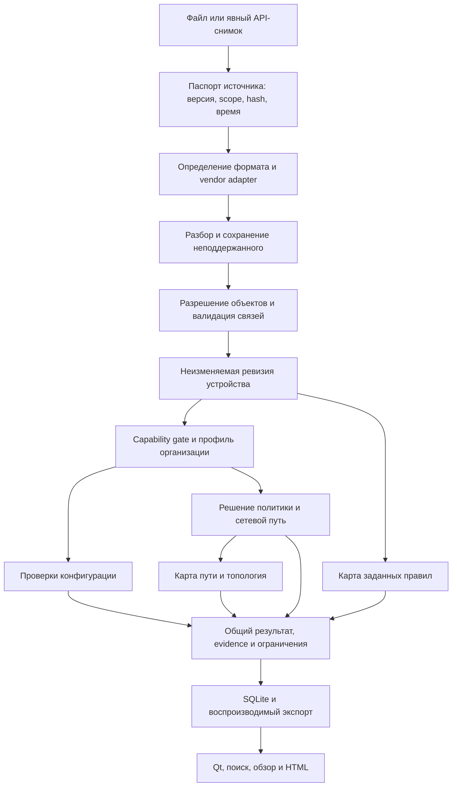
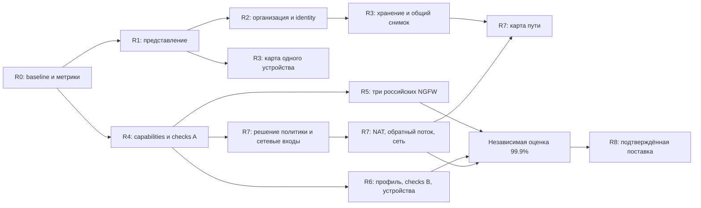

# Roadmap v2: исследование, целевая архитектура и порядок реализации

Дата исследования: 14.10.2026. Статус: расширенное техническое задание, предложения к реализации. Основание — первая версия roadmap и последующий запрос пользователя раскрыть каждый пункт, провести исследование субагентами, спроектировать достижение точности не ниже 99,9% и объединить материалы в один файл без сжатия.

## 0.1. Что представляет собой вторая версия

Первая версия [IMPROVEMENT_ROADMAP_2026-10.md](../IMPROVEMENT_ROADMAP_2026-10.md) сохраняется как исходная постановка. Вторая версия развивает её направления и критерии. Она содержит исследование существующей реализации, альтернатив, технологических ограничений, первичных источников, необходимых данных, алгоритмов, пользовательских сценариев и приёмки.

Полный итог — `ROADMAP_V2_FULL.md` в этом каталоге. Он включает тексты исследовательских разделов целиком, а не только их резюме. Отдельные файлы остаются рабочей базой знаний и позволяют независимо уточнять направления. Каждый факт, зависящий от производителя, версии библиотеки или документации, привязан к источнику и области действия. Авторские проектные решения обозначены как предложения, а не как рекомендации производителя.

Работа выполняется над документацией. Новые функции не объявляются реализованными; пользовательская база не мигрируется. Исследование исходников и проверка текста не заменяют будущие аппаратные эксперименты, статистическую оценку и чистую Windows-матрицу.

Для статуса реализации используются следующие уровни доказательства:

| Уровень | Что является доказательством | Что этот уровень позволяет утверждать |
|---|---|---|
| Код | Наличие конкретной функции, контракта и вызывающего сценария | Функция существует в исходниках в указанной границе |
| Тестовый сценарий | Содержание конкретного теста и входов | Есть средство проверки данного поведения |
| Выполнение проверки | Результат запуска на определённой версии/среде | Проверка прошла на этих входах и среде |
| Лабораторная валидация | Наблюдаемое поведение выбранного устройства/версии | Согласованность модели с данным аппаратным сценарием |
| Статистический gate | Независимая выборка, эталон, знаменатели и доверительные границы | Обоснование численной цели в объявленной генеральной совокупности |

Одно доказательство не подменяет другое. Существующие golden-эталоны, например, полезны для регрессии, но не подтверждают сами по себе семантическое соответствие устройству.

## 0.2. Обязательный объём и границы

Пользовательская цель сохраняется полностью: одна организация, информативный обзор, компактная инфраструктура, понятные правила/объекты, доказательства без повторов, полезные инструменты анализа, понятные отчёты, видимые и затем работающие российские NGFW, расширение парка сетевых устройств, 25 дополнительных проверок, моделирование доступности и динамическая карта.

«Операции» сохраняют существующие сценарии. Для перехода к организации потребуется заменить контекст и проверить восстановление истории; это не основание переустраивать весь раздел. Чекбоксы существующих проверок сохраняются до расширения каталога, после чего появляются поиск и категории без потери быстрого включения. Прямой сбор по API/SSH планируется отдельно от файлового импорта. Автоматическое изменение устройств не входит в поставленную задачу.

Развитие Cisco ASA/IOS/XE находится в backlog по существующей договорённости. Уже работающие ASA-сценарии сохраняются и служат источником архитектурного опыта. Российские NGFW, Comware и HP/Aruba не должны ждать новой реализации Cisco NAT. При появлении подтверждённых non-Cisco сетевых входов проверка доступности развивается на них.

Цель 99,9% не позволяет исключить трудные функции из roadmap, чтобы улучшить показатель. Неподдержанный ввод учитывается и виден; его расширение остаётся инженерной задачей. Нельзя считать ответ «неизвестно» правильным положительным/отрицательным решением и таким способом получать 100% accuracy.

## 0.3. Исследовательские направления и трассировка первой версии

| Раздел первой версии | Полное развитие во второй версии | Что должно появиться в результате |
|---|---|---|
| 1. Результат | Этот раздел и пользовательские сценарии UX | Продуктовые вопросы, ценность и проверяемые результаты |
| 2. Существующее | Исходный код в каждом исследовании + реестр доказательств | Подтверждённые точки расширения и ограничения |
| 3. UX-01 | Организация, данные и поставка | Модель организации, миграция, конфликты и восстановление |
| 3. UX-02…UX-07 | UX и отчёты | Сценарии, состояния, представления, поиск, агрегирование, доступность |
| 4. Устройства/NGFW | Платформы и парсеры | Паспорта платформ, форматы входов, capability matrix, quality gates |
| 5. NEW-01…NEW-25 | Каталог проверок | Предикаты, данные, алгоритмы, примеры, FP/FN, evidence и действия |
| 6. NET-01…NET-05 | Доступность и карта | Модель потока и пути, семантика выводов, неизвестность, проверка |
| 7. MAP-01…MAP-03 | Доступность и карта | Карта ACL, снимки/diff, топология, обновление и экспорт |
| 8. R0…R8 | Этот раздел + задачи в исследованиях | Зависимости, рабочие пакеты, выпуск и оценка по фактической готовности |
| 9. Качество | Точность и верификация | Статистический протокол, корпус, независимые эталоны, release evidence |
| 10. Уточнения | Реестр решений ниже и вопросы по платформам | Обязательные входы, время уточнения и работа, которая не зависит от них |
| Дополнение пользователя 15.10: как начать и работать | Полный пользовательский путь и onboarding | Первый запуск, ввод данных, первый полезный результат, исправление, повторная проверка и повседневная работа |

Матрица предназначена для контроля полноты. Она не заменяет развёрнутые разделы, включённые далее полностью.

### Пользовательский путь как связующее требование

Подробный путь пользователя включён отдельной главой сразу после этой. Он связывает функции в последовательную работу: первый запуск → подготовка экспорта → предварительный просмотр → анализ → понятный результат → доказательство → решение пользователя → изменение конфигурации вне приложения → новая ревизия → сравнение → отчёт. Для карты и запроса доступности есть отдельные ветви с проверкой готовности входных данных.

Onboarding не должен становиться обязательной длинной анкетой. Организация создаётся автоматически; импорт файлов доступен сразу; пример можно открыть отдельно; неизвестные бизнес-настройки запрашиваются перед зависимой проверкой, а не блокируют первый запуск. Пользователь всегда видит, какой следующий шаг даст полезный результат.

Сквозные задачи пути обозначаются JRN в полной главе. Их реализация распределяется между R1 (понятный первый результат), R2 (первый запуск и организация), R3 (первое использование карты), R5 (помощь с экспортом конкретного NGFW), R7 (первый запрос доступности) и R8 (полный проход на поставляемом exe). Пользовательская проверка проходит через эти переходы целиком: изолированное тестирование страниц не доказывает работоспособность рабочего сценария.

## 0.4. Как трактуется точность не ниже 99,9%

Требование превращается в набор измеримых целей, с отдельным итоговым измерением. Для каждой формулировки указываются единица измерения, генеральная совокупность, поддержанная версия/конструкция, допустимый вид вывода, способ получения эталона и доверительная граница.

- **Парсер:** правильное восстановление значимых полей и связей в поддержанном формате. Отдельно измеряются потерянные/лишние правила, неверные условия, порядок, области и действия. Простая доля распознанных строк не заменяет семантическую корректность.
- **Проверки:** precision подтверждённых находок и recall реально присутствующих нарушений в согласованной области. Разные проверки имеют разные знаменатели; большой объём простых отрицательных случаев не скрывает пропуски редких ошибок.
- **Policy/path:** корректность решений на независимых запросах, отдельно опасные ложные разрешения, ложные запреты, альтернативные пути и полный обратный поток. «По конфигурационной модели» и «наблюдалось на живом устройстве» — разные утверждения.
- **UI/отчёт:** точное сохранение сущностей, связей, чисел, статусов и доказательств. Эти преобразования должны выполнять строгие инварианты; усреднять потерю находок до допустимых 0,1% нельзя.
- **Хранение/миграция:** сохранность каждой записи и её принадлежности. Ошибка потери данных блокирует выпуск, даже если доля сохранённых записей выше 99,9%.
- **Удобство:** завершение пользовательских задач, время, понимание статусов и доступность. Это отдельные UX-показатели; никакой коэффициент точности не доказывает, что пользователь понял экран.

Для независимых бинарных испытаний без ошибок односторонняя 95%-ная нижняя граница вероятности успеха равна `0.05^(1/n)`. Чтобы она достигла 0,999, нужно не менее `ceil(log(0.05)/log(0.999)) = 2995` испытаний. Это расчёт для одного заранее определённого показателя, при предпосылках биномиальной модели. Он не означает «2995 тестовых функций достаточно для всего продукта». [NIST рассматривает проверку доли дефектов через биномиальную модель](https://www.itl.nist.gov/div898/handbook/prc/section2/prc24.htm); [SciPy документирует exact Clopper–Pearson interval](https://docs.scipy.org/doc/scipy/reference/generated/scipy.stats._result_classes.BinomTestResult.proportion_ci.html). Формула и её применение к проекту здесь — собственный расчёт.

Если шесть независимых необходимых этапов верны с вероятностью 0,999 каждый, вероятность одновременной корректности всех шести равна `0.999^6 ≈ 0.994015`, то есть около 99,4015%. Этот пример иллюстрирует необходимость итогового gate. При зависимости нельзя просто перемножать цифры: нужно либо измерять результат end-to-end на независимом корпусе, либо доказывать обоснованный бюджет ошибок без предположения независимости. Подробный статистический протокол изложен в отдельном полном разделе.

Для каждого gate обязательно публикуются доля определённых ответов и доля unsupported/unknown. Высокая точность на 1% простых запросов не соответствует намерению пользователя. Минимальная полезная доля ответов согласуется на реальном парке, фиксируется до итоговой проверки и повышается с каждым этапом покрытия. Внутри уже поддержанной области необъяснимый отказ от ответа считается дефектом полноты, а не бесплатным способом улучшить precision.

По результатам исследования нельзя утверждать, что 99,9% уже достигнуто. Вторая версия задаёт путь и доказательства, необходимые для такого утверждения после реализации.

## 0.5. Общая архитектура расширения

Это целевой поток, а не описание готовой реализации. Исходный parser API, существующие модели и ревизии сохраняются до явно протестированной замены. Переход оформляется с совместимостью или миграцией, а не массовым переписыванием.

### Предлагаемые общие контракты

1. **Source passport:** содержание/роль источника, точная версия продукта и способ получения, hash, полнота с основанием, observed_at и imported_at, timezone, устройство и контекст. Исходный файл нельзя объявлять полным по расширению или имени.
2. **Capability declaration:** возможность не только платформы, но конкретного снимка: parse, resolve, binding, route, NAT, identity, schedule, application, counters. «Vendor поддерживает» не означает «эти данные есть в текущем экспорте».
3. **Organization profile:** зоны и допустимые отношения, административные сети, защищаемые сервисы, пороги, владельцы, исключения и версии. История анализа хранит использованный профиль, поэтому изменение настройки не переписывает старое заключение.
4. **Analysis manifest:** версия приложения, адаптера и checks; набор входных ревизий, параметры, время расчёта, область, результат и зависимые ограничения. Это основа воспроизводимости карты, отчёта и diff.
5. **Presentation projection:** отдельное компактное представление findings/limitations/objects, с явными ссылками на исходный результат. Сводка не является новым аналитическим эталоном.
6. **Evidence bundle:** правило/объект/факт, использованное условие, исходное расположение и безопасный фрагмент. SHA-256 проверяет совпадение подключённого источника, но не доказывает подлинность устройства или актуальность политики.

### Что не стоит усложнять до появления оснований

Локальный модульный монолит остаётся подходящей основой. Graph database, отдельный web backend, распределённая очередь и микросервисы не помогают доказать правильность правил и создают дополнительную работу. Для первых карт подходят чистые доменные DTO и Qt-представление; аналитическая алгебра не должна зависеть от графической библиотеки. Введение solver/BDD, нового формального движка или внешнего oracle требует отдельного прототипа с измерением стоимости и доказуемым выигрышем.

## 0.6. Расширенный порядок выполнения

Оценки из v1 сохраняют статус предварительных ориентиров, а не обязательств. После углубления объём каждого adapter/path может существенно увеличиться. Точные инженерные оценки выдаются после паспорта платформы, схемы данных и прототипа сложной семантики. Нельзя складывать приблизительные дни и объявлять полученное число датой готовности 99,9%.

### R0. Исследовательский и измерительный baseline

**Цель:** определить состояние продукта и материал, на котором будут проверяться изменения.

Рабочие пакеты:

- B01 — воспроизводимые synthetic аналоги перегруженных сообщений и скриншотов, с известными объектами, неизвестными полями и управляющими ACL.
- B02 — фактическая матрица возможностей из кода, вызовов, схем и выполненных проверок. Устаревшая спецификация не повышает статус.
- B03 — паспорт реального парка: платформы, версии, доступные типы экспортов, роли, ограничения доступа.
- Q00 — единицы измерения 99,9%, корпус, protocol, границы precision/recall, unknown/coverage и ownership эталонов.
- B04 — latency/memory/render baseline на зафиксированном ПК и объёмах; никаких гарантированных чисел без измерения.

Выход: нет неизвестных в определении метрик; неизвестные форматы честно занесены в список входов; корпус разделён на разработку и независимую оценку. R0 не требует готового экспорта всех NGFW для исправления UI.

### R1. Читаемый результат на существующей модели

U01 — агрегатор ограничений; U02 — таблица сведений; U03 — правила/объекты; U04 — evidence; U05 — HTML; U06 — постоянно видимые NGFW-карточки.

Последовательность: единая проекция → представления Qt → отчёт → regression на одинаковых данных. Общие сообщения группируются с сохранением источников; семантические неизвестности остаются. Для UI counts и принадлежности findings действуют строгие инварианты. Успех этого этапа измеряется понятностью пользовательских задач и отсутствием потерь представления.

Выход: пользователь находит нужный объект и условие правила, понимает причину ограничения и открывает доказательство; технические данные доступны отдельно; NGFW видны со статусом планирования. Обновлённый HTML воспроизводит одинаковые итоги с UI.

### R2. Организация, обзор и поиск

O01 — контекст организации; O02 — миграция/backup/recovery; O03 — обзор с приоритетами и качеством входа; O04 — общая identity/search projection; O05 — проверка нового exe и документации.

Зависимости: identity и миграция предшествуют межустройственному diff и общим числам. Сначала слой совместимости, затем schema migration. Если старых проектов несколько, запускать подтверждённое разрешение конфликтов, сохраняя все исходные данные. Не перезаписывать подключения по provider и не объединять разные устройства по одному имени.

Выход: одна организация в обычной работе, история и отметки не потеряны, новая БД создаётся автоматически, столкновения старых ID доступны для разбора, обзор различает ошибки импорта и реальные находки.

### R3. Карта заданных правил

M01 — Qt-визуализация существующего ACL API; M02 — persistence/manifests; M03 — фильтры и агрегация; M04 — comparison/export.

Зависимости: M01 можно выполнить после R1 на одном устройстве; M02 и межустройственная identity используют R2. Не ждать NAT или всех NGFW. Построить карту сначала на HP/Aruba и Comware с уже имеющимся контрактом, сохраняя unknown/deny/disabled.

Выход: интерактивные связи по правилам, переход к доказательству, восстановление снимка и положения узлов, фильтры по сети/сервису и scope. Подписи объясняют смысл линий; наличие линии не объявляется доступностью.

### R4. Общие capabilities, расширение текущих parsers и пакет A

P01 — паспорт capabilities и полноты; P02 — Comware bindings/order; P03 — HP/Aruba расширения; P04 — реестр checks и параметров; C01 — NEW-03…06 и NEW-09…16.

Точный пакет A — 12 новых проверок. Непроверяемая область не становится положительным результатом. Для NEW-13 нужна полнота графа ссылок; для set algebra — известные порядок, scope и семантика. Если одна зависимость не готова, поставляется конкретный проверяемый срез с зарегистрированным остатком работ, а задача расширения не снимается.

Выход: versioned checks с детальными evidence и примерами, независимая проверка результата алгоритмов, расширенное покрытие текущих платформ. Достигнутая статистическая цель публикуется только после соответствующего gate.

### R5. UserGate, Ideco и PT NGFW

V01/V02/V03 — три обязательных независимых направления. Каждый разбивается на паспорт/исследование, importer, resolver, bindings, policy checks, map integration, эталонную оценку и затем сетевые факты/collector.

Порядок реализации определяет готовность входа. UserGate имеет материалы и более определённый стартовый контракт, но это не повод исключить остальные платформы. CSV, текстовый экспорт, архив и API snapshot имеют разные полноту и semantics. Один новый адаптер можно выпустить раньше других; общее направление остаётся активным.

Выход на каждом срезе: таблица конкретных версий и поддержанных конструкций, воспроизводимые findings и source mapping, отрицательные и неизвестные случаи, заявленная точность в измеренном scope, явные остальные ограничения. Наличие кнопки не считается частью quality gate адаптера.

### R6. Профиль организации, пакет B и оставшиеся устройства

C02 — NEW-01/02/07/08/17/18/19/21/22/23, то есть 10 проверок. V04 — Huawei, V05 — Juniper, V06 — ArubaOS controllers. Для каждого — отдельная дорожка с собственным паспортом и тестовым корпусом.

Зависимости: бизнес-профиль нужен для нарушения сегментации и небезопасного назначения сервисов; новые operational/settings-входы нужны для SNMP/NTP/получателей логов. Нельзя вывезти точность из правильного port matcher при неверно заданной бизнес-политике. Пользовательская матрица также требует версии и валидации на контрольных примерах.

Выход: авторские правила организации выразимы и проверяемы, исключения имеют scope/причину/срок, история сохраняет прежний профиль. Расширение Junos filters не выдаётся за готовый SRX evaluator.

### R7. Решение политики, полный путь и слой топологии

NET-01 — query/result и capability gate; NET-02 — route/interface/binding inputs одной подтверждённой платформы; NET-03 — NAT/return semantics; NET-04 — несколько устройств/альтернативы/loops; NET-05 — контрольные потоки и diff. MAP-03 — объяснимое отображение сетевых фактов и пути. C03 — NEW-20/24/25, то есть 3 проверки с дополнительными входами.

Следовать минимальным полным вертикальным срезам: известный non-NAT policy decision → маршрут и один узел → NAT и обратное направление → сеть с альтернативными путями. В каждом срезе «полный» относится к конкретной объявленной семантике, а не ко всем возможностям производителя. Усложнение сопровождается расширением независимого корпуса, не только unit tests.

Выход: результат содержит уровень доказательства, условия, пути, правило/маршрут/трансляцию, неизвестности и обратный поток; сохраняется manifest. Полезные control flows повторяются после новой ревизии и демонстрируют изменения. Физическая топология требует фактов, которые ACL не предоставляет.

### R8. Повторяемая поставка и проверка утверждений

Release branch здесь — организационная идея, а не утверждение о существующем Git: каталог пока не является репозиторием, remote/hosted CI отложены. До отдельного решения проверки выполняются локально теми же средствами, которые затем можно перенести в CI.

Каждый крупный выпуск получает evidence bundle: версии, checksums, dependency manifest/SBOM по требованиям проекта, результаты тестов и статистической оценки, список поддержанных конструкций, compatibility/migration checks, чистая Windows 10/11 матрица и пользовательские сценарии. Qt/frozen smoke не подменяется существующим Tk smoke.

Поставка — поперечная работа, а не «несколько дней в конце». Поведение новой схемы и адаптера проверяется вместе со сборкой, иначе исходники и запущенный exe снова могут расходиться.

## 0.7. Зависимости и критический путь

Диаграмма упрощает управление зависимостями, но подробный gate каждого направления остаётся в исследовательских разделах. Независимая оценка выполняется по каждому срезу и end-to-end. Она не откладывается целиком до последнего блока.

Критический путь для точного сетевого анализа: источник/полнота → нормализация/identity → правильная binding → policy semantics → route/NAT/return/path → независимый эталон → метрика. UI можно улучшать параллельно, но красивое объяснение не исправляет семантически неправильное решение.

## 0.8. Реестр решений и необходимых данных

| Решение/вход | Когда требуется | Что происходит до получения |
|---|---|---|
| Версии и экспорты трёх NGFW | До фиксации importer каждой платформы | Исследование официальных форматов, UI и общие контракты |
| Реальный парк Huawei/Juniper/controllers | До очередности V04…V06 | Паспорта и архитектура отдельных adapters |
| Состав старых проектов, collisions и integrations | Перед миграцией O02 | Synthetic сценарии, план и проверка сохранности |
| Админские сети, сервисы, зоны и segmentation matrix | До активации зависящих checks B | Реестр checks и техническая схема профиля |
| RIB/FIB/NAT/neighbor/counters и их время | Перед соответствующим NET/C03 gate | Локальные policy решения и карта условий |
| Генеральная совокупность независимой оценки | Перед любым численным claim 99.9% | Подготовка корпуса и методики; claim отсутствует |
| Бюджет ответа unknown и performance targets | После baseline на реальном парке, до релизной оценки | Явные неизвестности и измерения без ложных гарантий |
| Разрешение публикации/Git/CI | Перед hosted CI и внешней публикацией | Локальные проверки/сборка; подготовленные материалы |

Ни одно из этих уточнений не используется для остановки всех работ. Оно ограничивает конкретную зависимую реализацию. Каждый неподтверждённый формат или hardware oracle остаётся в списке незакрытых входов, а не скрывается формулировкой «поддерживается».

## 0.9. Шаблон перехода от исследования к задаче

Идентификаторы R0…R8 и крупные пакеты U01…U06, O, P, V, C сохранены из v1. Детальные задачи UX-главы имеют отдельный префикс `UX02-A`…`UX07-F`, связанный с номером UX-требования, а пользовательские переходы — `JRN-*`. Например, `UX06-B` — renderer HTML в требовании UX-06, а верхнеуровневый `U06` первой версии — видимость NGFW. При создании TASK-файла сохраняются оба уровня трассировки, чтобы сходные номера не смешивали разные обязанности.

Каждая задача реализации содержит:

1. Пользовательский сценарий и ожидаемую ценность; точную ссылку на направление этого документа.
2. Предыдущую реализацию и source evidence, которое показывает проблему.
3. Область данных, версии, scope и предикат применимости.
4. Выбранный вариант, рассмотренные альтернативы и основание выбора.
5. Контракт входа/выхода, версии, identity и сохранение evidence.
6. Алгоритм и обработку неизвестного/конфликтного/неполного случая.
7. Приёмку, независимый oracle где нужен, положительные/отрицательные/граничные сценарии.
8. Доказательство корректности результата и численной цели, если делается такой claim.
9. Производительность, ресурсный лимит, отмену и rollback.
10. Миграцию/совместимость/поставку/обновление документации.

Приёмка исследования отличается от приёмки реализации: для исследования требуется полнота разборов и достоверные источники; для реализации — результаты на коде, устройствах, корпусе и сборке. Разделы далее содержат полную базу знаний для такой декомпозиции.
