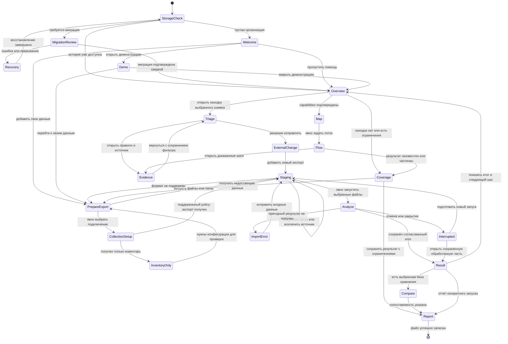

# Пользовательский путь: от первого запуска до подтверждённой повторной проверки

Дата разработки: 15.10.2026. Дополнение к roadmap v2 по прямому запросу: как человек, впервые запустивший программу, поймёт, что делать, получит полезный результат и продолжит работать. Это проект поведения и текстов интерфейса, а не заявление о реализации. Код приложения, база данных и пользовательские конфигурации при подготовке этого раздела не изменялись; пользовательское исследование и запуск desktop не проводились.

## 7.1. Основание и границы предложения

Исходники и действующее руководство подтверждают уже существующую цепочку: проект → добавить файлы/папку → предварительное определение формата и связи с устройством → локальная проверка → находки → правило/сохранённое доказательство → решение пользователя → новый запуск → сравнение → HTML/JSON. В навигации есть «Обзор», «Инфраструктура», «Анализ», «Операции» и «Отчёты»; настройки вынесены отдельно. Двойной щелчок в staging меняет связь файла с устройством. Предварительная подготовка и очередь выполняются в фоне. После завершения проверки текущая страница сохраняется, переход к результату явный. После перезапуска подключение исходника требует совпадающего SHA-256; изменённые байты предназначены для нового анализа. Отмена ожидающих заданий не равна остановке уже выполняющегося ядра. Эти свойства взяты из [USER_GUIDE](../USER_GUIDE.md), [workspace_navigation.py](../../src/firewall_compliance/interfaces/desktop/workspace_navigation.py) и [qt_app.py](../../src/firewall_compliance/interfaces/desktop/qt_app.py).

Целевыми расширениями являются: автоматическое пространство одной организации вместо обязательного проекта; welcome и пошаговая помощь; управляемая демонстрация; понятные инструкции получения данных из каталога возможностей; явное действие изменения связи без необходимости угадывать двойной щелчок; согласованный обзор; доказательная карточка находки; сравнение с gate совместимости; пользовательская карта и форма потока; сохранение безопасного прогресса знакомства. Их нет оснований объявлять работающими до реализации и испытания. Контракты представления, статусов и выгрузки подробно заданы в разделе UX; хранение, миграция и identities — в разделе организации; математическая область карты и потока — в сетевом разделе. Здесь определяется связный путь через эти возможности.

Все описанные ниже расположения кнопок, названия, персонажи, критерии и сценарии — авторские проектные предложения, требующие проверки с пользователями. Внешние источники подтверждают отдельные механизмы доступности и метод оценки, но не доказывают, что предложенный onboarding удобен именно администраторам этой программы.

Три ограничения действуют во всём пути:

1. Знакомство не запускает обнаружение сети, API-вызовы, автоматическую отправку отчёта или изменение оборудования. Подключение и конкретный сбор остаются отдельными явными действиями.
2. Работающий локальный анализ не означает полное понимание всех экспортов производителя. Версия, формат и поддержанные конструкции сопровождают вход и результат.
3. Прохождение подсказок не повышает точность анализа. Отсутствие находок, зелёная операция и вручную поставленное решение описывают разные факты.

## 7.2. Для кого проектируется путь

**Администратор, впервые открывший приложение.** Знает свою сеть, но не знает терминов и модели программы. Ему надо понять, какой файл взять, почему экспорт может оказаться неполным, как найти конкретную настройку и что исправлять во внешней системе. Полезный первый результат — объяснённая находка с правилом и достоверной привязкой к источнику либо честное объяснение, почему этот источник не анализируется. Создание имени организации само по себе полезным результатом не считается.

**Аудитор.** Может получить только готовый экспорт и историю, не имеет доступа к управлению устройством. Ему важны происхождение, время, область, воспроизводимость и автономный отчёт. В этом пути «запросить новые данные у администратора» является нормальным исходом; программа не требует вводить пароль от устройства для чтения сохранённого результата. Возможность открыть существующую историю и сформировать отчёт должна обходить мастер первого импорта.

**Опытный пользователь существующей версии.** Уже знает staging и раздел «Операции». Ему нужны сохранение истории и быстрый доступ к прежним действиям. Мастер не включается заново при каждом запуске и не меняет семантику команд очереди. Информация о переходе к организации показывается один раз по результатам реальной миграции.

**Новый сотрудник в организации с готовой историей.** Ему надо понять уже существующий обзор и последнее решение коллеги, не импортируя данные повторно. Короткая помощь предлагает «Открыть последнюю проверку», «Как читать результат» и «Добавить новые данные». Состояние знакомства относится к локальному пользовательскому контексту, а не к самому запуску анализа.

Это роли в исследовании, а не уже реализованная система RBAC. Если права чтения/редактирования в локальном продукте отдельно не реализованы, нельзя показывать выбор «аудитор» как обещание технического ограничения. Можно спросить «Что хотите сделать сейчас?» и переставить ссылки помощи, сохранив одни и те же доказательные требования. Введение реального режима чтения потребует отдельного контракта записи, а не только скрытия кнопок.

## 7.3. Модель обучения: действие, объяснение, проверка понимания

Выбран необязательный пошаговый помощник поверх существующей навигации. Он показывает ближайшее полезное действие и смысл данных; пользователь может уйти в обычный интерфейс и вернуться. Обязательный полноэкранный тур по всем разделам до импорта создаёт отложенную работу: человек ещё не знает, к каким данным относятся пояснения. Полный экспертный интерфейс без начального действия создаёт другую проблему: пустые таблицы и семь настроек не объясняют, где взять конфигурацию. Предложенный компромисс — начать с данных, раскрывать настройки на соответствующем шаге и предлагать короткое объяснение после появления реального результата.

На первом экране обещание формулируется предметно: «Добавьте экспорт конфигурации. Программа покажет найденные настройки и объяснит ограничения проверки. После изменения конфигурации можно сравнить новый результат». Рядом вторым уровнем: «Анализ файлов выполняется локально. Подключения и получение данных через API запускаются отдельно». Технические сведения о хранилище, версиях и журнале доступны через «Где хранятся данные?»; не требуется читать их для выбора файла.

Контрольный список помощника содержит только выполнимые пункты:

- Подготовить и добавить данные.
- Проверить распознавание и устройство.
- Выполнить первую проверку.
- Разобрать результат и его ограничения.
- Сохранить отчёт или подготовить повторную проверку.

Пункты отмечаются по подтверждённым событиям, а не по открытию страницы. «Разобрать результат» не считается доказанным автоматически по клику на находку: технически можно отметить «Карточка открыта», а понимание проверяется в исследовании. Если приложение не может наблюдать выполнение действия во внешней системе, оно не рисует соответствующую галочку. Помощник не выставляет балл «готовность администратора» и не называет первое знакомство аудитом всей сети.

Команды «Пропустить помощь» и «Продолжить позже» сохраняют обычный интерфейс. В «Справка → Первые шаги» открывается актуальная последовательность, рассчитанная по состоянию: если анализ уже есть, предлагается чтение результата, а не повторное создание данных. Обновление версии подсказок может добавить ненавязчивую ссылку «Изменилось в этой версии»; оно не сбрасывает завершённые операции.

## 7.4. Общее состояние и конечный автомат пути

Состояние помощника и состояние операции независимы. Поля состояния знакомства могут включать `onboarding_version`, `dismissed`, `last_step`, `demo_context` и ссылки на добровольно выбранный run. Они не заменяют persisted job/run/item states и не определяют, был ли файл обработан. Перед возобновлением проверяются существование объекта, право доступа и актуальный manifest. Исчезнувшая ссылка ведёт к истории с сообщением, а не к другой находке с похожим названием.

Здесь `Result` включает полное или частичное завершение с раздельными исходами файлов; это не синоним «все файлы успешно разобраны». `Interrupted` не обещает возможности продолжить с точки остановки. Если возобновление исполнения не реализовано, UI предлагает новый запуск оставшихся источников после проверки их байтов. `ExternalChange` — задача человека вне программы, не скрытая операция записи на устройстве.

Каждый переход, связанный с данными, несёт контекст: организация, синтетический/реальный режим, source revision, run/item, устройство, область политики и профиль проверки. Для обзора последних снимков передаётся manifest нескольких ревизий; для результата запуска — конкретный run. Нажатие «Назад» восстанавливает фильтр, сортировку, выбранную строку и область. Переход из первой находки в правило не должен незаметно переключаться на последнюю ревизию того же устройства.

## 7.5. Единый синтетический пример для всех экранов

Ниже описан проектный демонстрационный набор «Учебная организация». Он должен быть создан и проверен отдельной задачей, его ожидаемые результаты нельзя выдавать за результаты уже существующей fixture. Используется устройство `EDGE-LAB-01`, экспорт ограниченной IPv4 ACL поддержанного среза Aruba AOS-Switch с явно подтверждаемой версией. Сеть клиентов — `192.0.2.0/24`, сервер приложения — `198.51.100.20`, адрес тестового клиента — `192.0.2.10`, разрешённый сервис — TCP 443. Все адреса принадлежат диапазонам для документации, определённым [RFC 5737](https://www.rfc-editor.org/rfc/rfc5737.html); это учебные данные, не адреса инфраструктуры пользователя.

В ревизии `A` учебная ACL `CLIENTS_IN` содержит намеренно слишком широкое терминальное разрешение «Любой адрес → Любой адрес → Любой IPv4-сервис»; в независимом oracle fixture зафиксированы порядок и явная область применения. Карточка выбранной находки объясняет именно этот факт конфигурации. Иные автоматически полученные находки зависят от реально реализованных проверок, их настроек и семантики конкретного экспорта; общий счётчик заранее не придумывается. Один пользовательский сценарий разбирает одну находку, а не обещает, что в наборе будет ровно одна.

В ревизии `B` намеренно широкое правило заменяется разрешением `192.0.2.0/24 → 198.51.100.20 → TCP 443` с нужными для fixture полями и известным порядком. В демонстрации это заранее подготовленная новая конфигурация. В реальной работе изменение выполняет администратор по своим процедурам; программа не предлагает автоматически вставить этот пример в оборудование. Ожидаемое доказательство повторной проверки ограничено: выбранная any-any находка не наблюдается в сопоставимой поддержанной области. Это не доказывает сохранение всех сервисов, отсутствие других проблем или сквозную доступность сети.

Обе ревизии получают отдельные source keys и фактически вычисленные SHA-256. Базовая identity устройства сопоставлена явно. Время импорта и время наблюдения устройства не смешиваются; для демонстрации происхождение observation отмечается `synthetic`, если оно вообще задано. Если сценарий карты использует привязки, интерфейсы и маршруты, они входят в отдельный manifest учебного комплекта. Если данных для полного пути нет, демонстрация специально заканчивает поток ответом «Недостаточно данных для полного пути» и показывает, что локальное совпадение правила всё равно доступно. Учебная успешность не подменяет capability gate реального адаптера.

## 7.6. Экран за экраном: первый запуск и первые данные

### J01. Запуск и создание контекста одной организации

**Цель.** Открыть пригодное рабочее пространство без обязательного знания модели проектов.

**Экран и данные.** Перед welcome приложение проверяет фактическую доступность своего хранилища. Для новой пустой БД создаётся единственный внутренний контекст организации по контракту миграции; пользователю не нужно выбирать проект или создавать площадку. Имя «Моя организация» является редактируемой подписью. В шапке указано это имя и, при наличии, путь к данным через отдельную ссылку. Учётная запись и доступ к интернету для локального импорта не требуются по целевой модели.

**Кнопки и микротекст.** Основное действие «Добавить конфигурации». Рядом «Посмотреть на примере», «Открыть историю» при наличии истории и «Пропустить помощь». Поле «Название организации» необязательное; подпись: «Можно изменить позже в настройках». Текст: «Начните с одного устройства. Остальные конфигурации можно добавить позже».

**Выбор.** Пользователь выбирает свои данные, демонстрацию либо обычный интерфейс. Выбор цели «Проверить настройки», «Посмотреть готовый результат», «Разобраться в программе» может влиять на пояснение, но не создаёт разные хранилища или профили без явного действия.

**Обратная связь.** В пустой организации нет зелёных нулей и блока «Всё в порядке». Показывается «Данные ещё не добавлены». Сбой доступа к БД показывает проблему открытия данных с путём и доступными действиями восстановления; вместо этого не создаётся молча новое пустое пространство.

**Завершение и следующий шаг.** Контекст доступен, выбор пользователя сохранён. Свои данные → J03, демонстрация → J02, пропуск → пустой обзор с действием добавления. Проверка наличия старой БД ведёт к J20, а не к этому автоматическому созданию.

### J02. Демонстрация, которую невозможно спутать с собственной сетью

**Цель.** Дать изучить интерпретацию результата до подготовки реального экспорта.

**Экран и данные.** «Демонстрация — синтетические данные» с учебным `EDGE-LAB-01`, ревизиями A/B и ожидаемыми доказательствами. Предпочтительный вариант — отдельный временный demo-контекст за пределами production identities и сводок. Он не добавляет учебное устройство в организацию и не создаёт пользовательские решения для реальной истории. Архитектурный вариант временного хранилища требует реализации; до него можно поставлять автономный демонстрационный HTML, прямо называя его примером, без имитации интерактивного анализа.

**Кнопки и микротекст.** «Открыть учебный результат», «Как читать ограничения», «Добавить свои данные», «Закрыть демонстрацию». Постоянная подпись: «Учебный пример. Данные не относятся к вашей организации». Если доступен экспорт примера, и имя файла, и содержимое имеют эту маркировку.

**Выбор и обратная связь.** Можно последовательно открыть находку, evidence, сравнение A/B или выйти сразу. Демонстрация не меняет settings реальных проверок, не сохраняет секреты и не включает будущий сбор. Закрытие возвращает на предыдущую страницу реального контекста.

**Завершение и следующий шаг.** Просмотр примера доброволен; его можно повторить. Нажатие «Добавить свои данные» открывает J03 и явно снимает demo-контекст. Не ставить «Первый анализ выполнен» в реальном списке шагов только из-за просмотра примера.

### J03. Подготовить экспорт: сначала выбрать задачу и платформу

**Цель.** Объяснить, какой источник нужен и что он позволит проверить, прежде чем просить выбрать произвольный файл.

**Экран и данные.** Страница «Какие данные добавить?» имеет три варианта: «Уже есть файлы», «Нужна инструкция экспорта», «Получить через подключение». Для инструкции выбираются семейство, версия при наличии, способ экспорта и цель: проверки политики, карта заданных правил, расчёт потока. Каталог основан на единой матрице фактических capabilities, а не на списке логотипов. Неизвестную версию можно честно оставить неизвестной; это ограничивает подтверждение поддержки, а не провоцирует ввод случайной версии.

**Кнопки и микротекст.** «Выбрать файлы», «Выбрать папку», «Показать инструкцию», «Открыть подключения». Текст: «Имя и расширение файла не определяют поддержку: программа проверяет содержимое». Для инструкции: «Укажите семейство точно: Aruba AOS-Switch, AOS-CX и контроллер ArubaOS имеют разные форматы».

**Подтверждённые текущие входы.** У нового registry присутствуют Cisco ASA, HP/Aruba и Comware. По текущей матрице ASA ограничен текстовым running-config с указанным экспериментальным срезом; AOS-Switch/AOS-CX — соответствующими текстовыми UTF-8 экспортами IPv4 ACL; Comware — ограниченным IPv4 ACL с характерным контекстом версии. Конкретный перечень конструкций и веток версии берётся из [SUPPORTED_PLATFORMS](../SUPPORTED_PLATFORMS.md). Это не blanket-обещание поддержки всех версий производителя. Cisco не получает нового развития в этом onboarding сверх согласованного сохранения уже работающего. UserGate, Ideco и PT NGFW отображаются с фактическим статусом будущего/экспериментального адаптера; legacy JSON не предлагается как официальный универсальный формат. Juniper не объявляется подключённым.

**Состав инструкции.** Для каждой подтверждённой комбинации инструкция должна назвать исходный интерфейс производителя, точный вид документа, encoding, необходимость полного контекста ACL/объектов/привязок и обязательные сопутствующие источники для выбранной цели. Команды и пути экспорта публикуются только после сверки с официальной документацией соответствующего релиза. Если подтверждён только формат файла, показывать именно это и запросить документированный образец, а не изобретать команду. Для первого этапа реально полезнее короткая проверенная инструкция для нескольких форматов, чем универсальный неработающий скрипт.

**Выбор.** Пользователь может сразу добавить файл без знания платформы. Если файл уже есть, форма версии не блокирует автоматическое определение. Если выбран неподдержанный продукт, инструкция сообщает ограничение и предлагает сохранить запрос на формат локально/скопировать перечень нужных сведений; она не предлагает переименовать файл под поддержанный adapter.

**Обратная связь и ошибки.** «Экспорт получен» не означает «Полный набор данных устройства». Для фрагмента: «Можно разобрать доступную часть; выводы будут ограничены». Обезличенный токен вроде `ipN` не становится настоящим адресом по номеру. Для получения через API указывается отдельно, вернутся ли policy-данные или только инвентарь. Ссылка на внешнюю инструкцию открывается только по действию пользователя; локальная основная помощь доступна без сети.

**Завершение и следующий шаг.** У пользователя есть файл либо конкретное понимание, какой экспорт запросить. Готовые файлы → J05; выбранный коллектор → J04. Отсутствие файла не помечается ошибкой приложения: показывается «Вернитесь после получения экспорта» с возможностью открыть пример.

### J04. Явное подключение и сбор как отдельная ветка

**Цель.** Получить поддержанные данные без скрытого сетевого действия.

**Экран и данные.** Из J03 открывается существующий путь «Настройки → Интеграции», затем «Операции → Облачный сбор». Подключение содержит понятное имя, provider, endpoint, область и состояние последней попытки; несколько подключений различаются. Перед запросом видны выбранное подключение и предполагаемый тип данных. Сохранённый credential не означает согласия на запуск сбора при welcome или рестарте.

**Кнопки и микротекст.** «Сохранить подключение», «Проверить соединение», «Начать сбор», «Открыть последний результат». У проверки соединения текст результата ограничен фактически доказанным уровнем. Если вернулся инвентарь Cloud.ru: «Получены сведения о ресурсах. Проверки конфигурационных ACL для этих записей не выполнены».

**Выбор и обратная связь.** Человек может проверить связь и не запускать сбор. Во время сбора видны реально известные этапы и число полученных записей; невозможность получить один endpoint не превращает все остальные в подтверждённую политику. Ошибка авторизации объясняется без вывода секретов. Ранее сохранённый пригодный результат остаётся доступен с датой и отдельной ошибкой последней попытки.

**Завершение и следующий шаг.** Сбор имеет сохранённый исход и состав. Инвентарь ведёт в карточку ресурса и инструкцию получения policy-экспорта, а не к фиктивным семи выполненным checks. Только поддержанный policy-документ может попасть в соответствующую подготовку анализа. Существующие облачные операции сохраняются по смыслу; onboarding добавляет переходы и пояснения.

### J05. Добавить файлы или папку в подготовку

**Цель.** Сформировать контролируемый набор входов до запуска анализа.

**Экран и данные.** «Операции → Файлы и проверки», существующая staging-таблица с файлом, форматом, устройством и предупреждением. Над ней: «Подготовка: выбранные файлы ещё не проверены». Новый помощник подсвечивает этот уже существующий экран, не создаёт вторую отдельную очередь. В учебном сценарии выбирается `EDGE-LAB-01-A.cfg`.

**Кнопки и микротекст.** «Добавить файлы», «Добавить папку», «Убрать выбранные», «Очистить список». Дополнительно целевое видимое «Изменить связь с устройством» дублирует существующий double-click. Под очисткой пояснение: «Убирает файлы из подготовки; сохранённая история остаётся доступна». При выборе папки перед стартом показываются фактически отобранные файлы и правила включения подпапок/фильтра; необнаруженные файлы не подразумеваются проверенными.

**Выбор.** Можно удалить лишний файл, добавить недостающий, открыть локальные сведения о source. Перетаскивание допустимо как дополнительный способ при реализации, но все действия имеют кнопку и доступны с клавиатуры. Файл большого размера или очень большой набор получает понятный статус подготовки и отмену доступной работы; заранее выдуманный лимит размера не вводится.

**Обратная связь.** Предварительное определение идёт в фоне. До его завершения «Определяем формат», затем распознанное семейство/версия либо «Формат не определён». Имена и предупреждения не обрезаются без альтернативного полного просмотра. При отсутствии прав, исчезновении файла или изменении во время чтения показывается конкретная ошибка строки, без создания пустого устройства.

**Завершение и следующий шаг.** Набор зафиксирован для preview; ни одна строка пока не означает выполненный анализ. → J06. Если список пуст: «Добавьте хотя бы один источник для проверки» и основные действия добавления.

### J06. Предпросмотр распознавания и сопоставление устройства

**Цель.** Проверить, к чему относится файл, и избежать случайного объединения разных устройств.

**Экран и данные.** Для `EDGE-LAB-01-A.cfg` показываются имя источника, предполагаемая платформа, обнаруженная версия либо «Не определена», предложенная device identity, потенциальные ограничения. Детали содержат основание детекции и предупреждение об экспериментальной области. «Распознано» означает выбор адаптера, а не успешное выполнение всех проверок.

**Кнопки и микротекст.** «Новое устройство», «Это новая конфигурация существующего устройства», «Изменить связь», «Убрать источник». Для совпадения: «Предложена связь по известным признакам. Проверьте устройство перед запуском». Для неоднозначности: «Одинаковое имя не доказывает, что это одно устройство». Изменение ID не сопровождается текстом «Выбран другой формат»: парсер выбирается по содержимому.

**Выбор.** Новое устройство создаёт независимую identity. Для новой ревизии пользователь выбирает конкретное существующее устройство с платформой, последним source и происхождением, подтверждая связь. Несколько файлов одного устройства в одном пакете требуют понятного выбора: разные ревизии либо разные типы документов; их не объединяют в один full-export только по имени. Неизвестное соответствие остаётся раздельным до решения.

**Обратная связь и ошибки.** Совпадающие байты отмечаются как повтор того же source; это не обязательно запрет нового анализа с новым профилем. Разные байты при одинаковом имени — новый source. Для controller ArubaOS: явный неподдержанный формат с его реальным кодом, без попытки провести его как AOS-Switch. Для masked адресов: «Часть адресов не определена; проверки, зависящие от них, ограничены». Предпросмотр не должен говорить о полном coverage до фактического анализа.

**Завершение и следующий шаг.** Для пригодных источников подтверждена связь либо создана независимая identity; спорные строки остаются видимыми и исключаются из старта явно, с количеством исключённых. → J07. Если ни один файл не пригоден, доступна инструкция J03, а кнопка запуска объясняет причину недоступности.

### J07. Настроить первую проверку без перегрузки параметрами

**Цель.** Сделать параметры запуска видимыми и воспроизводимыми.

**Экран и данные.** Сохраняются существующие checkbox семи checks и параметры logging/comments. Короткая сводка: «Источников выбрано: …; устройств: …; проверок включено: …; профиль: …». Начальные значения соответствуют фактическим defaults выпуска. Пакеты новых checks не включаются как уже существующие: их доступность зависит от реализованного каталога и входов.

**Кнопки и микротекст.** Основное «Запустить проверку файлов». Вторичные «Параметры проверок», «Вернуться к источникам». «Выключенные проверки не выполняются и не подтверждают отсутствие проблем». Для правила logging объяснить, что наличие настройки логирования не доказывает получение событий внешним сервером.

**Выбор.** Начинающий может принять документированные defaults, опытный — раскрыть настройки. Параметры бизнес-профиля без данных, например административные сети, не подставляются из учебного набора. Проверка, требующая заполненного профиля, получает «Нужны данные профиля» либо явное невыполнение, а не мнимый отрицательный результат.

**Обратная связь.** При старте сохраняется snapshot параметров и source identities. Изменения настроек после старта относятся к будущим запускам; активная работа не меняется молча. Если файл изменился между preview и фактическим чтением, отображается реальное прочитанное содержимое/новая ревизия по контракту входов и требуется согласование изменившегося плана, когда это влияет на identity; старое SHA preview не используется как доказательство новых байтов.

**Завершение и следующий шаг.** Создан конкретный запуск и задания его источников. UI показывает run и фактический план. → J08. Двойное нажатие не создаёт случайно два одинаковых задания; повторный запуск остаётся отдельным явным действием.

### J08. Наблюдать выполнение и корректно отменять

**Цель.** Понимать, что уже сделано, что ещё выполняется и что означает отмена.

**Экран и данные.** Существующая очередь в «Операциях». Счётчик завершённых файлов относительно плана, исход каждой строки, текущий этап только если его действительно сообщает ядро. Во время первого анализа помощник кратко объясняет «Результат сохраняется в историю. Можно открыть другие разделы».

**Кнопки и микротекст.** Сохраняется «Отменить ожидающие». Рядом: «Задания, которые ещё не начались, будут отменены. Уже выполняющаяся проверка завершится по возможностям ядра». Не заменять эту команду общей «Остановить всё» без соответствующей реализации. «Открыть операцию» доступно после ухода со страницы.

**Выбор и обратная связь.** Пользователь может продолжать работу со старым результатом, который явно помечен старым run. Текущий запуск не зануляет предыдущий обзор. Недетерминированный этап не получает выдуманный процент 87% или прогноз времени. Ошибка одного файла сохраняется отдельно от обработанных источников. После закрытия окна реально прерванный run обозначается соответствующим состоянием после рестарта.

**Завершение и следующий шаг.** Показан подтверждённый итог: сколько обработано пригодно, частично, unsupported, error, отменено/прервано. Текст «Проверка завершена» дополняется этими исходами. Сохраняется принцип явного перехода «Открыть результат» без принудительного перенаправления пользователя. → J09; если пригодных результатов нет → J18.

## 7.7. Экран за экраном: понять результат и выполнить цикл исправления

### J09. Первый результат и обзор

**Цель.** Понять объём данных и выбрать обоснованный следующий шаг.

**Экран и данные.** После «Открыть результат» целевой помощник сначала показывает краткий итог выбранного run либо его обзор с четырьмя блоками UX-02. Режим области виден в заголовке: «Результат проверки …»; обзор последних снимков организации явно отличается. В учебном сценарии видны `EDGE-LAB-01`, ревизия A, область IPv4 ACL и предупреждение об экспериментальной поддержке.

**Кнопки и микротекст.** «Разобрать находки», «Посмотреть охват», «Открыть устройство», «Сохранить отчёт». Первое пояснение: «Находки описывают обнаруженные настройки. Ограничения показывают, где вывод сделать нельзя». Никакого общего процента безопасности.

**Выбор.** Администратор открывает приоритетную находку; аудитор может сразу изучить охват и provenance; при полном отсутствии находок пользователю предлагается прочитать выполненные проверки и ограничения, затем сформировать отчёт.

**Обратная связь.** Числа открывают именно соответствующее множество выбранного снимка, а не последние данные автоматически. «Не выполнена» показывается с `—` и причиной. Частичный ноль: «0 в проверенной части». Пустой фильтр отделяется от отсутствия находок во всём run. Облачный инвентарь не входит в число устройств с проверенной политикой.

**Завершение и следующий шаг.** Пользователь видит область, исходы источников, охват и действие. Есть находки → J10; нет/недостаточно данных → J18; отчёт → J15. При первом знакомстве уместна одна короткая подсказка о границе результата, закрываемая без блокировки интерфейса.

### J10. Разобрать первую находку

**Цель.** Понять конкретное условие, связанное правило и необходимое действие.

**Экран и данные.** «Анализ → Проблемы» с переданным run/device/filter. В учебном наборе выбрана находка по чрезмерно широкому разрешению. Карточка: «Что обнаружено», «Где», «Почему требует внимания», «Что проверить», «Доказательства», «Решение пользователя». В шапке — устройство, policy, ревизия, check и её охват. Ограничения не размножаются простынёй в каждой строке: общие причины сгруппированы, специфические причины остаются рядом.

**Кнопки и микротекст.** «Открыть правило», «Показать доказательство», «Связанные объекты», «Изменить решение». Пример текста: «В выбранной ACL есть разрешение с любыми адресами источника и назначения и любым IPv4-сервисом. Проверка описывает конфигурацию; сквозной путь сети здесь не рассчитывался». Для конкретного match-обоснования выводить реальные извлечённые условия, не общий шаблон вместо фактов.

**Выбор.** Можно перейти к rule/evidence до решения, оставить находку новой, подтвердить необходимость разбора или задокументировать иной вывод. Порядок важности помогает очереди, но не гарантирует бизнес-риск без контекста организации.

**Обратная связь.** Выбранная строка остаётся связана с payload при сортировке. Переходы не теряют run. Если finding не имеет прямой rule-ref, объясняется вид связи и доступный source; кнопка не открывает первое попавшееся правило. Ошибка загрузки карточки сохраняет список и предлагает повторить чтение, а не скрывает находку.

**Завершение и следующий шаг.** У пользователя есть предметное объяснение и доступ к основанию. → J11, затем J12. Открытие карточки не ставит автоматически «подтверждено» или «исправлено».

### J11. Проверить доказательство, правило и объекты

**Цель.** Сопоставить вывод программы с исходной настройкой и понять область действия.

**Экран и данные.** Карточка правила читает условия в порядке «откуда → куда → сервис → действие»; отдельно policy, порядок и binding. Вкладка evidence показывает сохранённый фрагмент, source identity, номера строк или иной реальный locator, SHA и статус доступности полного источника. Объекты раскрываются читаемым списком с вложенностью и предупреждением о цикле/неразрешённой ссылке. В учебном широком правиле адреса «Любой» — извлечённая семантика, а не замена unknown.

**Кнопки и микротекст.** «Назад к находке», «Открыть объект», «Копировать фрагмент», «Подключить исходник». «Этот фрагмент сохранён с результатом. Другие строки доступны после подключения исходника с совпадающим SHA-256». Для недоступного фрагмента: «Фрагмент не сохранён. Привязка к источнику доступна; содержимое нужно подключить отдельно».

**Выбор.** Сохранённые доказательства читаются без повторного импорта. Для дополнительных строк явно выбирается source. Не требовать сетевого подключения ради просмотра локального результата. Форма диапазона строк остаётся ограниченной подтверждённым source и реальным пределом текущей реализации; в текущем guide указано 200 строк.

**Обратная связь.** Совпадающие байты с другим именем допустимы по SHA-контракту. Несовпадающий SHA: «Это другая конфигурация. Её можно добавить для новой проверки; она не заменяет доказательство выбранного результата». Подлинность экспортировавшего устройства не доказывается хешем. Неразрешённая группа не отображается как пустая известная группа, отсутствующая область не становится transit.

**Завершение и следующий шаг.** Показано подтверждаемое evidence либо точная причина недоступности. Возврат восстанавливает исходный список и finding. → J12; если нужен новый экспорт → J03/J13. Повторное открытие после рестарта проходит J19.

### J12. Принять рабочее решение и подготовить исправление

**Цель.** Зафиксировать человеческую оценку отдельно от факта анализа.

**Экран и данные.** Вкладка «Решение» показывает текущий статус, комментарий и область применения. Уже существующие статусы сохраняются по контракту. Предлагаемый текстовый ряд: «Новая», «Подтверждена», «В работе», «Принят риск», «Ложное срабатывание», «Отмечена пользователем как устранённая». Подтверждённое системой изменение в новом сравнении показывается отдельно, чтобы ручной `resolved` не имитировал новую проверку.

**Кнопки и микротекст.** «Сохранить решение» либо существующее «Применить к выбранным» с явным количеством. «Решение меняет рабочую очередь, но сохраняет исходный результат и доказательства». Для `accepted_risk`/`false_positive` предложить причину; требования обязательности и срок исключения согласовать с контрактом профиля, не объявлять уже работающими.

**Выбор.** В учебном сценарии человек выбирает «В работе», пишет: «Согласовать ограничение доступа клиентов к серверу приложения по TCP 443». Может скопировать сведения для своей системы изменений. Программа не отправляет задачу коллегам или во внешнюю систему автоматически. Массовая смена требует видимых selected-count/scope и сохраняет историю каждого фактического изменения.

Принятие риска или исключение с датой действия не превращает исходное нарушение в соответствие требованиям. В целевом disposition-контракте допускается `accepted_until` с причиной, владельцем, областью и сроком, но raw finding/violation остаётся в результатах и доказательном архиве. По истечении срока возвращается открытое действие; исчезновение строки из фильтра «Открытые» не является устранением. Если exclusion влияет на применимость конкретного требования, основание и версия правила применимости должны быть самостоятельными доказательствами, а не выводиться из кнопки «Принять риск».

**Обратная связь.** После успешной записи: «Решение сохранено для выбранного результата». При ошибке записи остаётся несохранённый текст и доступна повторная попытка; тост успеха не показывается раньше commit. Новый запуск текущей реализации не наследует решение автоматически. Целевой перенос статусов возможен только после подтверждённого сопоставления находки; это отдельный gate, а не default приветственного мастера.

**Завершение и следующий шаг.** Решение и область сохранены либо явно остаются несохранёнными. Для исправления → J13. Аудитор без полномочий на оборудование может закончить отчётом J15 с зафиксированной необходимостью получения новых данных.

### J13. Выполнить изменение вне программы и получить новую конфигурацию

**Цель.** Замкнуть вывод приложения на реальную работу администратора, сохраняя различие между планом и выполненным действием.

**Экран и данные.** Небольшая панель «Как подтвердить изменение» в находке/сравнении. Последовательность: проверить назначение правила и зависимости → согласовать изменение по процедуре организации → применить через штатные средства устройства → проверить работу нужных сервисов → получить новый экспорт → добавить для повторной проверки. Программа не знает, выполнены ли внешние шаги, пока пользователь лишь читает панель.

**Кнопки и микротекст.** «Копировать сведения для изменения», «Добавить новую конфигурацию», «Открыть инструкцию экспорта». Текст: «Программа не изменила конфигурацию устройства. Повторный анализ требует нового экспорта». Копируемый блок включает device/revision/policy/rule, основание, ограничения и предложенное направление исправления; он не содержит неиспытанной команды vendor CLI, выдаваемой за готовую к применению.

**Выбор.** В учебном сценарии выбирается заранее подготовленный B. В реальном случае человек может отложить изменение, принять риск, запросить владельца сервиса или получить недостающие данные. Это нормальные ветви, не принудительный проход к «успеху».

**Обратная связь.** При выборе B предлагается связь с `EDGE-LAB-01`, но новая ревизия получает собственные source и run. Если человек по ошибке снова выбрал A, интерфейс сообщает совпадение содержания: «Выбран тот же source. Можно повторить проверки с текущим профилем; это не новый экспорт после изменения».

**Завершение и следующий шаг.** Новый source подготовлен и фактически проверен через J06–J08. Базовая ревизия A остаётся доступной. → J14. Наличие новой даты файла без изменения байтов не считается доказательством новой настройки.

### J14. Сравнить сопоставимые результаты и повторно проверить

**Цель.** Ответить, изменилось ли наблюдаемое условие, и отделить это от потери данных.

**Экран и данные.** «Операции → История» с существующим выбором двух запусков и целевым gate совместимости. База A и новая B показаны по сторонам с источниками, checks, версиями, профилями, manifest и датами. Форма предлагает последнюю сопоставимую базу, но не принимает её без показа. Сравнение rule IDs из существующей версии обозначается своим ограниченным смыслом до реализации более строгого сопоставления.

**Кнопки и микротекст.** «Выбрать базу», «Сравнить», «Почему часть данных несопоставима», «Открыть старое доказательство», «Открыть новое доказательство». Категории: «Появились», «Сохранились», «Не наблюдаются», «Несопоставимы»; «Устранены по критериям проверки» допускается только при выполнении отдельного доказательного контракта.

**Выбор.** Пользователь может сравнить конкретное устройство/область, не весь разновременный инвентарь. Если профиль изменён, видно влияние на checks. Если правило изменило номер, identity не подтверждается по похожему тексту без основания. При отсутствии базы «Это первая проверка выбранного устройства; сравнение появится после следующего сопоставимого запуска».

**Обратная связь.** Для A/B учебного oracle ожидается отсутствие выбранного any-any условия в поддержанной сопоставимой области B. Если B не разобрана, check выключен, устройство пропущено или область потеряна, вывод: «Повторно подтвердить изменение нельзя» с причиной. Отсутствие файла не даёт зелёное устранение. Уменьшение счётчика вследствие иной семантики новой версии проверки показывается как несопоставимость до обоснованной трансформации.

**Завершение и следующий шаг.** Для каждой сравниваемой части есть категория и основание. Человек может корректно описать, что подтверждено, а что осталось неизвестным. → J15 либо новая итерация J10–J14. Ручной комментарий A хранится с A, независимо от вывода B.

### J15. Сохранить отчёт и закончить осмысленный цикл

**Цель.** Получить автономный результат, который читатель поймёт без открытого приложения.

**Экран и данные.** «Отчёты» с явно выбранным run либо согласованным manifest. По умолчанию предлагается тот результат, из которого человек пришёл; текущая область подписана. Выбор последнего run отдельно допустим, но не происходит скрыто после завершения другой фоновой операции.

Если выбран режим «Последние снимки организации», это отчёт по manifest нескольких run/item/revision с собственными датами; он не получает фиктивный общий run_id. В таком отчёте видны состав и диапазон времени. Отчёт одного запуска остаётся отдельным режимом. При изменении базовых данных во время генерации используется зафиксированный snapshot, а не смесь обновлённой сводки со старым списком findings.

**Кнопки и микротекст.** Существующие «Сохранить HTML», «Сохранить JSON» и настройка включения фрагментов. Будущие CSV/отчёт сравнения появляются после реализации соответствующих контрактов. «Отчёт включает результаты, охват и ограничения выбранной области». «Без фрагментов» не называется полной анонимизацией: имена, адреса и комментарии могут оставаться в других полях.

**Выбор.** Аудитор выбирает подробный автономный HTML и JSON-архив; администратор — рабочий отчёт выбранного запуска/сравнения. Можно просмотреть состав до записи. Синтетический пример сохраняет маркировку. Программа не отправляет файл адресату самостоятельно.

**Обратная связь.** Сначала генерируется и записывается артефакт по атомарному контракту. Только затем «Отчёт сохранён» с полным путём, «Открыть файл» и «Показать папку» при поддержке. Ошибка диска, отказ доступа и отмена имеют отдельный исход, не оставляют неполный файл под видом готового. Сводка HTML и manifest сверяются с выбранным экраном, limitations не исчезают из управленческого варианта.

**Завершение и следующий шаг.** Файл доступен и содержит выбранную область. Первый цикл завершён как «получен и объяснён результат», а не «сеть стала безопасной». Далее предложить «Добавить другие устройства», «Запланировать у себя повторный экспорт» либо «Вернуться к открытым находкам». Без реализованного scheduler кнопка не обещает автоматическую еженедельную проверку.

## 7.8. Первый сетевой сценарий: карта и проверка потока

### J16. Открыть первую карту заданных правил

**Цель.** Понять связи, описанные поддержанными правилами, и не спутать их с физической топологией или доказанным прохождением трафика.

**Экран и данные.** Из карточки `EDGE-LAB-01` — «Карта связей по правилам». Сначала выбор ревизий и уровня, затем capability gate: есть ли нормализованные правила, известные области и необходимые ссылки. В раннем выпуске карта может быть доступна только для подтверждённых HP/Aruba/Comware срезов, как определено сетевым разделом; наличие ASA в общем registry не делает все карты универсальными.

**Кнопки и микротекст.** «Построить карту», «Выбрать устройства и ревизии», «Открыть правила связи», «Фильтры», «Табличное представление». Постоянный заголовок уровня: «Карта заданных правил. Не является подтверждением сквозной доступности». Одна карточка объясняет legend: источник, назначение, сервис, allow/deny и неизвестное, без обязательного изучения теории графов.

**Выбор.** Первый показ ограничен выбранным устройством/политикой; пользователь расширяет область явно. В учебной B выбирается связь клиентов `192.0.2.0/24` с `198.51.100.20` и TCP 443. Нажатие на связь показывает реальные исходные правила, действия, порядок и limitations. Агрегированная связь раскрывает число и состав underlying refs.

**Обратная связь.** При отсутствии bindings: «Можно показать условия правил. Место применения части политик неизвестно». При недоступном adapter карта не строит произвольные связи из имён. Если граф сокращён фильтром/лимитом отображения, показываются число скрытых сущностей и средство раскрыть/найти их. Табличная альтернатива содержит те же ключи и доступна клавиатурой.

**Завершение и следующий шаг.** Пользователь может найти rule evidence выбранной связи и назвать уровень доказательства. → J11 либо J17. Карта не ставит тост «Сеть доступна», даже если граф отрисован без ошибок.

### J17. Проверить конкретный поток без JSON-редактора

**Цель.** Задать понятный вопрос и получить ответ с границами модели.

**Экран и данные.** Форма «Проверить поток» с явными источником `192.0.2.10`, назначением `198.51.100.20`, протоколом TCP, портом назначения 443. Поле исходного порта запрашивается, когда требуется соответствующей моделью; неизвестный исходный порт не подставляется молча. Дополнительно направление, входной интерфейс, VRF/zone/time и контекст обратного трафика — по требованиям реально подключённого evaluator. Раскрытие параметров зависит от выбранного уровня, а отсутствие требуемого параметра видно до расчёта.

**Кнопки и микротекст.** «Проверить условия правил», «Проверить локальное решение» или «Рассчитать моделируемый путь» имеют разные подписи по фактическим capabilities. «Какие данные нужны?» раскрывает manifest потребностей. Существующие технические ASA JSON формы сохраняются в экспертном режиме; этот проект не выдаёт их за готовый универсальный пользовательский инструмент.

**Выбор.** Доступен самый высокий подтверждённый уровень, но человек может выбрать более узкий. Полный путь требует согласованных интерфейсов, маршрутов, NAT и иных источников по сетевому контракту; частичная ACL B не удовлетворяет этому автоматически. При недостающих данных можно получить ответ про совпадение правила, явно сохраняя неизвестность полного пути.

**Обратная связь.** В учебной B при корректно известном matcher можно показать совпадение с ограниченным разрешением и перейти к evidence. Если routes/NAT/topology не входят в manifest, текст: «Условия выбранного правила разрешают такой поток. Сквозной путь по имеющимся данным не определён». При неизвестном условии — «Решение не определено» с конкретным препятствием; при поддержанном полном evaluator — пошаговый trace и вывод только внутри его моделируемой области. Запуск формы сам по себе не посылает ping, TCP-пакеты или иные probes.

**Завершение и следующий шаг.** В ответе есть tuple запроса, уровень, набор источников, определённые и неизвестные шаги. Пользователь может открыть доказательство либо получить точную инструкцию недостающего экспорта. Ответ сохраняется/экспортируется с manifest после реализации persistence, а до неё честно отмечается текущий срок жизни результата.

## 7.9. Ошибки, пустые состояния и восстановление пути

### J18. Матрица ситуаций, в которых нельзя показывать ложный успех

| Состояние | Что пользователь должен понять | Текст и доступные действия | Условие выхода |
|---|---|---|---|
| Организация пустая | Анализ ещё не выполнялся | «Данные ещё не добавлены»; добавить файл/папку, инструкция, пример | Источник добавлен либо помощь закрыта |
| Нет файлов после фильтра папки | Папка выбрана, но план проверки пуст | «Подходящие файлы не выбраны»; показать фильтр и подпапки, изменить отбор | Есть явный план либо возврат |
| Предпросмотр идёт | Формат пока не установлен | «Определяем формат»; дождаться, убрать строку | Есть результат preview или подтверждённая отмена |
| Unsupported | Этот вход не имеет поддержанного анализа | Семейство/код причины; инструкция, другой файл, убрать из плана | Другой пригодный вход либо отчёт об отказе |
| Ошибка чтения | Файл не прочитан, это не нулевая политика | Имя, безопасный путь, причина; повторить/выбрать другой | Успешное фактическое чтение |
| Неполный экспорт | Анализ ограничен отсутствующими данными | «Проверена доступная часть»; конкретные недостающие данные | Полный для цели экспорт или осознанно ограниченный итог |
| Masked/unknown object | Программа не знает значение условия | Не определено + locator; показать затронутые checks | Подтверждённый source либо ограниченный ответ |
| Пригодных результатов нет | Операция могла закончиться, но анализ не получен | Итог источников, причины, инструкция; не «0 проблем» | Новый пригодный source |
| Ноль находок, check complete в своей области | Выбранные checks ничего не нашли в ограниченной области | «Находок в проверенной области нет»; охват/перечень checks | Просмотр охвата и отчёт/следующий вход |
| Ноль находок, check partial | Из неизвестной части нельзя вывести отрицательный результат | «0 в проверенной части»; конкретное ограничение | Дополнительные данные либо отчёт с неизвестностью |
| Check выключен | Он не выполнялся | «Не выполнена: выключена в настройках запуска» | Новый запуск с явным включением |
| Not applicable | Проверка не относится к этому scope | «Не применима» с основанием, без притворного успеха | Другой scope при необходимости |
| Фильтр скрыл все строки | Данные есть вне текущего фильтра | «По фильтру ничего не найдено»; активные chips, сброс | Изменён фильтр; manifest тот же |
| Очередь частично отменена | Сохранены только реально завершённые части | План и исход каждой строки, «Открыть обработанную часть» | Новый run оставшихся либо чтение результата |
| Прерванный запуск после закрытия | Последний run не полностью завершён | «Выполнение прервано»; обработанные/необработанные, новый запуск | Явный новый план; не фиктивный resume |
| Последний сбор неуспешен, старые данные есть | Старое наблюдение остаётся, но обновления нет | Последний пригодный снимок с датой + ошибка последней попытки | Новый подтверждённый сбор |
| Новая ревизия несопоставима | Нельзя доказать устранение сравнением | Перечень причин по устройству/check/scope/profile | Сопоставимые данные либо явный ограниченный отчёт |
| Нет маршрутов или NAT | Совпадение ACL не доказывает путь | Доступный уровень и список missing inputs | Новый manifest либо узкий ответ |
| Ошибка сохранения решения | Изменение статуса не подтверждено | «Не удалось сохранить»; сохранить текст, повторить | Успешный commit |
| Ошибка экспорта | Готовый отчёт не создан | Путь/причина, другой путь, повторить | Успешная атомарная запись |
| Нет доступной истории по ссылке помощника | Ссылка устарела, не сама задача анализа | «Этот результат недоступен»; история, обзор | Явный выбор существующего результата |

Эта матрица — продуктовый контракт микротекстов и переходов, а не разрешение изменять внутренние совместимые статусы JSON. Единый presentation-слой переводит raw состояния в точные сообщения, сохраняя оригинальный код и provenance в технических подробностях.

### J19. Рестарт, перенос исходника и потерянная сессия

При повторном запуске welcome не должен заслонять реальную историю. По умолчанию открывается существующая область/последний доступный обзор с датой и ссылкой на прерванные операции. Сохранённые findings, решения и выдержки доступны без исходного файла. Помощник предлагает «Продолжить разбор результата», но не перезапускает анализ и не обращается к сохранённому сетевому подключению.

Если человек хочет дополнительные строки или повторные checks в рамках исходной конфигурации, он выбирает «Подключить исходник». После чтения возможны три исхода:

1. Совпали байты по сохранённому SHA-256 — source подключён для соответствующей ревизии; другое имя файла не мешает. UI сообщает именно идентичность содержания, не подлинность устройства.
2. Байты отличаются — файл не подключён как evidence старого run. Можно явно добавить его в staging новой ревизии с предложенным устройством; исходный результат не переписывается.
3. Файл отсутствует/нечитаем — восстановление source не выполнено; сохранённое evidence остаётся доступным. Ошибка не создаёт пустую новую ревизию.

Повторные checks на совпавшем A создают новый run, сохраняющий выбранный profile/settings. Это не новый экспорт с оборудования. Если источник изменяется между подключением и запуском, ядро должно работать с теми фактически проверенными байтами/immutable session, которые указаны в manifest; silent substitution недопустима. Кнопка «Назад» после любого исхода возвращает к той же находке и не теряет несохранённый комментарий без предупреждения.

### J20. Первый запуск после обновления существующей установки

При 0/1/нескольких legacy projects поведение соответствует контракту организации. Для одного проекта — совместимый переход с сохранением исходного происхождения и исторических параметров; пользователь видит завершённый результат только после сверки миграции. Для нескольких проектов — сохранение всех данных с раздельными identities и подключениями, отдельная однократная страница возможных конфликтов. Названия проектов сохраняются как происхождение, а не теряются после исчезновения селектора.

Начальный экран миграции содержит: «Найдена существующая история», объём и состав, выбранный технический путь по разделу хранения, статус резервной копии и выполнения. Не требовать произвольной ручной пересборки организации или повторного импорта всей истории. Если процедура не допускает безопасной отмены во время транзакции, UI объясняет фактическую фазу и не обещает мгновенное прерывание. При недостатке места или сбое копирования миграция не объявляется успешной.

После подтверждённого завершения: «История доступна в едином рабочем пространстве организации». Ссылки «Открыть прежние результаты», «Проверить подключения», «Посмотреть изменения навигации». Счётчики и список конфликтов отражают реальную сверку, не только факт смены schema_version. Совпавшие имена устройств из разных проектов не объединяются автоматически; имя integration provider не заменяет identity подключения. Protected secrets сохраняются по реальным ограничениям среды, а недоступный после переноса секрет требует отдельного восстановления без ложного connected.

Первый onboarding старого пользователя — короткое объяснение нового контекста. Его не заставляют заново проходить «Добавить первый файл». При сбое показывается восстановление по документированному контракту, старые данные не подменяются новой пустой БД. Возможность открыть старую версию/копию зависит от совместимости хранения и не обещается текстом UI без доказательства.

## 7.10. Повседневная работа после первого знакомства

### J21. Еженедельная проверка конфигураций

Это предлагаемый рабочий ритм, не автоматически реализованное расписание. Сначала администратор открывает обзор последних снимков и смотрит их возраст/ошибки обновления. Если профиль свежести не задан, программа показывает дату и диапазон времени, не назначает произвольное «устарело через семь дней». Затем человек получает новые экспорты внешними средствами и добавляет их в существующую staging. Явно проверяет сопоставление устройств, выбирает согласованный профиль и запускает анализ.

По завершении он читает исходы файлов, сравнивает только сопоставимые части, начинает с новых/сохранившихся находок и отдельно проверяет потерянный охват. Если одно устройство не прислало экспорт, оно остаётся старым наблюдением с датой, а его проблемы не считаются устранёнными. После решений сохраняет отчёт нужного run или manifest. Следующая неделя использует ту же цепочку без welcome и без обязательного мастера.

Полезные быстрые действия: «Добавить новые конфигурации», «Открыть ошибки последнего импорта», «Сравнить с предыдущей сопоставимой проверкой», «Вернуться к находкам в работе». Они рассчитываются по состоянию и не запускают сбор автоматически. При выборе «Повторить с теми же файлами» текст различает повтор анализа неизменных байтов и проверку нового состояния оборудования.

### J22. Работа с одной срочной находкой

Администратор открывает конкретный run или результат поиска → проверяет device/revision → читает правило/evidence → фиксирует решение → вносит согласованное внешнее изменение → добавляет новый экспорт → сравнивает. Он может временно отфильтровать остальные устройства, но область отчёта остаётся явно выбранной. Смена фильтра не изменяет raw анализ, а принятый риск не исчезает из полного доказательного архива.

Если идентичность правила после изменения неоднозначна, задача не «закрывается» через исчезновение строки. Пользователь получает сопоставление области/семантики при поддержке либо ограниченное «не наблюдается». Исправление широкого разрешения дополнительно требует проверки бизнес-функции вне приложения; программа не делает вывод о штатной работе сервиса только из исчезновения finding.

### J23. Подготовка аудиторского среза

Аудитор фиксирует выбранный run или manifest последних снимков с диапазоном времени, проверяет источники/versions/profile, отдельно читает невыполненные checks и ограничения. Затем открывает выборку findings и evidence, читает статус человека с авторством/временем по реально доступному контракту, сохраняет HTML/JSON. Несовременные данные не становятся свежими от экспорта отчёта сегодня.

Если нужна передача другому лицу, перед сохранением доступен состав данных и предупреждение о фактическом содержимом. Внешнее отправление остаётся отдельной явной работой человека. Отсутствие фрагментов в отчёте не доказывает удаление всех адресов/идентификаторов. Если полноценная редакция/redaction не реализована, интерфейс не обещает её одним выключателем.

### J24. Добавление новой площадки или нового производителя

Пользователь добавляет файлы в ту же организацию, задаёт площадку/теги как фильтры и подтверждает identities. Не создаётся новый проект ради каждой партии. Для нового производителя сначала открывается capability card: статус разработки, поддержанные версии/форматы и границы. Unsupported экспорт виден в операциях как неподдержанный источник, а не в инвентаре как успешно проверенное устройство с нулём правил.

Облачные ресурсы в этих переходах имеют identity с namespace конкретного connection. Один provider/resource ID или одинаковое отображаемое имя в двух подключениях не дают оснований объединить их. Если связь с конфигурационным устройством подтверждается позже, она оформляется отдельной доказанной связью, не переписывающей происхождение облачных наблюдений.

Существующие данные других производителей остаются доступны; нет требования перевести весь инвентарь на единую платформу. Обзор показывает смешанную полноту, а карта и сравнение получают только явно выбранные подтверждённые части. Поисковая выдача отличает устройство, облачный ресурс и файл, который не удалось разобрать.

## 7.11. Доступность и управление интерфейсом с клавиатуры

Приложение desktop на Windows/PySide6. Проектировать прежде всего для рабочего окна, таблиц и клавиатуры; буквальный перенос мобильного wizard не является требованием. Уменьшение ширины окна и увеличение DPI должны сохранять порядок чтения и доступность основных действий через перенос, прокрутку и раздельные панели.

Qt документирует Tab/Shift+Tab, явный tab order, focus policy и accelerators; это техническая основа управляемого порядка фокуса, не доказательство готового UX приложения. [Qt: Keyboard Focus in Widgets](https://doc.qt.io/qt-6/focus.html). Для целевого пути задать последовательность фокуса по смыслу: заголовок/контекст → основные поля → действие → таблица → детали. После открытия карточки фокус переходит на её заголовок/первое действие, после закрытия — к исходной строке. Существующее Alt+Left сохраняется. Enter в таблице выполняет явное открытие выбранной строки; изменение device link имеет отдельную доступную команду, не только double-click. Не назначать Escape безусловной отменой уже запущенного анализа.

Qt предлагает стандартные механизмы семантической доступности, масштабируемые layouts и использование системных шрифтов; кастомные элементы требуют корректного доступного представления. [Qt: Accessibility](https://doc.qt.io/qt-6/accessible.html). У каждого поля должно быть постоянное название, а не только placeholder. Disabled capability поясняется доступным текстом рядом. Статусы включают слова и иконку по необходимости, цвет не является единственным носителем смысла. Прогресс не похищает фокус; окончание операции озвучивается через проверенный механизм и остаётся в истории. Ошибка связывается с полем/строкой и имеет действие исправления.

WCAG2ICT используется как информативное руководство применения критериев к desktop, а не самостоятельная сертификация. [W3C: WCAG2ICT](https://www.w3.org/TR/wcag2ict/). Для HTML-отчётов дополнительно проверяются их применимые веб-критерии; совпадение названия кнопки в Qt и HTML не доказывает одинаковую доступность. Карта получает табличную альтернативу с теми же связями; взаимодействие через наведение не является единственным способом получить правило. Многострочное evidence допускает выбор и копирование клавиатурой. Служебный JSON остаётся в дополнительных подробностях, предметный вывод читается независимо от него.

При реализации испытать путь на реальной целевой Windows и средствах чтения экрана, с высоким DPI, крупным шрифтом, светлой/тёмной темой и узким окном. Конкретные поддержанные комбинации фиксируются в результатах. Прохождение обычного keyboard smoke не заменяет испытание screen reader и не подтверждает доступность всех кастомных моделей.

## 7.12. Как проверить понимание пользователя и не подменить им точность 99,9%

### Отдельные виды доказательств

**Техническая верность пути.** Источник, ревизия, run, finding, rule/evidence и отчёт должны совпадать по ключам во всех переходах. Для этого применимы детерминированные acceptance cases и инварианты, с допуском ноль потерянных связей на контрольном корпусе. Это поддерживает доверие к интерфейсу, но не повышает точность matcher/parser.

**Понимание человеком.** Измеряются успешность конкретных задач без подсказки, ошибки интерпретации, обращения к помощи и время. Нельзя объявить «99,9% пользователей правильно понимают программу» по восьми сессиям или количеству завершённых мастеров. Результаты формативных исследований нужны для изменения дизайна и выявления барьеров. Цель аналитической precision/recall 99,9% из раздела качества имеет другие единицы, корпус и статистическую модель.

**Доступность.** Проверяются соответствующие критерии и реальные пользователи средств доступа. W3C рекомендует сочетать оценку по требованиям с участием пользователей и явно ограничивать выводы малых исследований; одного вида оценки недостаточно. [W3C: Involving Users in Evaluating Web Accessibility](https://www.w3.org/WAI/test-evaluate/involving-users/). Это основание отдельной линии исследования, а не доказательство универсальности предложенного onboarding.

### Протокол формативной проверки

Первый раунд — не менее восьми представителей предполагаемых ролей, распределённых между администраторами, аудиторами и новичками продукта, включая участников с привычным им keyboard/assistive workflow. Это проектный минимум для разнообразия наблюдений, а не расчёт статистической достаточности. Если целевые роли и доступность не представлены, ограничение явно записывается. Участники работают на синтетическом корпусе, не вводят реальные secrets и не исправляют настоящее оборудование. Перед массовым исследованием провести пилот сценария и проверить независимый oracle A/B.

Модератор выдаёт задачи без названий нужных кнопок: «Вы впервые открыли программу. Узнайте, есть ли в этой конфигурации настройка, которую следует обсудить»; «Покажите, откуда взят вывод»; «После изменения вам дали второй экспорт. Что именно можно утверждать по сравнению?»; «Сохраните результат для коллеги»; «Скажите, разрешён ли этот поток через всю сеть и почему». Заранее не объяснять, что ноль не доказывает безопасность: именно это является одним из проверяемых пониманий. Объяснение даётся после задания при разборе.

Для каждого задания фиксируются: стартовая точка, результат без помощи, результат после подсказки, отказ/блокер, число возвратов, выбранные scopes и время до осмысленного результата. Ошибка критична, если участник считает unsupported проверенным, ноль безопасностью всей сети, новый SHA доказательством старой конфигурации, ручной resolved подтверждённым исправлением или карту доказанным путём. Не объединять такие ошибки с косметическими задержками в один средний балл.

Ориентир UX-02 «определить объём и следующий шаг за 30 секунд» сохраняется как проектная цель для уже загруженного обзора. Время до первого анализа замеряется отдельно: подготовка внешнего экспорта, ручной выбор файлов, время фонового ядра и чтение результата. Нельзя требовать универсальные «две минуты до результата», если экспорт устройства не входит в контроль приложения. Для времени публикуются p50/p90 и распределение по опыту; восемь сессий дают описательные значения, не гарантию будущего percentile популяции.

Условие перехода от прототипа к следующему пилоту: нет неустранённых наблюдённых критичных ошибок интерпретации в повторно проверенных сценариях; все участники могут восстановить путь после допустимой ошибки/прерывания либо известные барьеры устранены; технические инварианты проходят на полном наборе сценариев этого раздела. Для релизного утверждения о доле успешных задач заранее определить population, independent unit, sampling, confidence и обработку неуспехов. Если нужна именно статистическая нижняя граница 99,9%, размер и независимость выборки рассчитываются до эксперимента в соответствии с разделом качества; повторение одного сценария автотестом не является тысячами независимых человеческих наблюдений.

### Что хранить как результат исследования

Артефакты: версия прототипа/сборки, corpus manifest с SHA, сценарии, независимые expected outcomes, обезличенная таблица участников по роли/опыту/средству доступа, протокол подсказок, фактические ошибки, времена, решения по изменениям и результаты повторного раунда. Запись экрана и дополнительные персональные данные собираются только по реальному согласованному протоколу; локальная разработка roadmap не подразумевает включение удалённой телеметрии продукта.

Отчёт исследования должен прямо разделять «разработано», «проверено технически», «наблюдалось в пилоте» и «подтверждено статистически». Пока такого отчёта нет, этот roadmap содержит проверяемую гипотезу пути, а не уже достигнутые показатели удобства.

## 7.13. Задачи реализации и зависимости

| ID | Конкретный результат | Зависимость | Проверяемая приёмка |
|---|---|---|---|
| JRN-01 | Таблица текущих/целевых переходов и общий navigation context | PresentationSnapshot/identity из UX и организации | Ни одна ссылка finding→rule→source не меняет ревизию; назад восстанавливает исходный фильтр |
| JRN-02 | Welcome для пустой организации и необязательное имя | Совместимый single-org слой | Нет обязательного проекта; ошибка открытия старой БД не создаёт пустую вместо неё |
| JRN-03 | Необязательный помощник со saved state и «Первые шаги» | JRN-01/02 | Можно уйти и вернуться; пункты выводятся из подтверждённых событий; повторный запуск не начинает анализ |
| JRN-04 | Отдельный синтетический demo-контекст либо честный автономный пример раннего этапа | Oracle corpus A/B, разделение identities | Demo не входит в реальный обзор/отчёт и не меняет профиль; маркировка сохраняется во всех переходах |
| JRN-05 | Каталог «Как получить данные» по format/version/capability | Матрица адаптеров и проверенные vendor instructions | Unsupported продукты не получают кнопку несуществующего импорта; офлайн-помощь доступна |
| JRN-06 | Staging preview с явной командой связи и состояниями источников | Существующая staging и identity contract | Все действия доступны без double-click; разные устройства не объединяются по имени |
| JRN-07 | План запуска и понятные параметры checks | Snapshot profile/settings | Выключенный check не отображается выполненным; изменение settings после старта не меняет run |
| JRN-08 | Итог очереди и честная отмена/прерывание | Существующие job states | План и каждый исход согласованы; «Отменить ожидающие» не обещает остановку выполняющегося |
| JRN-09 | Первый результат, переходы к coverage/finding/evidence | UX-02–UX-05 | Ноль/partial/unsupported различимы; открываемые счётчики совпадают с выбранной областью |
| JRN-10 | Читаемая панель решения и внешнего исправления | Persisted decisions/history | Ручной статус не меняет raw; программа не утверждает, что изменила устройство |
| JRN-11 | Путь новый экспорт→сопоставимость→сравнение | Diff gate и identities | Пропавший source/выключенный check/ошибка B не считаются устранением |
| JRN-12 | Отчёт выбранного результата с завершением записи | Versioned projection/atomic export | Успех только после записи; counts/keys/limitations равны выбранному snapshot |
| JRN-13 | Первый map/flow сценарий и missing-input объяснение | NET capability contracts | Rule map не выдаётся за путь; unsupported уровень недоступен с причиной; нет неявных probes |
| JRN-14 | Возобновление чтения после рестарта и source guard | Persisted history/SHA session | Совпавший SHA восстанавливает чтение; изменённый source — только новая ревизия |
| JRN-15 | Migration walkthrough для 0/1/нескольких проектов | Протокол миграции хранения | История не теряется; конфликты видимы; старый пользователь не проходит первый импорт заново |
| JRN-16 | Keyboard/accessibility реализация всех шагов и табличная карта | Qt view semantics, целевая Windows | Полный цикл без мыши; возвращаемый фокус; ошибки/статусы читаются целевым средством доступа |
| JRN-17 | Формативный протокол и отчёт с наблюдениями | Реальный прототип, представители ролей | Есть результаты задач, ошибки и retest; нет неподтверждённого UX-процента |
| JRN-18 | Согласованное обновление USER_GUIDE и встроенной помощи | Реализованные предыдущие задачи | Инструкции соответствуют текущему выпуску; будущие возможности не описаны как работающие |

Порядок: сначала контекст/статусы/пустое состояние и существующий staging-путь, затем карточка результата и цикл исправления, затем каталог форматов и демо, после готовности сетевых contracts — map/flow. Миграция и single-org требуют своего quality gate до включения нового first-run. Простые исправления объяснений возможны раньше большого wizard; они должны использовать тот же status vocabulary, чтобы не создавать временную ложную семантику. Календарные оценки здесь не назначаются: объём UX зависит от готовности общей проекции, хранилища и сетевых контрактов; оценка появится после прототипа и разбивки UI в реальном Qt-коде.

## 7.14. Сквозные сценарии приёмки

1. **Чистый старт.** Новая БД, без сети: открывается одна организация, можно пропустить помощь, добавить файл и выполнить поддержанный анализ. Не требуется проект, API-credential или обязательный тур.
2. **Учебный режим.** Открыть A, доказательство и B, выйти к своим данным: в production инвентаре нет `EDGE-LAB-01`, настройки и решения не изменены, экспорт примера маркирован.
3. **Первый файл.** Добавить A через клавиатуру, подтвердить устройство, оставить документированные defaults, запустить, открыть результат. В каждой карточке совпадают source/run/revision.
4. **Смешанный пакет.** Пригодный A, controller unsupported, нечитаемый файл и частичный экспорт: итог сохраняет каждый исход; число проверенных устройств не включает ошибки; нет общего «всё успешно».
5. **Отмена очереди.** Отменить ожидающие во время работающего задания: подтверждены реально отменённые и реально завершённые части; после рестарта нет ложного resume/success.
6. **Чтение первого результата.** По находке A открыть правило, объект при наличии и evidence, вернуться: выбранная находка, фильтр и ревизия те же. Неизвестная ссылка не выбирает похожий объект.
7. **Ручное решение.** Поставить «В работе» и комментарий, затем попытаться сохранить при контролируемой ошибке записи: raw unchanged, несохранённый текст не потерян, успех не показан. После успешного commit статус связан с исходным run.
8. **Реальная повторная проверка модели.** Добавить B как новую ревизию того же устройства, выполнить checks с сопоставимым профилем, открыть diff: исчезновение выбранного any-any имеет основание; другие неизвестные части не получают устранение.
9. **Несопоставимая B.** Повторить сравнение с B-error, B-unsupported, исключённым устройством, выключенным check и несовместимой версией проверки: каждое препятствие видно, зелёного подтверждения исправления нет.
10. **Нулевой результат.** Отдельные complete-in-scope/partial/not-executed/not-applicable наборы без findings: каждый имеет свой текст, ни один не называется безопасностью сети.
11. **Source после рестарта.** Сохранённое evidence открывается без файла; тот же SHA под другим именем подключается; другой SHA не подменяет A и явно направляется в новую подготовку.
12. **Облачная ветка.** Сохранить connection без сбора, перезапустить приложение: запросы не запускаются. Явный inventory-only сбор не становится policy analysis; предыдущие данные сохраняются при неуспехе обновления.
13. **Карта/поток.** Выбрать B с известным matcher, но без полного сетевого комплекта: увидеть заданную связь/совпадение и неизвестность полного пути, открыть underlying rule refs. Нет скрытого сетевого probe.
14. **Отчёт.** Из конкретного A/B-контекста сохранить HTML/JSON: manifest и count sets совпадают с выбранным snapshot, limitations доступны offline. Отмена/ошибка записи не публикует полуартефакт как готовый.
15. **Миграция.** 0/1/несколько проектов, совпадающие device names, несколько connections одного provider и interruption: UI соответствует проверенному состоянию хранения, конфликт не скрыт, сохранённая история доступна.
16. **Доступность.** Пройти J01→J15 только клавиатурой и повторить значимые этапы целевым средством чтения экрана; масштабировать окно/DPI; таблица заменяет граф для всех существенных действий. Результаты фиксируются по фактическим комбинациям.
17. **Повторная неделя.** Открыть историю без welcome, добавить новые sources для части устройств, сравнить: старые данные остальных сохраняют свою дату и не объявлены свежими; список следующего действия объясняет ошибку обновления.

Для реализации технических сценариев использовать существующие pytest/Hypothesis, Ruff, mypy и uv. Отдельно нужны Qt-интеграционные проверки навигации, ручная визуальная/keyboard/assistive QA и исследование с представителями ролей. Снимок экрана не доказывает identity; backend unit-test не доказывает понимание пользователя; успешный usability task не доказывает точность parser. Допуск пути требует каждого соответствующего вида доказательства.

## 7.15. Что человек должен уметь после первого цикла

После первого осмысленного знакомства человек должен уметь своими словами объяснить: какой источник и какая ревизия проверены; какие проверки реально выполнены и с какими границами; где находится исходная настройка выбранной находки; как сохранить собственное решение; что изменение устройства выполняется внешними средствами; как получить новую проверку и почему исчезновение finding не всегда подтверждает исправление; как сохранить автономный отчёт выбранной области. Дополнительно при использовании карты он должен различать заданное правило, локальное решение и полный моделируемый путь.

Эти способности проверяются заданиями и технической связностью данных. Программа помогает пройти цепочку «данные → проверка → объяснение → доказательство → решение → внешнее изменение → новые данные → сравнение → отчёт», сохраняя доступ к ошибкам и неизвестности на каждом этапе. Только после такой проверки можно утверждать, что пользовательский путь реализован и подтверждён в заявленной области исследования.

## 7.16. Как целевой путь выглядит глазами обычного пользователя

Это текст будущего быстрого старта после реализации соответствующих задач. Его нельзя без изменений включать в действующее руководство текущей версии: сейчас первый анализ всё ещё начинается с проекта, а welcome, demo и новые формы карты/потока являются целевыми возможностями.

1. Вы запускаете программу. На экране написано: «Данные ещё не добавлены». Название организации можно оставить предложенным или изменить. Чтобы начать, нажимаете «Добавить конфигурации». Если сначала хотите посмотреть результат без своих файлов, нажимаете «Посмотреть на примере»; учебный режим всё время подписан.
2. Если файл уже есть, выбираете «Уже есть файлы». Если файла нет, выбираете семейство устройства в «Нужна инструкция экспорта» и видите, какой именно документ нужен для вашей задачи. Если формат пока не поддержан, программа сообщает это до обещания анализа. Вы получаете экспорт самостоятельно либо просите администратора; программа не подключается к устройству сама.
3. Нажимаете «Выбрать файлы» или «Выбрать папку». Открывается подготовка в «Операциях». В ней видно, какие файлы действительно попали в план и что программа смогла распознать. Можно убрать лишний файл; это не удаляет старую историю.
4. Проверяете строку каждого файла. Для первого `EDGE-LAB-01-A.cfg` подтверждаете новое устройство `EDGE-LAB-01`. Если программа предлагает связать файл с уже известным устройством, сверяете его сведения. Не объединяете устройства только потому, что у них одинаковые имена.
5. Нажимаете «Запустить проверку файлов». При необходимости раскрываете параметры; обычный первый запуск может использовать документированные defaults. Видите прогресс по файлам. Если передумали, «Отменить ожидающие» отменяет ещё не начавшиеся задания; уже выполняющаяся работа имеет свой фактический исход.
6. После окончания нажимаете «Открыть результат». Сначала проверяете, все ли нужные файлы разобраны и какие проверки имеют ограничения. Если находок нет, читаете охват: это отсутствие находок в проверенной области, а не заключение о безопасности всей сети.
7. Открываете выбранную находку. Для учебного A программа объясняет слишком широкое разрешение. Нажимаете «Открыть правило» и «Показать доказательство», видите исходную строку и ревизию. Если значение неизвестно, программа прямо пишет «Не определено» и объясняет причину.
8. Если вывод требует работы, выбираете «В работе», добавляете комментарий и сохраняете решение. Это ваша рабочая отметка. Она не исправляет конфигурацию и не меняет исходный результат. При принятии риска находка остаётся в полном результате с вашим решением и сроком, если такой срок поддержан.
9. Меняете настройку через обычные средства управления устройством и процедуры своей организации, проверяете необходимые сервисы, затем получаете новый экспорт. В учебном примере выбираете подготовленный B. В программе нажимаете «Добавить новую конфигурацию», подтверждаете то же устройство и запускаете проверку новой ревизии.
10. В истории выбираете старый и новый результаты и нажимаете «Сравнить». Программа показывает, какие части действительно сопоставимы. Если выбранное широкое правило больше не обнаруживается в сопоставимой области, это видно с основанием. Ошибка нового файла, выключенная проверка или потерянная область дают неизвестность вместо ложного исправления.
11. Для вопроса о связи можно открыть «Карту связей по правилам». Она показывает заданные правила. Для конкретного запроса открываете «Проверить поток», вводите адреса и сервис. Программа отдельно сообщает, рассчитаны ли только условия правила, локальное решение или полный моделируемый путь. Если данных не хватает, показывает недостающий экспорт; сетевые пробы не запускаются скрыто.
12. В «Отчётах» выбираете нужный запуск или состав последних снимков, проверяете включение фрагментов и нажимаете «Сохранить HTML» либо «Сохранить JSON». После подтверждения записи открываете готовый файл. В следующий раз начинаете с обзора и новых экспортов: проходить знакомство заново не нужно, история и сохранённые доказательства остаются доступны.

Если вы аудитор и получили уже готовую историю, начинаете со шага 6. Если изменение устройства делает другой администратор, после шага 8 можете сохранить отчёт и запросить новый экспорт; отсутствие прямого доступа к устройству не блокирует чтение доказательств. Если вы закрыли программу между шагами, открываете нужный результат в истории. Для дополнительных строк старого source подключаете файл с совпадающим SHA-256; новую конфигурацию добавляете новым запуском.
